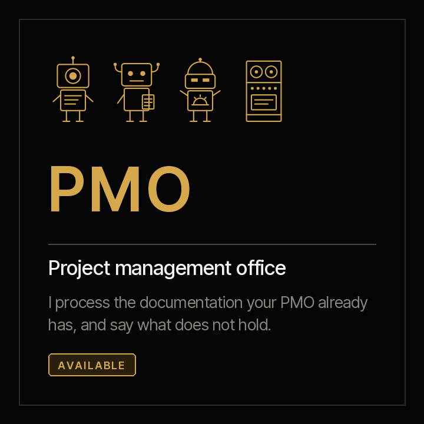
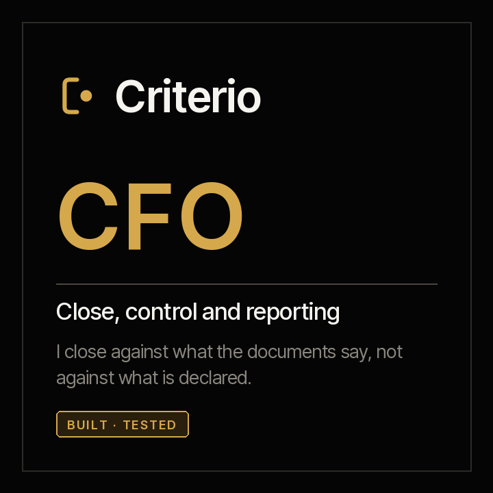
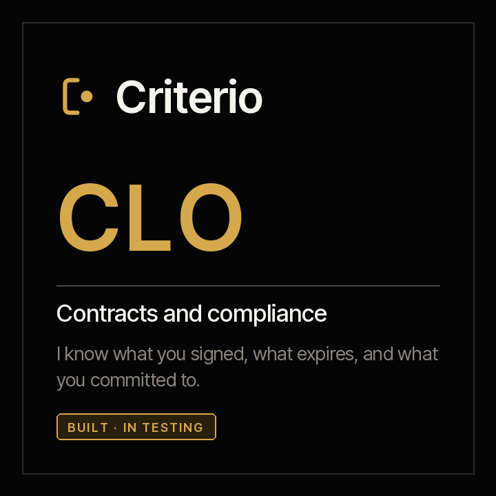
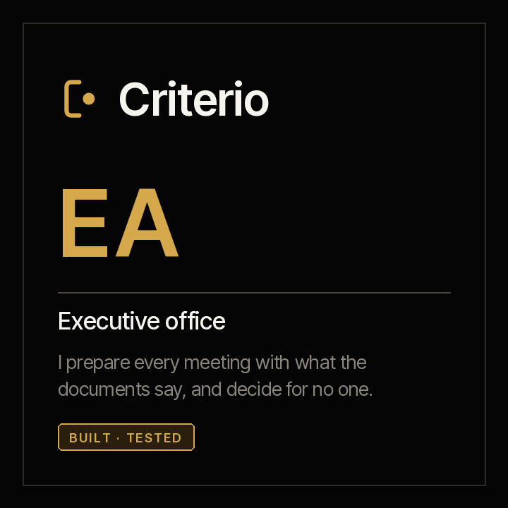

<picture><source media="(prefers-color-scheme: dark)" srcset="docs/img/marca/logotipo-oscuro.svg"></picture>

# Criterio

**Evidence before the decision.** A platform of agent families: each family extends a complete executive function —project governance, finance, legal and those to come— with one method, one brand and one portal, Rostrum.

[Español](README.es.md) · [Terms](TERMS.md) · [Disclaimer](DISCLAIMER.md) · [Contributing](CONTRIBUTING.md)

Apache 2.0 · Four clicks to install · Each agent produces its first result in fifteen minutes

**Status: the PMO, CFO, CLO and EA families are built and tested on synthetic material, and are released together;** the current version and what changed in each one are in the [version register](https://www.josenanez.com/agents/criterio-pmo/legal). Every change goes through `scripts/verificar.py`, with each gate, what it tests and what it does not on [the results page](docs/pruebas.md) (Spanish). Reliability figures on real data are published when they are measured, not before. [Security](SECURITY.md)

---

| | | | |
|:--:|:--:|:--:|:--:|
|  |  |  |  |
| **[criterio-pmo →](families/criterio-pmo/README.md)**<br>three agents | **[criterio-cfo →](families/criterio-cfo/README.md)**<br>Clara, Tomás and Áurea, built and tested | **[criterio-clo →](families/criterio-clo/README.md)**<br>Fidel and Constanza, built and tested | **[criterio-ea →](families/criterio-ea/README.md)**<br>Ofelia, built and tested |

---

## The problem was never a missing tool

An organisation does not move by departments: it moves by **capabilities**. The capability to govern a portfolio of projects. To close a month and answer for the numbers. To review a contract before signing it.

Each has its own method, its own language and its own ways of failing. And they all share the same bottleneck: **hundreds of documents nobody has read together.** Charters, schedules, minutes, reconciliations, contracts. Each was read by someone, once. Nobody has cross-read them.

Work tools help you produce one more document. The problem was never a missing template.

**Criterio is a platform of agent families, one per capability.** They process what already exists, keep a record of what they found with a citation for every data point, and on the next run say what changed.

---

## The families

A **family** groups the agents that need each other to cover one whole capability. It is
not a catalogue category: the agents in a family share a data contract and hand work to
one another. Agents from different families do not.

| Family | Scope | Objective | State |
|---|---|---|---|
| **[criterio-pmo](families/criterio-pmo/README.md)** | The governance of a portfolio, of each project and of each product | That what is declared and what the documents support can be compared, every day and across the whole | **Three agents, installable today** |
| **[criterio-cfo](families/criterio-cfo/README.md)** | Close, control and financial reporting | That closing the books stops depending on somebody remembering what is missing | **Three agents built and tested:** [Clara](plugins/criterio-finance/README.md), [Tomás](plugins/criterio-budget/README.md) and [Áurea](plugins/criterio-treasury/README.md) |
| **[criterio-clo](families/criterio-clo/README.md)** | Contracts, compliance and legal risk | That a company knows what it signed, what expires and what it committed to | **Two agents built and tested:** [Fidel](plugins/criterio-legal/README.md) and [Constanza](plugins/criterio-compliance/README.md) |
| **[criterio-ea](families/criterio-ea/README.md)** | The executive office: the calendar, the governing bodies' meetings, the minutes, the commitments and the correspondence | That the executive arrives at every meeting prepared and no agreement is left without an owner or a date | **One agent built and tested:** [Ofelia](plugins/criterio-assistant/README.md) |

**Rostrum, the portal, is one for every family.** It publishes what the agents already wrote —the
PMO report, the CFO and CLO reports, what falls due across all of them— for whoever does not open
a folder, and takes written questions for any agent. It installs separately,
[`criterio-server`](plugins/criterio-server/README.md), and a map built by folder selection says
what it serves ([ADR 0010](docs/decisions/0010-rostrum-plugin-propio.md), Spanish). Its home page
says what needs attention today across every family. Its menu has one entry per family, so it grows
without getting longer. Every page meets WCAG 2.2 AA, checked with Chromium and axe-core at four
screen widths ([how it is tested](plugins/criterio-server/README.md#how-it-is-verified)).

**The list is not closed.** A family joins when somebody who performs that capability
wants to build it, and the format is in [CONTRIBUTING.md](CONTRIBUTING.md).

## What every agent shares

This is not a collection of loose assistants. All of them are built on the same six behaviours,
and they are not style: they are what makes their output something you can put in front of a
committee.

1. **Every value carries the citation of the document it came from**, with its date. A value
   with no source is a defect, not a degraded case.
2. **"Not stated anywhere" is a valid answer**, and it is the most common one at the start.
3. **They go quiet when there is nothing.** None produces a report to say there is no news. An
   agent that reports every week whether or not there is news gets ignored within a month.
4. **None of them declares.** None writes a project's status or decides what gets built.
5. **None of them writes to anybody.** They produce the list; chasing someone is a conversation.
6. **They find their folder; they do not ask for it.** Setup searches for the root folder, offers
   numbered candidates with the reason for each and, if the person says yes, marks it with a
   visible file, `_CRITERIO_<QUÉ>.txt`. It is the only thing an agent writes among the
   organisation's documents ([ADR 0011](docs/decisions/0011-la-carpeta-raiz-se-busca-y-se-marca.md), Spanish).

What changes between them is **the rhythm of the conversation**, and that is on each one's page.

## Installation

The marketplace is added once, and after that you install what you need.

```
/plugin marketplace add josenanez/criterio
```

**In Claude Cowork** — Customise → Explore plugins → Personal → **+** → Add marketplace
from GitHub → `josenanez/criterio`.

**To receive every new version**, turn on auto-update once: in /plugin, Marketplaces → criterio
→ Enable auto-update. Claude Code leaves it off for marketplaces that are not Anthropic's, and
without it the installed version does not change on its own.

**What to install depends on the role you have, and each family explains that.** For the
project governance one, see [criterio-pmo](families/criterio-pmo/README.md#installing-the-family).

## Apache 2.0 — what we give and what we invite

**We give, in full and with no conditions,** each agent's method, its record schemas, the code that computes, its acceptance criteria and the way to measure them.

**What we invite**

- Use it inside your organisation without asking, and adapt it to how you work.
- Change the criteria: thresholds are configuration, not code.
- **Build the capability you are missing.** If you practise a function that is not on the list, its agent should be written by someone who knows the work, not by someone who knows how to code. The format is in [CONTRIBUTING.md](CONTRIBUTING.md).
- If you find it wrong, open an issue with the document that proves it. That is worth more than a star.

**What we do not claim**

This produces working drafts, not decisions. Every version goes through an internal validation before it is published, and its evidence is public. The agents know what was written, not what was said outside the documents. Read the [disclaimer](DISCLAIMER.md) before installing: using it means accepting the [terms](TERMS.md).

---

Maintained by [José Francisco Ñáñez](https://josenanez.com).
