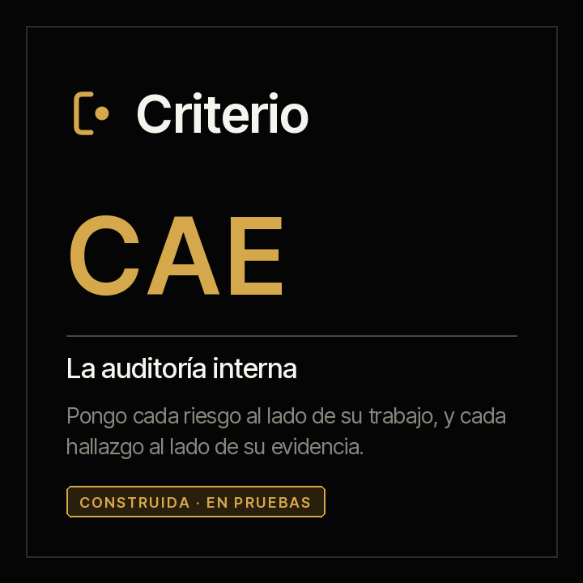

<picture><source media="(prefers-color-scheme: dark)" srcset="../../docs/img/marca/es/criterio-cae-oscuro.svg"></picture>

# criterio-cae · la familia de la auditoría interna

**Tres agentes y un portal, alrededor de sus fichas.** Cada uno extiende a una persona distinta de la
auditoría interna —quien responde por el plan, quien responde por los trabajos y quien lleva el
seguimiento de los hallazgos— y comparten la carpeta y la metodología de la entidad: cada uno escribe
solo su ficha.

[English](README.md) · [← Criterio](../../README.es.md) · Apache 2.0



| | |
|---|---|
| **Alcance** | El plan de auditoría de una entidad contra su matriz de riesgos, su universo auditable y su capacidad; cada trabajo contra su programa, sus papeles y su informe; y cada hallazgo hasta su cierre, con su evidencia, sobre las Normas Globales de Auditoría Interna |
| **Objetivo** | Que cada riesgo alto tenga un trabajo, que cada hallazgo se pueda rastrear hasta el papel que lo soporta y que cada plan de acción llegue a su cierre con la evidencia de que se implementó |
| **Compuesta por** | [Prudencia](../../plugins/criterio-audit-plan/README.es.md) · [Justo](../../plugins/criterio-audit-work/README.es.md) · [Remedios](../../plugins/criterio-remediation/README.es.md) · [Rostrum](../../plugins/criterio-server/README.es.md) |
| **El soporte** | Las Normas Globales de Auditoría Interna y sus requisitos temáticos, el Modelo de las Tres Líneas, COSO 2013 y la regulación de la auditoría interna en el sector financiero, con su fuente y su estado: [`FUENTES.es.md`](FUENTES.es.md) |
| **Estado** | Construida, en pruebas: el motor probado sobre todo su material, con su clave y sus entidades de control. La ronda con los tres agentes viene en la 0.2.0. **No se ha probado todavía sobre la documentación de una organización concreta** |
| **Enfoque** | Documentos y exportaciones, nunca sistemas: ningún agente entra a los sistemas auditados ni a la herramienta de auditoría |
| **Compromiso** | Generar, difundir y conservar el conocimiento es una obligación profesional |
| **Qué no es** | No reemplaza al auditor: no emite opiniones, no firma informes, no cambia la prioridad de un hallazgo, no cierra planes y no acepta riesgos |
| **Licencia** | [Apache 2.0](../../LICENSE) |
| **Qué viene** | La ronda con los tres agentes: [la hoja de ruta](#hoja-de-ruta) |

---

## Qué hace la familia

La auditoría interna es el área que más trabaja contra documentos, porque su producto es una opinión
sostenida en evidencia: cada hallazgo tiene que poder rastrearse hasta el papel de trabajo que lo
soporta, y cada plan de acción hasta la evidencia de que se implementó. Esa trazabilidad hoy se revisa a
mano, trabajo por trabajo. La familia la calcula, con la estructura de las Normas Globales de Auditoría
Interna de The IIA (F-01) —citadas por su número y su título, nunca por su texto— y la metodología de la
organización ([decisión 0033](../../docs/decisions/0033-la-familia-cae.md)).

- **Prudencia** pone el plan al lado de la matriz de riesgos y del universo auditable, y dice qué riesgo
  alto no tiene un trabajo, qué unidad pasó su ciclo y qué cambio no tiene su acta.
- **Justo** pone cada hallazgo al lado de su criterio y de su papel, y cada informe al lado de sus papeles.
- **Remedios** lleva cada hallazgo hasta su cierre: el plan vencido, la fecha que se corre, el cierre sin
  evidencia y el riesgo aceptado que no llegó al consejo.

## Lo que sigue siendo de las personas

Decidir qué se audita, concluir sobre el control interno, poner la prioridad de un hallazgo, validar una
evidencia, cerrar un plan, aceptar un riesgo y comunicar al comité. Los agentes dicen qué falta y dónde;
la opinión es siempre del auditor.

## La estructura de carpetas recomendada

<!-- cae:carpetas · generado por scripts/familias.py; no se edita a mano -->
Una carpeta por entidad, con su identificación fiscal al inicio del nombre. Dentro, el estatuto y la metodología de auditoría con el equipo, el plan con el universo auditable, la matriz de riesgos y las actas del comité, una carpeta por trabajo con su programa, sus papeles y su informe, y el seguimiento de los hallazgos con sus evidencias.

```
auditoria/
└── <entidad>/
    ├── 00-referencia/
    ├── 10-plan/
    ├── 20-trabajos/
    └── 30-seguimiento/
estado-auditoria/
```

**`<entidad>/`** · Lo que la auditoría interna lleva de la entidad

| Carpeta | Qué va | Agente |
|---|---|---|
| `00-referencia/` | El estatuto y la metodología de auditoría —los ciclos, la escala de prioridad, los plazos de seguimiento—, el informe de la última evaluación externa de calidad y el equipo: cada auditor con sus horas disponibles y los cargos que tuvo | Prudencia, Justo, Remedios |
| `10-plan/` | El universo auditable, la matriz de riesgos de la segunda línea, el plan anual con sus trabajos y sus horas, y las actas del comité que lo aprueban y lo cambian | Prudencia |
| `20-trabajos/` | Una carpeta por trabajo con su código: el programa de trabajo, el índice de papeles, los papeles de trabajo y el informe | Justo |
| `30-seguimiento/` | El registro de hallazgos y planes de acción, una carpeta por hallazgo con sus evidencias y explicaciones de atraso, el registro de riesgos aceptados y los informes del revisor fiscal, del auditor externo y del supervisor | Remedios |

**`estado-auditoria/`** · Lo que escriben Prudencia, Justo y Remedios: la configuración, la ficha de cada periodo, los informes y los índices. Ninguna persona lo edita, y ningún agente escribe fuera de aquí.
<!-- /cae:carpetas -->

Un archivo sin el formato esperado no se adivina: se reporta con lo que le falta.

## Instalación de la familia

Necesita Claude Code 2.1.110 o posterior; si algo falla, [la instalación paso a paso](../../docs/instalacion.es.md).

**La familia se instala de una vez.** El plugin `criterio-cae` trae a sus agentes y a Rostrum, y
`/criterio-cae:cae-setup` los configura en orden, en una sola conversación: lo que ya se respondió
no se vuelve a preguntar.

```
/plugin marketplace add josenanez/criterio
/plugin install criterio-cae@criterio
/criterio-cae:cae-setup
```

Después, a cada agente se le pide en tus palabras, sin saber cómo se llama cada comando:
`/criterio-audit-plan:prudencia`, `/criterio-audit-work:justo` y `/criterio-remediation:remedios`
([decisión 0027](../../docs/decisions/0027-cada-agente-se-pide-en-palabras.md)).

## De qué responde cada agente, y dónde está su detalle

<!-- cae:familia-agentes · generado por scripts/familias.py; no se edita a mano -->
| | De qué responde | Lo que nunca hace | Su página | Sus pruebas |
|---|---|---|---|---|
| **Prudencia** · el plan de auditoría | El plan de auditoría contra el universo auditable y la matriz de riesgos: los riesgos altos sin un trabajo, las unidades que pasaron su ciclo, la evaluación de riesgos vencida, las áreas que el plan tiene que considerar, los cambios sin aprobación, los trabajos atrasados, las horas que no alcanzan, el requisito temático que falta y la evaluación externa de calidad | No aprueba el plan, no decide qué se audita, no emite una opinión y no copia el texto de las Normas | [criterio-audit-plan](../../plugins/criterio-audit-plan/README.es.md) · 9 comandos, 3 skills | [resultados](../../tests/criterio-audit-plan/RESULTADOS.md) |
| **Justo** · los trabajos de auditoría | Cada trabajo contra su programa y sus papeles: el programa sin aprobar, el hallazgo sin su criterio, su condición, su causa, su efecto o su prioridad, el hallazgo sin papel, el paso sin ejecutar, el papel sin revisión, el informe que no dice lo que dicen los papeles, la prioridad que no da la metodología y el auditor que revisa lo que tuvo a su cargo | No emite una opinión, no firma ni aprueba un informe, no cambia la prioridad de un hallazgo, no edita un papel de trabajo y no califica a las personas | [criterio-audit-work](../../plugins/criterio-audit-work/README.es.md) · 9 comandos, 3 skills | [resultados](../../tests/criterio-audit-work/RESULTADOS.md) |
| **Remedios** · el seguimiento de los hallazgos | Cada hallazgo hasta su cierre: el plan de acción sin responsable o sin fecha, el vencido sin evidencia ni explicación, la fecha que se corre una y otra vez, el cierre sin evidencia o sin validación, el hallazgo que vuelve, el riesgo aceptado que no llegó a la alta dirección o al consejo y el hallazgo externo que no está en el registro | No cierra un hallazgo, no valida una evidencia por su cuenta, no acepta un riesgo y no comunica nada al comité: prepara lo que el responsable de auditoría lleva | [criterio-remediation](../../plugins/criterio-remediation/README.es.md) · 8 comandos, 3 skills | [resultados](../../tests/criterio-remediation/RESULTADOS.md) |
| **Rostrum** · el portal | Publicar lo que escriben los agentes donde el equipo lo vea, y recibir la pregunta de quien no abre una carpeta | **No escribe en el estado ni recalcula nada**, y no decide nada | [criterio-server](../../plugins/criterio-server/README.es.md) · 3 comandos, uno para todas las familias | [resultados](../../tests/criterio-server/RESULTADOS.md) |
<!-- /cae:familia-agentes -->

## Cómo se configura y cada cuánto corre cada uno

<!-- cae:configuracion · generado por scripts/familias.py; no se edita a mano -->
| | Prudencia | Justo | Remedios |
|---|---|---|---|
| **Se instala** | `criterio-audit-plan` | `criterio-audit-work` | `criterio-remediation` |
| **Instancias** | Una por entidad | Una por entidad | Una por entidad |
| **Se configura con** | `/criterio-audit-plan:plan-setup` | `/criterio-audit-work:work-setup` | `/criterio-remediation:remediation-setup` |
| **Cuánto tarda eso** | Quince minutos | Quince minutos | Quince minutos |
| **Qué le tienes que decir** | Entidad y su identificación fiscal, país, el periodo, el ciclo de rotación de cada nivel de riesgo, desde qué calificación un riesgo es alto, quién aprueba el plan según el estatuto, la fecha de la última evaluación de riesgos y la de la última evaluación externa de calidad | Entidad y su identificación fiscal, país, el periodo, la escala de prioridad de la metodología —cada nivel con su impacto y su probabilidad— y quién aprueba el programa y los papeles | Entidad y su identificación fiscal, país, el periodo y cuántas veces permite la metodología correr la fecha de un plan |
| **Dónde queda** | `.criterio/plan/<entidad>/config.json`, escrito por el comando | `.criterio/trabajos/<entidad>/config.json`, escrito por el comando | `.criterio/seguimiento/<entidad>/config.json`, escrito por el comando |
| **El que se le pone a un reloj** | `/criterio-audit-plan:plan-wake` | `/criterio-audit-work:work-wake` | `/criterio-remediation:remediation-wake` |
| **Qué toca cada día** | Decide si toca procesar el plan —documentos nuevos o la revisión semanal— o un reporte con señales abiertas, y lo corre; si no toca nada, se calla | Decide si toca procesar los trabajos —documentos nuevos o la revisión semanal— o un reporte con señales abiertas, y lo corre; si no toca nada, se calla | Decide si toca procesar el seguimiento —documentos nuevos o la revisión semanal— o un reporte con señales abiertas, y lo corre; si no toca nada, se calla |
| **Qué lo despierta además del reloj** | Una pregunta que alguien dejó en Rostrum | Una pregunta que alguien dejó en Rostrum | Una pregunta que alguien dejó en Rostrum |
<!-- /cae:configuracion -->

**Nadie edita un archivo de configuración a mano.** Se dice en la conversación y el comando lo reescribe.
Los ciclos, la escala de prioridad y los plazos salen de la metodología de auditoría de la organización.

## Las pruebas de la familia

**Una sola puerta corre todo lo que este repositorio comprueba**, de todas las familias a la vez:

```
python3 scripts/verificar.py
```

Lo propio de la CAE está en [`tests/criterio-cae/`](../../tests/criterio-cae/): material sintético con
una clave que el motor no ve y dos entidades de control, donde cualquier señal es una falla. **Una señal
de más cuenta igual que una de menos.** Qué se siembra y qué no prueba el material, en
[`EVIDENCIA.md`](../../tests/criterio-cae/EVIDENCIA.md).

## Hoja de ruta

<!-- hoja de ruta: generado por scripts/hoja.py desde hoja-de-ruta.json; no se edita a mano -->
<!-- /hoja de ruta -->

## Los skills de la familia

<!-- cae:skills-familia · generado por scripts/familias.py; no se edita a mano -->
Cinco skills distintos entre los tres agentes. **Los que comparten son copias literales, no un módulo importado**: un plugin instalado tiene que correr solo. `scripts/sincronizar.py` las copia y `scripts/sincronizar.py --check` falla si se separan.

| Skill | Prudencia | Justo | Remedios |
|---|:--:|:--:|:--:|
| `audit-intake` | ● | ● | ● |
| `audit-methodology` | ● | ● | ● |
| `finding-record` | · | ● | · |
| `follow-up-record` | · | · | ● |
| `plan-record` | ● | · | · |
<!-- /cae:skills-familia -->

## Estado

<!-- cae:estado · generado por scripts/familias.py; no se edita a mano -->
| Agente | Se instala | Su prueba |
|---|---|---|
| **Prudencia** · El plan de auditoría | `criterio-audit-plan` · 9 comandos, 3 skills | El motor, probado; con el agente, todas las entidades del material, hasta la ronda 1 · [resultados](../../tests/criterio-audit-plan/RESULTADOS.md) |
| **Justo** · Los trabajos de auditoría | `criterio-audit-work` · 9 comandos, 3 skills | El motor, probado; con el agente, todas las entidades del material, hasta la ronda 1 · [resultados](../../tests/criterio-audit-work/RESULTADOS.md) |
| **Remedios** · El seguimiento de los hallazgos | `criterio-remediation` · 8 comandos, 3 skills | El motor, probado; con el agente, todas las entidades del material, hasta la ronda 1 · [resultados](../../tests/criterio-remediation/RESULTADOS.md) |
| **Rostrum** · el portal | `criterio-server` · 3 comandos, para todas las familias | — |

Las pruebas usan material sintético construido sobre información real de empresas, anonimizada antes de procesarse: ningún nombre, identificación, cifra ni dato personal que permita reconocer a una empresa o a una persona se conserva ni se publica. Lo que se publica de cada prueba son sus resultados, sin datos.
<!-- /cae:estado -->
