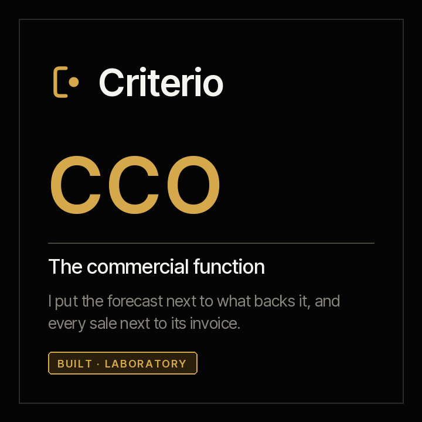

<picture><source media="(prefers-color-scheme: dark)" srcset="../../docs/img/marca/en/criterio-cco-oscuro.svg"></picture>

# criterio-cco · the sales function family

**Two agents and a portal, around their records.** Each one extends a different person in the sales
function —whoever answers for the forecast and whoever answers for what was sold, all the way to the
invoice— and neither talks to the other directly: they talk through their records, and with Fidel
and Clara through theirs.

[Español](README.es.md) · [← Criterio](../../README.md) · Apache 2.0



| | |
|---|---|
| **Scope** | An entity's sales function: the CRM pipeline against its evidence, the forecast against what backs it, the target against what closed, the discount against its policy, what was won against what was signed and invoiced, and the commission against the plan |
| **Goal** | That what is committed in the sales committee has the documents that back it, and that no sale gets stuck between the close and the invoice |
| **Made up of** | [Augusto](../../plugins/criterio-sales/README.md) · [Valeria](../../plugins/criterio-revenue/README.md) · [Rostrum](../../plugins/criterio-server/README.md) |
| **The support** | The framework that defines the role, each CRM export's format and what it costs an organisation today, with its source, year and sample: [`FUENTES.es.md`](FUENTES.es.md) (Spanish) |
| **Status** | Laboratory, not yet launched: published in the marketplace from version 0.1.0, with the engine tested on synthetic material from Colombia and Mexico; the round with the agents is the next step. **Not yet tested on the documentation of a specific organisation** |
| **Approach** | Exports, never systems: no agent connects to the CRM or writes to it |
| **Commitment** | Generating, sharing and preserving knowledge is a professional obligation |
| **What it is not** | It does not replace the head of sales or their team, and does not decide for them: it does not set targets, approve discounts, settle commissions, contact customers or rate whoever sells |
| **Licence** | [Apache 2.0](../../LICENSE) |
| **What comes next** | The full round with the agents, in 0.2.0: [the roadmap](#roadmap) |

---

## What the family does

The sales function has two roles that work on the same CRM exports and answer for different things,
which is why the family has two agents. They carry people's names because **they are extended
capacities of people**, and each name's meaning points to what it does: **Augusto** —from *augur*,
the one who reads the signs before they happen— puts the forecast next to what backs it; **Valeria**
—from *valere*, to be worth— says what a sale is worth once it is signed and invoiced.

**Augusto**, the forecast, puts the pipeline next to its evidence: every opportunity against the
document its stage requires —the proposal sent, the purchase order—, the ones without activity for
weeks, the close dates that slip again and again, what the committee committed against what closed
and what is weighted with evidence, and the target against what closed at the cut-off. What nobody
does today and he does: **checking every opportunity, not a sample, against its stage's evidence**,
and separating the committed forecast that has documents from what does not.

**Valeria**, from sale to invoice, puts every sale next to its policy, its contract and its invoice:
the discount against the matrix level that approves it, what was won against the contract Fidel
signed, what was signed against the invoice Clara issued, and the commission against what the plan
gives on what was won and invoiced.

**Four in five** sales and finance leaders missed at least one quarterly forecast in the past year,
and **84%** of sales leaders say sales analytics had less influence than expected; nearly half of
them point to data quality. The figures, with their source, year and sample, in
[`FUENTES.es.md`](FUENTES.es.md).

Countries: Colombia and Mexico. **It does not rate people**: it says which opportunity has no
evidence and which commission is not the plan's, never who sells best.

---

## How the two operate

The language model (LLM) extracts; the code calculates; the decision —the forecast that is
committed, the discount that is approved, the target— is always a person's. **The engine processes
the tables directly** —the dated CRM exports, the close-date history, the stage table, the targets,
the discount matrix, the accounts table, the commission plan and settlement—, and the agent takes to
the record what only a written document carries: every evidence document of an opportunity, the
committed forecast from the committee minutes and every quote with its discount and approval.

**Exports, from their source.** Salesforce by each field's name or label; HubSpot by each property's
label; any other CRM in CSV or Excel with the column mapping the setup leaves. Every field processed
is verified in its source, in [`FUENTES.es.md`](FUENTES.es.md).

**Automated**: they process the documents, calculate the signals and prepare every deliverable
without intervention. **Semi-automated** when a data point no document carries is missing —which CRM
the export comes from, which column carries each field, within how many days a contract is
invoiced—: then they ask the person, say what they asked and carry on with the answer.

## The two agents and their records

Nothing talks to anything directly. **Each agent writes its records, and the record is the
contract.**

| Record | One per | What it carries | Who writes it |
|---|---|---|---|
| Forecast record | Entity and period | Every evidence document of an opportunity with its type, amount and date, and the committed forecast from the committee minutes | Augusto; the forecast, the committee that commits it |
| Sales record | Entity and period | Every quote or order with its list price, discount and approval | Valeria; the approval, whoever gives it |

Valeria also reads two records she does not write: **each of Fidel's contract records** and **each
of Clara's close records**, with their issued invoices. She never processes a contract or an
electronic invoice again.

Every data point cites the document it comes from and its date. "Not found" is a valid answer.

### The seven invariants

1. **The agents never talk to each other.** They talk through their records, and with Fidel and
   Clara through theirs.
2. **Rostrum, the portal, does not write.** It serves what the engine already wrote and says so with
   its date; it recalculates nothing. Commissions do not appear there unless the configuration says
   so.
3. **Exports, never systems.** No agent connects to the CRM, and none writes to it.
4. **Committed and backed are never merged.** What the committee commits goes in the record; what
   backs it is calculated by the engine, and the difference is the signal.
5. **The model extracts, the code calculates.** Every amount, percentage, day or count in a report
   comes from `ventas.py`; if the engine does not give it, it is not written.
6. **No agent decides.** The forecast, the discount, the target and the commission belong to a
   person.
7. **It does not rate people, and keeps no contact data.** The signal belongs to the opportunity,
   not to whoever owns it, and the record keeps the account, not anyone's email or phone.

## What still belongs to people

Both roles still exist in full. This extends capacity; it does not replace a function.

> **Each agent's input is produced by its person's non-delegable work.**

Augusto needs the team to leave each opportunity's proposal and purchase order, and the committee to
commit a forecast in writing: without evidence there is nothing to check a stage against, and
without a commitment there is nothing to compare the backing with. Valeria needs someone to approve
every discount in writing, the organisation to keep its matrix and its plan, and Fidel and Clara to
keep their records.

**And neither of them contacts a customer, negotiates, approves a discount, sets a target or settles
a commission.**

## The recommended folder structure

Recommended, not mandatory ([ADR 0007](../../docs/decisions/0007-estructura-recomendada.md)): the
agents process the folder as it is. `sales-setup` and `revenue-setup` compare what they find with
this structure and, on every run, say which file is out of place and where it would go; they create,
move or rename nothing in the organisation's documents. Numbering goes in tens, as in the other
families.

<!-- cco:carpetas · generado por scripts/familias.py; no se edita a mano -->
One folder per entity, with its tax id at the start of the name. Inside it, the commercial function's reference, the CRM exports with their date, the committee, each opportunity's evidence, the quotes and the commission settlements.

```
comercial/
└── <entidad>/
    ├── 00-referencia/
    ├── 10-crm/
    ├── 20-comite/
    ├── 30-evidencia/
    ├── 40-cotizaciones/
    └── 50-comisiones/
estado-comercial/
```

**`<entidad>/`** · What the organisation keeps for the whole sales function

| Folder | What goes in | Agent |
|---|---|---|
| `00-referencia/` | The stage table —the document each stage requires and its probability—, the year's targets, the discount matrix, the commission plan and the accounts table with each customer's tax id | Augusto, Valeria |
| `10-crm/` | The CRM's opportunity exports, in CSV or Excel, with the export date in the name, and the close-date history if the CRM exports it | Augusto, Valeria |
| `20-comite/` | The sales committee's minutes and packs, with the forecast committed for the period | Augusto |
| `30-evidencia/` | The proposals sent, the purchase orders and the acceptance records, with the opportunity id at the start of the name | Augusto |
| `40-cotizaciones/` | The quotes and orders with their price, discount and approval, with the quote id at the start of the name | Valeria |
| `50-comisiones/` | Each period's commission settlement, with the period in the name | Valeria |

**`estado-comercial/`** · What Augusto and Valeria write: the configuration, each period's record, the reports and the indexes. No person edits it, and no agent writes anywhere else.
<!-- /cco:carpetas -->

A file without the expected format is not guessed: it is reported with what it lacks.

## Installing the family

**The family is a laboratory one and not yet launched, but it can already be installed.** Each agent
is a plugin that installs on its own:

```
/plugin marketplace add josenanez/criterio

/plugin install criterio-sales@criterio     if you answer for the forecast
/plugin install criterio-revenue@criterio   if you answer for the sale through to the invoice
```

After installing, each agent has its own setup command that looks at the folder, recognises each CRM
export, asks the questions no document answers and produces a first result. **Nobody edits a
configuration file by hand.** And if you install both, they find each other: they share the entity's
state, and each one writes only its own.

## What each agent answers for, and where its detail is

The same for each piece: what it answers for, what it does not do, and where all its detail is.
**Each agent page reads on its own.**

<!-- cco:familia-agentes · generado por scripts/familias.py; no se edita a mano -->
| | What it answers for | What it never does | Its page | Its tests |
|---|---|---|---|---|
| **Augusto** · the forecast | The pipeline against its evidence and the forecast against what backs it: every opportunity against the document its stage requires, the stalled ones, the close dates that slip, what was committed against what is weighted with evidence, and the target against what closed | It does not write to the CRM, does not contact a customer, does not set or change a target and does not rate the people on the team: it says which opportunity has no evidence, not who sells best | [criterio-sales](../../plugins/criterio-sales/README.md) · 6 commands, 4 skills | [results](../../tests/criterio-sales/RESULTADOS.md) |
| **Valeria** · from sale to invoice | Price and discount against their policy, and what was won against what was signed and invoiced: every discount against the level that approves it, every won sale against its contract in Fidel's records, every signed contract against its invoice in Clara's, and every commission against the plan | It does not write to the CRM, does not approve a discount or a price exception and does not settle or correct a commission: it says where the settlement is not the plan's | [criterio-revenue](../../plugins/criterio-revenue/README.md) · 6 commands, 6 skills | [results](../../tests/criterio-revenue/RESULTADOS.md) |
| **Rostrum** · the portal | Publishing what the agents write where the team will see it, and taking the question from whoever will not open a folder | **Never writes the state or recalculates anything**, and decides nothing | [criterio-server](../../plugins/criterio-server/README.md) · 2 commands, one for every family | [results](../../tests/criterio-server/RESULTADOS.md) |
<!-- /cco:familia-agentes -->

Their input, process and report, with the signals the engine calculates, in the
[family's design](DISENO.md); and the answers to the most frequent questions, in the
[FAQ](PREGUNTAS.md).

## In Rostrum, the portal for every family

**A head of sales does not open a folder of files**: they open a link. That is what **Rostrum**,
`criterio-server`, is for: it serves the CCO together with the other families, without the server
knowing anything about sales ([ADR 0010](../../docs/decisions/0010-rostrum-plugin-propio.md)).
`/criterio-sales:sales-setup` and `/criterio-revenue:revenue-setup` leave their configuration in
`.criterio/comercial/<entidad>/` and `.criterio/ingresos/<entidad>/`, with the sales folder marked
with `_CRITERIO_COMERCIAL.txt`, and `/criterio-server:server-setup` adds them to the map. **The
commission report is not published** unless Valeria's configuration says so: it is the pay of
identifiable people (ADR 0019).

## How each one is configured and how often it runs

<!-- cco:configuracion · generado por scripts/familias.py; no se edita a mano -->
| | Augusto | Valeria |
|---|---|---|
| **Installs as** | `criterio-sales` | `criterio-revenue` |
| **Instances** | One per entity | One per entity |
| **Configured with** | `/criterio-sales:sales-setup` | `/criterio-revenue:revenue-setup` |
| **How long that takes** | Fifteen minutes | Fifteen minutes |
| **What you have to tell it** | Entity and its tax ID, country, the period, which CRM the export in `10-crm/` comes from —Salesforce, HubSpot, Dynamics 365, Zoho or another, in CSV or Excel— and, if another, which column carries each field, the stage table in `00-referencia/` with the document each stage requires and its probability, how many days without activity stall an opportunity and how many times a close date may slip | Entity and its tax ID, country, the period, the discount matrix, the commission plan and the accounts table in `00-referencia/`, where Fidel's contract records and Clara's invoicing records are, and within how many days a signed contract is invoiced |
| **Where it lands** | `.criterio/comercial/<entity>/config.json`, written by the command | `.criterio/ingresos/<entity>/config.json`, written by the command |
| **The one you put on a clock** | `/criterio-sales:sales-wake` | `/criterio-revenue:revenue-wake` |
| **What it does each day** | Decides what is due: a new export in `10-crm/`, new committee minutes, the period's end coming up and a weekly review | Decides what is due: new quotes, a won opportunity without a contract or an invoice when its deadline arrives, the period's settlement when it arrives and a weekly review |
| **What wakes it besides the clock** | A question somebody left in Rostrum | A question somebody left in Rostrum |
<!-- /cco:configuracion -->

**Nobody edits a configuration file by hand.** It is said in the conversation and the command
rewrites it. Each plugin ships its `scripts/config.example.json` to see the full shape; the days
without activity, the times a close date may slip, the tolerances and the invoicing period are each
organisation's configuration, not rules.

### Both stay quiet when there is nothing

The two clock commands produce nothing when nothing is due, and then the output is one line. With a
question open in Rostrum they are never quiet: they answer it first.

## The family's tests

**A single gate runs everything this repository checks**, for every family at once:

```
python3 scripts/verificar.py
```

What belongs to the CCO is in [`tests/criterio-cco/`](../../tests/criterio-cco/): synthetic material
from Colombia and Mexico —a Salesforce export, a HubSpot export and a CSV export with its mapping—
with a key the engine never sees, and one control entity per country, where any signal is a failure.
Each of the nine signals is seeded at least once, and each entity's Fidel and Clara records come in
the material. `evaluar.py` runs Augusto's and Valeria's engine and compares every signal by its name
and key: **one extra counts the same as one missing.** What is seeded and what the material does not
test, in [`EVIDENCIA.md`](../../tests/criterio-cco/EVIDENCIA.md).

## Roadmap

<!-- hoja de ruta: generado por scripts/hoja.py desde hoja-de-ruta.json; no se edita a mano -->

The family grows in increments. Each one is a version with its full test and its statistical analysis published, with the same metrics, so the evolution can be compared.

| Version | Status | What goes in | Test |
|---|---|---|---|
| 0.1.0 | Released | **Augusto and Valeria, built, with the engine tested**<br>· The twelve commands, their skills and the engine, with the nine signals: Augusto's pipeline, forecast and target; Valeria's discount, contract, invoice and commission<br>· Salesforce and HubSpot exports, and any CSV or Excel with its column mapping<br>· What was won against Fidel's contracts and what was signed against Clara's invoices, through their records<br>· Colombia and Mexico, with control entities | The engine against the key of all the material: six entities from Colombia and Mexico, with their controls |
| 0.2.0 | Released | **The full round with the agents**<br>· Augusto and Valeria run their commands on every entity in the material, with a key they never see<br>· The material seeds at least 73 signals: what a 95% floor with no misses needs (decision 0020)<br>· Every defect the round finds, with its fix and its verification | Round 1 with both agents on the material's six entities: 72 of 80 seeded signals and 30 of 30 data points on the first run, with two extra signals in a control, and 80 of 80 with none extra after verifying the fixes; the three defects it found, with their fix and their verification |
| 0.3.0 | Released | **Ecuador, Peru and Chile, and Microsoft Dynamics and Zoho**<br>· The three countries already in the country registry, with their material and their round<br>· The Microsoft Dynamics and Zoho exports, each from its verified source | Round 2 with both agents on the nine entities of Ecuador, Peru and Chile, three on Dynamics and three on Zoho: 117 of 117 seeded signals and 45 of 45 data items on the first run, with one extra signal in a control; the defect it found, in the instructions, with its fix and its verification |

<!-- /hoja de ruta -->

## The family's eight skills

<!-- cco:skills-familia · generado por scripts/familias.py; no se edita a mano -->
Eight distinct skills across the two agents. **The ones they share are literal copies, not an imported module**: an installed plugin has to run on its own. `scripts/sincronizar.py` copies them and `scripts/sincronizar.py --check` fails if they drift.

| Skill | Augusto | Valeria |
|---|:--:|:--:|
| `commission-plan` | · | ● |
| `crm-exports` | ● | ● |
| `deal-record` | · | ● |
| `discount-policy` | · | ● |
| `forecast-backing` | ● | · |
| `pipeline-record` | ● | · |
| `sales-intake` | ● | ● |
| `won-to-cash` | · | ● |
<!-- /cco:skills-familia -->

## Status

**Both are laboratory ones.** Their version 0.1.0 brings the engine, which passes its deterministic
test on all the material; the round with the agents on the same material, with a key they never see,
is what declares it tested, and it comes with 0.2.0. Laboratory or stable is said by the evidence
(decision 0020), and on the day the family is launched, if it is stable, its version is 1.0.0
(decision 0021).

<!-- cco:estado · generado por scripts/familias.py; no se edita a mano -->
| Agent | Installs as | Its test |
|---|---|---|
| **Augusto** · The forecast | `criterio-sales` · 6 commands, 4 skills | The engine, tested; with the agent, every entitie in the material, up to round 2 · [results](../../tests/criterio-sales/RESULTADOS.md) |
| **Valeria** · From sale to invoice | `criterio-revenue` · 6 commands, 6 skills | The engine, tested; with the agent, every entitie in the material, up to round 2 · [results](../../tests/criterio-revenue/RESULTADOS.md) |
| **Rostrum** · the portal | `criterio-server` · 2 commands, for every family | — |
<!-- /cco:estado -->

The decisions still open, in the [design](DISENO.md#open-decisions).
