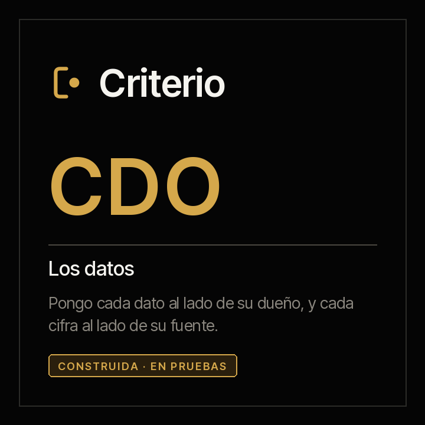

<picture><source media="(prefers-color-scheme: dark)" srcset="../../docs/img/marca/es/criterio-cdo-oscuro.svg"></picture>

# criterio-cdo · la familia de los datos

**Dos agentes y un portal, alrededor de sus fichas.** Cada una extiende a una persona distinta del área de
datos —quien gobierna los datos y quien responde por la cifra que llega a la dirección— y comparten la
carpeta y la política de datos de la entidad: cada una escribe solo su ficha.

[English](README.md) · [← Criterio](../../README.es.md) · Apache 2.0



| | |
|---|---|
| **Alcance** | El catálogo de datos de una entidad contra sus dueños, su clasificación, su conservación y sus políticas; y cada cifra de los informes de dirección contra su fuente, su corte y su linaje, con las reglas de calidad contra su umbral, sobre DAMA-DMBOK y BCBS 239 |
| **Objetivo** | Que cada dato tenga quien responda por él y que cada cifra que llega a la dirección se pueda seguir hasta su fuente |
| **Compuesta por** | [Custodia](../../plugins/criterio-data-governance/README.es.md) · [Ariadna](../../plugins/criterio-data-quality/README.es.md) · [Rostrum](../../plugins/criterio-server/README.es.md) |
| **El soporte** | DAMA-DMBOK, los principios BCBS 239 del Comité de Basilea e ISO/IEC 25012, con su fuente y su estado: [`FUENTES.es.md`](FUENTES.es.md) |
| **Estado** | Construida, en pruebas: el motor probado sobre todo su material, con su clave y sus entidades de control. En la 0.2.0, la ronda con las dos agentes sobre todas las entidades del material. **No se ha probado todavía sobre la documentación de una organización concreta** |
| **Enfoque** | Exportaciones y metadatos, nunca sistemas: ninguna agente se conecta a una base ni procesa un dato personal |
| **Compromiso** | Generar, difundir y conservar el conocimiento es una obligación profesional |
| **Qué no es** | No reemplaza al área de datos: no asigna dueños, no decide una clasificación, no borra nada, no corrige una cifra y no decide cuál de dos cifras es la correcta |
| **Licencia** | [Apache 2.0](../../LICENSE) |
| **Qué viene** | La ronda con las dos agentes: [la hoja de ruta](#hoja-de-ruta) |

---

## Qué hace la familia

La cifra que llega a la junta pasa por muchas manos antes de llegar: un sistema de origen, una bodega, una
hoja de cálculo, un informe. Cuando no coincide con su fuente, casi nunca es por un error de cálculo: es un
corte distinto, un paso del linaje que nadie documentó o un dato que nadie gobierna. Esa trazabilidad hoy
se revisa a mano, informe por informe. La familia la calcula, sobre las áreas de DAMA-DMBOK (F-01) y, en
una entidad financiera, los principios BCBS 239 del Comité de Basilea (F-02)
([decisión 0034](../../docs/decisions/0034-la-familia-cdo.md)).

- **Custodia** pone cada conjunto del catálogo al lado de su dueño, su clasificación y su plazo de
  conservación, y dice qué política se venció, qué término de los informes no está en el glosario y qué
  base con datos personales no está en el registro de la organización.
- **Ariadna** sigue cada cifra de los informes hasta su fuente: la que no coincide, la que sale de otro
  corte, el linaje que se corta y la regla de calidad que no pasa.

## Lo que sigue siendo de las personas

Asignar un dueño, decidir una clasificación, fijar un plazo de conservación, borrar o archivar un dato,
corregir una cifra y decidir cuál de dos cifras es la correcta. Las agentes dicen qué falta y dónde; la
decisión es siempre del área de datos y de quien firma el informe.

## La estructura de carpetas recomendada

<!-- cdo:carpetas · generado por scripts/familias.py; no se edita a mano -->
Una carpeta por entidad, con su identificación fiscal al inicio del nombre. Dentro, las políticas de datos y de conservación con el glosario de negocio, la exportación del catálogo con el registro de bases de datos personales, los informes de dirección con sus cifras, y el linaje, las cifras de la fuente y las reglas de calidad con sus resultados.

```
datos/
└── <entidad>/
    ├── 00-referencia/
    ├── 10-catalogo/
    ├── 20-informes/
    └── 30-calidad/
estado-datos/
```

**`<entidad>/`** · Lo que el área de datos lleva de la entidad

| Carpeta | Qué va | Agente |
|---|---|---|
| `00-referencia/` | La política de datos —con sus tolerancias y sus plazos de revisión—, la política de conservación con el plazo de cada tipo de dato y el glosario de negocio | Custodia, Ariadna |
| `10-catalogo/` | La exportación del catálogo de datos —cada conjunto con su dueño, su clasificación, su tipo y su registro más antiguo— y el registro de bases de datos personales de la organización | Custodia |
| `20-informes/` | Los informes de dirección, de junta y al supervisor, con sus cifras y su fecha de corte | Custodia, Ariadna |
| `30-calidad/` | La exportación del linaje de cada cifra, las cifras de la fuente por corte, las reglas de calidad con su umbral, sus resultados por periodo y la lista de datos críticos | Ariadna |

**`estado-datos/`** · Lo que escriben Custodia y Ariadna: la configuración, la ficha de cada periodo, los informes y los índices. Ninguna persona lo edita, y ningún agente escribe fuera de aquí.
<!-- /cdo:carpetas -->

Un archivo sin el formato esperado no se adivina: se reporta con lo que le falta.

## Instalación de la familia

Necesita Claude Code 2.1.110 o posterior; si algo falla, [la instalación paso a paso](../../docs/instalacion.es.md).

**La familia se instala de una vez.** El plugin `criterio-cdo` trae a sus agentes y a Rostrum, y
`/criterio-cdo:cdo-setup` las configura en orden, en una sola conversación: lo que ya se respondió
no se vuelve a preguntar.

```
/plugin marketplace add josenanez/criterio
/plugin install criterio-cdo@criterio
/criterio-cdo:cdo-setup
```

Después, a cada agente se le pide en tus palabras, sin saber cómo se llama cada comando:
`/criterio-data-governance:custodia` y `/criterio-data-quality:ariadna`
([decisión 0027](../../docs/decisions/0027-cada-agente-se-pide-en-palabras.md)).

## De qué responde cada agente, y dónde está su detalle

<!-- cdo:familia-agentes · generado por scripts/familias.py; no se edita a mano -->
| | De qué responde | Lo que nunca hace | Su página | Sus pruebas |
|---|---|---|---|---|
| **Custodia** · el gobierno de los datos | El catálogo de datos contra sus dueños, su clasificación, su conservación y sus políticas: el conjunto sin dueño o sin clasificar, la política con la revisión vencida, lo que se conserva más de lo que dice la política, el término del informe que no está en el glosario y la base con datos personales que no está en el registro de la organización | No se conecta a una base ni a un sistema, no procesa un dato personal —solo sus metadatos—, no asigna un dueño, no decide una clasificación y no borra nada | [criterio-data-governance](../../plugins/criterio-data-governance/README.es.md) · 8 comandos, 3 skills | [resultados](../../tests/criterio-data-governance/RESULTADOS.md) |
| **Ariadna** · la calidad y el linaje | Cada cifra de un informe de dirección contra su fuente, su corte y su linaje, y cada regla de calidad contra su umbral: la cifra sin fuente, la que no coincide con su fuente en el mismo corte, la que sale de otro corte, el linaje que se corta, la regla bajo su umbral, la que no corrió y el dato crítico sin regla | No se conecta a una base ni a un sistema, no procesa un dato personal, no corrige una cifra y no decide cuál de dos cifras es la correcta | [criterio-data-quality](../../plugins/criterio-data-quality/README.es.md) · 8 comandos, 3 skills | [resultados](../../tests/criterio-data-quality/RESULTADOS.md) |
| **Rostrum** · el portal | Publicar lo que escriben los agentes donde el equipo lo vea, y recibir la pregunta de quien no abre una carpeta | **No escribe en el estado ni recalcula nada**, y no decide nada | [criterio-server](../../plugins/criterio-server/README.es.md) · 3 comandos, uno para todas las familias | [resultados](../../tests/criterio-server/RESULTADOS.md) |
<!-- /cdo:familia-agentes -->

## Cómo se configura y cada cuánto corre cada una

<!-- cdo:configuracion · generado por scripts/familias.py; no se edita a mano -->
| | Custodia | Ariadna |
|---|---|---|
| **Se instala** | `criterio-data-governance` | `criterio-data-quality` |
| **Instancias** | Una por entidad | Una por entidad |
| **Se configura con** | `/criterio-data-governance:governance-setup` | `/criterio-data-quality:lineage-setup` |
| **Cuánto tarda eso** | Quince minutos | Quince minutos |
| **Qué le tienes que decir** | Entidad y su identificación fiscal, país y el periodo | Entidad y su identificación fiscal, país, el periodo y la diferencia que tolera la política de datos entre una cifra y su fuente |
| **Dónde queda** | `.criterio/gobierno/<entidad>/config.json`, escrito por el comando | `.criterio/calidad/<entidad>/config.json`, escrito por el comando |
| **El que se le pone a un reloj** | `/criterio-data-governance:governance-wake` | `/criterio-data-quality:lineage-wake` |
| **Qué toca cada día** | Decide si toca procesar el gobierno —documentos nuevos o la revisión semanal— o un reporte con señales abiertas, y lo corre; si no toca nada, se calla | Decide si toca procesar la calidad —documentos nuevos o la revisión semanal— o un reporte con señales abiertas, y lo corre; si no toca nada, se calla |
| **Qué lo despierta además del reloj** | Una pregunta que alguien dejó en Rostrum | Una pregunta que alguien dejó en Rostrum |
<!-- /cdo:configuracion -->

**Nadie edita un archivo de configuración a mano.** Se dice en la conversación y el comando lo reescribe.
La tolerancia, los umbrales y los plazos salen de la política de datos de la organización.

## Las pruebas de la familia

**Una sola puerta corre todo lo que este repositorio comprueba**, de todas las familias a la vez:

```
python3 scripts/verificar.py
```

Lo propio de la CDO está en [`tests/criterio-cdo/`](../../tests/criterio-cdo/): material sintético con
una clave que el motor no ve y dos entidades de control, donde cualquier señal es una falla. **Una señal
de más cuenta igual que una de menos.** Qué se siembra y qué no prueba el material, en
[`EVIDENCIA.md`](../../tests/criterio-cdo/EVIDENCIA.md).

## Hoja de ruta

<!-- hoja de ruta: generado por scripts/hoja.py desde hoja-de-ruta.json; no se edita a mano -->
<!-- /hoja de ruta -->

## Los skills de la familia

<!-- cdo:skills-familia · generado por scripts/familias.py; no se edita a mano -->
Cuatro skills distintos entre los dos agentes. **Los que comparten son copias literales, no un módulo importado**: un plugin instalado tiene que correr solo. `scripts/sincronizar.py` las copia y `scripts/sincronizar.py --check` falla si se separan.

| Skill | Custodia | Ariadna |
|---|:--:|:--:|
| `data-intake` | ● | ● |
| `data-policy` | ● | ● |
| `figure-record` | · | ● |
| `governance-record` | ● | · |
<!-- /cdo:skills-familia -->

## Estado

<!-- cdo:estado · generado por scripts/familias.py; no se edita a mano -->
| Agente | Se instala | Su prueba |
|---|---|---|
| **Custodia** · El gobierno de los datos | `criterio-data-governance` · 8 comandos, 3 skills | El motor, probado; con el agente, todas las entidades del material, hasta la ronda 1 · [resultados](../../tests/criterio-data-governance/RESULTADOS.md) |
| **Ariadna** · La calidad y el linaje | `criterio-data-quality` · 8 comandos, 3 skills | El motor, probado; con el agente, todas las entidades del material, hasta la ronda 1 · [resultados](../../tests/criterio-data-quality/RESULTADOS.md) |
| **Rostrum** · el portal | `criterio-server` · 3 comandos, para todas las familias | — |

Las pruebas usan material sintético construido sobre información real de empresas, anonimizada antes de procesarse: ningún nombre, identificación, cifra ni dato personal que permita reconocer a una empresa o a una persona se conserva ni se publica. Lo que se publica de cada prueba son sus resultados, sin datos.
<!-- /cdo:estado -->
