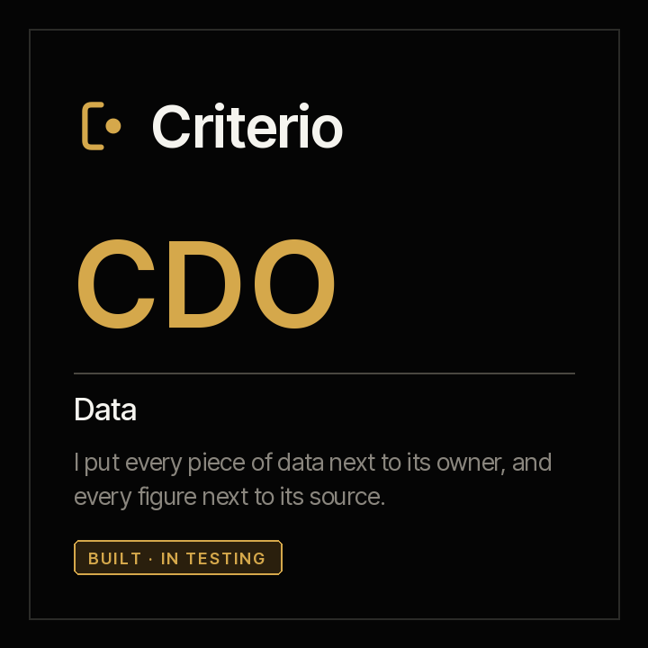

<picture><source media="(prefers-color-scheme: dark)" srcset="../../docs/img/marca/en/criterio-cdo-oscuro.svg"></picture>

# criterio-cdo · the data family

**Two agents and a portal, around their records.** Each extends a different person in the data office
—whoever governs the data and whoever answers for the figure that reaches management— and they share the
entity's folder and data policy: each writes only its own record.

[Español](README.es.md) · [← Criterio](../../README.md) · Apache 2.0



| | |
|---|---|
| **Scope** | An entity's data catalog against its owners, classification, retention and policies; and each figure in the management reports against its source, cut-off and lineage, with the quality rules against their threshold, on DAMA-DMBOK and BCBS 239 |
| **Goal** | That every piece of data has someone answering for it and that every figure reaching management can be followed back to its source |
| **Made up of** | [Custodia](../../plugins/criterio-data-governance/README.md) · [Ariadna](../../plugins/criterio-data-quality/README.md) · [Rostrum](../../plugins/criterio-server/README.md) |
| **The backing** | DAMA-DMBOK, the Basel Committee's BCBS 239 principles and ISO/IEC 25012, with their source and status: [`FUENTES.es.md`](FUENTES.es.md) |
| **Status** | Stable, launched at version 1.0.0: the engine tested on all its material, with its key and its control entities. In 0.2.0, the round with the two agents on every entity in the material; in 1.0.0, round 2 in Colombia, Mexico and Peru: 94 signals and 348 data items, with a floor of 96.0% on signals and 98.9% on data, and no control with a signal. **Not yet tested on a specific organisation's documentation** |
| **Approach** | Exports and metadata, never systems: no agent connects to a database or processes personal data |
| **Commitment** | Generating, sharing and preserving knowledge is a professional duty |
| **What it is not** | It does not replace the data office: it assigns no owners, decides no classification, deletes nothing, corrects no figure and does not decide which of two figures is right |
| **Licence** | [Apache 2.0](../../LICENSE) |
| **What comes next** | The round with the two agents: [the roadmap](#roadmap) |

---

## What the family does

The figure that reaches the board passes through many hands first: a source system, a warehouse, a
spreadsheet, a report. When it does not match its source, it is almost never a calculation error: it is a
different cut-off, a lineage step nobody documented or data nobody governs. Today that traceability is
checked by hand, report by report. The family calculates it, on the DAMA-DMBOK areas (F-01) and, in a
financial institution, the Basel Committee's BCBS 239 principles (F-02)
([decision 0034](../../docs/decisions/0034-la-familia-cdo.md)).

- **Custodia** puts each dataset in the catalog beside its owner, classification and retention period, and
  says which policy is overdue, which report term is not in the glossary and which database with personal
  data is missing from the organisation's register.
- **Ariadna** follows each figure in the reports back to its source: the one that does not match, the one
  from another cut-off, the broken lineage and the quality rule that fails.

## What stays with people

Assigning an owner, deciding a classification, setting a retention period, deleting or archiving data,
correcting a figure and deciding which of two figures is right. The agents say what is missing and where;
the decision is always the data office's and whoever signs the report.

## The recommended folder structure

<!-- cdo:carpetas · generado por scripts/familias.py; no se edita a mano -->
One folder per entity, with its tax id at the start of the name. Inside it, the data and retention policies with the business glossary, the catalog export with the register of personal databases, the management reports with their figures, and the lineage, the source figures and the quality rules with their results.

```
datos/
└── <entidad>/
    ├── 00-referencia/
    ├── 10-catalogo/
    ├── 20-informes/
    └── 30-calidad/
estado-datos/
```

**`<entidad>/`** · What the data office keeps for the entity

| Folder | What goes in | Agent |
|---|---|---|
| `00-referencia/` | The data policy —with its tolerances and review deadlines—, the retention policy with the period for each data type and the business glossary | Custodia, Ariadna |
| `10-catalogo/` | The data catalog export —each dataset with its owner, classification, type and oldest record— and the organisation's register of personal databases | Custodia |
| `20-informes/` | The management, board and supervisory reports, with their figures and cut-off date | Custodia, Ariadna |
| `30-calidad/` | The lineage export of each figure, the source figures by cut-off, the quality rules with their threshold, their results by period and the list of critical data | Ariadna |

**`estado-datos/`** · What Custodia and Ariadna write: the configuration, each period's record, the reports and the indexes. No person edits it, and no agent writes anywhere else.
<!-- /cdo:carpetas -->

A file without the expected format is not guessed at: it is reported with what it lacks.

## Installing the family

Needs Claude Code 2.1.110 or later; if something fails, [the step-by-step installation](../../docs/instalacion.md).

**The family installs at once.** The `criterio-cdo` plugin brings its agents and Rostrum, and
`/criterio-cdo:cdo-setup` configures them in order, in a single conversation: what was already answered
is not asked again.

```
/plugin marketplace add josenanez/criterio
/plugin install criterio-cdo@criterio
/criterio-cdo:cdo-setup
```

Afterwards, each agent is asked in your own words, without knowing what each command is called:
`/criterio-data-governance:custodia` and `/criterio-data-quality:ariadna`
([decision 0027](../../docs/decisions/0027-cada-agente-se-pide-en-palabras.md)).

## What each agent answers for, and where its detail is

<!-- cdo:familia-agentes · generado por scripts/familias.py; no se edita a mano -->
| | What it answers for | What it never does | Its page | Its tests |
|---|---|---|---|---|
| **Custodia** · data governance | The data catalog against its owners, classification, retention and policies: a dataset with no owner or no classification, a policy past its review, data kept longer than the policy says, a report term missing from the glossary and a database with personal data missing from the organisation's register | It does not connect to a database or a system, does not process personal data —only its metadata—, does not assign an owner, decide a classification or delete anything | [criterio-data-governance](../../plugins/criterio-data-governance/README.md) · 8 commands, 3 skills | [results](../../tests/criterio-data-governance/RESULTADOS.md) |
| **Ariadna** · quality and lineage | Each figure in a management report against its source, cut-off and lineage, and each quality rule against its threshold: a figure with no source, one that does not match its source at the same cut-off, one taken from another cut-off, a broken lineage, a rule below its threshold, one that did not run and a critical data element with no rule | It does not connect to a database or a system, does not process personal data, does not correct a figure and does not decide which of two figures is right | [criterio-data-quality](../../plugins/criterio-data-quality/README.md) · 8 commands, 3 skills | [results](../../tests/criterio-data-quality/RESULTADOS.md) |
| **Rostrum** · the portal | Publishing what the agents write where the team will see it, and taking the question from whoever will not open a folder | **Never writes the state or recalculates anything**, and decides nothing | [criterio-server](../../plugins/criterio-server/README.md) · 3 commands, one for every family | [results](../../tests/criterio-server/RESULTADOS.md) |
<!-- /cdo:familia-agentes -->

## How each one is configured and how often it runs

<!-- cdo:configuracion · generado por scripts/familias.py; no se edita a mano -->
| | Custodia | Ariadna |
|---|---|---|
| **Installs as** | `criterio-data-governance` | `criterio-data-quality` |
| **Instances** | One per entity | One per entity |
| **Configured with** | `/criterio-data-governance:governance-setup` | `/criterio-data-quality:lineage-setup` |
| **How long that takes** | Fifteen minutes | Fifteen minutes |
| **What you have to tell it** | Entity and its tax ID, country and the period | Entity and its tax ID, country, the period and the difference the data policy tolerates between a figure and its source |
| **Where it lands** | `.criterio/gobierno/<entity>/config.json`, written by the command | `.criterio/calidad/<entity>/config.json`, written by the command |
| **The one you put on a clock** | `/criterio-data-governance:governance-wake` | `/criterio-data-quality:lineage-wake` |
| **What it does each day** | Decides whether governance needs processing —new documents or the weekly review— or a report with open signals, and runs it; if nothing is due, it stays quiet | Decides whether quality needs processing —new documents or the weekly review— or a report with open signals, and runs it; if nothing is due, it stays quiet |
| **What wakes it besides the clock** | A question somebody left in Rostrum | A question somebody left in Rostrum |
<!-- /cdo:configuracion -->

**Nobody edits a configuration file by hand.** You say it in the conversation and the command rewrites it.
The tolerance, thresholds and periods come from the organisation's data policy.

## The family's tests

**A single gate runs everything this repository checks**, for every family at once:

```
python3 scripts/verificar.py
```

What belongs to the CDO is in [`tests/criterio-cdo/`](../../tests/criterio-cdo/): synthetic material with a
key the engine never sees and two control entities, where any signal is a failure. **An extra signal counts
the same as a missing one.** What is planted and what the material does not test, in
[`EVIDENCIA.md`](../../tests/criterio-cdo/EVIDENCIA.md).

## Roadmap

<!-- hoja de ruta: generado por scripts/hoja.py desde hoja-de-ruta.json; no se edita a mano -->
<!-- /hoja de ruta -->

## The family's skills

<!-- cdo:skills-familia · generado por scripts/familias.py; no se edita a mano -->
Four distinct skills across the two agents. **The ones they share are literal copies, not an imported module**: an installed plugin has to run on its own. `scripts/sincronizar.py` copies them and `scripts/sincronizar.py --check` fails if they drift.

| Skill | Custodia | Ariadna |
|---|:--:|:--:|
| `data-intake` | ● | ● |
| `data-policy` | ● | ● |
| `figure-record` | · | ● |
| `governance-record` | ● | · |
<!-- /cdo:skills-familia -->

## Status

<!-- cdo:estado · generado por scripts/familias.py; no se edita a mano -->
| Agent | Installs as | Its test |
|---|---|---|
| **Custodia** · Data governance | `criterio-data-governance` · 8 commands, 3 skills | The engine, tested; a first round with the agent; the full one, pending · [results](../../tests/criterio-data-governance/RESULTADOS.md) |
| **Ariadna** · Quality and lineage | `criterio-data-quality` · 8 commands, 3 skills | The engine, tested; a first round with the agent; the full one, pending · [results](../../tests/criterio-data-quality/RESULTADOS.md) |
| **Rostrum** · the portal | `criterio-server` · 3 commands, for every family | — |

Tests use synthetic material built on real company information, anonymised before processing: no name, identifier, figure or personal data that could identify a company or a person is kept or published. What is published from each test is its results, without data.
<!-- /cdo:estado -->
