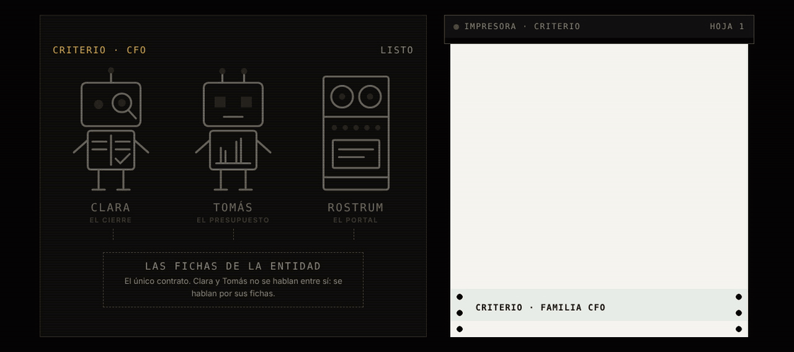
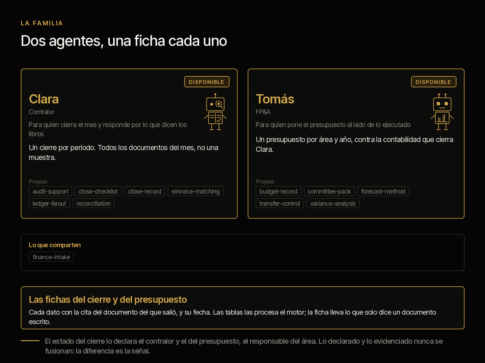
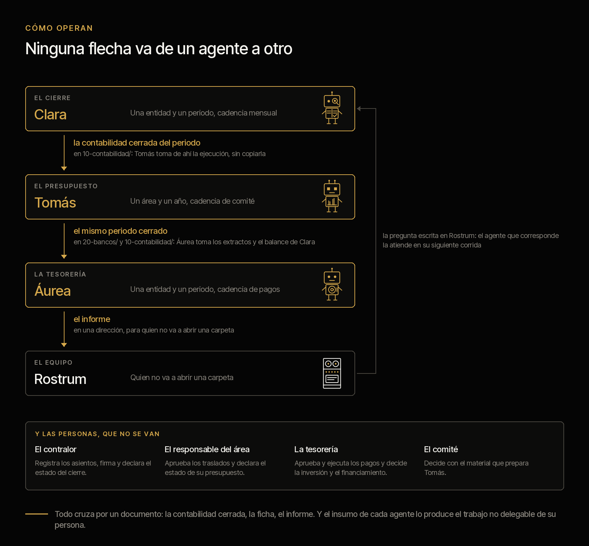
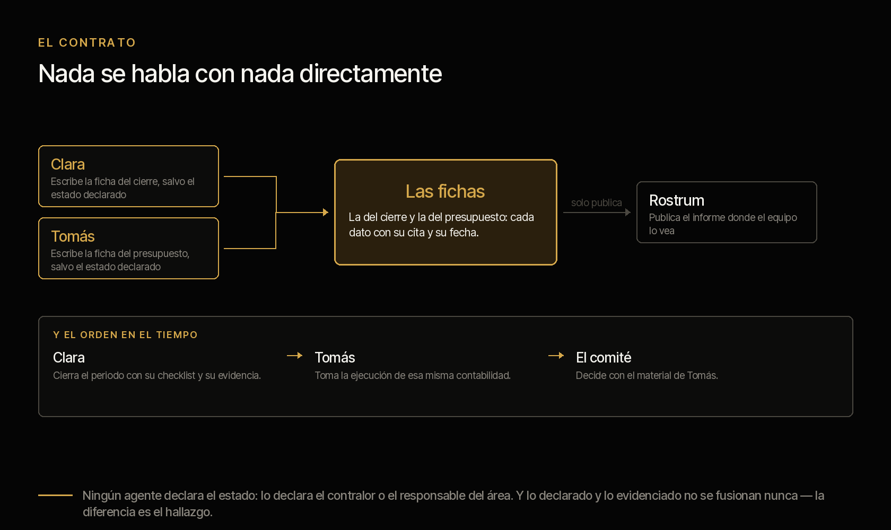

<picture><source media="(prefers-color-scheme: dark)" srcset="../../docs/img/marca/es/criterio-cfo-oscuro.svg"></picture>

# criterio-cfo · la familia de la función financiera

**Cada cifra que firma el CFO, sostenida por su evidencia.** La familia extiende la oficina del CFO
con tres agentes y un portal, alrededor de sus fichas. Cada uno extiende a una persona distinta
de la función financiera —quien cierra los libros, quien lleva el presupuesto y quien cuida la
caja— y ninguno habla con los otros directamente: se hablan por sus fichas.

[English](README.md) · [← Criterio](../../README.es.md) · Apache 2.0



| | |
|---|---|
| **Alcance** | La función financiera de una entidad: los libros contra sus soportes, el presupuesto contra su ejecución y la caja, los pagos y la deuda contra su política |
| **Objetivo** | Que el cierre deje de depender de que alguien recuerde qué falta |
| **Compuesta por** | [Clara](../../plugins/criterio-finance/README.es.md) · [Tomás](../../plugins/criterio-budget/README.es.md) · [Áurea](../../plugins/criterio-treasury/README.es.md) · [Rostrum](../../plugins/criterio-server/README.es.md) |
| **El soporte** | El marco de trabajo que define cada rol y lo que cuesta hoy a una organización, con su fuente, su año y su muestra: [`FUENTES.es.md`](FUENTES.es.md) |
| **Estado** | Construida y probada sobre material sintético de cinco países —Colombia, Ecuador, Perú, Chile y México—: el motor, contra las quince entidades del material; los tres agentes, en [las rondas con el agente](../../tests/evidencias/familias/cfo/RONDAS.md), la más reciente la 6, sobre México. **No se ha probado todavía sobre la documentación de una organización concreta** |
| **Enfoque** | Control y reporte |
| **Compromiso** | Generar, difundir y conservar el conocimiento es una obligación profesional |
| **Qué no es** | No reemplaza al contralor, al equipo de planeación financiera ni a la tesorería, y no decide por ellos: procesa lo que la función ya tiene y dice qué no cuadra |
| **Licencia** | [Apache 2.0](../../LICENSE) |
| **Qué viene** | Brasil, en la 1.0: [la hoja de ruta](#hoja-de-ruta) |

---

## Qué hace la familia



La función financiera tiene tres roles que trabajan sobre los mismos libros y miran cosas
distintas, y por eso la familia tiene tres agentes. Llevan nombre de persona porque **son
capacidades extendidas de personas**, y el significado de cada nombre apunta a lo que hace:
**Clara** —de *clarus*— cuida que los libros digan lo mismo que los soportes; **Tomás** —«el
gemelo»— pone el presupuesto al lado de su gemelo, la ejecución; **Áurea** —de *aureus*, «de oro»— cuida la caja.

**Clara**, la del contralor, prepara el cierre del mes: el checklist con su evidencia, las
conciliaciones bancarias y de cuentas, cada factura electrónica de la DIAN o del SRI contra su
registro y el paquete para el auditor. Lo que hoy no hace nadie y ella sí: **procesar todas las
facturas del periodo, no una muestra**, y todas las tareas del cierre contra su evidencia.

**Tomás**, el de planeación financiera (FP&A), pone lo aprobado al lado de lo ejecutado y lo
comprometido, proyecta el cierre del año con su supuesto escrito, cruza cada traslado con su
acta y arma el material del comité como un paquete de decisiones. Toma la ejecución de la misma
contabilidad que cierra Clara, sin copiarla.

**Áurea**, la de tesorería, pone cada cuenta contra su mínimo y su proyección, cada pago
programado contra quién puede aprobarlo según la política y la matriz de firmas, la exposición
cambiaria contra su límite, y cada covenant de la deuda —calculado desde el balance que cierra
Clara— contra su límite. **Nunca mueve dinero ni entra a un portal bancario**
([ADR 0016](../../docs/decisions/0016-tesoreria-tercer-agente-cfo.md)).

**Clara, Tomás y Áurea se instalan hoy**, cada uno con su propio plugin, y tienen la misma deuda, escrita en
su página: el motor y la extracción de los agentes están probados sobre material sintético de cinco países;
**nada se ha probado todavía sobre los documentos de una organización.**

El marco contable que adoptó cada país, con su fuente —en México, las NIIF o las NIF según la
entidad (F-20)—, y la factura electrónica de la DIAN, del SRI, de la SUNAT, del SII y del SAT
procesada desde su fuente técnica oficial.

---

## Cómo operan



El modelo de lenguaje (LLM) extrae; el código calcula; el estado del cierre y del presupuesto lo
declara siempre una persona. **El motor procesa las tablas directamente** —el balance, el mayor,
los extractos, las facturas, el presupuesto—, y el agente lleva a la ficha solo lo que trae un
documento escrito: lo que alguien declara, un requerimiento que llegó por correo, un acta
([ADR 0008](../../docs/decisions/0008-cfo-motor-procesa-tablas.md)).

**Automatizados**: procesan los documentos, calculan las señales y preparan cada entregable sin
intervención. **Semiautomatizados** cuando falta un dato que ningún documento trae —la entidad,
el periodo, el umbral, quién aprueba—: entonces le preguntan a la persona, dicen qué preguntaron
y siguen con la respuesta.

## Los agentes y sus fichas

Nada se habla con nada directamente. **Cada agente escribe su ficha, y la ficha es el contrato.**



| Ficha | Una por | Qué lleva | Quién la escribe |
|---|---|---|---|
| Ficha del cierre | Entidad y periodo | Las tareas del checklist con responsable, fecha y evidencia; cada conciliación con sus partidas abiertas; las facturas electrónicas contra sus registros; el estado declarado del cierre | Clara; el estado, el contralor persona |
| Ficha del presupuesto | Área o centro de costo y año | Aprobado, ejecutado y comprometido por cuenta; la proyección del área; los traslados con su acta; el estado declarado | Tomás; el estado, el responsable del área |

Cada dato cita el documento del que sale y su fecha. «No encontrado» es una respuesta válida.

### Las siete invariantes

1. **Los agentes no se hablan entre sí.** Se hablan por sus fichas.
2. **Rostrum, el portal, no escribe.** Sirve lo que el motor ya escribió y lo dice con su fecha;
   no recalcula nada.
3. **Cada documento tiene un solo lugar.** La contabilidad del periodo vive en
   `10-contabilidad/`: Clara la cierra y Tomás saca de ahí la ejecución, sin copias entre
   carpetas.
4. **Declarado y evidenciado nunca se fusionan.** Van en campos separados de la ficha.
5. **El modelo extrae, el código calcula.** Toda cifra de un reporte sale de `finanzas.py`, con
   todos sus dígitos; si el motor no la da, no se escribe.
6. **Ningún agente declara el estado.** El del cierre lo declara el contralor; el de cada área,
   su responsable.
7. **Un escritor por archivo.** La ficha la escribe el agente y los resultados, el motor; ninguno
   escribe el del otro.

La sexta es la más fácil de romper por conveniencia y la que se lleva el sistema entero si se
rompe: si el agente declara el cierre, la comparación entre lo declarado y lo evidenciado
compara al sistema consigo mismo. No es una recomendación de la documentación: es una
restricción del camino de escritura.

## Lo que sigue siendo de las personas

Los tres roles siguen existiendo completos. Esto extiende capacidad; no sustituye función. Y el
argumento no es de cortesía, es estructural:

> **El insumo de cada agente lo produce el trabajo no delegable de su persona.**

Clara necesita que alguien haga las tareas del cierre y deje su evidencia, porque sin soporte no
hay nada que contrastar, y que el contralor declare el estado, porque esa es la línea contra la
que se compara. Tomás necesita que cada área entregue su proyección y que el comité deje escrita
su decisión, porque un traslado sin acta es justamente lo que señala.

Quitar a la persona no deja al agente solo: lo deja sin insumo. **Y ninguno registra
un asiento, aprueba un traslado, presenta una declaración ni firma.**

## La estructura de carpetas recomendada

Recomendada, no obligatoria ([ADR 0007](../../docs/decisions/0007-estructura-recomendada.md)):
los agentes procesan la carpeta como esté. `finance-setup` y `budget-setup` comparan lo que
encuentran con esta estructura y, en cada corrida, dicen qué archivo está fuera de su lugar y
dónde iría; no crean, mueven ni renombran nada en los documentos de la organización. La
numeración va de diez en diez, como en la familia PMO, en el orden en que se trabaja el cierre y
el presupuesto.

<!-- cfo:carpetas · generado por scripts/familias.py; no se edita a mano -->
Una carpeta por entidad, con el NIT o el RUC al inicio del nombre: `900123456-nombre-de-la-entidad`. Dentro, lo que la organización entrega una vez, una carpeta por periodo contable y una por año presupuestal.

```
finanzas/
└── <entidad>/
    ├── 00-referencia/
    ├── <AAAA-MM>/
    │   ├── 10-contabilidad/
    │   ├── 20-bancos/
    │   ├── 30-facturacion/
    │   ├── 40-soportes/
    │   ├── 50-auditoria/
    │   └── 60-tesoreria/
    └── presupuesto-<AAAA>/
        ├── 10-aprobado/
        ├── 20-compromisos/
        ├── 30-proyecciones/
        └── 40-actas/
estado-finanzas/
```

**`<entidad>/`** · Lo que la organización entrega una vez

| Carpeta | Qué va | Agente |
|---|---|---|
| `00-referencia/` | El plan de cuentas con la naturaleza de cada cuenta, `checklist-cierre.xlsx` en el modelo definido y el mapeo de cuentas a centros de costo y líneas presupuestales; para Áurea, la política de tesorería, la matriz de firmas, el registro de la deuda y los covenants | Clara, Tomás, Áurea |

**`<AAAA-MM>/`** · Un periodo contable, numerado en el orden en que se trabaja el cierre

| Carpeta | Qué va | Agente |
|---|---|---|
| `10-contabilidad/` | Balance de comprobación y libro mayor exportados del ERP, y `auxiliares/` con un archivo por cuenta; de aquí sale también la ejecución del presupuesto | Clara, Tomás |
| `20-bancos/` | Una carpeta por cuenta, `<banco>-<últimos 4 dígitos>`, con el extracto y el auxiliar de libros | Clara, Áurea |
| `30-facturacion/` | `emitidas/` y `recibidas/`, con el XML de la DIAN (F-01), del SRI (F-04), de la SUNAT (F-13), del SII (F-16) o del SAT (F-19) | Clara |
| `40-soportes/` | La evidencia de cada tarea del checklist —actas, correos, conciliaciones firmadas—, con el id de la tarea al inicio del nombre | Clara |
| `50-auditoria/` | `requerimientos/` y `respuestas/` del auditor | Clara |
| `60-tesoreria/` | El programa de pagos con quién aprobó cada uno y el flujo de caja proyectado al cierre del periodo | Áurea |

**`presupuesto-<AAAA>/`** · Un año presupuestal

| Carpeta | Qué va | Agente |
|---|---|---|
| `10-aprobado/` | El presupuesto aprobado y cada versión, con su fecha en el nombre | Tomás |
| `20-compromisos/` | Órdenes de compra y compromisos exportados del ERP, con la fecha de corte en el nombre | Tomás |
| `30-proyecciones/` | La proyección de cada área, una por área y fecha | Tomás |
| `40-actas/` | Actas del comité de presupuesto, de aprobación y de traslados | Tomás |

**`estado-finanzas/`** · Lo que escriben Clara, Tomás y Áurea: la configuración, las fichas, los informes y los índices. Ninguna persona lo edita, y ningún agente escribe fuera de aquí.
<!-- /cfo:carpetas -->

Un archivo sin el formato esperado no se adivina: se reporta con lo que le falta.

## Instalación de la familia

Cada agente es un plugin y se instala solo. **No hace falta instalarlos todos**: se instala el
que resuelve el rol que tienes.

```
/plugin marketplace add josenanez/criterio

/plugin install criterio-finance@criterio     si cierras los libros
/plugin install criterio-budget@criterio      si llevas el presupuesto
```

**En Claude Cowork** — Personalizar → Explorar plugins → Personal → **+** → Agregar
marketplace desde GitHub → `josenanez/criterio`.

Después de instalar, cada agente tiene su propio comando de instalación que mira la carpeta,
hace las preguntas que ningún documento responde y produce un primer resultado sobre tus
propios documentos. **Nadie edita un archivo de configuración a mano.**

Y si instalas más de uno, se encuentran solos: **no hay nada que conectar.** Comparten el estado
de la entidad, y cada uno escribe solo lo suyo.

## De qué responde cada agente, y dónde está su detalle

Lo mismo para cada pieza: de qué responde, qué no hace, y dónde está todo su detalle. **Cada
página de agente se lee sola** — alguien puede instalar uno sin el otro.

<!-- cfo:familia-agentes · generado por scripts/familias.py; no se edita a mano -->
| | De qué responde | Lo que nunca hace | Su página | Sus pruebas |
|---|---|---|---|---|
| **Clara** · contralor | El cierre mensual con su checklist y su evidencia, las conciliaciones bancarias y de cuentas, la factura electrónica contra la contabilidad y el paquete para el auditor | No registra asientos, no firma y no declara el estado del cierre | [criterio-finance](../../plugins/criterio-finance/README.es.md) · 9 comandos, 7 skills | [resultados](../../tests/criterio-finance/RESULTADOS.md) |
| **Tomás** · FP&A | El presupuesto aprobado contra lo ejecutado y lo comprometido, la proyección al cierre del año, los traslados y el material del comité de presupuesto | No aprueba traslados, no recomienda la decisión del comité y no declara el estado de ningún área | [criterio-budget](../../plugins/criterio-budget/README.es.md) · 7 comandos, 6 skills | [resultados](../../tests/criterio-budget/RESULTADOS.md) |
| **Áurea** · tesorería | La caja contra su mínimo y su proyección, cada pago programado contra quién puede aprobarlo, la exposición cambiaria contra su límite, y la deuda contra su vencimiento y sus covenants | No mueve dinero, no hace pagos, no entra a un portal bancario y no recomienda una inversión, un financiamiento ni una cobertura | [criterio-treasury](../../plugins/criterio-treasury/README.es.md) · 6 comandos, 2 skills | [resultados](../../tests/criterio-treasury/RESULTADOS.md) |
| **Rostrum** · el portal | Publicar lo que escriben los agentes donde el equipo lo vea, y recibir la pregunta de quien no abre una carpeta | **No escribe en el estado ni recalcula nada**, y no decide nada | [criterio-server](../../plugins/criterio-server/README.es.md) · 2 comandos, uno para todas las familias | [resultados](../../tests/criterio-server/RESULTADOS.md) |
<!-- /cfo:familia-agentes -->

Los comandos, uno por uno —qué hacen, qué reciben, qué procesan y qué escriben—, están en el
[manual de los comandos](../../docs/manual.es.md); su entrada, su proceso y su reporte, con las
señales que calcula el motor, en el [diseño de la familia](DISENO.es.md); y las respuestas a lo
que más se pregunta, en las [preguntas frecuentes](PREGUNTAS.es.md).

## En Rostrum, el portal de todas las familias

Hasta aquí el resultado de la familia son archivos en el equipo de quien corrió los agentes.
**Un director financiero no abre una carpeta de archivos**: abre un enlace, o no abre nada. Para
eso está **Rostrum**, un plugin aparte, `criterio-server`, que sirve a la CFO junto con las demás
familias, sin que el servidor sepa nada de finanzas
([ADR 0010](../../docs/decisions/0010-rostrum-plugin-propio.md)).

**Cómo entra la CFO al portal.** `/criterio-finance:finance-setup` y
`/criterio-budget:budget-setup` y `/criterio-treasury:treasury-setup` dejan su configuración en
`.criterio/finanzas/<entidad>/`, `.criterio/presupuesto/<entidad>/` y `.criterio/tesoreria/<entidad>/`,
con la carpeta de finanzas de la entidad marcada con `_CRITERIO_FINANZAS.txt`. Los tres comparten el
estado de la entidad, y cada uno ve en el portal sus corridas y sus reportes, no los de los otros.
El reporte de Áurea, con saldos, no se publica por omisión. Después, `/criterio-server:server-setup`
encuentra las configuraciones y las suma al mapa, y `/criterio-server:server-start` levanta el
portal. Una entidad nueva entra volviendo a correr `server-setup`.

**Lo que la CFO tiene en Rostrum:**

| Dónde | Qué |
|---|---|
| Inicio | La tarjeta **Criterio CFO** con Clara, Tomás y Áurea y sus señales abiertas |
| `/familia/cfo` | Lo último que escribió el motor de cada uno —el cierre de un mes, el presupuesto de un año, la tesorería de un periodo—, con sus señales en palabras y la fecha de cálculo, y sus reportes tal como los dejó el motor |
| Lo que vence | Las tareas del cierre y los requerimientos del auditor con fecha, ordenados con los vencimientos de las otras familias |
| `/caso/<PRY>` | Una señal de presupuesto sobre un proyecto de la PMO aparece en la página de ese proyecto |
| Dónde trabaja | La ruta completa de la carpeta raíz, de los documentos de la entidad con su marca, del estado y de cada configuración |
| Preguntar a un agente | Una pregunta para Clara, Tomás o Áurea, que la atiende en su siguiente corrida |

**No autentica a nadie, y es a propósito**: se publica detrás del control de acceso que la
organización ya tiene. No recalcula nada y no escribe en el estado. Las páginas cumplen WCAG 2.2
nivel AA, comprobado con axe-core a cuatro anchos de pantalla
(`tests/criterio-server/accesibilidad/`).

→ **[Rostrum: instalación, configuración y uso con todas las familias](https://www.josenanez.com/es/agents/rostrum)** ·
[su README, con las rutas y qué pedirle a tu organización](../../plugins/criterio-server/README.es.md)

## Cómo se configura y cada cuánto corre cada uno

Esta es la tabla que responde tres preguntas a la vez: **dónde queda cada agente, qué le hace
falta configurado, y cada cuánto tiene sentido que corra.**

<!-- cfo:configuracion · generado por scripts/familias.py; no se edita a mano -->
| | Clara | Tomás | Áurea |
|---|---|---|---|
| **Se instala** | `criterio-finance` | `criterio-budget` | `criterio-treasury` |
| **Instancias** | Una por entidad | Una por entidad | Una por entidad |
| **Se configura con** | `/criterio-finance:finance-setup` | `/criterio-budget:budget-setup` | `/criterio-treasury:treasury-setup` |
| **Cuánto tarda eso** | Quince minutos | Quince minutos | Quince minutos |
| **Qué le tienes que decir** | Entidad y NIT, RUC, RUT o RFC, país, grupo NIIF (F-05, F-06, F-15, F-18, F-20), ERP, moneda, periodo, umbrales, quién aprueba, plan de cuentas | Entidad, año presupuestal, áreas o centros de costo con su responsable, la versión aprobada y su acta, el mapeo de cuentas a líneas presupuestales (en `00-referencia/`), los umbrales de desviación y, si la organización usa la familia PMO, dónde están sus fichas | Entidad y periodo, las cuentas en otra moneda, los umbrales de desviación, de vencimiento y del margen del covenant, dónde guarda el estado y los términos |
| **Dónde queda** | `.criterio/finanzas/<entidad>/config.json`, escrito por el comando | `.criterio/presupuesto/<entidad>/config.json`, escrito por el comando | `.criterio/tesoreria/<entidad>/config.json`, escrito por el comando |
| **El que se le pone a un reloj** | `/criterio-finance:finance-wake` | `/criterio-budget:budget-wake` | `/criterio-treasury:treasury-wake` |
| **Qué toca cada día** | Decide qué toca según la cadencia: a diario durante la ventana del cierre, semanal fuera de ella | Decide qué toca según la cadencia: cuando aparece un periodo nuevo en `10-contabilidad/`, antes de cada comité y una vez por semana para los compromisos | Decide qué toca: los pagos de los próximos cinco días, las obligaciones que entran en su ventana de vencimiento y una revisión semanal |
| **Qué lo despierta además del reloj** | Una pregunta que alguien dejó en Rostrum | Una pregunta que alguien dejó en Rostrum | Una pregunta que alguien dejó en Rostrum |
<!-- /cfo:configuracion -->

**Nadie edita un archivo de configuración a mano.** Si para cambiar un umbral hay que abrir un
JSON, el umbral se queda como vino y la configuración deja de describir a la organización. Se
dice en la conversación y el comando lo reescribe. Cada plugin trae su
`scripts/config.example.json` para ver la forma completa sin instalar nada; los umbrales por
defecto son configuración, no norma.

### Por qué las dos cadencias son distintas

No es una preferencia: **cada agente mide contra otra cosa.**

- **Clara** mide contra la ventana del cierre. Mientras el cierre está abierto, una tarea vencida
  o una conciliación sin actualizar cambia el estado hoy, así que corre a diario; fuera de la
  ventana, una vez por semana alcanza.
- **Tomás** mide contra la contabilidad y el comité. Su ciclo no es el calendario: es *cuando
  llega un periodo nuevo* a `10-contabilidad/` y *antes de cada comité*, y una vez por semana
  revisa los compromisos.

### Se callan cuando no hay nada

Es la regla que decide si un agente sigue instalado el mes siguiente. Los comandos de reloj
no producen nada cuando no toca nada, y entonces la salida es una línea: qué se revisó y cuándo
vuelve. Con una pregunta abierta en Rostrum nunca se callan: la responden primero.

Un agente que produce un informe para decir que no hay novedad enseña a ignorarlo, y el día que
sí hay novedad ya nadie lo abre.

### Qué es lo que **no** está programado

**Ninguno se programa solo.** Cada uno trae el comando que un reloj invoca, y el reloj
vive fuera del plugin — una tarea programada de Claude Cowork, o el programador del sistema
operativo invocando Claude en modo no interactivo. Alguien tiene que ponerlo, una vez.

Y para que corra sin nadie delante hacen falta dos cosas que no dependen de este repositorio:
**que la sesión pueda correr sin aprobar cada paso**, y **que la carpeta esté montada cuando el
reloj dispare.** Si la organización no quiere corridas desatendidas —y en una función financiera
es una respuesta razonable—, los comandos sirven corridos a mano y la cadencia sigue diciendo qué
toca.

## Las pruebas de la familia

**Una sola puerta corre todo lo que este repositorio comprueba**, de todas las familias a la vez:

```
python3 scripts/verificar.py
```

Lo propio de la CFO está en [`tests/criterio-cfo/`](../../tests/criterio-cfo/): material
sintético por industria con una clave que el motor no ve, y una entidad de control por país que
no trae ningún defecto, donde cualquier señal es una falla. Cada señal de la familia se siembra
al menos una vez. `evaluar.py` corre el motor y compara cada señal por su nombre y su clave: **una
de más cuenta igual que una de menos.**

| Qué se comprueba del conjunto | Por qué es de la familia y no de un agente |
|---|---|
| Que cada señal sembrada se levante, y ninguna en los controles | Las señales de Clara y las de Tomás salen del mismo motor y del mismo material |
| **Que las copias compartidas no se hayan separado** | `finanzas.py` y `finance-intake` viajan copiados en los tres plugins. Dos copias que se separan calculan distinto sobre los mismos documentos, y nadie sabría a cuál creerle |
| Que el diseño, las páginas y el portal digan lo que dicen las fuentes | Las tablas de agentes, comandos, señales, carpetas y skills salen de `familia.json`, `carpetas.json` y `fuentes.json`; `scripts/familias.py --check` falla si una copia no cuadra |
| Que cada campo de factura que procesa el motor esté en su fuente oficial | Un campo que no está en el anexo de la DIAN o en la ficha del SRI no se procesa ([ADR 0006](../../docs/decisions/0006-scope-cfo.md), regla 2) |

**El resultado de cada agente, generado desde la corrida**, en su propia página:
[Clara](../../tests/criterio-finance/RESULTADOS.md) ·
[Tomás](../../tests/criterio-budget/RESULTADOS.md). Qué se siembra en cada entidad y la señal que
tiene que levantar, con el mismo detalle, **y qué no prueba el material**, en
[`EVIDENCIA.md`](../../tests/criterio-cfo/EVIDENCIA.md). El conjunto de todas las familias, en
[`docs/pruebas.md`](../../docs/pruebas.md).

**Las rondas con el agente.** La ronda 1 corrió sobre banca y el control de Colombia; la 2, completa, sobre las seis entidades de Colombia y Ecuador; la 3 sumó a Áurea y a Perú, y la 4 corrió los tres agentes sobre las nueve entidades: 80 de 80 señales sin una de más y 74 de 74 datos; la 5 sumó a Chile: 26 de 26 señales y 24 de 24 datos; la 6 sumó a México: 27 de 27 señales y 24 de 24 datos. Cada defecto que encontraron las rondas está corregido y verificado. Cada salida, su costo, su calificación, los comandos que se repitieron tras corregir un defecto y cada defecto con su origen y su commit están en [las rondas de la familia](../../tests/evidencias/familias/cfo/RONDAS.md). **El análisis estadístico de las rondas** —cobertura y precisión de las señales, los datos extraídos y el margen del 95 % de cada uno, su evolución ronda a ronda, por industria y país, cada falla con el defecto que la explica y su origen— en [`analisis/ANALISIS.es.md`](analisis/ANALISIS.es.md). Lo genera [`scripts/analisis_familias.py`](../../scripts/analisis_familias.py) desde la evidencia de las rondas, y `verificar.py` comprueba que diga lo que dice la evidencia.

## Las industrias de prueba

Cuatro industrias de América Latina y una entidad de control por país: **banca y retail en
Colombia**, con el XML de la DIAN; **cooperativas y minería en Ecuador**, con el del SRI; **banca y
minería en Perú**, con el de la SUNAT; **retail y minería en Chile**, con el DTE del SII, y **banca y
retail en México**, con el CFDI del SAT. Cada
una trae el cierre de un mes y el presupuesto del año.
Las entidades, los defectos sembrados y las señales esperadas de cada una, en
[`tests/criterio-cfo/EVIDENCIA.md`](../../tests/criterio-cfo/EVIDENCIA.md).

## Hoja de ruta

<!-- hoja de ruta: generado por scripts/hoja.py desde hoja-de-ruta.json; no se edita a mano -->

La familia crece por incrementos. Cada uno es una versión con su prueba completa y su análisis estadístico publicados, con las mismas métricas, para que la evolución se pueda comparar.

| Versión | Estado | Qué entra | Prueba |
|---|---|---|---|
| 0.8.0 | Liberada | **Construida, con el motor probado y una primera ronda con el agente**<br>· Los comandos de Clara y Tomás, sus skills y el motor de cálculo<br>· La factura electrónica de la DIAN y del SRI, procesada desde su fuente técnica oficial<br>· La carpeta raíz que cada agente busca y, con permiso, marca<br>· La familia en Rostrum, con lo que vence y dónde trabaja cada agente<br>· La primera ronda con el agente: Clara y Tomás sobre banca y el control de Colombia, con los defectos que encontró corregidos | El motor, contra 4 industrias y 2 entidades de control; el agente, sobre banca y el control de Colombia |
| 0.9.0 | Liberada | **La ronda completa con el agente**<br>· Clara y Tomás corren sus comandos sobre el material de las cuatro industrias, como la PMO en cada ronda<br>· Lo que solo traen las actas, los correos y las cartas del auditor, extraído y calificado contra la clave<br>· Con la ronda completa, la familia se declara probada | 4 industrias y 2 entidades de control, con la clave que el agente no ve |
| 0.10.0 | Liberada | **Áurea, Perú y los formatos de un área financiera real**<br>· Áurea, el tercer agente: la caja, los pagos y la deuda contra su política<br>· Perú, con el lector de la factura electrónica de la SUNAT desde su guía oficial<br>· El material de prueba en Excel, Word y PDF, como lo tiene un área financiera, y el extracto bancario en PDF procesado por el motor | La ronda 4, completa: los tres agentes sobre las nueve entidades de Colombia, Ecuador y Perú, con los defectos que encontraron sus rondas corregidos y verificados |
| 0.11.0 | Liberada | **Chile**<br>· El lector de la factura electrónica de Chile, el DTE del SII (F-16), con el RUT y su dígito verificador<br>· El IVA del 19 % (F-17) y las NIIF que adoptó el Colegio de Contadores (F-18)<br>· Material de retail, minería y una entidad de control de Chile | La ronda 5: los tres agentes sobre las tres entidades de Chile, 26 de 26 señales, ninguna de más y 24 de 24 datos |
| 0.12.0 | Liberada | **México**<br>· El lector del CFDI 4.0 del SAT, desde su guía de llenado (F-19), con el RFC<br>· El IVA del 16 % del catálogo de la guía y el marco NIIF o NIF de cada entidad (F-20)<br>· Material de banca, retail y una entidad de control de México | La ronda 6: los tres agentes sobre las tres entidades de México, 27 de 27 señales, ninguna de más y 24 de 24 datos |
| 1.0.0 | Liberada | **Brasil**<br>· Su entrada en el registro de países, el lector de su factura electrónica y sus fuentes verificadas<br>· Los documentos en portugués: el motor los procesa como los de los demás países | La ronda 7 con los tres agentes en Brasil, con los documentos en portugués: 24 de 24 señales, ninguna de más, y 24 de 25 datos; el defecto que encontró, en la clave, con su corrección |
| 1.1.0 | Liberada | **Argentina, Panamá, Guatemala y Costa Rica**<br>· Su entrada en el registro de países, con sus fuentes verificadas<br>· Los lectores de su factura electrónica: el comprobante de ARCA con su CAE, la factura de la DGI con su CUFE, la FEL de la SAT con su número de autorización y el comprobante 4.4 de Hacienda con su clave<br>· Tres entidades de prueba por país, una de ellas de control, sin defectos sembrados | Las rondas 8 a 11 con los tres agentes, una por país |
| 1.2.0 | En curso | **Honduras**<br>· Su entrada en el registro de países, con sus fuentes verificadas<br>· La factura como documento, sin XML: el agente extrae el CAI, el rango autorizado, la fecha límite de emisión y el número correlativo, y el motor los valida (decisión 0024)<br>· Una señal nueva: la factura recibida fuera de su rango autorizado o emitida después de su fecha límite<br>· Tres entidades de prueba, una de ellas de control, sin defectos sembrados | La ronda 12 con los tres agentes |

<!-- /hoja de ruta -->

## Los trece skills de la familia

<!-- cfo:skills-familia · generado por scripts/familias.py; no se edita a mano -->
Trece skills distintos entre los tres agentes. **Los que comparten son copias literales, no un módulo importado**: un plugin instalado tiene que correr solo. `scripts/sincronizar.py` las copia y `scripts/sincronizar.py --check` falla si se separan.

| Skill | Clara | Tomás | Áurea |
|---|:--:|:--:|:--:|
| `audit-support` | ● | · | · |
| `budget-record` | · | ● | · |
| `close-checklist` | ● | · | · |
| `close-record` | ● | · | · |
| `committee-pack` | · | ● | · |
| `einvoice-matching` | ● | · | · |
| `finance-intake` | ● | ● | ● |
| `forecast-method` | · | ● | · |
| `ledger-tieout` | ● | · | · |
| `reconciliation` | ● | · | · |
| `transfer-control` | · | ● | · |
| `treasury-control` | · | · | ● |
| `variance-analysis` | · | ● | · |
<!-- /cfo:skills-familia -->

## Estado

**Los tres están construidos y se pueden instalar hoy**, y tienen la misma deuda, que
conviene no esconder: **el motor y la extracción de los agentes están probados sobre material sintético, no
sobre la documentación de una organización real.**

<!-- cfo:estado · generado por scripts/familias.py; no se edita a mano -->
| Agente | Se instala | Su prueba |
|---|---|---|
| **Clara** · Contralor | `criterio-finance` · 9 comandos, 7 skills | El motor, probado; una primera ronda con el agente; la completa, pendiente · [resultados](../../tests/criterio-finance/RESULTADOS.md) |
| **Tomás** · FP&A | `criterio-budget` · 7 comandos, 6 skills | El motor, probado; una primera ronda con el agente; la completa, pendiente · [resultados](../../tests/criterio-budget/RESULTADOS.md) |
| **Áurea** · Tesorería | `criterio-treasury` · 6 comandos, 2 skills | El motor, probado; una primera ronda con el agente; la completa, pendiente · [resultados](../../tests/criterio-treasury/RESULTADOS.md) |
| **Rostrum** · el portal | `criterio-server` · 2 comandos, para todas las familias | — |
<!-- /cfo:estado -->

La familia quedó probada con la ronda completa con el agente, y su evidencia la hace **estable**:
la corrida más reciente de cada una de sus entidades tiene el piso del margen del 95 % en 95 % o más,
en señales y en datos, y ningún control levantó una señal
([decisión 0020](../../docs/decisions/0020-laboratorio-estable-y-diez-versiones.md); lo calcula
`scripts/calidad.py`). Lo siguiente es Brasil, en la 1.0. Las decisiones que siguen abiertas, en el
[diseño](DISENO.es.md#decisiones-abiertas).
