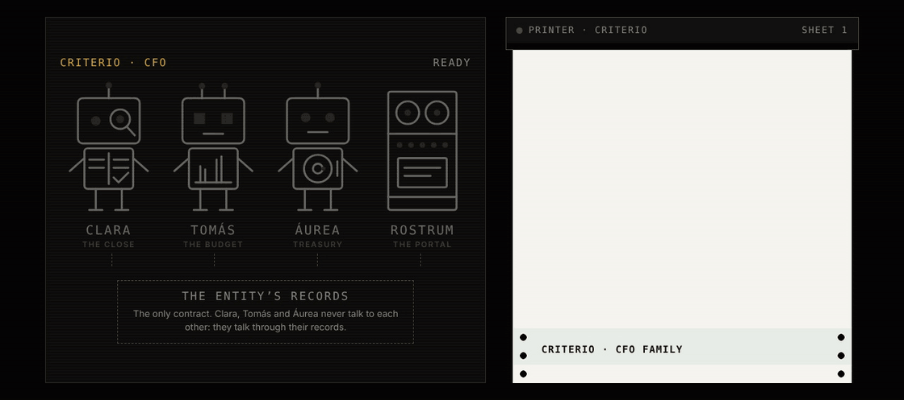
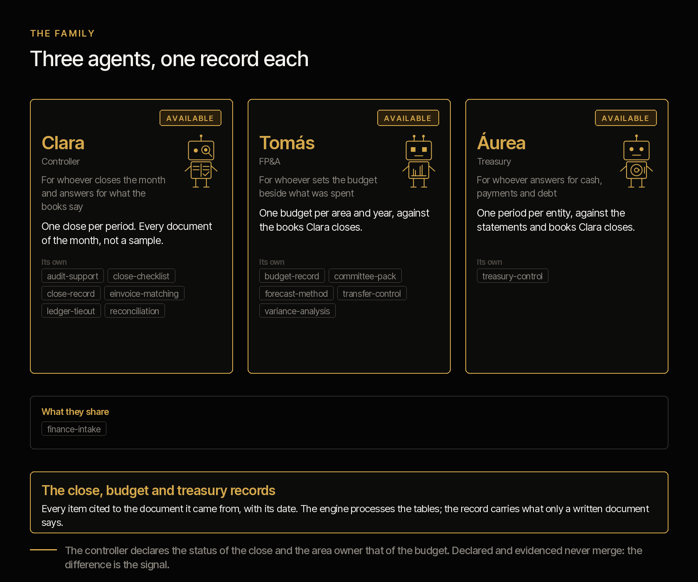
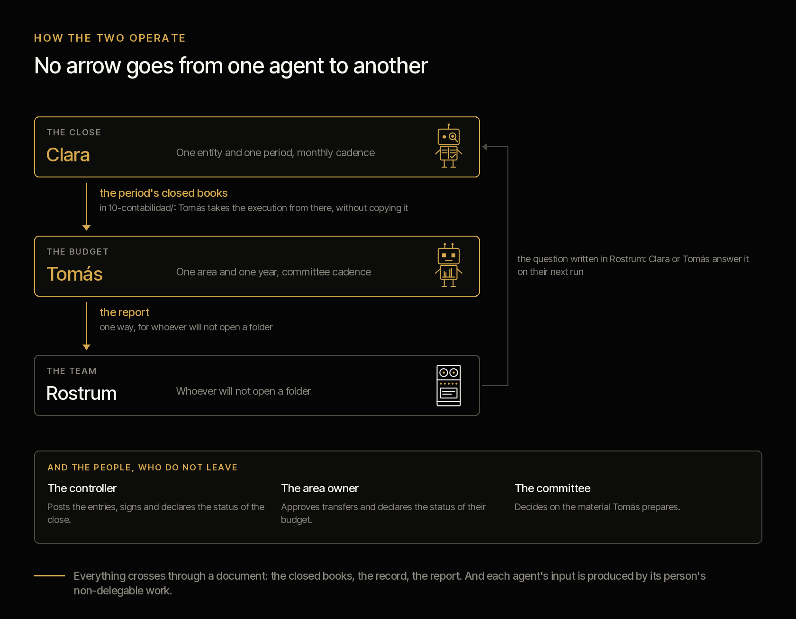
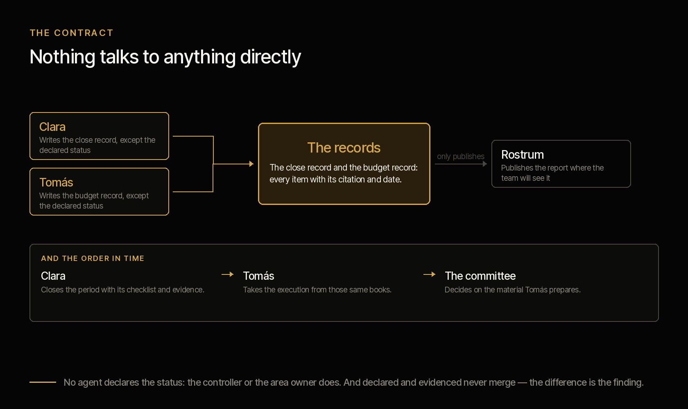

<picture><source media="(prefers-color-scheme: dark)" srcset="../../docs/img/marca/en/criterio-cfo-oscuro.svg"></picture>

# criterio-cfo · the finance function family

**Every figure the CFO signs, backed by its evidence.** The family extends the CFO's office with
three agents and a portal, around their records. Each one extends a different person in the
finance function — whoever closes the books, whoever runs the budget and whoever looks after the
cash — and none talks to the others directly: they talk through their records.

[Español](README.es.md) · [← Criterio](../../README.md) · Apache 2.0



| | |
|---|---|
| **Scope** | The finance function of an entity: the books against their supporting documents, the budget against its execution, and cash, payments and debt against their policy |
| **Objective** | That the close stops depending on someone remembering what is missing |
| **Made of** | [Clara](../../plugins/criterio-finance/README.md) · [Tomás](../../plugins/criterio-budget/README.md) · [Áurea](../../plugins/criterio-treasury/README.md) · [Rostrum](../../plugins/criterio-server/README.md) |
| **The support** | The framework that defines each role and what it costs an organisation today, with its source, year and sample: [`FUENTES.es.md`](FUENTES.es.md) (Spanish) |
| **State** | Built and tested on synthetic material from five countries —Colombia, Ecuador, Peru, Chile and Mexico—: the engine, against the fifteen entities in the material; the three agents, in [the rounds with the agent](../../tests/evidencias/familias/cfo/RONDAS.md), the latest round 6, on Mexico. **Not yet tested on a specific organisation's documentation** |
| **Approach** | Control and reporting |
| **Commitment** | Generating, sharing and preserving knowledge is a professional obligation |
| **What it is not** | It does not replace the controller, the financial planning team or treasury, and does not decide for them: it processes what the function already has and says what does not tie out |
| **Licence** | [Apache 2.0](../../LICENSE) |
| **What comes next** | Brazil, in 1.0: [the roadmap](#roadmap) |

---

## What the family does



The finance function has three roles that work on the same books and look at different things,
which is why the family has three agents. They carry a person's name because **they are extended
capabilities of people**, and what each name means points to what it does: **Clara** —from
*clarus*— makes sure the books say what the supporting documents say; **Tomás** —"the twin"— puts
the budget next to its twin, actual spend; **Áurea** —from *aureus*, "golden"— looks after the cash.

**Clara**, the controller's agent, prepares the monthly close: the checklist with its evidence,
bank and account reconciliations, every DIAN or SRI e-invoice against its entry, and the
auditor's package. What nobody does today and she does: **process every invoice of the period,
not a sample**, and every close task against its evidence.

**Tomás**, the financial planning (FP&A) agent, puts approved next to actual and committed,
forecasts the year-end with its stated assumption, matches each transfer with its minutes and
builds the committee material as a decision pack. He takes actuals from the same books Clara
closes, without copying them.

**Áurea**, the treasury agent, puts each account against its minimum and its projection, each
scheduled payment against who may approve it under the policy and the signing-authority matrix,
currency exposure against its limit, and each debt covenant —calculated from the books Clara
closes— against its limit. **She never moves money or logs into a bank portal**
([ADR 0016](../../docs/decisions/0016-tesoreria-tercer-agente-cfo.md)).

**Clara, Tomás and Áurea install today**, each with its own plugin, and all carry the same debt, written on their
page: the engine and the agents' extraction are tested on synthetic material from five countries;
**nothing has been tested yet on an organisation's documents.**

The accounting framework each country adopted, with its source —in Mexico, IFRS or NIF depending on
the entity (F-20)—, and the electronic invoice of the DIAN, SRI, SUNAT, SII and SAT processed from
its official technical source.

---

## How they operate



The language model (LLM) extracts; the code calculates; the status of the close and of the
budget is always declared by a person. **The engine processes the tables directly** —the trial
balance, the ledger, the statements, the invoices, the budget—, and the agent takes to the record
only what a written document carries: what somebody declares, a request that arrived by email,
minutes ([ADR 0008](../../docs/decisions/0008-cfo-motor-procesa-tablas.md)).

**Automated**: they process the documents, calculate the signals and prepare each deliverable
without intervention. **Semi-automated** when a data point no document carries is missing —the
entity, the period, the threshold, who approves—: then they ask the person, say what they asked
and carry on with the answer.

## The agents and their records

Nothing talks to anything directly. **Each agent writes its record, and the record is the
contract.**



| Record | One per | What it holds | Who writes it |
|---|---|---|---|
| Close record | Entity and period | The checklist tasks with owner, date and evidence; each reconciliation with its open items; the e-invoices against their entries; the declared status of the close | Clara; the status, the controller in person |
| Budget record | Area or cost centre and year | Approved, actual and committed by account; the area's forecast; the transfers with their minutes; the declared status | Tomás; the status, the area's owner |

Every data point cites the document it comes from and its date. "Not found" is a valid answer.

### The seven invariants

1. **The agents do not talk to each other.** They talk through their records.
2. **Rostrum, the portal, does not write.** It serves what the engine already wrote and says so
   with its date; it recalculates nothing.
3. **Each document has one place.** The period's books live in `10-contabilidad/`: Clara closes
   them and Tomás takes actuals from there, with no copies between folders.
4. **Declared and evidenced never merge.** They go in separate fields of the record.
5. **The model extracts, the code calculates.** Every figure in a report comes from
   `finanzas.py`, with all its digits; if the engine does not give it, it is not written.
6. **No agent declares the status.** The close's is declared by the controller; each area's, by
   its owner.
7. **One writer per file.** The agent writes the record and the engine writes the results;
   neither writes the other's.

The sixth is the easiest to break for convenience and the one that takes the whole system with
it: if the agent declares the close, the comparison between declared and evidenced compares the
system with itself. It is not a recommendation in the documentation: it is a restriction on the
write path.

## What still belongs to the people

All three roles continue to exist in full. This extends capability; it does not replace function. And
the argument is not politeness, it is structural:

> **Each agent's input is produced by the non-delegable work of its person.**

Clara needs somebody to do the close tasks and leave their evidence, because without support
there is nothing to contrast, and the controller to declare the status, because that is the line
everything is compared against. Tomás needs each area to deliver its forecast and the committee
to write down its decision, because a transfer without minutes is exactly what he flags.

Removing the person does not leave the agent alone: it leaves it without input. **And none of
them posts an entry, approves a transfer, files a return or signs.**

## The recommended folder structure

Recommended, not mandatory ([ADR 0007](../../docs/decisions/0007-estructura-recomendada.md)):
the agents process the folder as it is. `finance-setup` and `budget-setup` compare what they find
with this structure and, on every run, say which file is out of place and where it would go; they
never create, move or rename anything in the organisation's documents. The numbering goes in
tens, as in the PMO family, in the order the close and the budget are worked.

<!-- cfo:carpetas · generado por scripts/familias.py; no se edita a mano -->
One folder per entity, with its tax id at the start of the name: `900123456-entity-name`. Inside it, what the organisation provides once, one folder per accounting period and one per budget year.

```
finanzas/
└── <entidad>/
    ├── 00-referencia/
    ├── <AAAA-MM>/
    │   ├── 10-contabilidad/
    │   ├── 20-bancos/
    │   ├── 30-facturacion/
    │   ├── 40-soportes/
    │   ├── 50-auditoria/
    │   └── 60-tesoreria/
    └── presupuesto-<AAAA>/
        ├── 10-aprobado/
        ├── 20-compromisos/
        ├── 30-proyecciones/
        └── 40-actas/
estado-finanzas/
```

**`<entidad>/`** · What the organisation provides once

| Folder | What goes in | Agent |
|---|---|---|
| `00-referencia/` | The chart of accounts with each account's nature, `checklist-cierre.xlsx` in the defined model, and the mapping of accounts to cost centres and budget lines; for Áurea, the treasury policy, the signing-authority matrix, the debt register and the covenants | Clara, Tomás, Áurea |

**`<AAAA-MM>/`** · One accounting period, numbered in the order the close is worked

| Folder | What goes in | Agent |
|---|---|---|
| `10-contabilidad/` | Trial balance and general ledger exported from the ERP, and `auxiliares/` with one file per account; budget execution comes from here too | Clara, Tomás |
| `20-bancos/` | One folder per account, `<bank>-<last 4 digits>`, with the statement and the book ledger | Clara, Áurea |
| `30-facturacion/` | `emitidas/` and `recibidas/`, with the DIAN (F-01), SRI (F-04), SUNAT (F-13), SII (F-16) or SAT (F-19) XML | Clara |
| `40-soportes/` | The evidence for each checklist task —minutes, emails, signed reconciliations—, with the task id at the start of the name | Clara |
| `50-auditoria/` | The auditor's `requerimientos/` (requests) and `respuestas/` (answers) | Clara |
| `60-tesoreria/` | The payment schedule with who approved each payment, and the cash flow projected to period end | Áurea |

**`presupuesto-<AAAA>/`** · One budget year

| Folder | What goes in | Agent |
|---|---|---|
| `10-aprobado/` | The approved budget and every version, with its date in the name | Tomás |
| `20-compromisos/` | Purchase orders and commitments exported from the ERP, with the cut-off date in the name | Tomás |
| `30-proyecciones/` | Each area's forecast, one per area and date | Tomás |
| `40-actas/` | Minutes of the budget committee, of approvals and of transfers | Tomás |

**`estado-finanzas/`** · What Clara, Tomás and Áurea write: the configuration, the records, the reports and the indexes. No person edits it, and no agent writes anywhere else.
<!-- /cfo:carpetas -->

A file without the expected format is not guessed: it is reported with what it lacks.

## Installing the family

Each agent is a plugin and installs on its own. **You do not need both**: install the one that
covers the role you have.

```
/plugin marketplace add josenanez/criterio

/plugin install criterio-finance@criterio     if you close the books
/plugin install criterio-budget@criterio      if you run the budget
```

**In Claude Cowork** — Customise → Explore plugins → Personal → **+** → Add marketplace from
GitHub → `josenanez/criterio`.

After installing, each agent has its own setup command that looks at the folder, asks the
questions no document answers and produces a first result over your own documents. **Nobody
edits a configuration file by hand.**

And if you install both, they find each other: **there is nothing to connect.** They share the
entity's state, and each one writes only its own.

## What each agent answers for, and where its detail lives

The same for each piece: what it answers for, what it does not do, and where all its detail
lives. **Each agent page stands on its own** — somebody can install one without the other.

<!-- cfo:familia-agentes · generado por scripts/familias.py; no se edita a mano -->
| | What it answers for | What it never does | Its page | Its tests |
|---|---|---|---|---|
| **Clara** · controller | The monthly close with its checklist and evidence, bank and account reconciliations, e-invoices against the books, and the auditor's package | It does not post entries, does not sign and does not declare the close status | [criterio-finance](../../plugins/criterio-finance/README.md) · 10 commands, 7 skills | [results](../../tests/criterio-finance/RESULTADOS.md) |
| **Tomás** · FP&A | The approved budget against actual and committed spend, the year-end forecast, budget transfers and the budget committee pack | It does not approve transfers, does not recommend the committee's decision and does not declare any area's status | [criterio-budget](../../plugins/criterio-budget/README.md) · 8 commands, 6 skills | [results](../../tests/criterio-budget/RESULTADOS.md) |
| **Áurea** · treasury | Cash against its minimum and projection, each scheduled payment against who may approve it, currency exposure against its limit, and debt against its maturity and its covenants | It does not move money, make payments or log into a bank portal, and it does not recommend an investment, a financing or a hedge | [criterio-treasury](../../plugins/criterio-treasury/README.md) · 7 commands, 2 skills | [results](../../tests/criterio-treasury/RESULTADOS.md) |
| **Rostrum** · the portal | Publishing what the agents write where the team will see it, and taking the question from whoever will not open a folder | **Never writes the state or recalculates anything**, and decides nothing | [criterio-server](../../plugins/criterio-server/README.md) · 2 commands, one for every family | [results](../../tests/criterio-server/RESULTADOS.md) |
<!-- /cfo:familia-agentes -->

The commands, one by one —what each does and which skills it uses—, are in the
[command manual](../../docs/manual.md); their input, process and report, with the signals the
engine calculates, in the [family design](DISENO.md); and the answers to what people ask most, in
the [FAQ](PREGUNTAS.md).

## In Rostrum, the portal for every family

Up to here the family's result is files on the machine of whoever ran the agents. **A CFO does
not open a folder of files**: they open a link, or they open nothing. That is what **Rostrum** is
for: a plugin of its own, `criterio-server`, that serves the CFO family together with the other
families, without the server knowing anything about finance
([ADR 0010](../../docs/decisions/0010-rostrum-plugin-propio.md)).

**How the CFO family enters the portal.** `/criterio-finance:finance-setup` and
`/criterio-budget:budget-setup` and `/criterio-treasury:treasury-setup` leave their configuration in
`.criterio/finanzas/<entidad>/`, `.criterio/presupuesto/<entidad>/` and `.criterio/tesoreria/<entidad>/`,
with the entity's finance folder marked with `_CRITERIO_FINANZAS.txt`. The three share the entity's
state, and each one sees its own runs and reports in the portal, not the others'. Áurea's report,
with balances, is not published by default. Then `/criterio-server:server-setup` finds the
configurations and adds them to the map, and `/criterio-server:server-start` raises the portal. A
new entity enters by running `server-setup` again.

**What the CFO family has in Rostrum:**

| Where | What |
|---|---|
| Home | The **Criterio CFO** card with Clara, Tomás and Áurea and their open signals |
| `/familia/cfo` | The latest each one's engine wrote —the close of a month, the budget of a year, the treasury of a period—, with its signals in words and the calculation date, and its reports exactly as the engine left them |
| What falls due | The close tasks and the auditor's requests with a date, sorted with the other families' due dates |
| `/caso/<PRY>` | A budget signal on a PMO project appears on that project's page |
| Where it works | The full path of the root folder, of the entity's documents with their marker, of the state and of each configuration |
| Ask an agent | A question for Clara, Tomás or Áurea, taken on their next run |

**It authenticates nobody, and that is on purpose**: it is published behind the access control
the organisation already has. It recalculates nothing and does not write the state. The pages
meet WCAG 2.2 level AA, checked with axe-core at four screen widths
(`tests/criterio-server/accesibilidad/`).

→ **[Rostrum: install, configure and use it with every family](https://www.josenanez.com/agents/rostrum)** ·
[its README, with the routes and what to ask your organisation for](../../plugins/criterio-server/README.md)

## How each one is configured and how often it runs

This is the table that answers three questions at once: **where each agent lands, what it needs
configured, and how often it makes sense for it to run.**

<!-- cfo:configuracion · generado por scripts/familias.py; no se edita a mano -->
| | Clara | Tomás | Áurea |
|---|---|---|---|
| **Installs as** | `criterio-finance` | `criterio-budget` | `criterio-treasury` |
| **Instances** | One per entity | One per entity | One per entity |
| **Configured with** | `/criterio-finance:finance-setup` | `/criterio-budget:budget-setup` | `/criterio-treasury:treasury-setup` |
| **How long that takes** | Fifteen minutes | Fifteen minutes | Fifteen minutes |
| **What you have to tell it** | Entity and NIT, RUC, RUT or RFC, country, IFRS group (F-05, F-06, F-15, F-18, F-20), ERP, currency, period, thresholds, who approves, chart of accounts | Entity, budget year, areas or cost centres with their owner, the approved version and its minutes, the mapping of accounts to budget lines (in `00-referencia/`), the variance thresholds and, if the organisation uses the PMO family, where its records are | Entity and period, the accounts in another currency, the thresholds for deviation, maturity and covenant margin, where the state is kept and the terms |
| **Where it lands** | `.criterio/finanzas/<entity>/config.json`, written by the command | `.criterio/presupuesto/<entity>/config.json`, written by the command | `.criterio/tesoreria/<entity>/config.json`, written by the command |
| **The one you put on a clock** | `/criterio-finance:share-findings` | `/criterio-budget:share-findings` | `/criterio-treasury:share-findings` |
| **What it does each day** | The code builds a summary with no data —the plugin and its version, each command with how many times it ran and its median duration, each signal by its code with how many times it came up— and always asks whether you want to share it; nothing is sent (decision 0025) | The code builds a summary with no data —the plugin and its version, each command with how many times it ran and its median duration, each signal by its code with how many times it came up— and always asks whether you want to share it; nothing is sent (decision 0025) | The code builds a summary with no data —the plugin and its version, each command with how many times it ran and its median duration, each signal by its code with how many times it came up— and always asks whether you want to share it; nothing is sent (decision 0025) |
| **What wakes it besides the clock** | A question somebody left in Rostrum | A question somebody left in Rostrum | A question somebody left in Rostrum |
<!-- /cfo:configuracion -->

**Nobody edits a configuration file by hand.** If changing a threshold means opening a JSON, the
threshold stays as it came and the configuration stops describing the organisation. You say it
in the conversation and the command rewrites it. Each plugin ships its
`scripts/config.example.json` so you can see the full shape without installing anything; the
default thresholds are configuration, not a standard.

### Why the two cadences are different

It is not a preference: **each agent measures against something else.**

- **Clara** measures against the close window. While the close is open, an overdue task or a
  reconciliation not updated changes the status today, so she runs daily; outside the window,
  once a week is enough.
- **Tomás** measures against the books and the committee. His cycle is not the calendar: it is
  *when a new period arrives* in `10-contabilidad/` and *before each committee*, and once a week
  he reviews the commitments.

### Both go quiet when there is nothing

It is the rule that decides whether an agent is still installed a month later. The two clock
commands produce nothing when nothing is due, and then the output is one line: what was reviewed
and when it comes back. With an open question in Rostrum they never go quiet: they answer it
first.

An agent that produces a report to say there is no news teaches you to ignore it, and the day
there is news nobody opens it.

### What is **not** scheduled

**None of them schedules itself.** Each ships the command a clock invokes, and the clock lives
outside the plugin — a Claude Cowork scheduled task, or the operating system's scheduler invoking
Claude non-interactively. Somebody has to set it up, once.

And for it to run with nobody watching, two things are needed that do not depend on this
repository: **that the session can run without approving each step**, and **that the folder is
mounted when the clock fires.** If the organisation does not want unattended runs —and in a
finance function that is a reasonable answer—, the commands work run by hand and the cadence
still says what is due.

## The family's tests

**A single gate runs everything this repository checks**, across every family at once:

```
python3 scripts/verificar.py
```

What belongs to the CFO family is in [`tests/criterio-cfo/`](../../tests/criterio-cfo/): synthetic
material per industry with a key the engine never sees, and one control entity per country with no
defects at all, where any signal is a failure. Every family signal is planted at least once.
`evaluar.py` runs the engine and compares every signal by its name and its key: **an extra one
counts the same as a missing one.**

| What is checked across the family | Why it belongs to the family and not to one agent |
|---|---|
| That every planted signal is raised, and none in the controls | Clara's signals and Tomás's come from the same engine and the same material |
| **That the shared copies have not drifted apart** | `finanzas.py` and `finance-intake` travel copied in all three plugins. Two copies that drift compute differently over the same documents, and nobody would know which to believe |
| That the design, the pages and the portal say what the sources say | The tables of agents, commands, signals, folders and skills come from `familia.json`, `carpetas.json` and `fuentes.json`; `scripts/familias.py --check` fails if a copy does not match |
| That every invoice field the engine processes is in its official source | A field that is not in the DIAN annex or the SRI technical sheet is not processed ([ADR 0006](../../docs/decisions/0006-scope-cfo.md), rule 2) |

**Each agent's result, generated from the run**, on its own page:
[Clara](../../tests/criterio-finance/RESULTADOS.md) ·
[Tomás](../../tests/criterio-budget/RESULTADOS.md) (Spanish). What is planted in each entity and
the signal it has to raise, in the same detail, **and what the material does not test**, in
[`EVIDENCIA.md`](../../tests/criterio-cfo/EVIDENCIA.md) (Spanish). The whole set across every
family, in [`docs/pruebas.md`](../../docs/pruebas.md).

**The rounds with the agent.** Round 1 ran on banking and the Colombian control; round 2, the full one, on the six entities of Colombia and Ecuador; round 3 added Áurea and Peru, and round 4 ran the three agents on the nine entities: 80 of 80 signals with none extra and 74 of 74 data points; round 5 added Chile: 26 of 26 signals and 24 of 24 data points; round 6 added Mexico: 27 of 27 signals and 24 of 24 data points. Every defect the rounds found is fixed and verified. Every output, its cost, its grading, the commands repeated after a defect was fixed and every defect with its origin and commit are in [the family's rounds](../../tests/evidencias/familias/cfo/RONDAS.md). **The statistical analysis of the rounds** —coverage and precision of the signals, the data extracted and the 95% margin of each, their evolution round by round, by industry and country, each failure with the defect that explains it and its origin— in [`analisis/ANALISIS.md`](analisis/ANALISIS.md). [`scripts/analisis_familias.py`](../../scripts/analisis_familias.py) generates it from the round evidence, and `verificar.py` checks that it says what the evidence says.

## The test industries

Four Latin American industries and one control entity per country: **banking and retail in
Colombia**, with the DIAN XML; **cooperatives and mining in Ecuador**, with the SRI's; **banking and
mining in Peru**, with SUNAT's; **retail and mining in Chile**, with the SII's DTE, and **banking and
retail in Mexico**, with the SAT's CFDI. Each
one carries the close of a month and the budget of the year. The entities, the planted defects
and the signals expected of each, in
[`tests/criterio-cfo/EVIDENCIA.md`](../../tests/criterio-cfo/EVIDENCIA.md) (Spanish).

## Roadmap

<!-- hoja de ruta: generado por scripts/hoja.py desde hoja-de-ruta.json; no se edita a mano -->

The family grows in increments. Each one is a version with its full test and its statistical analysis published, with the same metrics, so the evolution can be compared.

| Version | Status | What goes in | Test |
|---|---|---|---|
| 0.8.0 | Released | **Built, with the engine tested and a first round with the agent**<br>· Clara and Tomás’s commands, their skills and the calculation engine<br>· DIAN and SRI electronic invoicing, processed from its official technical source<br>· The root folder each agent searches for and, with permission, marks<br>· The family in Rostrum, with what falls due and where each agent works<br>· The first round with the agent: Clara and Tomás on banking and the Colombian control, with the defects it found fixed | The engine, against 4 industries and 2 control entities; the agent, on banking and the Colombian control |
| 0.9.0 | Released | **The full round with the agent**<br>· Clara and Tomás run their commands on the material of the four industries, as the PMO does in every round<br>· What only minutes, emails and auditor letters carry, extracted and graded against the key<br>· With a full round, the family is declared tested | 4 industries and 2 control entities, with the key the agent never sees |
| 0.10.0 | Released | **Áurea, Peru and the formats of a real finance function**<br>· Áurea, the third agent: cash, payments and debt against their policy<br>· Peru, with the SUNAT e-invoice reader built from its official guide<br>· The test material in Excel, Word and PDF, as a finance function holds it, and the bank statement in PDF processed by the engine | Round 4, complete: the three agents on the nine entities of Colombia, Ecuador and Peru, with the defects their rounds found fixed and verified |
| 0.11.0 | Released | **Chile**<br>· The reader for Chile's electronic invoice, the SII DTE (F-16), with the RUT and its check digit<br>· The 19% VAT (F-17) and the IFRS adopted by the Colegio de Contadores (F-18)<br>· Material for retail, mining and a control entity in Chile | Round 5: the three agents on the three Chilean entities, 26 of 26 signals, none extra and 24 of 24 data points |
| 0.12.0 | Released | **Mexico**<br>· The reader for the SAT's CFDI 4.0, from its filling guide (F-19), with the RFC<br>· The 16% VAT from the guide's catalogue and each entity's IFRS or NIF framework (F-20)<br>· Material for banking, retail and a control entity in Mexico | Round 6: the three agents on the three Mexican entities, 27 of 27 signals, none extra and 24 of 24 data points |
| 1.0.0 | Released | **Brazil**<br>· Its entry in the country registry, the reader for its electronic invoice and its verified sources<br>· Documents in Portuguese: the engine processes them like those of the other countries | Round 7 with the three agents in Brazil, with the documents in Portuguese: 24 of 24 signals, none extra, and 24 of 25 data points; the defect it found, in the key, with its fix |
| 1.1.0 | Released | **Argentina, Panama, Guatemala and Costa Rica**<br>· Their entry in the country registry, with their verified sources<br>· The readers for their electronic invoices: the ARCA voucher with its CAE, the DGI invoice with its CUFE, the SAT FEL with its authorization number and the Hacienda 4.4 voucher with its key<br>· Three test entities per country, one of them a control with no seeded defects | Rounds 8 to 11 with the three agents, one per country |
| 1.2.0 | Reserved | **Honduras**<br>· Its entry in the country registry, with its verified sources<br>· The invoice as a document, with no XML: the agent extracts the CAI, the authorized range, the issue deadline and the sequential number, and the engine validates them (decision 0024)<br>· A new signal: the received invoice outside its authorized range or issued after its deadline<br>· Three test entities, one of them a control with no seeded defects | Round 12 with the three agents |

<!-- /hoja de ruta -->

## The family's thirteen skills

<!-- cfo:skills-familia · generado por scripts/familias.py; no se edita a mano -->
Thirteen distinct skills across the three agents. **The ones they share are literal copies, not an imported module**: an installed plugin has to run on its own. `scripts/sincronizar.py` copies them and `scripts/sincronizar.py --check` fails if they drift.

| Skill | Clara | Tomás | Áurea |
|---|:--:|:--:|:--:|
| `audit-support` | ● | · | · |
| `budget-record` | · | ● | · |
| `close-checklist` | ● | · | · |
| `close-record` | ● | · | · |
| `committee-pack` | · | ● | · |
| `einvoice-matching` | ● | · | · |
| `finance-intake` | ● | ● | ● |
| `forecast-method` | · | ● | · |
| `ledger-tieout` | ● | · | · |
| `reconciliation` | ● | · | · |
| `transfer-control` | · | ● | · |
| `treasury-control` | · | · | ● |
| `variance-analysis` | · | ● | · |
<!-- /cfo:skills-familia -->

## Status

**All three are built and can be installed today**, and they carry the same debt, which is better not
hidden: **the engine and the agents' extraction are tested on synthetic material, not on a real organisation's
documentation.**

<!-- cfo:estado · generado por scripts/familias.py; no se edita a mano -->
| Agent | Installs as | Its test |
|---|---|---|
| **Clara** · Controller | `criterio-finance` · 10 commands, 7 skills | The engine, tested; with the agent, every entitie in the material, up to round 12 · [results](../../tests/criterio-finance/RESULTADOS.md) |
| **Tomás** · FP&A | `criterio-budget` · 8 commands, 6 skills | The engine, tested; with the agent, every entitie in the material, up to round 12 · [results](../../tests/criterio-budget/RESULTADOS.md) |
| **Áurea** · Treasury | `criterio-treasury` · 7 commands, 2 skills | The engine, tested; with the agent, every entitie in the material, up to round 12 · [results](../../tests/criterio-treasury/RESULTADOS.md) |
| **Rostrum** · the portal | `criterio-server` · 2 commands, for every family | — |
<!-- /cfo:estado -->

The family was declared tested with the full round with the agent, and its evidence makes it
**stable**: each of its entities' most recent run has the floor of the 95% margin at 95% or more, for
signals and data, and no control raised a signal
([decision 0020](../../docs/decisions/0020-laboratorio-estable-y-diez-versiones.md); `scripts/calidad.py`
calculates it). Next comes Brazil, in 1.0. The decisions still open, in the [design](DISENO.md#open-decisions).
