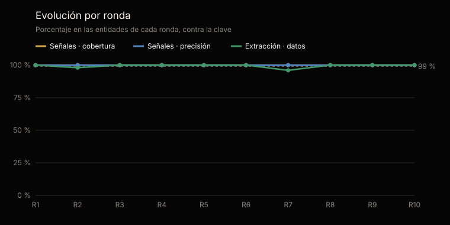
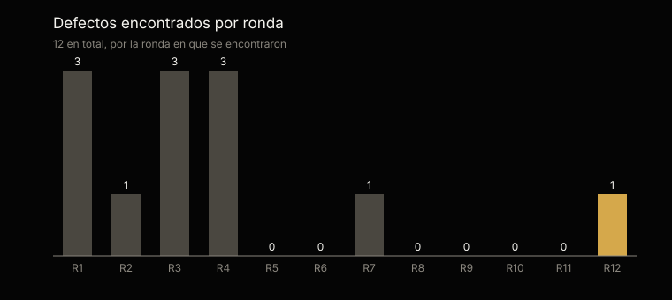

# Análisis estadístico de las pruebas · familia CFO

Generado por `scripts/analisis_familias.py` desde `tests/evidencias/familias/cfo/` · ronda más reciente: 3 · [English](ANALISIS.md)

No se edita a mano: cada cifra sale de la evidencia y el análisis se regenera con cada ronda.

## En una mirada

La ronda más reciente, la 3, parcial, sobre 4 de las 9 entidades del material: 40 de 40 señales sembradas encontradas (margen del 95 %: 91,2–100 %) y 0 de más; 33 de 33 datos extraídos bien (100 %, margen del 95 %: 89,5–100 %); y 1 de 1 entidades de control sin ninguna señal.

Sumando las rondas 1–3, 98 de 98 señales encontradas, 0 de más y 97 de 98 datos bien. Las rondas repiten el mismo material: no son muestras independientes, y el margen se calcula sobre los casos de cada una.

## Qué se probó y cómo

Cada entidad corre todos los comandos de los dos agentes, con un tope de tokens fijado antes de empezar, sobre un material que trae su clave aparte: el agente nunca la ve. Las señales se comparan por su nombre y su clave; la extracción, campo por campo, contra lo que traen los documentos escritos. Las entidades de control no tienen ningún defecto sembrado: cualquier señal en ellas es una falla.

Cobertura: de las señales sembradas, cuántas encontró. Precisión: de las que levantó, cuántas eran correctas. Margen del 95 %: intervalo de confianza de Wilson sobre los casos.

|   |   |
|---|---|
| Rondas | 3; la más reciente, la 3, es parcial |
| Material | Banca · Colombia, Banca · Perú, Minería · Perú |
| Entidades de control | Control · Perú |
| Corridas de una entidad | 12 |
| Señales sembradas | 98 |
| Datos calificados | 98 |

## Resultados acumulados · rondas 1–3

| Métrica | Casos | Resultado | Margen del 95 % |
|---|---|---|---|
| Señales · cobertura | 98 de 98 | 100 % | 96,2–100 % |
| Señales · precisión | 98 de 98 | 100 % | 96,2–100 % |
| Extracción · datos correctos | 97 de 98 | 99 % | 94,4–99,9 % |
| Control · sin ninguna señal | 4 de 4 | 100 % | 51–100 % |

## Evolución por ronda

Una ronda que no corre todas las entidades es parcial: la primera, pequeña, antes de la completa, o una de verificación, que repite las corridas que un defecto corregido dejó pendientes.

| Ronda | Entidades | Señales · cobertura | Señales · precisión | Extracción | Control sin señales | Tokens | Defectos |
|---|---|---|---|---|---|---|---|
| 1 | 2 | 100 % | 100 % | 100 % | 1 de 1 | 17,3 M | 3 |
| 2 | 6 | 100 % | 100 % | 98 % | 2 de 2 | 53 M | 1 |
| 3 | 4 | 100 % | 100 % | 100 % | 1 de 1 | 17,2 M | 3 |

## La ronda más reciente · ronda 3

| Métrica | Casos | Resultado | Margen del 95 % |
|---|---|---|---|
| Señales · cobertura | 40 de 40 | 100 % | 91,2–100 % |
| Señales · precisión | 40 de 40 | 100 % | 91,2–100 % |
| Extracción · datos correctos | 33 de 33 | 100 % | 89,5–100 % |
| Control · sin ninguna señal | 1 de 1 | 100 % | 20,6–100 % |

## Por industria y país · ronda 3

| Material | Agentes | Señales | De más | Extracción | Tokens |
|---|---|---|---|---|---|
| Banca · Colombia | aurea, Clara, Tomás | 16 de 16 | 0 | 8 de 8 | 3,8 M |
| Banca · Perú | aurea, Clara, Tomás | 12 de 12 | 0 | 8 de 8 | 4,8 M |
| Minería · Perú | aurea, Clara, Tomás | 12 de 12 | 0 | 9 de 9 | 4,7 M |
| Control · Perú | aurea, Clara, Tomás | 0 de 0 | 0 | 8 de 8 | 3,9 M |

## Lo que falló, uno por uno · rondas 1–3

1 falla en 12 corridas, cada una con el defecto que la explica: su origen dice si falló el agente o la prueba. Las cifras son las de la calificación original: 1 de esas fallas vino de la prueba —el arnés o la clave—, no del agente, y con la prueba corregida se califican como correctas.

| Ronda | Material | Qué | Dónde | Defecto | Origen |
|---|---|---|---|---|---|
| 2 | Minería · Ecuador | Dato calificado como mal | presupuesto · committee_commitments | CFO-4 | Arnés de pruebas |

## Defectos

7 defectos registrados, cada uno con su origen, su corrección y la corrida que la verificó: 7 verificados y 0 por verificar. 3 vinieron del material, la clave o el arnés de pruebas, no de los agentes.

| Origen | Defectos |
|---|---|
| Instrucciones del agente | 3 |
| Arnés de pruebas | 2 |
| Código | 1 |
| Material de prueba | 1 |

| Agente | Defectos |
|---|---|
| Tomás | 5 |
| Ninguno | 1 |
| Clara | 1 |
| aurea | 1 |

## Consumo y próximo paso

Las 3 rondas usaron 92,8 millones de tokens: 87,5 millones en las corridas calificadas y 5,3 en las que se repitieron después de corregir un defecto. En promedio, 7,3 millones por entidad.

El material es sintético. El próximo paso es el despliegue en una organización, con su propia documentación.

---

La evidencia completa de cada ronda: [`tests/evidencias/familias/cfo/`](https://github.com/josenanez/criterio/tree/main/tests/evidencias/familias/cfo).
