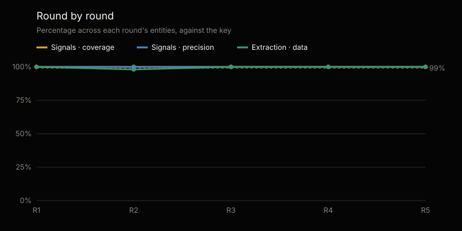
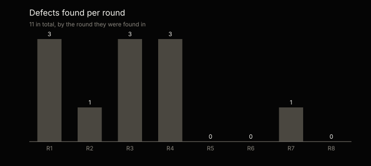

# Statistical analysis of the tests · CFO family

Generated by `scripts/analisis_familias.py` from `tests/evidencias/familias/cfo/` · most recent round: 6 · [Español](ANALISIS.es.md)

Not edited by hand: every figure comes from the evidence and the analysis is regenerated with every round.

## At a glance

The most recent round, round 6, partial, on 3 of the material's 15 entities: 27 of 27 seeded signals found (95% margin: 87.5–100%) and 0 extra; 24 of 24 data items extracted right (100%, 95% margin: 86.2–100%); and 1 of 1 control entities with no signal at all.

Across rounds 1–6, 231 of 231 signals found, 0 extra and 219 of 220 data items right. The rounds repeat the same material: they are not independent samples, and the margin is computed over each round's cases.

## What was tested and how

Each entity runs every command of the two agents, with a token cap set before starting, on material whose key is kept apart: the agent never sees it. Signals are compared by name and key; extraction, field by field, against what the written documents say. Control entities carry no seeded defect: any signal in them is a failure.

Coverage: of the seeded signals, how many were found. Precision: of those raised, how many were right. 95% margin: Wilson confidence interval over the cases.

|   |   |
|---|---|
| Rounds | 6; the most recent, round 6, is partial |
| Material | Banking · Mexico, Retail · Mexico |
| Control entities | Control · Mexico |
| Entity runs | 27 |
| Seeded signals | 231 |
| Data items graded | 220 |

## Cumulative results · rounds 1–6

| Measure | Cases | Result | 95% margin |
|---|---|---|---|
| Signals · coverage | 231 of 231 | 100% | 98.3–100% |
| Signals · precision | 231 of 231 | 100% | 98.3–100% |
| Extraction · data right | 219 of 220 | 99.5% | 97.4–100% |
| Control · with no signal | 9 of 9 | 100% | 70–100% |

## Round by round

A round that does not run every entity is partial: the first, small one, before the complete one, or a verification round, which repeats the runs a fixed defect left pending.

| Round | Entities | Signals · coverage | Signals · precision | Extraction | Control with no signal | Tokens | Defects |
|---|---|---|---|---|---|---|---|
| 1 | 2 | 100% | 100% | 100% | 1 of 1 | 17.3 M | 3 |
| 2 | 6 | 100% | 100% | 98% | 2 of 2 | 53 M | 1 |
| 3 | 4 | 100% | 100% | 100% | 1 of 1 | 17.2 M | 3 |
| 4 | 9 | 100% | 100% | 100% | 3 of 3 | 38 M | 3 |
| 5 | 3 | 100% | 100% | 100% | 1 of 1 | 12.7 M | 0 |
| 6 | 3 | 100% | 100% | 100% | 1 of 1 | 13.2 M | 0 |

## The most recent round · round 6

| Measure | Cases | Result | 95% margin |
|---|---|---|---|
| Signals · coverage | 27 of 27 | 100% | 87.5–100% |
| Signals · precision | 27 of 27 | 100% | 87.5–100% |
| Extraction · data right | 24 of 24 | 100% | 86.2–100% |
| Control · with no signal | 1 of 1 | 100% | 20.6–100% |

## By industry and country · round 6

| Material | Agents | Signals | Extra | Extraction | Tokens |
|---|---|---|---|---|---|
| Banking · Mexico | aurea, Clara, Tomás | 16 of 16 | 0 | 8 of 8 | 4.3 M |
| Retail · Mexico | aurea, Clara, Tomás | 11 of 11 | 0 | 8 of 8 | 4.5 M |
| Control · Mexico | aurea, Clara, Tomás | 0 of 0 | 0 | 8 of 8 | 4.4 M |

## What failed, one by one · rounds 1–6

1 failure in 27 runs, each with the defect that explains it: its origin says whether the agent or the test failed. The figures are those of the original grading: 1 of those failures came from the test —the harness or the key—, not from the agent, and with the test fixed they grade as right.

| Round | Material | What | Where | Defect | Origin |
|---|---|---|---|---|---|
| 2 | Mining · Ecuador | Data item graded wrong | presupuesto · committee_commitments | CFO-4 | Test harness |

## Defects

10 defects logged, each with its origin, its fix and the run that verified it: 10 verified and 0 to verify. 5 came from the material, the key or the test harness, not from the agents.

| Origin | Defects |
|---|---|
| Agent instructions | 4 |
| Test material | 3 |
| Test harness | 2 |
| Code | 1 |

| Agent | Defects |
|---|---|
| Tomás | 5 |
| Clara | 3 |
| aurea | 2 |
| None | 1 |

## Cost and next step

The 6 rounds used 162.1 million tokens: 151.4 million in the graded runs and 10.7 in the ones repeated after fixing a defect. On average, 5.6 million per entity.

The material is synthetic. The next step is deployment in an organisation, with its own documentation.

---

The full evidence of every round: [`tests/evidencias/familias/cfo/`](https://github.com/josenanez/criterio/tree/main/tests/evidencias/familias/cfo).
