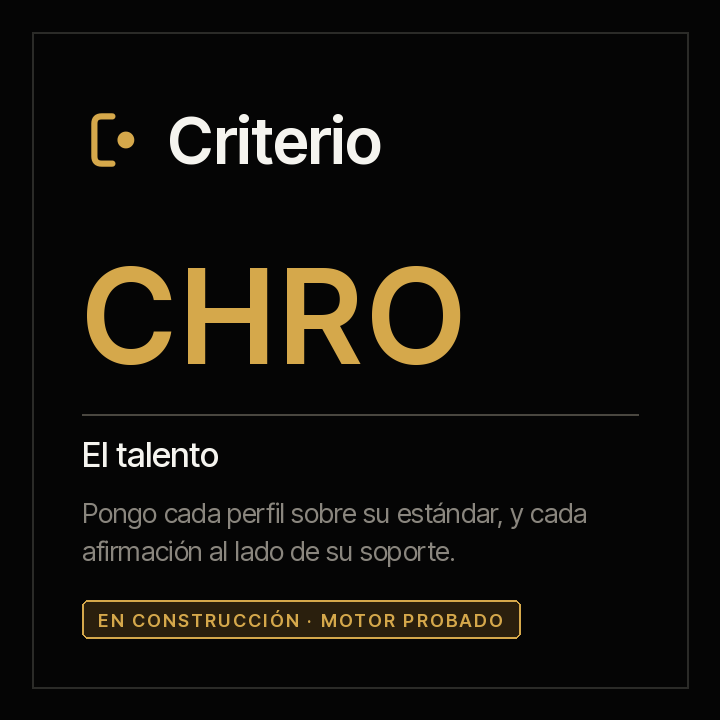

<picture><source media="(prefers-color-scheme: dark)" srcset="../../docs/img/marca/es/criterio-chro-oscuro.svg"></picture>

# criterio-chro · la familia del talento

**Dos agentes y un portal, alrededor de sus fichas.** Cada uno extiende a una persona distinta de la
gestión humana —quien responde por los perfiles de cargo y quien responde por la selección— y comparten
la carpeta y la referencia de la entidad: cada uno escribe solo su ficha.

[English](README.md) · [← Criterio](../../README.es.md) · Apache 2.0



| | |
|---|---|
| **Alcance** | Los perfiles de cargo de una entidad contra la ocupación de su estándar —la CUOC del DANE u O*NET—, contra lo que la ley de datos del país y la política no permiten pedir y entre sí; cada hoja de vida contra sus soportes, cada candidato contra el perfil, la autorización y la conservación de sus datos, y cada vacante contra su plazo |
| **Objetivo** | Que cada perfil se apoye en un estándar y en sus tareas, y que cada candidato se mire contra el perfil con la evidencia que trae, sin que su nombre, su fotografía o su edad entren al análisis |
| **Compuesta por** | [Norma](../../plugins/criterio-roles/README.es.md) · [Cándido](../../plugins/criterio-talent/README.es.md) · [Rostrum](../../plugins/criterio-server/README.es.md) |
| **El soporte** | Los estándares de ocupaciones, la regulación de la inteligencia artificial en el empleo, la ley de datos de cada país y lo que cuesta hoy a una organización, con su fuente, su año y su muestra: [`FUENTES.es.md`](FUENTES.es.md) |
| **Estado** | Construida, en su versión 0.2.0, de laboratorio: el motor probado sobre todo el material, con su clave, sus entidades de control y la prueba de sesgo con pares de candidatos; con los agentes, las cinco entidades de prueba, en Colombia, México, Chile y Perú. **Todavía no se ha probado sobre la documentación de una organización concreta** |
| **Enfoque** | Documentos y exportaciones, nunca sistemas ni redes: ningún agente se conecta a un ATS ni busca personas fuera de lo que la organización entrega |
| **Compromiso** | Generar, difundir y conservar el conocimiento es una obligación profesional |
| **Qué no es** | No reemplaza a quien selecciona ni decide por nadie: no aprueba perfiles, no rechaza, no descarta, no da puntajes y no ordena candidatos |
| **Licencia** | [Apache 2.0](../../LICENSE) |
| **Qué viene** | La ronda con los dos agentes sobre el resto del material: [la hoja de ruta](#hoja-de-ruta) |

---

## Qué hace la familia

Esta familia es distinta de las demás en un punto que manda sobre todo el diseño: **procesa datos de
personas para decidir sobre personas**. En la Unión Europea, un sistema de inteligencia artificial que
filtra solicitudes o evalúa candidatos es de alto riesgo (Reglamento (UE) 2024/1689, anexo III, punto 4,
F-04), y la ley de datos personales de cada país protege los datos sensibles y, en varios, el derecho a no
quedar sujeto a una decisión solo automatizada (F-10 a F-17). Por eso **ninguna decisión sobre una persona
la toma un agente**, y eso se prueba: dos candidatos iguales salvo en un dato protegido tienen que dar
exactamente lo mismo.

- **Norma** pone cada perfil de cargo al lado de la ocupación de su estándar y de sus tareas, y dice qué
  pide que no se puede pedir.
- **Cándido** pone cada afirmación de la hoja de vida al lado de su soporte y cada candidato al lado del
  perfil, requisito por requisito, en el orden de su identificador.

## Lo que sigue siendo de las personas

Aprobar un perfil, decidir quién sigue en un proceso, contactar a alguien, conservar o suprimir los datos de
un candidato y responderle. Los agentes dicen qué falta y dónde; la decisión es siempre de una persona.

## La estructura de carpetas recomendada

<!-- chro:carpetas · generado por scripts/familias.py; no se edita a mano -->
Una carpeta por entidad, con su identificación fiscal al inicio del nombre. Dentro, la política de selección y el estándar de ocupaciones, los perfiles de cargo, el registro de vacantes, una carpeta por candidato con su hoja de vida y sus soportes, las autorizaciones de tratamiento de datos y las exportaciones del ATS. Nunca la fotografía, la edad ni la salud de un candidato como requisito: el motor las excluye.

```
talento/
└── <entidad>/
    ├── 00-referencia/
    ├── 10-perfiles/
    ├── 20-vacantes/
    ├── 30-candidatos/
    ├── 40-autorizaciones/
    └── 50-ats/
estado-talento/
```

**`<entidad>/`** · Lo que la organización lleva para su selección y sus perfiles de cargo

| Carpeta | Qué va | Agente |
|---|---|---|
| `00-referencia/` | La política de selección —el plazo de cobertura de una vacante, la conservación de los datos, quién aprueba— y la descarga oficial del estándar de ocupaciones: el Excel de los perfiles ocupacionales de la CUOC del DANE o la carpeta de O*NET | Norma, Cándido |
| `10-perfiles/` | Los perfiles de cargo y el manual de funciones, uno por cargo, con su código o su nombre en el archivo | Norma |
| `20-vacantes/` | El registro de vacantes: cada una con su perfil, su fecha de apertura y la de su cierre | Cándido |
| `30-candidatos/` | Una carpeta por vacante y, dentro, una por candidato con su identificador: la hoja de vida y sus soportes —diplomas, actas de grado, certificaciones y certificados laborales— | Cándido |
| `40-autorizaciones/` | El registro de autorizaciones de tratamiento de datos de los candidatos, con su fecha | Cándido |
| `50-ats/` | La exportación del sistema de selección (ATS) —cada candidato con su vacante, su postulación y su etapa— y la base de talento interna | Cándido |

**`estado-talento/`** · Lo que escriben Norma y Cándido: la configuración, la ficha de cada periodo, los informes y los índices. Ninguna persona lo edita, y ningún agente escribe fuera de aquí.
<!-- /chro:carpetas -->

Un archivo sin el formato esperado no se adivina: se reporta con lo que le falta.

## Instalación de la familia

Necesita Claude Code 2.1.110 o posterior; si algo falla, [la instalación paso a paso](../../docs/instalacion.es.md).

**La familia se instala de una vez.** El plugin `criterio-chro` trae a sus agentes y a Rostrum, y
`/criterio-chro:chro-setup` los configura en orden, en una sola conversación: lo que ya se respondió
no se vuelve a preguntar.

```
/plugin marketplace add josenanez/criterio
/plugin install criterio-chro@criterio
/criterio-chro:chro-setup
```

Después, a cada agente se le pide en tus palabras, sin saber cómo se llama cada comando: `/criterio-roles:norma`
y `/criterio-talent:candido` ([decisión 0027](../../docs/decisions/0027-cada-agente-se-pide-en-palabras.md)).

## De qué responde cada agente, y dónde está su detalle

<!-- chro:familia-agentes · generado por scripts/familias.py; no se edita a mano -->
| | De qué responde | Lo que nunca hace | Su página | Sus pruebas |
|---|---|---|---|---|
| **Norma** · los perfiles de cargo | Cada perfil de cargo contra la ocupación de su estándar —la CUOC del DANE u O*NET—: las destrezas y los conocimientos que no recoge, los requisitos sin tarea, lo que la ley del país y la política no permiten pedir, el nivel de estudios contra el nivel de competencia, los perfiles que se solapan y los que pasaron su revisión | No aprueba un perfil, no fija un salario ni un cargo, no evalúa a una persona y no copia el texto de una norma de pago | [criterio-roles](../../plugins/criterio-roles/README.es.md) · 9 comandos, 3 skills | [resultados](../../tests/criterio-roles/RESULTADOS.md) |
| **Cándido** · la selección | Cada hoja de vida contra sus soportes y cada candidato contra el perfil, requisito por requisito y con la cita; la autorización y la conservación de sus datos; cada vacante contra su plazo, y la búsqueda que corre quien recluta | No rechaza, no descarta, no da un puntaje ni ordena candidatos por un número; no usa la fotografía, la edad, el sexo, el origen ni la salud de nadie; no entra a redes ni busca personas fuera de lo que la organización entrega | [criterio-talent](../../plugins/criterio-talent/README.es.md) · 10 comandos, 3 skills | [resultados](../../tests/criterio-talent/RESULTADOS.md) |
| **Rostrum** · el portal | Publicar lo que escriben los agentes donde el equipo lo vea, y recibir la pregunta de quien no abre una carpeta | **No escribe en el estado ni recalcula nada**, y no decide nada | [criterio-server](../../plugins/criterio-server/README.es.md) · 3 comandos, uno para todas las familias | [resultados](../../tests/criterio-server/RESULTADOS.md) |
<!-- /chro:familia-agentes -->

## Cómo se configura y cada cuánto corre cada uno

<!-- chro:configuracion · generado por scripts/familias.py; no se edita a mano -->
| | Norma | Cándido |
|---|---|---|
| **Se instala** | `criterio-roles` | `criterio-talent` |
| **Instancias** | Una por entidad | Una por entidad |
| **Se configura con** | `/criterio-roles:roles-setup` | `/criterio-talent:talent-setup` |
| **Cuánto tarda eso** | Quince minutos | Quince minutos |
| **Qué le tienes que decir** | Entidad y su identificación fiscal, país, el periodo, el estándar de ocupaciones —la CUOC o O*NET— y dónde está su descarga oficial en `00-referencia/`, con O*NET el umbral de importancia, la equivalencia de los niveles de estudio de la organización con la CINE, cada cuántos meses se revisa un perfil y lo que la política prohíbe pedir | Entidad y su identificación fiscal, país, el periodo, el plazo de cobertura de una vacante y los días de conservación de los datos de la política de selección, el registro de vacantes de `20-vacantes/`, el de autorizaciones de `40-autorizaciones/` y la exportación del ATS de `50-ats/` con sus columnas |
| **Dónde queda** | `.criterio/perfiles/<entidad>/config.json`, escrito por el comando | `.criterio/seleccion/<entidad>/config.json`, escrito por el comando |
| **El que se le pone a un reloj** | `/criterio-roles:roles-wake` | `/criterio-talent:talent-wake` |
| **Qué toca cada día** | Decide si toca procesar perfiles nuevos o un reporte con señales abiertas; si no toca nada, se calla | Decide si tocan hojas de vida nuevas, una vacante que vence o un reporte con señales abiertas; si no toca nada, se calla |
| **Qué lo despierta además del reloj** | Una pregunta que alguien dejó en Rostrum | Una pregunta que alguien dejó en Rostrum |
<!-- /chro:configuracion -->

**Nadie edita un archivo de configuración a mano.** Se dice en la conversación y el comando lo reescribe.
El plazo de cobertura, la conservación de los datos y lo que no se puede pedir salen de la política de
selección de la organización; el estándar es el que ella elige.

## Las pruebas de la familia

**Una sola puerta corre todo lo que este repositorio comprueba**, de todas las familias a la vez:

```
python3 scripts/verificar.py
```

Lo propio de la CHRO está en [`tests/criterio-chro/`](../../tests/criterio-chro/): material sintético con
una clave que el motor no ve, dos entidades de control, donde cualquier señal es una falla, y los pares de
la prueba de sesgo. **Una señal de más cuenta igual que una de menos**, y un par que no da lo mismo bloquea
la versión. Qué se siembra y qué no prueba el material, en [`EVIDENCIA.md`](../../tests/criterio-chro/EVIDENCIA.md).

## Hoja de ruta

<!-- hoja de ruta: generado por scripts/hoja.py desde hoja-de-ruta.json; no se edita a mano -->
<!-- /hoja de ruta -->

## Los skills de la familia

<!-- chro:skills-familia · generado por scripts/familias.py; no se edita a mano -->
Cinco skills distintos entre los dos agentes. **Los que comparten son copias literales, no un módulo importado**: un plugin instalado tiene que correr solo. `scripts/sincronizar.py` las copia y `scripts/sincronizar.py --check` falla si se separan.

| Skill | Norma | Cándido |
|---|:--:|:--:|
| `cv-record` | · | ● |
| `occupation-standard` | ● | · |
| `profile-record` | ● | · |
| `selection-policy` | · | ● |
| `talent-intake` | ● | ● |
<!-- /chro:skills-familia -->

## Estado

<!-- chro:estado · generado por scripts/familias.py; no se edita a mano -->
| Agente | Se instala | Su prueba |
|---|---|---|
| **Norma** · Los perfiles de cargo | `criterio-roles` · 9 comandos, 3 skills | El motor, probado; con el agente, todas las entidades del material, hasta la ronda 3 · [resultados](../../tests/criterio-roles/RESULTADOS.md) |
| **Cándido** · La selección | `criterio-talent` · 10 comandos, 3 skills | El motor, probado; con el agente, todas las entidades del material, hasta la ronda 3 · [resultados](../../tests/criterio-talent/RESULTADOS.md) |
| **Rostrum** · el portal | `criterio-server` · 3 comandos, para todas las familias | — |

Las pruebas usan material sintético construido sobre información real de empresas, anonimizada antes de procesarse: ningún nombre, identificación, cifra ni dato personal que permita reconocer a una empresa o a una persona se conserva ni se publica. Lo que se publica de cada prueba son sus resultados, sin datos.
<!-- /chro:estado -->
