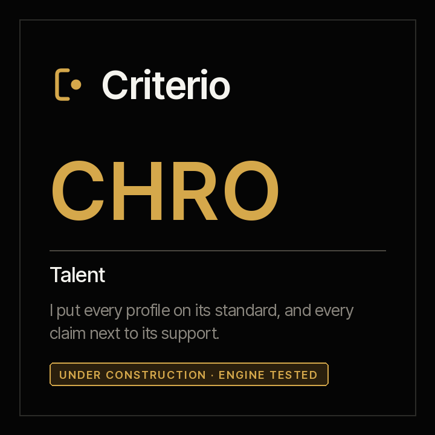

<picture><source media="(prefers-color-scheme: dark)" srcset="../../docs/img/marca/en/criterio-chro-oscuro.svg"></picture>

# criterio-chro · the talent family

**Two agents and a portal, around their records.** Each one extends a different person in people
management —whoever answers for job profiles and whoever answers for selection— and they share the
entity's folder and reference: each writes only its own record.

[Español](README.es.md) · [← Criterio](../../README.md) · Apache 2.0



| | |
|---|---|
| **Scope** | An entity's job profiles against the occupation in their standard —DANE's CUOC or O*NET—, against what the country's data law and the policy do not allow asking for, and against each other; every CV against its supporting documents, every candidate against the profile, the authorisation and retention of their data, and every vacancy against its deadline |
| **Goal** | That every profile rests on a standard and on its tasks, and that every candidate is looked at against the profile with the evidence they bring, without their name, photograph or age entering the analysis |
| **Made up of** | [Norma](../../plugins/criterio-roles/README.md) · [Cándido](../../plugins/criterio-talent/README.md) · [Rostrum](../../plugins/criterio-server/README.md) |
| **The backing** | The occupational standards, the regulation of AI in employment, each country's data law and what it costs an organisation today, with its source, year and sample: [`FUENTES.es.md`](FUENTES.es.md) |
| **Status** | Built, at its version 0.1.0, in the lab: the engine tested on all the material, with its key, its control entities and the bias test with candidate pairs; with the agents, the Colombian bank and its control, with no false alarm in the control. **The rest of the material does not run with the agents yet** |
| **Approach** | Documents and exports, never systems or networks: no agent connects to an ATS or looks for people beyond what the organisation provides |
| **Commitment** | Creating, sharing and preserving knowledge is a professional duty |
| **What it is not** | It does not replace the person selecting or decide for anyone: it approves no profiles and rejects, discards, scores or ranks no candidates |
| **License** | [Apache 2.0](../../LICENSE) |
| **What comes next** | The round with the two agents on the rest of the material: [the roadmap](#roadmap) |

---

## What the family does

This family differs from the others in one point that governs the whole design: **it processes data about
people to decide about people**. In the European Union, an AI system that filters applications or
evaluates candidates is high-risk (Regulation (EU) 2024/1689, Annex III, point 4, F-04), and each country's
personal data law protects sensitive data and, in several, the right not to be subject to a solely automated
decision (F-10 to F-17). That is why **no decision about a person is taken by an agent**, and it is tested:
two candidates identical except for one protected attribute must give exactly the same result.

- **Norma** puts every job profile next to the occupation in its standard and its tasks, and says what it
  asks for that cannot be asked for.
- **Cándido** puts every claim in the CV next to its supporting document and every candidate next to the
  profile, requirement by requirement, in identifier order.

## What remains with people

Approving a profile, deciding who moves on in a process, contacting someone, keeping or deleting a
candidate's data and answering them. The agents say what is missing and where; the decision is always a
person's.

## The recommended folder structure

<!-- chro:carpetas · generado por scripts/familias.py; no se edita a mano -->
One folder per entity, with its tax id at the start of the name. Inside it, the selection policy and the occupational standard, the job profiles, the vacancy register, one folder per candidate with their CV and supporting documents, the data-processing authorisations and the ATS exports. Never a candidate's photograph, age or health as a requirement: the engine excludes them.

```
talento/
└── <entidad>/
    ├── 00-referencia/
    ├── 10-perfiles/
    ├── 20-vacantes/
    ├── 30-candidatos/
    ├── 40-autorizaciones/
    └── 50-ats/
estado-talento/
```

**`<entidad>/`** · What the organisation keeps for its selection and its job profiles

| Folder | What goes in | Agent |
|---|---|---|
| `00-referencia/` | The selection policy —the time to fill a vacancy, how long data is kept, who approves— and the official download of the occupational standard: the DANE CUOC occupational profiles workbook or the O*NET folder | Norma, Cándido |
| `10-perfiles/` | The job profiles and the duties manual, one per role, with its code or name in the file | Norma |
| `20-vacantes/` | The vacancy register: each one with its profile, its opening date and its closing date | Cándido |
| `30-candidatos/` | One folder per vacancy and, inside it, one per candidate with their identifier: the CV and its supporting documents —diplomas, degree certificates, certifications and employment certificates— | Cándido |
| `40-autorizaciones/` | The register of candidates' data-processing authorisations, with their date | Cándido |
| `50-ats/` | The export of the applicant tracking system (ATS) —each candidate with their vacancy, application and stage— and the internal talent base | Cándido |

**`estado-talento/`** · What Norma and Cándido write: the configuration, each period's record, the reports and the indexes. No person edits it, and no agent writes anywhere else.
<!-- /chro:carpetas -->

A file without the expected format is not guessed at: it is reported with what it lacks.

## Installing the family

It needs Claude Code 2.1.110 or later; if something fails, [step-by-step installation](../../docs/instalacion.md).

**The family installs in one go.** The `criterio-chro` plugin brings its agents and Rostrum, and
`/criterio-chro:chro-setup` configures them in order, in a single conversation: what has been answered is
not asked again.

```
/plugin marketplace add josenanez/criterio
/plugin install criterio-chro@criterio
/criterio-chro:chro-setup
```

Then each agent is asked in your own words, without knowing each command's name: `/criterio-roles:norma`
and `/criterio-talent:candido` ([decision 0027](../../docs/decisions/0027-cada-agente-se-pide-en-palabras.md)).

## What each agent answers for, and where its detail is

<!-- chro:familia-agentes · generado por scripts/familias.py; no se edita a mano -->
| | What it answers for | What it never does | Its page | Its tests |
|---|---|---|---|---|
| **Norma** · job profiles | Every job profile against the occupation in its standard —DANE's CUOC or O*NET—: the skills and knowledge it leaves out, the requirements with no task, what the country's law and the policy do not allow asking for, the level of education against the skill level, the profiles that overlap and the ones past their review | It does not approve a profile, set a salary or a position, assess a person or copy the text of a paid standard | [criterio-roles](../../plugins/criterio-roles/README.md) · 9 commands, 3 skills | [results](../../tests/criterio-roles/RESULTADOS.md) |
| **Cándido** · selection | Every CV against its supporting documents and every candidate against the profile, requirement by requirement and with its citation; the authorisation and retention of their data; every vacancy against its deadline, and the search the recruiter runs | It does not reject, discard, score or rank candidates by a number; it does not use anyone's photograph, age, sex, origin or health; it does not go into networks or look for people beyond what the organisation provides | [criterio-talent](../../plugins/criterio-talent/README.md) · 10 commands, 3 skills | [results](../../tests/criterio-talent/RESULTADOS.md) |
| **Rostrum** · the portal | Publishing what the agents write where the team will see it, and taking the question from whoever will not open a folder | **Never writes the state or recalculates anything**, and decides nothing | [criterio-server](../../plugins/criterio-server/README.md) · 3 commands, one for every family | [results](../../tests/criterio-server/RESULTADOS.md) |
<!-- /chro:familia-agentes -->

## How each one is configured and how often it runs

<!-- chro:configuracion · generado por scripts/familias.py; no se edita a mano -->
| | Norma | Cándido |
|---|---|---|
| **Installs as** | `criterio-roles` | `criterio-talent` |
| **Instances** | One per entity | One per entity |
| **Configured with** | `/criterio-roles:roles-setup` | `/criterio-talent:talent-setup` |
| **How long that takes** | Fifteen minutes | Fifteen minutes |
| **What you have to tell it** | Entity and its tax ID, country, the period, the occupational standard —CUOC or O*NET— and where its official download is in `00-referencia/`, with O*NET the importance threshold, how the organisation's levels of education map to ISCED, how often a profile is reviewed and what the policy forbids asking for | Entity and its tax ID, country, the period, the time to fill a vacancy and the days data is kept under the selection policy, the vacancy register in `20-vacantes/`, the authorisation register in `40-autorizaciones/` and the ATS export in `50-ats/` with its columns |
| **Where it lands** | `.criterio/perfiles/<entity>/config.json`, written by the command | `.criterio/seleccion/<entity>/config.json`, written by the command |
| **The one you put on a clock** | `/criterio-roles:roles-wake` | `/criterio-talent:talent-wake` |
| **What it does each day** | Decides whether new profiles or a report with open signals are due; if nothing is due, it stays quiet | Decides whether new CVs, a vacancy falling due or a report with open signals are due; if nothing is due, it stays quiet |
| **What wakes it besides the clock** | A question somebody left in Rostrum | A question somebody left in Rostrum |
<!-- /chro:configuracion -->

**Nobody edits a configuration file by hand.** It is said in the conversation and the command rewrites it.
The time to fill, data retention and what cannot be asked for come from the organisation's selection policy;
the standard is the one it chooses.

## The family's tests

**A single gate runs everything this repository checks**, for every family at once:

```
python3 scripts/verificar.py
```

What belongs to the CHRO is in [`tests/criterio-chro/`](../../tests/criterio-chro/): synthetic material with
a key the engine never sees, two control entities, where any signal is a failure, and the bias-test pairs.
**One signal too many counts the same as one too few**, and a pair that does not give the same result
blocks the version. What is planted and what the material does not test, in [`EVIDENCIA.md`](../../tests/criterio-chro/EVIDENCIA.md).

## Roadmap

<!-- hoja de ruta: generado por scripts/hoja.py desde hoja-de-ruta.json; no se edita a mano -->
<!-- /hoja de ruta -->

## The family's skills

<!-- chro:skills-familia · generado por scripts/familias.py; no se edita a mano -->
Five distinct skills across the two agents. **The ones they share are literal copies, not an imported module**: an installed plugin has to run on its own. `scripts/sincronizar.py` copies them and `scripts/sincronizar.py --check` fails if they drift.

| Skill | Norma | Cándido |
|---|:--:|:--:|
| `cv-record` | · | ● |
| `occupation-standard` | ● | · |
| `profile-record` | ● | · |
| `selection-policy` | · | ● |
| `talent-intake` | ● | ● |
<!-- /chro:skills-familia -->

## Status

<!-- chro:estado · generado por scripts/familias.py; no se edita a mano -->
| Agent | Installs as | Its test |
|---|---|---|
| **Norma** · Job profiles | `criterio-roles` · 9 commands, 3 skills | The engine, tested; a first round with the agent; the full one, pending · [results](../../tests/criterio-roles/RESULTADOS.md) |
| **Cándido** · Selection | `criterio-talent` · 10 commands, 3 skills | The engine, tested; a first round with the agent; the full one, pending · [results](../../tests/criterio-talent/RESULTADOS.md) |
| **Rostrum** · the portal | `criterio-server` · 3 commands, for every family | — |

Tests use synthetic material built on real company information, anonymised before processing: no name, identifier, figure or personal data that could identify a company or a person is kept or published. What is published from each test is its results, without data.
<!-- /chro:estado -->
