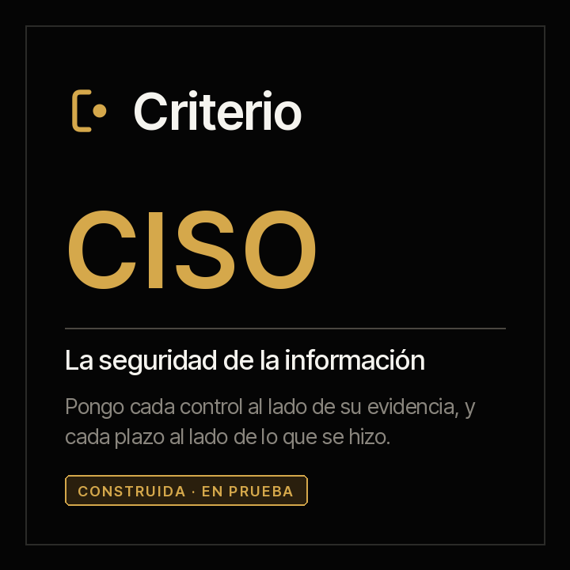

<picture><source media="(prefers-color-scheme: dark)" srcset="../../docs/img/marca/es/criterio-ciso-oscuro.svg"></picture>

# criterio-ciso · la familia de la seguridad de la información

**Tres agentes y un portal, alrededor de sus fichas.** Cada uno extiende a una persona distinta de
la seguridad de la información —quien responde por los controles, quien responde por las
vulnerabilidades y quien responde por la respuesta a incidentes y la continuidad— y ninguno habla con
los otros directamente: comparten la carpeta y la referencia de la entidad, y cada uno escribe solo lo
suyo.

[English](README.md) · [← Criterio](../../README.es.md) · Apache 2.0



| | |
|---|---|
| **Alcance** | La seguridad de la información de una entidad: la declaración de aplicabilidad contra la evidencia de cada control, las revisiones de acceso, los terceros críticos y las aceptaciones de riesgo; cada vulnerabilidad contra su plazo, el catálogo KEV y la cobertura de los escaneos; cada incidente contra sus plazos y sus notificaciones, y las pruebas de continuidad contra su calendario |
| **Objetivo** | Que lo que la organización se comprometió a hacer en su política —revisar, corregir, notificar, probar— tenga detrás los documentos que muestran que lo hizo, y a tiempo |
| **Compuesta por** | [Alexis](../../plugins/criterio-security/README.es.md) · [Guillermo](../../plugins/criterio-vulnerability/README.es.md) · [Amparo](../../plugins/criterio-resilience/README.es.md) · [Rostrum](../../plugins/criterio-server/README.es.md) |
| **El soporte** | Los marcos internacionales que ordenan la familia, el formato de cada archivo que procesa el motor y lo que cuesta hoy a una organización, con su fuente, su año y su muestra: [`FUENTES.es.md`](FUENTES.es.md) |
| **Estado** | De laboratorio, sin lanzar (0.2.0): el motor probado sobre material sintético de banca, retail, salud y tecnología, y la primera ronda con los tres agentes sobre las seis entidades, 100 de 100 señales y ninguna de más; los datos extraídos son todavía pocos para un piso del 95 %. **No se ha probado todavía sobre la documentación de una organización concreta** |
| **Enfoque** | Documentos y exportaciones, nunca sistemas: ningún agente corre un escaneo ni se conecta a una consola |
| **Compromiso** | Generar, difundir y conservar el conocimiento es una obligación profesional |
| **Qué no es** | No reemplaza al responsable de seguridad ni a su equipo, y no decide por ellos: no acepta riesgos, no declara cumplido un control, no aprueba excepciones, no notifica a nadie, no califica la madurez y no certifica contra ninguna norma |
| **Licencia** | [Apache 2.0](../../LICENSE) |
| **Qué viene** | La ronda completa con los tres agentes, en la 0.2.0: [la hoja de ruta](#hoja-de-ruta) |

---

## Qué hace la familia

La seguridad de la información tiene tres trabajos recurrentes que hoy se hacen a mano contra
documentos, y por eso la familia tiene tres agentes. Se ordenan por las seis funciones del NIST
Cybersecurity Framework 2.0 —gobernar, identificar, proteger, detectar, responder y recuperar— (F-02).
Llevan nombre de persona porque **son capacidades extendidas de personas**, y el significado de cada
nombre apunta a lo que hace: **Alexis** —«el que defiende»— pone cada control al lado de la evidencia de
que operó; **Guillermo** —«protector decidido»— pone cada vulnerabilidad al lado de su plazo; **Amparo**
—«proteger»— pone cada incidente al lado de los plazos que se comprometieron.

**Alexis**, el del gobierno y los controles, contrasta la declaración de aplicabilidad con la evidencia:
cada control aplicable con su responsable y la evidencia de que operó en su periodicidad, la revisión de
accesos de cada sistema, la evaluación de cada tercero crítico y las aceptaciones de riesgo que pasaron
su fecha.

**Guillermo**, el de las vulnerabilidades, cruza cada hallazgo de las exportaciones del escáner con el
plazo de su severidad en la política, con el catálogo KEV de CISA de lo que se está explotando, con las
excepciones aprobadas y con el escaneo que prueba cada cierre; y dice qué activo del inventario ningún
escaneo cubre.

**Amparo**, la de la respuesta y la recuperación, pone la línea de tiempo de cada incidente al lado del
plazo de contención de su severidad, cada notificación que pide la matriz —al supervisor, a la autoridad
de datos, a los clientes— al lado de la que se hizo, la revisión posterior al lado de su plazo, y cada
prueba de continuidad, de recuperación y de restauración al lado de su calendario.

**El 31 %** de las brechas empezó por la explotación de una vulnerabilidad, y **solo el 26 %** de las
vulnerabilidades del catálogo KEV quedaron corregidas por completo en 2025. Las cifras, con su fuente,
su año y su muestra, en [`FUENTES.es.md`](FUENTES.es.md).

**Los plazos los fija la organización**, en su política, su matriz y sus registros. Lo único que viene
de una fuente externa es la fecha de corrección que trae el catálogo KEV y la escala de severidad del
CVSS cuando el escáner da el puntaje y no la severidad.

---

## Cómo operan los tres

El modelo de lenguaje (LLM) extrae; el código calcula; la decisión —aceptar un riesgo, aprobar una
excepción, notificar, declarar un incidente— la toma siempre una persona. **El motor procesa las tablas
directamente** —la declaración de aplicabilidad, la tabla de sistemas, el registro de terceros, el de
riesgos, el inventario de activos, cada exportación del escáner, el catálogo KEV, el seguimiento, las
excepciones, la matriz de notificaciones y el calendario de continuidad—, y el agente lleva a la ficha lo
que solo trae un documento escrito: la evidencia de un control, una revisión de accesos, la evaluación de
un tercero, la línea de tiempo de un incidente con sus notificaciones, su revisión y cada prueba.

**Lo que nunca se abre.** Credenciales, llaves y respaldos: el motor los excluye por omisión y cada
reporte dice cuáles excluyó. **Lo de vulnerabilidades no se publica** en Rostrum salvo que la
configuración lo diga: un informe de vulnerabilidades abiertas es un mapa para un atacante.

**Automatizados**: procesan los documentos, calculan las señales y preparan cada entregable sin
intervención. **Semiautomatizados** cuando falta un dato que ningún documento trae —un plazo que la
política no dice, qué columna del escáner trae cada dato—: entonces le preguntan a la persona, dicen qué
preguntaron y siguen con la respuesta.

## Los tres agentes y sus fichas

Nada se habla con nada directamente. **Cada agente escribe sus fichas, y la ficha es el contrato.**

| Ficha | Una por | Qué lleva | Quién la escribe |
|---|---|---|---|
| Ficha de los controles | Entidad y periodo | Cada evidencia de un control con la fecha que cubre, cada revisión de accesos y cada evaluación de un tercero | Alexis; la aceptación de un riesgo, quien la firma |
| Ficha de las vulnerabilidades | Entidad y periodo | Las preguntas que hizo y sus respuestas: lo demás son tablas que procesa el motor | Guillermo; una excepción, quien la aprueba |
| Ficha de la respuesta | Entidad y periodo | Cada incidente con su línea de tiempo y sus notificaciones, cada revisión posterior y cada prueba de continuidad | Amparo; la severidad y la notificación, quien responde por el incidente |

Cada dato cita el documento del que sale y su fecha. «No encontrado» es una respuesta válida.

### Las siete invariantes

1. **Los agentes no se hablan entre sí.** Comparten la carpeta y la referencia; cada uno escribe solo su
   ficha.
2. **Rostrum, el portal, no escribe.** Sirve lo que el motor ya escribió y lo dice con su fecha; no
   recalcula nada. Lo de vulnerabilidades no sale ahí salvo que la configuración lo diga.
3. **Documentos, nunca sistemas.** Ningún agente corre un escaneo, se conecta a una consola o a internet.
4. **Lo que nunca se abre, no se abre.** Credenciales, llaves y respaldos quedan fuera por omisión.
5. **El modelo extrae, el código calcula.** Todo plazo, día, hora o conteo de un reporte sale de
   `seguridad.py`; si el motor no lo da, no se escribe.
6. **Los plazos son de la organización.** Salen de su política, su matriz y sus registros, con su cita;
   ninguno lo pone el agente.
7. **Ningún agente decide.** Aceptar un riesgo, aprobar una excepción, notificar y declarar cumplido un
   control son de una persona.

## Lo que sigue siendo de las personas

Los tres roles siguen existiendo completos. Esto extiende capacidad; no sustituye función.

> **El insumo de cada agente lo produce el trabajo no delegable de su persona.**

Alexis necesita que la organización lleve su declaración de aplicabilidad con un responsable por control y
deje la evidencia de que cada control operó. Guillermo necesita que alguien exporte cada escaneo y descargue
el catálogo KEV, y que la política diga sus plazos. Amparo necesita que cada incidente quede escrito con su
línea de tiempo y que cada notificación deje su constancia.

**Y ninguno de los tres acepta un riesgo, aprueba una excepción, notifica a un supervisor ni declara
cumplida una norma.**

## La estructura de carpetas recomendada

Recomendada, no obligatoria ([ADR 0007](../../docs/decisions/0007-estructura-recomendada.md)): los
agentes procesan la carpeta como esté. Los comandos de instalación de los tres comparan lo que encuentran con
esta estructura y, en cada corrida, dicen qué archivo está fuera de su lugar y dónde iría; no crean,
mueven ni renombran nada en los documentos de la organización. La numeración va de diez en diez, como en
las demás familias.

<!-- ciso:carpetas · generado por scripts/familias.py; no se edita a mano -->
Una carpeta por entidad, con su identificación fiscal al inicio del nombre. Dentro, las políticas y los registros de referencia, la evidencia de cada control, las revisiones de acceso, las evaluaciones de terceros, el registro de riesgos, las exportaciones del escáner, la remediación, los incidentes, sus revisiones y las pruebas de continuidad. Nunca credenciales, llaves ni respaldos: el motor los excluye.

```
seguridad/
└── <entidad>/
    ├── 00-referencia/
    ├── 10-controles/
    ├── 20-accesos/
    ├── 30-terceros/
    ├── 40-riesgos/
    ├── 50-escaneos/
    ├── 60-remediacion/
    ├── 70-incidentes/
    ├── 80-revisiones/
    └── 90-continuidad/
estado-seguridad/
```

**`<entidad>/`** · Lo que la organización lleva para toda la seguridad de la información

| Carpeta | Qué va | Agente |
|---|---|---|
| `00-referencia/` | Las políticas —de seguridad, de gestión de vulnerabilidades y de respuesta a incidentes—, la declaración de aplicabilidad, la tabla de sistemas, el registro de terceros, el inventario de activos, la matriz de notificaciones y el calendario de continuidad | Alexis, Guillermo, Amparo |
| `10-controles/` | La evidencia de cada control, con el número del control al inicio del nombre y el periodo que cubre: el informe, el registro, la captura o el acta que dice que el control operó | Alexis |
| `20-accesos/` | Las revisiones de acceso de cada sistema, con el sistema y la fecha en el nombre | Alexis |
| `30-terceros/` | Las evaluaciones de seguridad de cada tercero: el cuestionario, el informe o la certificación que entregó, con su fecha | Alexis |
| `40-riesgos/` | El registro de riesgos, con la decisión sobre cada uno, quién aceptó y hasta cuándo, y el documento de cada aceptación | Alexis |
| `50-escaneos/` | Las exportaciones del escáner de vulnerabilidades, en CSV o Excel, con la fecha del escaneo en el nombre, y el catálogo KEV de CISA tal como se descarga | Guillermo |
| `60-remediacion/` | El seguimiento de la remediación —cada vulnerabilidad con su estado y su fecha de cierre— y el registro de excepciones con su aprobación y su vencimiento | Guillermo |
| `70-incidentes/` | El informe de cada incidente, con su línea de tiempo —la detección, la contención y el cierre— y cada notificación que se hizo, con su constancia | Amparo |
| `80-revisiones/` | La revisión posterior de cada incidente: las lecciones aprendidas y las acciones que salen de ellas | Amparo |
| `90-continuidad/` | El informe de cada prueba del plan de continuidad, del de recuperación y de cada restauración de un respaldo, con su fecha y su resultado | Amparo |

**`estado-seguridad/`** · Lo que escriben Alexis, Guillermo y Amparo: la configuración, la ficha de cada periodo, los informes y los índices. Ninguna persona lo edita, y ningún agente escribe fuera de aquí.
<!-- /ciso:carpetas -->

Un archivo sin el formato esperado no se adivina: se reporta con lo que le falta.

## Instalación de la familia

**La familia es de laboratorio y todavía no se lanza, pero ya se puede instalar.** Cada agente es un
plugin que se instala solo:

```
/plugin marketplace add josenanez/criterio

/plugin install criterio-security@criterio        si respondes por los controles
/plugin install criterio-vulnerability@criterio   si respondes por las vulnerabilidades
/plugin install criterio-resilience@criterio      si respondes por los incidentes y la continuidad
```

Después de instalar, cada agente tiene su propio comando de instalación que mira la carpeta, dice qué no
va a abrir, hace las preguntas que ningún documento responde y produce un primer resultado. **Nadie edita
un archivo de configuración a mano.** Y si instalas los tres, se encuentran solos: comparten el estado de
la entidad, y cada uno escribe solo lo suyo.

## De qué responde cada agente, y dónde está su detalle

Lo mismo para cada pieza: de qué responde, qué no hace, y dónde está todo su detalle. **Cada página de
agente se lee sola.**

<!-- ciso:familia-agentes · generado por scripts/familias.py; no se edita a mano -->
| | De qué responde | Lo que nunca hace | Su página | Sus pruebas |
|---|---|---|---|---|
| **Alexis** · el gobierno y los controles | La declaración de aplicabilidad contra la evidencia: cada control aplicable con su responsable y la evidencia de que operó en su periodicidad, las revisiones de acceso de cada sistema, las evaluaciones de cada tercero crítico y las aceptaciones de riesgo que pasaron su fecha | No acepta un riesgo, no declara cumplido un control, no califica la madurez de la organización ni la certifica contra la ISO/IEC 27001, y no abre credenciales, llaves ni respaldos | [criterio-security](../../plugins/criterio-security/README.es.md) · 9 comandos, 3 skills | [resultados](../../tests/criterio-security/RESULTADOS.md) |
| **Guillermo** · las vulnerabilidades | Cada vulnerabilidad de las exportaciones del escáner contra el plazo de su severidad en la política, el catálogo KEV, las excepciones aprobadas, los cierres que ningún escaneo prueba y los activos del inventario que ningún escaneo cubre | No corre un escaneo, no se conecta a un sistema ni a una consola, no aprueba una excepción y no publica en Rostrum las vulnerabilidades abiertas salvo que la configuración lo diga | [criterio-vulnerability](../../plugins/criterio-vulnerability/README.es.md) · 7 comandos, 3 skills | [resultados](../../tests/criterio-vulnerability/RESULTADOS.md) |
| **Amparo** · la respuesta y la recuperación | Cada incidente contra los plazos de la política y la matriz de notificaciones: la contención de su severidad, cada notificación al supervisor, a la autoridad de datos o a los clientes, y su revisión posterior; y las pruebas de continuidad, de recuperación y de restauración contra su calendario | No notifica a nadie, no declara ni cierra un incidente, no ejecuta un plan de continuidad ni una restauración, y no abre respaldos | [criterio-resilience](../../plugins/criterio-resilience/README.es.md) · 7 comandos, 3 skills | [resultados](../../tests/criterio-resilience/RESULTADOS.md) |
| **Rostrum** · el portal | Publicar lo que escriben los agentes donde el equipo lo vea, y recibir la pregunta de quien no abre una carpeta | **No escribe en el estado ni recalcula nada**, y no decide nada | [criterio-server](../../plugins/criterio-server/README.es.md) · 2 comandos, uno para todas las familias | [resultados](../../tests/criterio-server/RESULTADOS.md) |
<!-- /ciso:familia-agentes -->

Su entrada, su proceso y su reporte, con las señales que calcula el motor, en el
[diseño de la familia](DISENO.es.md); y las respuestas a lo que más se pregunta, en las
[preguntas frecuentes](PREGUNTAS.es.md).

## En Rostrum, el portal de todas las familias

**Un comité de seguridad no abre una carpeta de archivos**: abre un enlace. Para eso está **Rostrum**,
`criterio-server`, que sirve a la CISO junto con las demás familias, sin que el servidor sepa nada de
seguridad ([ADR 0010](../../docs/decisions/0010-rostrum-plugin-propio.md)). Los comandos de
instalación dejan su configuración en `.criterio/seguridad/<entidad>/`, `.criterio/vulnerabilidades/<entidad>/`
y `.criterio/resiliencia/<entidad>/`, con la carpeta marcada con `_CRITERIO_SEGURIDAD.txt`, y
`/criterio-server:server-setup` las suma al mapa. **Los reportes de Guillermo no se publican** salvo que
su configuración lo diga (ADR 0023).

## Cómo se configura y cada cuánto corre cada uno

<!-- ciso:configuracion · generado por scripts/familias.py; no se edita a mano -->
| | Alexis | Guillermo | Amparo |
|---|---|---|---|
| **Se instala** | `criterio-security` | `criterio-vulnerability` | `criterio-resilience` |
| **Instancias** | Una por entidad | Una por entidad | Una por entidad |
| **Se configura con** | `/criterio-security:security-setup` | `/criterio-vulnerability:vuln-setup` | `/criterio-resilience:resilience-setup` |
| **Cuánto tarda eso** | Quince minutos | Quince minutos | Quince minutos |
| **Qué le tienes que decir** | Entidad y su identificación fiscal, país, el periodo, dónde está la declaración de aplicabilidad de `00-referencia/` y qué columna trae el control, si aplica, su estado, su responsable y su periodicidad, la tabla de sistemas con la frecuencia de su revisión de accesos, el registro de terceros con los críticos y la frecuencia de su evaluación, y el registro de riesgos de `40-riesgos/` | Entidad y su identificación fiscal, país, el periodo, los plazos de corrección de cada severidad que da la política de gestión de vulnerabilidades de `00-referencia/`, de qué escáner salen las exportaciones de `50-escaneos/` y, si sus columnas no se reconocen, qué columna trae el activo, la vulnerabilidad, la severidad o el puntaje CVSS y la primera detección, cuántos días sin escaneo dejan un activo sin cobertura y si sus reportes se publican en Rostrum | Entidad y su identificación fiscal, país, el periodo, los plazos de contención de cada severidad y los días para la revisión posterior que da la política de respuesta a incidentes de `00-referencia/`, la matriz de notificaciones con cada destinatario, cuándo aplica y su plazo, y el calendario de continuidad con cada prueba, su tipo y su frecuencia |
| **Dónde queda** | `.criterio/seguridad/<entidad>/config.json`, escrito por el comando | `.criterio/vulnerabilidades/<entidad>/config.json`, escrito por el comando | `.criterio/resiliencia/<entidad>/config.json`, escrito por el comando |
| **El que se le pone a un reloj** | `/criterio-security:share-findings` | `/criterio-vulnerability:share-findings` | `/criterio-resilience:share-findings` |
| **Qué toca cada día** | El código arma un resumen sin datos —el plugin y su versión, cada comando con cuántas veces corrió y su duración mediana, cada señal por su código con cuántas veces salió— y pregunta siempre si se quiere compartir; nada se envía (decisión 0025) | El código arma un resumen sin datos —el plugin y su versión, cada comando con cuántas veces corrió y su duración mediana, cada señal por su código con cuántas veces salió— y pregunta siempre si se quiere compartir; nada se envía (decisión 0025) | El código arma un resumen sin datos —el plugin y su versión, cada comando con cuántas veces corrió y su duración mediana, cada señal por su código con cuántas veces salió— y pregunta siempre si se quiere compartir; nada se envía (decisión 0025) |
| **Qué lo despierta además del reloj** | Una pregunta que alguien dejó en Rostrum | Una pregunta que alguien dejó en Rostrum | Una pregunta que alguien dejó en Rostrum |
<!-- /ciso:configuracion -->

**Nadie edita un archivo de configuración a mano.** Se dice en la conversación y el comando lo reescribe.
Cada plugin trae su `scripts/config.example.json` para ver la forma completa; los plazos de corrección,
de contención y de revisión salen de la política de la organización, con su cita, y la ventana de
escaneo es configuración de cada organización, no norma.

### Los tres se callan cuando no hay nada

Los tres comandos de reloj no producen nada cuando no toca nada, y entonces la salida es una línea. Con
una pregunta abierta en Rostrum nunca se callan: la responden primero.

## Las pruebas de la familia

**Una sola puerta corre todo lo que este repositorio comprueba**, de todas las familias a la vez:

```
python3 scripts/verificar.py
```

Lo propio de la CISO está en [`tests/criterio-ciso/`](../../tests/criterio-ciso/): material sintético de
banca, retail, salud y tecnología —con una exportación de escáner con cabeceras en inglés, otra en
español y otra que pide su mapeo— con una clave que el motor no ve, y dos entidades de control, donde
cualquier señal es una falla. Cada una de las dieciséis señales se siembra al menos una vez, junto con
casos que se parecen a un defecto y no lo son. `evaluar.py` corre el motor de cada agente y compara cada
señal por su nombre y su clave: **una de más cuenta igual que una de menos.** Qué se siembra y qué no
prueba el material, en [`EVIDENCIA.md`](../../tests/criterio-ciso/EVIDENCIA.md).

## Hoja de ruta

## Hoja de ruta

<!-- hoja de ruta: generado por scripts/hoja.py desde hoja-de-ruta.json; no se edita a mano -->

La familia crece por incrementos. Cada uno es una versión con su prueba completa y su análisis estadístico publicados, con las mismas métricas, para que la evolución se pueda comparar.

| Versión | Estado | Qué entra | Prueba |
|---|---|---|---|
| 0.1.0 | Liberada | **Alexis, Guillermo y Amparo, construidos, con el motor probado**<br>· Los comandos, sus siete skills y el motor, con las dieciséis señales: los controles, los accesos, los terceros y los riesgos de Alexis; las vulnerabilidades, el catálogo KEV y la cobertura de Guillermo; los incidentes, las notificaciones y las pruebas de Amparo<br>· Cualquier exportación de escáner en CSV o Excel con su mapeo de columnas, la severidad desde el CVSS v4.0 y el catálogo KEV de CISA<br>· Lo que nunca se abre: credenciales, llaves y respaldos, excluidos por omisión<br>· Material de banca, retail, salud y tecnología, con dos entidades de control | El motor contra la clave de todo el material: seis entidades de cuatro industrias, con sus controles |
| 0.2.0 | Liberada | **La ronda de los tres agentes**<br>· La ronda con Alexis, Guillermo y Amparo sobre todo el material, con la clave que no ven<br>· Los defectos que encuentre, con su corrección y su verificación | La ronda completa, con el piso del margen del 95 % en señales y en datos (decisión 0020) |
| 0.3.0 | En curso | **Los escáneres, cada uno desde su fuente**<br>· El formato de exportación de Tenable, Qualys, Rapid7 y Microsoft Defender, cada uno desde su fuente verificada, como entraron Dynamics y Zoho en la CCO | Su material y su ronda, con las mismas métricas |

<!-- /hoja de ruta -->

## Los siete skills de la familia

<!-- ciso:skills-familia · generado por scripts/familias.py; no se edita a mano -->
Siete skills distintos entre los tres agentes. **Los que comparten son copias literales, no un módulo importado**: un plugin instalado tiene que correr solo. `scripts/sincronizar.py` las copia y `scripts/sincronizar.py --check` falla si se separan.

| Skill | Alexis | Guillermo | Amparo |
|---|:--:|:--:|:--:|
| `continuity-record` | · | · | ● |
| `control-evidence-record` | ● | · | · |
| `incident-record` | · | · | ● |
| `scanner-exports` | · | ● | · |
| `security-intake` | ● | ● | ● |
| `soa-and-risks` | ● | · | · |
| `vuln-policy` | · | ● | · |
<!-- /ciso:skills-familia -->

## Estado

**Los tres son de laboratorio.** Su versión 0.2.0 trae el motor, que pasa su prueba determinista
sobre todo el material, y la primera ronda con los agentes sobre el mismo material, con una clave que
no ven: 100 de 100 señales y ninguna de más, con un piso del 96,3 %; los 48 datos extraídos dan un
piso del 92,5 %, por debajo del 95 % que pide estable. Laboratorio o estable lo dice la evidencia
(decisión 0020), y el día que se lance la familia, si es estable, su versión es la 1.0.0 (decisión
0021).

<!-- ciso:estado · generado por scripts/familias.py; no se edita a mano -->
| Agente | Se instala | Su prueba |
|---|---|---|
| **Alexis** · El gobierno y los controles | `criterio-security` · 9 comandos, 3 skills | El motor, probado; con el agente, todas las entidades del material, hasta la ronda 1 · [resultados](../../tests/criterio-security/RESULTADOS.md) |
| **Guillermo** · Las vulnerabilidades | `criterio-vulnerability` · 7 comandos, 3 skills | El motor, probado; con el agente, todas las entidades del material, hasta la ronda 1 · [resultados](../../tests/criterio-vulnerability/RESULTADOS.md) |
| **Amparo** · La respuesta y la recuperación | `criterio-resilience` · 7 comandos, 3 skills | El motor, probado; con la agente, todas las entidades del material, hasta la ronda 1 · [resultados](../../tests/criterio-resilience/RESULTADOS.md) |
| **Rostrum** · el portal | `criterio-server` · 2 comandos, para todas las familias | — |
<!-- /ciso:estado -->

Las decisiones que siguen abiertas, en el [diseño](DISENO.es.md#decisiones-abiertas).
