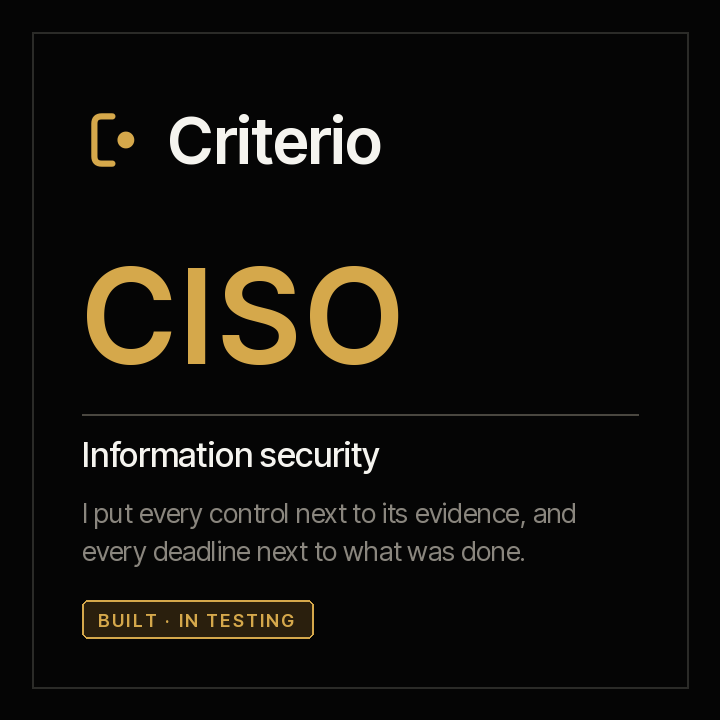

<picture><source media="(prefers-color-scheme: dark)" srcset="../../docs/img/marca/en/criterio-ciso-oscuro.svg"></picture>

# criterio-ciso · the information security family

**Three agents and a portal, around their records.** Each one extends a different person in
information security —whoever answers for the controls, whoever answers for vulnerabilities and whoever
answers for incident response and continuity— and none of them talks to the others directly: they share
the entity's folder and reference, and each writes only its own.

[Español](README.es.md) · [← Criterio](../../README.md) · Apache 2.0



| | |
|---|---|
| **Scope** | An entity's information security: the statement of applicability against each control's evidence, access reviews, critical third parties and risk acceptances; every vulnerability against its deadline, the KEV catalog and scan coverage; every incident against its deadlines and notifications, and the continuity tests against their calendar |
| **Goal** | That what the organisation committed to in its policy —review, fix, notify, test— has behind it the documents that show it did, and on time |
| **Made up of** | [Alexis](../../plugins/criterio-security/README.md) · [Guillermo](../../plugins/criterio-vulnerability/README.md) · [Amparo](../../plugins/criterio-resilience/README.md) · [Rostrum](../../plugins/criterio-server/README.md) |
| **The support** | The international frameworks that order the family, the format of every file the engine processes and what it costs an organisation today, with its source, year and sample: [`FUENTES.es.md`](FUENTES.es.md) (Spanish) |
| **Status** | Laboratory, not yet launched: published in the marketplace from version 0.1.0, with the engine tested on synthetic banking, retail, healthcare and technology material; the round with the agents is the next step. **Not yet tested on a specific organisation's documentation** |
| **Approach** | Documents and exports, never systems: no agent runs a scan or connects to a console |
| **Commitment** | Generating, spreading and preserving knowledge is a professional obligation |
| **What it is not** | It does not replace the security lead or their team, and does not decide for them: it accepts no risks, declares no control met, approves no exceptions, notifies no one, rates no maturity and certifies against no standard |
| **Licence** | [Apache 2.0](../../LICENSE) |
| **What's next** | The full round with the three agents, in 0.2.0: [the roadmap](#roadmap) |

---

## What the family does

Information security has three recurring jobs that are done by hand against documents today, so the
family has three agents. They are ordered by the six functions of the NIST Cybersecurity Framework 2.0
—govern, identify, protect, detect, respond and recover— (F-02). They carry people's names because
**they are extended capabilities of people**, and each name's meaning points at what it does: **Alexis**
—“the one who defends”— puts every control next to the evidence that it operated; **Guillermo**
—“resolute protector”— puts every vulnerability next to its deadline; **Amparo** —“to protect”— puts
every incident next to the deadlines that were committed.

**Alexis**, governance and controls, contrasts the statement of applicability with the evidence: every
applicable control with its owner and the evidence that it operated within its frequency, each system's
access review, each critical third party's assessment and the risk acceptances past their date.

**Guillermo**, vulnerabilities, crosses every finding in the scanner exports with its severity's
deadline in the policy, with CISA's KEV catalog of what is being exploited, with the approved exceptions
and with the scan that proves each closure; and says which inventory asset no scan covers.

**Amparo**, response and recovery, puts each incident's timeline next to its severity's containment
deadline, every notification the matrix requires —to the supervisor, the data authority, the customers—
next to the one that was made, the post-incident review next to its deadline, and every continuity,
recovery and restore test next to its calendar.

**31%** of breaches began with the exploitation of a vulnerability, and **only 26%** of the KEV
catalog's vulnerabilities were fully remediated in 2025. The figures, with their source, year and
sample, are in [`FUENTES.es.md`](FUENTES.es.md) (Spanish).

**The deadlines are the organisation's**, in its policy, matrix and registers. The only thing that
comes from an external source is the remediation date the KEV catalog carries, and the CVSS severity
scale when the scanner gives the score and not the severity.

---

## How the three operate

The language model (LLM) extracts; the code calculates; the decision —accepting a risk, approving an
exception, notifying, declaring an incident— is always a person's. **The engine processes the tables
directly** —the statement of applicability, the systems table, the third-party register, the risk
register, the asset inventory, each scanner export, the KEV catalog, the tracker, the exceptions, the
notification matrix and the continuity calendar—, and the agent takes to the record what only a written
document carries: a control's evidence, an access review, a third party's assessment, an incident's
timeline with its notifications, its review and each test.

**What is never opened.** Credentials, keys and backups: the engine excludes them by default and every
report says which it excluded. **Vulnerability findings are not published** in Rostrum unless the
configuration says so: a report of open vulnerabilities is a map for an attacker.

**Automated**: they process the documents, calculate the signals and prepare each deliverable without
intervention. **Semi-automated** when a data point is missing that no document carries —a deadline the
policy does not state, which scanner column carries each field—: then they ask the person, say what
they asked and carry on with the answer.

## The three agents and their records

Nothing talks to anything directly. **Each agent writes its records, and the record is the contract.**

| Record | One per | What it carries | Who writes it |
|---|---|---|---|
| Controls record | Entity and period | Each piece of control evidence with the date it covers, each access review and each third-party assessment | Alexis; a risk acceptance, whoever signs it |
| Vulnerabilities record | Entity and period | The questions it asked and their answers: the rest are tables the engine processes | Guillermo; an exception, whoever approves it |
| Response record | Entity and period | Each incident with its timeline and notifications, each post-incident review and each continuity test | Amparo; the severity and the notification, whoever answers for the incident |

Every data point cites the document it comes from and its date. “Not found” is a valid answer.

### The seven invariants

1. **The agents do not talk to each other.** They share the folder and the reference; each writes only
   its own record.
2. **Rostrum, the portal, does not write.** It serves what the engine already wrote and states its date;
   it recalculates nothing. Vulnerability findings do not go there unless the configuration says so.
3. **Documents, never systems.** No agent runs a scan or connects to a console or the internet.
4. **What is never opened stays closed.** Credentials, keys and backups are out by default.
5. **The model extracts, the code calculates.** Every deadline, day, hour or count in a report comes from
   `seguridad.py`; if the engine does not give it, it is not written.
6. **The deadlines are the organisation's.** They come from its policy, matrix and registers, with their
   citation; none is set by the agent.
7. **No agent decides.** Accepting a risk, approving an exception, notifying and declaring a control met
   are a person's.

## What remains with the people

The three roles remain whole. This extends capacity; it does not substitute a function.

> **Each agent's input is produced by its person's non-delegable work.**

Alexis needs the organisation to keep its statement of applicability with an owner per control and to
leave the evidence that each control operated. Guillermo needs someone to export each scan and download
the KEV catalog, and the policy to state its deadlines. Amparo needs each incident written down with its
timeline and each notification to leave its record.

**And none of the three accepts a risk, approves an exception, notifies a supervisor or declares a
standard met.**

## The recommended folder structure

Recommended, not mandatory ([ADR 0007](../../docs/decisions/0007-estructura-recomendada.md)): the agents
process the folder as it is. The three setup commands compare what they find with this structure and, on
each run, say which file is out of place and where it would go; they create, move or rename nothing in
the organisation's documents. Numbering goes in tens, as in the other families.

<!-- ciso:carpetas · generado por scripts/familias.py; no se edita a mano -->
One folder per entity, with its tax id at the start of the name. Inside it, the policies and reference registers, each control's evidence, the access reviews, the third-party assessments, the risk register, the scanner exports, the remediation, the incidents, their reviews and the continuity tests. Never credentials, keys or backups: the engine excludes them.

```
seguridad/
└── <entidad>/
    ├── 00-referencia/
    ├── 10-controles/
    ├── 20-accesos/
    ├── 30-terceros/
    ├── 40-riesgos/
    ├── 50-escaneos/
    ├── 60-remediacion/
    ├── 70-incidentes/
    ├── 80-revisiones/
    └── 90-continuidad/
estado-seguridad/
```

**`<entidad>/`** · What the organisation keeps for all of its information security

| Folder | What goes in | Agent |
|---|---|---|
| `00-referencia/` | The policies —security, vulnerability management and incident response—, the statement of applicability, the systems table, the third-party register, the asset inventory, the notification matrix and the continuity calendar | Alexis, Guillermo, Amparo |
| `10-controles/` | Each control's evidence, with the control number at the start of the name and the period it covers: the report, log, screenshot or minutes that show the control operated | Alexis |
| `20-accesos/` | Each system's access reviews, with the system and the date in the name | Alexis |
| `30-terceros/` | Each third party's security assessments: the questionnaire, report or attestation it delivered, with its date | Alexis |
| `40-riesgos/` | The risk register, with the decision on each risk, who accepted it and until when, and each acceptance's document | Alexis |
| `50-escaneos/` | The vulnerability scanner's exports, in CSV or Excel, with the scan date in the name, and CISA's KEV catalog as downloaded | Guillermo |
| `60-remediacion/` | The remediation tracker —each vulnerability with its status and closing date— and the exceptions register with its approval and expiry | Guillermo |
| `70-incidentes/` | Each incident's report, with its timeline —detection, containment and closure— and every notification made, with its record | Amparo |
| `80-revisiones/` | Each incident's post-incident review: the lessons learned and the actions that come out of them | Amparo |
| `90-continuidad/` | The report of each test of the continuity plan, of the recovery plan and of each backup restore, with its date and its result | Amparo |

**`estado-seguridad/`** · What Alexis, Guillermo and Amparo write: the configuration, each period's record, the reports and the indexes. No person edits it, and no agent writes anywhere else.
<!-- /ciso:carpetas -->

A file without the expected format is not guessed: it is reported with what it lacks.

## Installing the family

**The family is a laboratory one and not yet launched, but it can already be installed.** Each agent
is a plugin that installs on its own:

```
/plugin marketplace add josenanez/criterio

/plugin install criterio-security@criterio        if you answer for the controls
/plugin install criterio-vulnerability@criterio   if you answer for vulnerabilities
/plugin install criterio-resilience@criterio      if you answer for incidents and continuity
```

After installing, each agent has its own setup command that looks at the folder, says what it will not
open, asks the questions no document answers and produces a first result. **Nobody edits a configuration
file by hand.** And if you install all three, they find each other: they share the entity's state, and
each writes only its own.

## What each agent answers for, and where its detail is

The same for every piece: what it answers for, what it does not do, and where all its detail is. **Each
agent page stands on its own.**

<!-- ciso:familia-agentes · generado por scripts/familias.py; no se edita a mano -->
| | What it answers for | What it never does | Its page | Its tests |
|---|---|---|---|---|
| **Alexis** · governance and controls | The statement of applicability against the evidence: every applicable control with its owner and the evidence that it operated within its frequency, each system's access reviews, each critical third party's assessments and the risk acceptances past their date | It does not accept a risk, does not declare a control met, does not rate the organisation's maturity or certify it against ISO/IEC 27001, and does not open credentials, keys or backups | [criterio-security](../../plugins/criterio-security/README.md) · 9 commands, 3 skills | [results](../../tests/criterio-security/RESULTADOS.md) |
| **Guillermo** · vulnerabilities | Every vulnerability in the scanner exports against its severity's deadline in the policy, the KEV catalog, the approved exceptions, the closures no scan proves and the inventory assets no scan covers | It does not run a scan, does not connect to a system or a console, does not approve an exception and does not publish open vulnerabilities in Rostrum unless the configuration says so | [criterio-vulnerability](../../plugins/criterio-vulnerability/README.md) · 7 commands, 3 skills | [results](../../tests/criterio-vulnerability/RESULTADOS.md) |
| **Amparo** · response and recovery | Every incident against the policy's deadlines and the notification matrix: its severity's containment, each notification to the supervisor, the data authority or the customers, and its post-incident review; and the continuity, recovery and restore tests against their calendar | It notifies no one, does not declare or close an incident, does not run a continuity plan or a restore, and does not open backups | [criterio-resilience](../../plugins/criterio-resilience/README.md) · 7 commands, 3 skills | [results](../../tests/criterio-resilience/RESULTADOS.md) |
| **Rostrum** · the portal | Publishing what the agents write where the team will see it, and taking the question from whoever will not open a folder | **Never writes the state or recalculates anything**, and decides nothing | [criterio-server](../../plugins/criterio-server/README.md) · 2 commands, one for every family | [results](../../tests/criterio-server/RESULTADOS.md) |
<!-- /ciso:familia-agentes -->

Their input, process and report, with the signals the engine calculates, are in the
[family design](DISENO.md); and the answers to what is asked most, in the [FAQ](PREGUNTAS.md).

## In Rostrum, the portal for every family

**A security committee does not open a folder of files**: it opens a link. That is what **Rostrum**,
`criterio-server`, is for: it serves the CISO family alongside the others, without the server knowing
anything about security ([ADR 0010](../../docs/decisions/0010-rostrum-plugin-propio.md)). The three setup
commands leave their configuration in `.criterio/seguridad/<entity>/`, `.criterio/vulnerabilidades/<entity>/`
and `.criterio/resiliencia/<entity>/`, with the folder marked with `_CRITERIO_SEGURIDAD.txt`, and
`/criterio-server:server-setup` adds them to the map. **Guillermo's reports are not published** unless
his configuration says so (ADR 0023).

## How each one is configured and how often it runs

<!-- ciso:configuracion · generado por scripts/familias.py; no se edita a mano -->
| | Alexis | Guillermo | Amparo |
|---|---|---|---|
| **Installs as** | `criterio-security` | `criterio-vulnerability` | `criterio-resilience` |
| **Instances** | One per entity | One per entity | One per entity |
| **Configured with** | `/criterio-security:security-setup` | `/criterio-vulnerability:vuln-setup` | `/criterio-resilience:resilience-setup` |
| **How long that takes** | Fifteen minutes | Fifteen minutes | Fifteen minutes |
| **What you have to tell it** | Entity and its tax ID, country, the period, where the statement of applicability in `00-referencia/` is and which column carries the control, whether it applies, its status, its owner and its frequency, the systems table with how often their access is reviewed, the third-party register with the critical ones and how often they are assessed, and the risk register in `40-riesgos/` | Entity and its tax ID, country, the period, the remediation deadline for each severity in the vulnerability management policy in `00-referencia/`, which scanner produces the exports in `50-escaneos/` and, if their columns are not recognised, which column carries the asset, the vulnerability, the severity or the CVSS score and the first detection, how many days without a scan leave an asset uncovered, and whether its reports are published in Rostrum | Entity and its tax ID, country, the period, the containment deadline for each severity and the days for the post-incident review in the incident response policy in `00-referencia/`, the notification matrix with each recipient, when it applies and its deadline, and the continuity calendar with each test, its type and its frequency |
| **Where it lands** | `.criterio/seguridad/<entity>/config.json`, written by the command | `.criterio/vulnerabilidades/<entity>/config.json`, written by the command | `.criterio/resiliencia/<entity>/config.json`, written by the command |
| **The one you put on a clock** | `/criterio-security:share-findings` | `/criterio-vulnerability:share-findings` | `/criterio-resilience:share-findings` |
| **What it does each day** | The code builds a summary with no data —the plugin and its version, each command with how many times it ran and its median duration, each signal by its code with how many times it came up— and always asks whether you want to share it; nothing is sent (decision 0025) | The code builds a summary with no data —the plugin and its version, each command with how many times it ran and its median duration, each signal by its code with how many times it came up— and always asks whether you want to share it; nothing is sent (decision 0025) | The code builds a summary with no data —the plugin and its version, each command with how many times it ran and its median duration, each signal by its code with how many times it came up— and always asks whether you want to share it; nothing is sent (decision 0025) |
| **What wakes it besides the clock** | A question somebody left in Rostrum | A question somebody left in Rostrum | A question somebody left in Rostrum |
<!-- /ciso:configuracion -->

**Nobody edits a configuration file by hand.** It is said in the conversation and the command rewrites
it. Each plugin ships its `scripts/config.example.json` to show the full shape; the remediation,
containment and review deadlines come from the organisation's policy, with their citation, and the scan
window is each organisation's configuration, not a rule.

### All three stay quiet when there is nothing

The three clock commands produce nothing when nothing is due, and then the output is one line. With a
question open in Rostrum they never stay quiet: they answer it first.

## The family's tests

**A single gate runs everything this repository checks**, for every family at once:

```
python3 scripts/verificar.py
```

What belongs to the CISO family is in [`tests/criterio-ciso/`](../../tests/criterio-ciso/): synthetic
banking, retail, healthcare and technology material —with a scanner export with English headers, another
with Spanish headers and another that needs its mapping— with a key the engine never sees, and two control
entities, where any signal is a failure. Each of the sixteen signals is planted at least once, along with
cases that look like a defect and are not. `evaluar.py` runs each agent's engine and compares every signal
by its name and key: **an extra one counts the same as a missing one.** What is planted and what the
material does not test, in [`EVIDENCIA.md`](../../tests/criterio-ciso/EVIDENCIA.md) (Spanish).

## Roadmap

## Roadmap

<!-- hoja de ruta: generado por scripts/hoja.py desde hoja-de-ruta.json; no se edita a mano -->

The family grows in increments. Each one is a version with its full test and its statistical analysis published, with the same metrics, so the evolution can be compared.

| Version | Status | What goes in | Test |
|---|---|---|---|
| 0.1.0 | Released | **Alexis, Guillermo and Amparo, built, with the engine tested**<br>· The commands, their seven skills and the engine, with the sixteen signals: Alexis's controls, access, third parties and risks; Guillermo's vulnerabilities, KEV catalog and coverage; Amparo's incidents, notifications and tests<br>· Any scanner export in CSV or Excel with its column mapping, severity from CVSS v4.0 and CISA's KEV catalog<br>· What is never opened: credentials, keys and backups, excluded by default<br>· Banking, retail, healthcare and technology material, with two control entities | The engine against the key of all the material: six entities from four industries, with their controls |
| 0.2.0 | In progress | **The round of the three agents**<br>· The round with Alexis, Guillermo and Amparo on all the material, with the key they never see<br>· The defects it finds, with their fix and their verification | The full round, with the 95% confidence floor on signals and data (decision 0020) |
| Increment 3 | Next | **The scanners, each from its source**<br>· The export format of Tenable, Qualys, Rapid7 and Microsoft Defender, each from its verified source, as Dynamics and Zoho entered the CCO | Their material and their round, with the same metrics |

<!-- /hoja de ruta -->

## The family's seven skills

<!-- ciso:skills-familia · generado por scripts/familias.py; no se edita a mano -->
Seven distinct skills across the three agents. **The ones they share are literal copies, not an imported module**: an installed plugin has to run on its own. `scripts/sincronizar.py` copies them and `scripts/sincronizar.py --check` fails if they drift.

| Skill | Alexis | Guillermo | Amparo |
|---|:--:|:--:|:--:|
| `continuity-record` | · | · | ● |
| `control-evidence-record` | ● | · | · |
| `incident-record` | · | · | ● |
| `scanner-exports` | · | ● | · |
| `security-intake` | ● | ● | ● |
| `soa-and-risks` | ● | · | · |
| `vuln-policy` | · | ● | · |
<!-- /ciso:skills-familia -->

## Status

**All three are laboratory ones.** Their version 0.1.0 brings the engine, which passes its
deterministic test on all the material; the round with the agents on the same material, with a key they
never see, is what declares it tested, and it comes with 0.2.0. Laboratory or stable is said by the
evidence (decision 0020), and on the day the family is launched, if it is stable, its version is 1.0.0
(decision 0021).

<!-- ciso:estado · generado por scripts/familias.py; no se edita a mano -->
| Agent | Installs as | Its test |
|---|---|---|
| **Alexis** · Governance and controls | `criterio-security` · 9 commands, 3 skills | The engine, tested; with the agent, every entitie in the material, up to round 1 · [results](../../tests/criterio-security/RESULTADOS.md) |
| **Guillermo** · Vulnerabilities | `criterio-vulnerability` · 7 commands, 3 skills | The engine, tested; with the agent, every entitie in the material, up to round 1 · [results](../../tests/criterio-vulnerability/RESULTADOS.md) |
| **Amparo** · Response and recovery | `criterio-resilience` · 7 commands, 3 skills | The engine, tested; with the agent, every entitie in the material, up to round 1 · [results](../../tests/criterio-resilience/RESULTADOS.md) |
| **Rostrum** · the portal | `criterio-server` · 2 commands, for every family | — |
<!-- /ciso:estado -->

The decisions still open are in the [design](DISENO.md#open-decisions).
