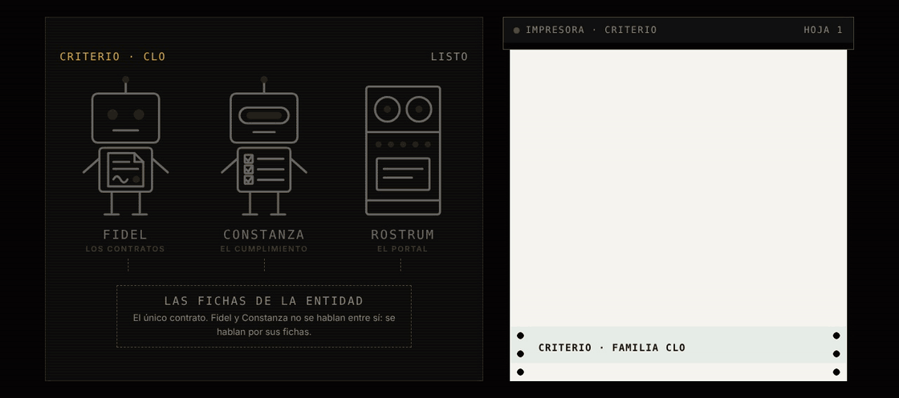

<picture><source media="(prefers-color-scheme: dark)" srcset="../../docs/img/marca/es/criterio-clo-oscuro.svg"></picture>

# criterio-clo · la familia de la función legal

**Dos agentes y un portal, alrededor de sus fichas.** Cada uno extiende a una persona distinta
de la función legal —quien lleva los contratos y quien responde por el cumplimiento— y ninguno
habla con el otro directamente: se hablan por sus fichas.

[English](README.md) · [← Criterio](../../README.es.md) · Apache 2.0



| | |
|---|---|
| **Alcance** | Los contratos, el cumplimiento y el riesgo legal de una entidad: lo que firmó contra lo que está pasando, y cada obligación contra su evidencia |
| **Objetivo** | Que una empresa sepa qué firmó, qué vence y a qué se obligó |
| **Compuesta por** | [Fidel](../../plugins/criterio-legal/README.es.md) · [Constanza](../../plugins/criterio-compliance/README.es.md) · [Rostrum](../../plugins/criterio-server/README.es.md) |
| **Estado** | Construida y en prueba: el motor, probado contra el material de cuatro industrias y dos entidades de control. Una primera ronda con el agente, pequeña —banca y el control de Colombia—, ya [corrió](../../tests/evidencias/familias/clo/RONDAS.md). **La ronda completa es el paso siguiente**, y sin ella la familia no se declara probada |
| **Enfoque** | Contratos y cumplimiento, sin opinión jurídica |
| **Compromiso** | Generar, difundir y conservar el conocimiento es una obligación profesional |
| **Qué no es** | No reemplaza al abogado ni al oficial de cumplimiento, y no decide por ellos: procesa lo que la organización firmó y lo que se obligó a cumplir, y dice qué vence, qué no tiene evidencia y qué no cuadra |
| **Licencia** | [Apache 2.0](../../LICENSE) |
| **Qué viene** | La ronda completa con el agente, y después el despliegue en una organización: [la hoja de ruta](#hoja-de-ruta) |

---

## Qué hace la familia

La función legal tiene dos roles que trabajan sobre los mismos documentos y responden por cosas
distintas, y por eso la familia tiene dos agentes. Llevan nombre de persona porque **son
capacidades extendidas de personas**, y el significado de cada nombre apunta a lo que hace:
**Fidel** —de *fides*, la palabra dada— cuida que lo firmado se cumpla; **Constanza** —de
*constantia*— cumple siempre, no solo el día de la auditoría.

**Fidel**, el de los contratos, pone lo que la empresa firmó al lado de lo que está pasando: el
registro de contratos contra sus documentos, los vencimientos y los preavisos de renovación, cada
obligación con su evidencia, quién firmó con qué facultad y lo pagado contra lo pactado y sus
garantías. Lo que hoy no hace nadie y él sí: **revisar todos los contratos, no una muestra,
contra la matriz de atribuciones**, y todos los pagos contra el valor y la terminación de su
contrato.

**Constanza**, la del cumplimiento, pone cada obligación de la organización al lado de su
evidencia: la matriz periodo a periodo, las obligaciones que vienen de los contratos, las
políticas por revisar, las normas nuevas sin evaluar y los plazos del canal de denuncias. Toma de
las fichas de Fidel las obligaciones de cumplimiento que traen los contratos.

**Los dos se instalan hoy**, cada uno con su propio plugin, y tienen la misma deuda, escrita en
su página: el motor está probado contra material sintético de cuatro industrias; **la extracción del agente pasó una primera ronda pequeña, y la completa es la que sigue; nada se ha probado todavía
sobre los documentos de una organización.**

Primera versión: Colombia y Ecuador. **Sin opinión jurídica**: ninguno de los dos interpreta una
cláusula, califica la validez de un contrato ni dice qué exige una norma. Lo que una obligación
exige lo define la organización en su matriz, con la cita de su fuente.

---

## Cómo trabajan los dos

El modelo de lenguaje (LLM) extrae; el código calcula; la decisión —renovar, terminar, cómo se
interpreta una cláusula o una norma— la toma siempre una persona. **El motor procesa las tablas
directamente** —el registro de contratos, los pagos, las matrices, el índice de políticas, el
registro normativo y el de casos—, y el agente lleva a la ficha lo que solo trae un documento
escrito: cada contrato con sus partes, valor, fechas, renovación, preaviso, firmantes, otrosíes,
garantías y obligaciones; lo que declara el informe de cumplimiento; las normas nuevas de un
boletín.

**Automatizados**: procesan los documentos, calculan las señales y preparan cada entregable sin
intervención. **Semiautomatizados** cuando falta un dato que ningún documento trae —la entidad,
los días de aviso, quién decide renovar—: entonces le preguntan a la persona, dicen qué
preguntaron y siguen con la respuesta.

## Los dos agentes y sus fichas

Nada se habla con nada directamente. **Cada agente escribe sus fichas, y la ficha es el
contrato.**

| Ficha | Una por | Qué lleva | Quién la escribe |
|---|---|---|---|
| Ficha del contrato | Contrato | Partes, valor, fechas, renovación, preaviso, firmantes, otrosíes, garantías, el certificado de la contraparte, las obligaciones y la decisión de renovar o terminar | Fidel; la decisión, la persona que la toma |
| Ficha del periodo | Entidad y periodo de cumplimiento | Lo que declara el informe del periodo, las normas nuevas que trae un boletín o un correo y las preguntas que se le hicieron a la persona | Constanza; el estado, el oficial de cumplimiento |

Cada dato cita el documento del que sale y su fecha. «No encontrado» es una respuesta válida.

### Las siete invariantes

1. **Los agentes no se hablan entre sí.** Se hablan por sus fichas: Constanza toma de las de
   Fidel las obligaciones de cumplimiento de los contratos.
2. **Rostrum, el portal, no escribe.** Sirve lo que el motor ya escribió y lo dice con su fecha;
   no recalcula nada.
3. **Cada contrato tiene un solo lugar**, su carpeta en `contratos/`: Fidel la procesa y
   Constanza toma de su ficha lo que le toca, sin copias entre carpetas.
4. **Declarado y evidenciado nunca se fusionan.** Van en campos separados de la ficha.
5. **El modelo extrae, el código calcula.** Todo monto, plazo, día o conteo de un reporte sale de
   `legal.py`; si el motor no lo da, no se escribe.
6. **Ningún agente declara ni decide.** El estado del cumplimiento lo declara el oficial de
   cumplimiento; renovar o terminar lo decide una persona, y Fidel lo registra cuando un
   documento lo toma.
7. **Sin opinión jurídica.** Lo que exige una obligación lo define la organización en su matriz,
   con su fuente. Ningún agente agrega, quita ni reescribe una obligación.

La sexta es la más fácil de romper por conveniencia y la que se lleva el sistema entero si se
rompe: si el agente declara el cumplimiento, la comparación entre lo declarado y lo evidenciado
compara al sistema consigo mismo. No es una recomendación de la documentación: es una
restricción del camino de escritura.

## Lo que sigue siendo de las personas

Los dos roles siguen existiendo completos. Esto extiende capacidad; no sustituye función. Y el
argumento no es de cortesía, es estructural:

> **El insumo de cada agente lo produce el trabajo no delegable de su persona.**

Fidel necesita que alguien decida renovar o terminar y lo deje escrito, porque un preaviso que
pasa sin decisión es justamente lo que señala; y que la organización lleve su matriz de
atribuciones, porque sin ella no hay contra qué revisar una firma. Constanza necesita que la
organización defina sus obligaciones con su fuente y su responsable, y que alguien deje la
evidencia de cada una, porque sin matriz no hay nada que cumplir y sin evidencia no hay nada que
contrastar.

Quitar a la persona no deja al agente solo: lo deja sin insumo. **Y ninguno de los dos
interpreta una cláusula, redacta, negocia, firma ni responde un caso del canal de denuncias.**

## La estructura de carpetas recomendada

Recomendada, no obligatoria ([ADR 0007](../../docs/decisions/0007-estructura-recomendada.md)):
los agentes procesan la carpeta como esté. `legal-setup` y `compliance-setup` comparan lo que
encuentran con esta estructura y, en cada corrida, dicen qué archivo está fuera de su lugar y
dónde iría; no crean, mueven ni renombran nada en los documentos de la organización. La
numeración va de diez en diez, como en las familias PMO y CFO.

<!-- clo:carpetas · generado por scripts/familias.py; no se edita a mano -->
Una carpeta por entidad, con el NIT o el RUC al inicio del nombre. Dentro, lo que la organización lleva para toda la entidad, una carpeta por contrato y una por periodo de cumplimiento.

```
legal/
└── <entidad>/
    ├── 00-referencia/
    ├── 10-registro/
    ├── 20-politicas/
    ├── 30-normativa/
    ├── 40-canal/
    ├── contratos/<código>/
    │   ├── 10-contrato/
    │   ├── 20-garantias/
    │   ├── 30-contraparte/
    │   └── 40-ejecucion/
    └── cumplimiento-<AAAA-MM>/
        ├── 10-evidencias/
        └── 20-reportes/
estado-legal/
```

**`<entidad>/`** · Lo que la organización lleva para toda la entidad

| Carpeta | Qué va | Agente |
|---|---|---|
| `00-referencia/` | La matriz de atribuciones —quién firma qué y hasta qué monto— y la matriz de obligaciones de cumplimiento | Fidel, Constanza |
| `10-registro/` | El registro de contratos que lleva la organización y la exportación de pagos por contrato del ERP, con la fecha de corte en el nombre | Fidel |
| `20-politicas/` | El índice de políticas con su versión y su próxima revisión, y cada política | Constanza |
| `30-normativa/` | El registro normativo, los boletines y las evaluaciones de impacto de cada norma nueva | Constanza |
| `40-canal/` | El registro de casos del canal de denuncias, con su fecha de recepción y de respuesta | Constanza |

**`contratos/<código>/`** · Un contrato, con su código al inicio del nombre de la carpeta

| Carpeta | Qué va | Agente |
|---|---|---|
| `10-contrato/` | El contrato firmado y cada otrosí | Fidel |
| `20-garantias/` | Las pólizas y garantías aportadas | Fidel |
| `30-contraparte/` | El certificado de existencia y representación de la contraparte y sus documentos | Fidel |
| `40-ejecucion/` | Actas de entrega, informes y la evidencia de cada obligación, con su id al inicio del nombre | Fidel, Constanza |

**`cumplimiento-<AAAA-MM>/`** · Un periodo de cumplimiento

| Carpeta | Qué va | Agente |
|---|---|---|
| `10-evidencias/` | La evidencia de cada obligación del periodo, con su id al inicio del nombre | Constanza |
| `20-reportes/` | El informe de cumplimiento del periodo | Constanza |

**`estado-legal/`** · Lo que escriben Fidel y Constanza: la configuración, las fichas de cada contrato, los informes y los índices. Ninguna persona lo edita, y ningún agente escribe fuera de aquí.
<!-- /clo:carpetas -->

Un archivo sin el formato esperado no se adivina: se reporta con lo que le falta.

## Instalación de la familia

Cada agente es un plugin y se instala solo. **No hace falta instalar los dos**: se instala el
que resuelve el rol que tienes.

```
/plugin marketplace add josenanez/criterio

/plugin install criterio-legal@criterio        si llevas los contratos
/plugin install criterio-compliance@criterio   si respondes por el cumplimiento
```

**En Claude Cowork** — Personalizar → Explorar plugins → Personal → **+** → Agregar
marketplace desde GitHub → `josenanez/criterio`.

Después de instalar, cada agente tiene su propio comando de instalación que mira la carpeta,
hace las preguntas que ningún documento responde y produce un primer resultado sobre tus
propios documentos. **Nadie edita un archivo de configuración a mano.**

Y si instalas los dos, se encuentran solos: **no hay nada que conectar.** Comparten el estado
de la entidad, y cada uno escribe solo lo suyo.

## De qué responde cada agente, y dónde está su detalle

Lo mismo para cada pieza: de qué responde, qué no hace, y dónde está todo su detalle. **Cada
página de agente se lee sola** — alguien puede instalar uno sin el otro.

<!-- clo:familia-agentes · generado por scripts/familias.py; no se edita a mano -->
| | De qué responde | Lo que nunca hace | Su página | Sus pruebas |
|---|---|---|---|---|
| **Fidel** · contratos | Lo firmado y en qué términos: el registro de contratos contra sus documentos, los vencimientos y los preavisos de renovación, las obligaciones con su evidencia, quién firmó con qué facultad y lo pagado contra lo pactado y sus garantías | No interpreta cláusulas, no califica la validez de un contrato y no decide renovar ni terminar | [criterio-legal](../../plugins/criterio-legal/README.es.md) · 7 comandos, 5 skills | [resultados](../../tests/criterio-legal/RESULTADOS.md) |
| **Constanza** · cumplimiento | La matriz de obligaciones de la organización contra su evidencia, la revisión de las políticas, las normas nuevas con su evaluación, el canal de denuncias con sus plazos y las obligaciones de cumplimiento que traen los contratos | No define obligaciones, no dice qué exige una norma y no procesa quién denunció | [criterio-compliance](../../plugins/criterio-compliance/README.es.md) · 7 comandos, 6 skills | [resultados](../../tests/criterio-compliance/RESULTADOS.md) |
| **Rostrum** · el portal | Publicar lo que escriben los agentes donde el equipo lo vea, y recibir la pregunta de quien no abre una carpeta | **No escribe en el estado ni recalcula nada**, y no decide nada | [criterio-server](../../plugins/criterio-server/README.es.md) · 2 comandos, uno para todas las familias | [resultados](../../tests/criterio-server/RESULTADOS.md) |
<!-- /clo:familia-agentes -->

Los comandos, uno por uno —qué hacen, qué reciben, qué procesan y qué escriben—, están en el
[manual de los comandos](../../docs/manual.es.md); su entrada, su proceso y su reporte, con las
señales que calcula el motor, en el [diseño de la familia](DISENO.es.md); y las respuestas a lo
que más se pregunta, en las [preguntas frecuentes](PREGUNTAS.es.md).

## En Rostrum, el portal de todas las familias

Hasta aquí el resultado de la familia son archivos en el equipo de quien corrió los agentes.
**Un director legal no abre una carpeta de archivos**: abre un enlace, o no abre nada. Para eso
está **Rostrum**, un plugin aparte, `criterio-server`, que sirve a la CLO junto con las demás
familias, sin que el servidor sepa nada de contratos
([ADR 0010](../../docs/decisions/0010-rostrum-plugin-propio.md)).

**Cómo entra la CLO al portal.** `/criterio-legal:legal-setup` y
`/criterio-compliance:compliance-setup` dejan su configuración en `.criterio/legal/<entidad>/` y
`.criterio/cumplimiento/<entidad>/`, con la carpeta legal de la entidad marcada con
`_CRITERIO_LEGAL.txt`. Fidel y Constanza comparten el estado de la entidad, y cada uno ve en el
portal sus corridas y sus reportes, no los del otro. Después, `/criterio-server:server-setup`
encuentra las dos configuraciones y las suma al mapa, y `/criterio-server:server-start` levanta el
portal. Una entidad nueva entra volviendo a correr `server-setup`.

**Lo que la CLO tiene en Rostrum:**

| Dónde | Qué |
|---|---|
| Inicio | La tarjeta **Criterio CLO** con Fidel y Constanza y sus señales abiertas |
| `/familia/clo` | Lo último que escribió el motor de cada uno —los contratos, el cumplimiento de un periodo—, con sus señales en palabras y sus reportes tal como los dejó el motor |
| Lo que vence | El preaviso de un contrato con renovación automática, el límite de un plazo, la obligación que vence, ordenados con los de las otras familias |
| `/caso/<CTR>` | Todo lo que los agentes hicieron sobre un contrato |
| Dónde trabaja | La ruta completa de la carpeta raíz, de los documentos de la entidad con su marca, del estado y de cada configuración |
| Preguntar a un agente | Una pregunta para Fidel o para Constanza, que la atiende en su siguiente corrida |

**No autentica a nadie, y es a propósito**: se publica detrás del control de acceso que la
organización ya tiene. No recalcula nada y no escribe en el estado. Las páginas cumplen WCAG 2.2
nivel AA, comprobado con axe-core a cuatro anchos de pantalla
(`tests/criterio-server/accesibilidad/`).

→ **[Rostrum: instalación, configuración y uso con todas las familias](https://www.josenanez.com/es/agents/rostrum)** ·
[su README, con las rutas y qué pedirle a tu organización](../../plugins/criterio-server/README.es.md)

## Cómo se configura y cada cuánto corre cada uno

Esta es la tabla que responde tres preguntas a la vez: **dónde queda cada agente, qué le hace
falta configurado, y cada cuánto tiene sentido que corra.**

<!-- clo:configuracion · generado por scripts/familias.py; no se edita a mano -->
| | Fidel | Constanza |
|---|---|---|
| **Se instala** | `criterio-legal` | `criterio-compliance` |
| **Instancias** | Una por entidad | Una por entidad |
| **Se configura con** | `/criterio-legal:legal-setup` | `/criterio-compliance:compliance-setup` |
| **Cuánto tarda eso** | Quince minutos | Quince minutos |
| **Qué le tienes que decir** | Entidad y NIT o RUC, país, la matriz de atribuciones de `00-referencia/`, con cuántos días de anticipación se avisa un vencimiento o un preaviso, la antigüedad máxima del certificado de la contraparte y quién decide renovar | Entidad, país, la matriz de obligaciones de `00-referencia/` en el modelo definido (F-01), el periodo, el plazo de respuesta del canal, los días para evaluar una norma nueva y, si la organización usa a Fidel, dónde están sus fichas |
| **Dónde queda** | `.criterio/legal/<entidad>/config.json`, escrito por el comando | `.criterio/cumplimiento/<entidad>/config.json`, escrito por el comando |
| **El que se le pone a un reloj** | `/criterio-legal:legal-wake` | `/criterio-compliance:compliance-wake` |
| **Qué toca cada día** | Decide qué toca: los vencimientos y preavisos que entran en la ventana, los documentos nuevos y una revisión semanal | Decide qué toca: las obligaciones que vencen en la ventana, los documentos nuevos y una revisión semanal |
| **Qué lo despierta además del reloj** | Una pregunta que alguien dejó en Rostrum | Una pregunta que alguien dejó en Rostrum |
<!-- /clo:configuracion -->

**Nadie edita un archivo de configuración a mano.** Si para cambiar un umbral hay que abrir un
JSON, el umbral se queda como vino y la configuración deja de describir a la organización. Se
dice en la conversación y el comando lo reescribe. Cada plugin trae su
`scripts/config.example.json` para ver la forma completa sin instalar nada; los días de aviso, la
antigüedad del certificado, el plazo del canal y los días para evaluar una norma son
configuración de cada organización, no norma.

### Por qué las dos cadencias son distintas

No es una preferencia: **cada agente mide contra otra cosa.**

- **Fidel** mide contra las fechas de los contratos. Un preaviso de no renovación tiene un día
  límite, y pasado ese día el contrato se renueva solo; por eso corre cuando un vencimiento o un
  preaviso entra en la ventana configurada, cuando llega un documento nuevo, y una vez por semana.
- **Constanza** mide contra la periodicidad de cada obligación. Lo que importa es la ventana en
  que tiene que aparecer la evidencia; por eso corre cuando una obligación vence en la ventana,
  cuando llega un documento nuevo, y una vez por semana.

### Los dos se callan cuando no hay nada

Es la regla que decide si un agente sigue instalado el mes siguiente. Los dos comandos de reloj
no producen nada cuando no toca nada, y entonces la salida es una línea: qué se revisó y cuándo
vuelve. Con una pregunta abierta en Rostrum nunca se callan: la responden primero.

Un agente que produce un informe para decir que no hay novedad enseña a ignorarlo, y el día que
sí hay novedad ya nadie lo abre.

### Qué es lo que **no** está programado

**Ninguno de los dos se programa solo.** Los dos traen el comando que un reloj invoca, y el reloj
vive fuera del plugin — una tarea programada de Claude Cowork, o el programador del sistema
operativo invocando Claude en modo no interactivo. Alguien tiene que ponerlo, una vez.

Y para que corra sin nadie delante hacen falta dos cosas que no dependen de este repositorio:
**que la sesión pueda correr sin aprobar cada paso**, y **que la carpeta esté montada cuando el
reloj dispare.** Si la organización no quiere corridas desatendidas —y con contratos y denuncias
es una respuesta razonable—, los comandos sirven corridos a mano y la cadencia sigue diciendo qué
toca.

## Las pruebas de la familia

**Una sola puerta corre todo lo que este repositorio comprueba**, de todas las familias a la vez:

```
python3 scripts/verificar.py
```

Lo propio de la CLO está en [`tests/criterio-clo/`](../../tests/criterio-clo/): material
sintético por industria con una clave que el motor no ve, y una entidad de control por país que
no trae ningún defecto —y sí los casos que se parecen a uno—, donde cualquier señal es una falla.
Cada señal de la familia se siembra al menos una vez. `evaluar.py` corre el motor de Fidel y el
de Constanza y compara cada señal por su nombre y su clave: **una de más cuenta igual que una de
menos.**

| Qué se comprueba del conjunto | Por qué es de la familia y no de un agente |
|---|---|
| Que cada señal sembrada se levante, y ninguna en los controles | Las señales de Fidel y las de Constanza salen del mismo motor y del mismo material |
| Que la obligación de cumplimiento de un contrato cruce con la matriz | Es la frontera entre los dos: la trae el contrato de Fidel y la cumple la matriz de Constanza |
| **Que las copias compartidas no se hayan separado** | `legal.py` y `legal-intake` viajan copiados en los dos plugins. Dos copias que se separan calculan distinto sobre los mismos documentos, y nadie sabría a cuál creerle |
| Que el diseño, las páginas y el portal digan lo que dicen las fuentes | Las tablas de agentes, comandos, señales, carpetas y skills salen de `familia.json`, `carpetas.json` y `fuentes.json`; `scripts/familias.py --check` falla si una copia no cuadra |

**El resultado de cada agente, generado desde la corrida**, en su propia página:
[Fidel](../../tests/criterio-legal/RESULTADOS.md) ·
[Constanza](../../tests/criterio-compliance/RESULTADOS.md). Qué se siembra en cada entidad y la
señal que tiene que levantar, con el mismo detalle, **y qué no prueba el material**, en
[`EVIDENCIA.md`](../../tests/criterio-clo/EVIDENCIA.md). El conjunto de todas las familias, en
[`docs/pruebas.md`](../../docs/pruebas.md).

**La primera ronda con el agente** corrió sobre banca y el control de Colombia: Fidel y Constanza corren sus comandos y lo que extraen de cada contrato y de cada informe se califica contra la misma clave. Cada salida, su costo, su calificación y los comandos que se repitieron tras corregir un defecto están en [las rondas de la familia](../../tests/evidencias/familias/clo/RONDAS.md). La ronda completa, con las cuatro industrias y los dos controles, trae el análisis estadístico de la familia, con las mismas métricas que la PMO.

## Las industrias de prueba

Cuatro industrias de Suramérica y una entidad de control por país: **banca y retail en
Colombia**, y **cooperativas y minería en Ecuador**. Cada una trae su carpeta legal con seis
contratos —cada uno con su otrosí, su póliza, el certificado de la contraparte y la evidencia de
sus obligaciones— y tres periodos de cumplimiento. Las entidades, los defectos sembrados y las
señales esperadas de cada una, en
[`tests/criterio-clo/EVIDENCIA.md`](../../tests/criterio-clo/EVIDENCIA.md).

## Hoja de ruta

<!-- hoja de ruta: generado por scripts/hoja.py desde hoja-de-ruta.json; no se edita a mano -->

La familia crece por incrementos. Cada uno es una versión con su prueba completa y su análisis estadístico publicados, con las mismas métricas, para que la evolución se pueda comparar.

| Versión | Estado | Qué entra | Prueba |
|---|---|---|---|
| 0.8.0 | En curso | **Construida, con el motor probado y una primera ronda con el agente**<br>· Los catorce comandos de Fidel y Constanza, sus skills y el motor de cálculo<br>· Colombia y Ecuador, sin opinión jurídica: lo que exige una obligación lo define la organización en su matriz<br>· La carpeta raíz que cada agente busca y, con permiso, marca<br>· La familia en Rostrum, con lo que vence y dónde trabaja cada agente<br>· La primera ronda con el agente: Fidel y Constanza sobre banca y el control de Colombia, con los defectos que encontró corregidos | El motor, contra 4 industrias y 2 entidades de control; el agente, sobre banca y el control de Colombia |
| Incremento 2 | Siguiente | **La ronda completa con el agente**<br>· Fidel y Constanza corren sus comandos sobre el material de las cuatro industrias, como la PMO en cada ronda<br>· Lo que solo trae cada contrato —partes, valor, fechas, renovación, preaviso, firmantes, otrosíes, garantías y obligaciones—, extraído y calificado contra la clave<br>· Con la ronda completa, la familia se declara probada | 4 industrias y 2 entidades de control, con la clave que el agente no ve |
| Incremento 3 | Reservada | **El despliegue en una organización**<br>· El primer uso sobre los contratos y el cumplimiento de una organización concreta | La documentación de esa organización |
| Incremento 4 | Reservada | **Los contratos públicos**<br>· Sus propias reglas de publicación y de garantías | Su propio material, como cada incremento |

<!-- /hoja de ruta -->

## Los diez skills de la familia

<!-- clo:skills-familia · generado por scripts/familias.py; no se edita a mano -->
Diez skills distintos entre los dos agentes. **Los que comparten son copias literales, no un módulo importado**: un plugin instalado tiene que correr solo. `scripts/sincronizar.py` las copia y `scripts/sincronizar.py --check` falla si se separan.

| Skill | Fidel | Constanza |
|---|:--:|:--:|
| `compliance-record` | · | ● |
| `contract-calendar` | ● | · |
| `contract-record` | ● | · |
| `legal-intake` | ● | ● |
| `obligations-matrix` | · | ● |
| `payments-guarantees` | ● | · |
| `policy-control` | · | ● |
| `regulatory-change` | · | ● |
| `signing-authority` | ● | · |
| `whistleblowing-channel` | · | ● |
<!-- /clo:skills-familia -->

## Estado

**Los dos están construidos y se pueden instalar hoy**, y los dos tienen la misma deuda, que
conviene no esconder: **el motor está probado sobre material sintético; la extracción del agente
todavía no.**

<!-- clo:estado · generado por scripts/familias.py; no se edita a mano -->
| Agente | Se instala | Su prueba |
|---|---|---|
| **Fidel** · Contratos | `criterio-legal` · 7 comandos, 5 skills | El motor, probado; una primera ronda con el agente; la completa, pendiente · [resultados](../../tests/criterio-legal/RESULTADOS.md) |
| **Constanza** · Cumplimiento | `criterio-compliance` · 7 comandos, 6 skills | El motor, probado; una primera ronda con el agente; la completa, pendiente · [resultados](../../tests/criterio-compliance/RESULTADOS.md) |
| **Rostrum** · el portal | `criterio-server` · 2 comandos, para todas las familias | — |
<!-- /clo:estado -->

La familia se declara probada con una ronda completa con el agente, y el primer uso sobre los
contratos y el cumplimiento de una organización concreta es el incremento siguiente; los
contratos públicos, con sus propias reglas, vienen después. Las decisiones que siguen abiertas,
en el [diseño](DISENO.es.md#decisiones-abiertas).
