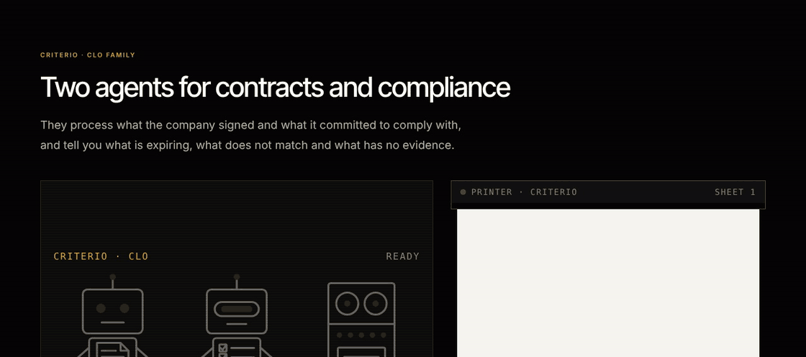
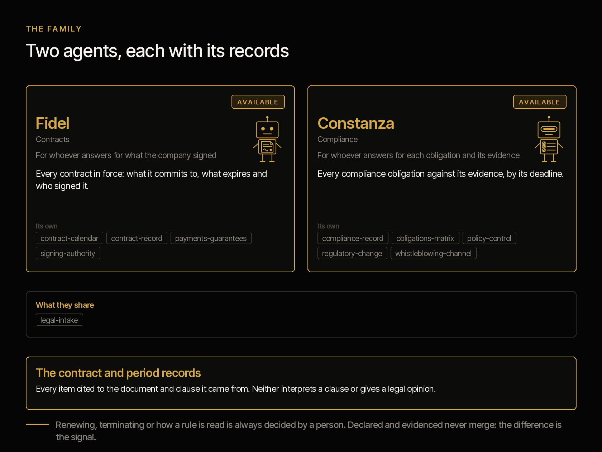
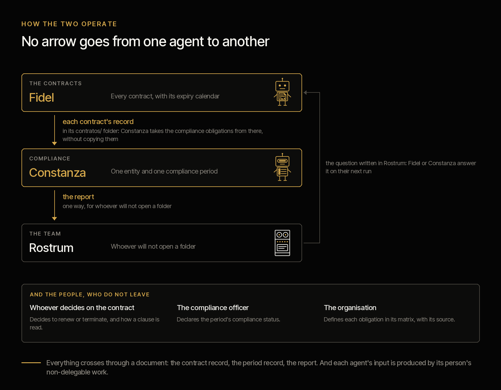
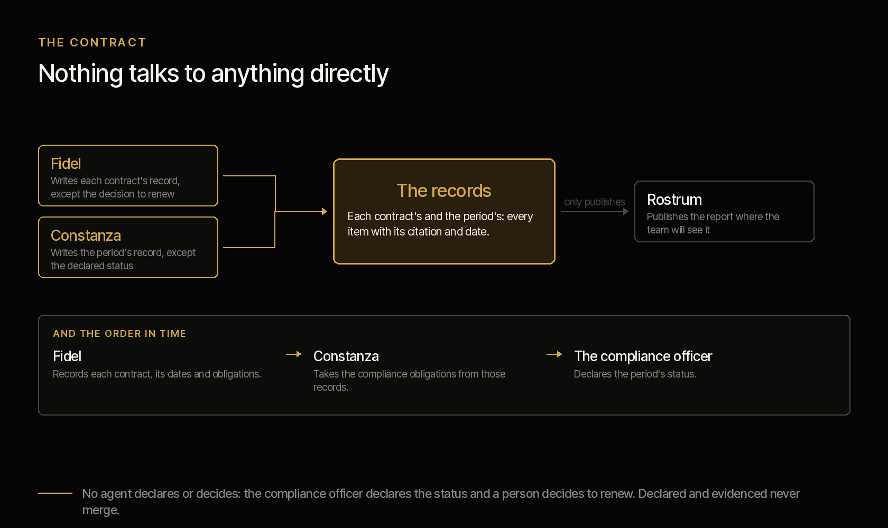

<picture><source media="(prefers-color-scheme: dark)" srcset="../../docs/img/marca/en/criterio-clo-oscuro.svg"></picture>

# criterio-clo · the legal function family

**Two agents and a portal, around their records.** Each one extends a different person in the
legal function — whoever handles the contracts and whoever answers for compliance — and neither
talks to the other directly: they talk through their records.

[Español](README.es.md) · [← Criterio](../../README.md) · Apache 2.0



| | |
|---|---|
| **Scope** | The contracts, compliance and legal risk of an entity: what it signed against what is happening, and each obligation against its evidence |
| **Objective** | That a company knows what it signed, what falls due and what it committed to |
| **Made of** | [Fidel](../../plugins/criterio-legal/README.md) · [Constanza](../../plugins/criterio-compliance/README.md) · [Rostrum](../../plugins/criterio-server/README.md) |
| **The support** | The framework that defines each role and what it costs an organisation today, with its source, year and sample: [`FUENTES.es.md`](FUENTES.es.md) (Spanish) |
| **State** | Built and tested on synthetic material from four countries —Colombia, Ecuador, Peru and Chile—: the engine, against the twelve entities in the material; the agents, in [the rounds with the agent](../../tests/evidencias/familias/clo/RONDAS.md), the latest round 4, on Peru and Chile. **Not yet tested on a specific organisation's documentation** |
| **Approach** | Contracts and compliance, with no legal opinion |
| **Commitment** | Generating, sharing and preserving knowledge is a professional obligation |
| **What it is not** | It does not replace the lawyer or the compliance officer, and does not decide for them: it processes what the organisation signed and what it committed to comply with, and says what falls due, what has no evidence and what does not tie out |
| **Licence** | [Apache 2.0](../../LICENSE) |
| **What comes next** | Deployment in an organisation: [the roadmap](#roadmap) |

---

## What the family does



The legal function has two roles that work on the same documents and answer for different
things, which is why the family has two agents. They carry a person's name because **they are
extended capabilities of people**, and what each name means points to what it does: **Fidel**
—from *fides*, the word given— makes sure what was signed is kept; **Constanza** —from
*constantia*— complies every day, not only on audit day.

**Fidel**, the contracts agent, puts what the company signed next to what is happening: the
contract register against its documents, expiries and renewal notices, each obligation with its
evidence, who signed with what authority, and what was paid against what was agreed and its
guarantees. What nobody does today and he does: **check every contract, not a sample, against
the signing-authority matrix**, and every payment against its contract's value and end date.

**Constanza**, the compliance agent, puts each of the organisation's obligations next to its
evidence: the matrix period by period, the obligations that come from contracts, the policies due
for review, the new regulations not yet assessed and the whistleblowing channel's deadlines. She
takes from Fidel's records the compliance obligations that contracts carry.

**Both install today**, each with its own plugin, and both carry the same debt, written on their
page: the engine is tested against synthetic material from four industries; **the engine and the agents' extraction are tested on synthetic material from four
countries; nothing has been tested yet on an organisation's documents.**

Countries: Colombia, Ecuador, Peru and Chile. **No legal opinion**: neither of them interprets a clause,
rules on the validity of a contract or says what a regulation requires. What an obligation
requires is defined by the organisation in its matrix, citing its source.

---

## How the two operate



The language model (LLM) extracts; the code calculates; the decision —to renew, to terminate, how
a clause or a regulation is read— is always made by a person. **The engine processes the tables
directly** —the contract register, the payments, the matrices, the policy index, the regulatory
register and the case register—, and the agent takes to the record what only a written document
carries: each contract with its parties, value, dates, renewal, notice period, signatories,
amendments, guarantees and obligations; what the compliance report declares; the new regulations
in a bulletin.

**Automated**: they process the documents, calculate the signals and prepare each deliverable
without intervention. **Semi-automated** when a data point no document carries is missing —the
entity, the notice days, who decides to renew—: then they ask the person, say what they asked and
carry on with the answer.

## The two agents and their records

Nothing talks to anything directly. **Each agent writes its records, and the record is the
contract.**



| Record | One per | What it holds | Who writes it |
|---|---|---|---|
| Contract record | Contract | Parties, value, dates, renewal, notice period, signatories, amendments, guarantees, the counterparty certificate, the obligations and the decision to renew or terminate | Fidel; the decision, the person who takes it |
| Period record | Entity and compliance period | What the period's report declares, the new regulations a bulletin or an email brings and the questions the person was asked | Constanza; the status, the compliance officer |

Every data point cites the document it comes from and its date. "Not found" is a valid answer.

### The seven invariants

1. **The agents do not talk to each other.** They talk through their records: Constanza takes
   from Fidel's the compliance obligations of the contracts.
2. **Rostrum, the portal, does not write.** It serves what the engine already wrote and says so
   with its date; it recalculates nothing.
3. **Each contract has one place**, its folder in `contratos/`: Fidel processes it and Constanza
   takes from its record what concerns her, with no copies between folders.
4. **Declared and evidenced never merge.** They go in separate fields of the record.
5. **The model extracts, the code calculates.** Every amount, deadline, day or count in a report
   comes from `legal.py`; if the engine does not give it, it is not written.
6. **No agent declares or decides.** The compliance status is declared by the compliance officer;
   renewing or terminating is decided by a person, and Fidel records it when a document takes it.
7. **No legal opinion.** What an obligation requires is defined by the organisation in its matrix,
   with its source. No agent adds, removes or rewrites an obligation.

The sixth is the easiest to break for convenience and the one that takes the whole system with
it: if the agent declares compliance, the comparison between declared and evidenced compares the
system with itself. It is not a recommendation in the documentation: it is a restriction on the
write path.

## What still belongs to the people

Both roles continue to exist in full. This extends capability; it does not replace function. And
the argument is not politeness, it is structural:

> **Each agent's input is produced by the non-delegable work of its person.**

Fidel needs somebody to decide to renew or terminate and write it down, because a notice period
that passes with no decision is exactly what he flags; and the organisation to keep its
signing-authority matrix, because without it there is nothing to check a signature against.
Constanza needs the organisation to define its obligations with their source and owner, and
somebody to leave the evidence of each one, because without a matrix there is nothing to comply
with and without evidence there is nothing to contrast.

Removing the person does not leave the agent alone: it leaves it without input. **And neither of
them interprets a clause, drafts, negotiates, signs or answers a whistleblowing case.**

## The recommended folder structure

Recommended, not mandatory ([ADR 0007](../../docs/decisions/0007-estructura-recomendada.md)):
the agents process the folder as it is. `legal-setup` and `compliance-setup` compare what they
find with this structure and, on every run, say which file is out of place and where it would go;
they never create, move or rename anything in the organisation's documents. The numbering goes in
tens, as in the PMO and CFO families.

<!-- clo:carpetas · generado por scripts/familias.py; no se edita a mano -->
One folder per entity, with its tax id at the start of the name. Inside it, what the organisation keeps for the whole entity, one folder per contract and one per compliance period.

```
legal/
└── <entidad>/
    ├── 00-referencia/
    ├── 10-registro/
    ├── 20-politicas/
    ├── 30-normativa/
    ├── 40-canal/
    ├── contratos/<código>/
    │   ├── 10-contrato/
    │   ├── 20-garantias/
    │   ├── 30-contraparte/
    │   └── 40-ejecucion/
    └── cumplimiento-<AAAA-MM>/
        ├── 10-evidencias/
        └── 20-reportes/
estado-legal/
```

**`<entidad>/`** · What the organisation keeps for the whole entity

| Folder | What goes in | Agent |
|---|---|---|
| `00-referencia/` | The authority matrix —who signs what and up to what amount— and the compliance obligations matrix | Fidel, Constanza |
| `10-registro/` | The organisation's contract register and the ERP export of payments by contract, with the cut-off date in the name | Fidel |
| `20-politicas/` | The policy index with each version and next review, and every policy | Constanza |
| `30-normativa/` | The regulatory register, the bulletins and the impact assessment of every new rule | Constanza |
| `40-canal/` | The whistleblowing channel case log, with received and answered dates | Constanza |

**`contratos/<código>/`** · One contract, with its code at the start of the folder name

| Folder | What goes in | Agent |
|---|---|---|
| `10-contrato/` | The signed contract and every amendment | Fidel |
| `20-garantias/` | The insurance policies and guarantees provided | Fidel |
| `30-contraparte/` | The counterparty's certificate of existence and representation and its documents | Fidel |
| `40-ejecucion/` | Delivery records, reports and the evidence of every obligation, with its id at the start of the name | Fidel, Constanza |

**`cumplimiento-<AAAA-MM>/`** · One compliance period

| Folder | What goes in | Agent |
|---|---|---|
| `10-evidencias/` | The evidence of every obligation in the period, with its id at the start of the name | Constanza |
| `20-reportes/` | The period's compliance report | Constanza |

**`estado-legal/`** · What Fidel and Constanza write: the configuration, each contract's record, the reports and the indexes. No person edits it, and no agent writes anywhere else.
<!-- /clo:carpetas -->

A file without the expected format is not guessed: it is reported with what it lacks.

## Installing the family

Each agent is a plugin and installs on its own. **You do not need both**: install the one that
covers the role you have.

```
/plugin marketplace add josenanez/criterio

/plugin install criterio-legal@criterio        if you handle the contracts
/plugin install criterio-compliance@criterio   if you answer for compliance
```

**In Claude Cowork** — Customise → Explore plugins → Personal → **+** → Add marketplace from
GitHub → `josenanez/criterio`.

After installing, each agent has its own setup command that looks at the folder, asks the
questions no document answers and produces a first result over your own documents. **Nobody
edits a configuration file by hand.**

And if you install both, they find each other: **there is nothing to connect.** They share the
entity's state, and each one writes only its own.

## What each agent answers for, and where its detail lives

The same for each piece: what it answers for, what it does not do, and where all its detail
lives. **Each agent page stands on its own** — somebody can install one without the other.

<!-- clo:familia-agentes · generado por scripts/familias.py; no se edita a mano -->
| | What it answers for | What it never does | Its page | Its tests |
|---|---|---|---|---|
| **Fidel** · contracts | What was signed and on what terms: the contract register against its documents, expiries and renewal notices, obligations with their evidence, who signed with what authority, and what was paid against what was agreed and its guarantees | It does not interpret clauses, does not rule on a contract's validity and does not decide to renew or terminate | [criterio-legal](../../plugins/criterio-legal/README.md) · 7 commands, 5 skills | [results](../../tests/criterio-legal/RESULTADOS.md) |
| **Constanza** · compliance | The organisation's obligations matrix against its evidence, policy reviews, new rules with their assessment, the whistleblowing channel with its deadlines, and the compliance obligations that contracts carry | It does not define obligations, does not say what a regulation requires and does not process who reported | [criterio-compliance](../../plugins/criterio-compliance/README.md) · 7 commands, 6 skills | [results](../../tests/criterio-compliance/RESULTADOS.md) |
| **Rostrum** · the portal | Publishing what the agents write where the team will see it, and taking the question from whoever will not open a folder | **Never writes the state or recalculates anything**, and decides nothing | [criterio-server](../../plugins/criterio-server/README.md) · 2 commands, one for every family | [results](../../tests/criterio-server/RESULTADOS.md) |
<!-- /clo:familia-agentes -->

The commands, one by one —what each does and which skills it uses—, are in the
[command manual](../../docs/manual.md); their input, process and report, with the signals the
engine calculates, in the [family design](DISENO.md); and the answers to what people ask most, in
the [FAQ](PREGUNTAS.md).

## In Rostrum, the portal for every family

Up to here the family's result is files on the machine of whoever ran the agents. **A general
counsel does not open a folder of files**: they open a link, or they open nothing. That is what
**Rostrum** is for: a plugin of its own, `criterio-server`, that serves the CLO family together
with the other families, without the server knowing anything about contracts
([ADR 0010](../../docs/decisions/0010-rostrum-plugin-propio.md)).

**How the CLO family enters the portal.** `/criterio-legal:legal-setup` and
`/criterio-compliance:compliance-setup` leave their configuration in `.criterio/legal/<entidad>/`
and `.criterio/cumplimiento/<entidad>/`, with the entity's legal folder marked with
`_CRITERIO_LEGAL.txt`. Fidel and Constanza share the entity's state, and each one sees its own runs
and reports in the portal, not the other's. Then `/criterio-server:server-setup` finds both
configurations and adds them to the map, and `/criterio-server:server-start` raises the portal. A
new entity enters by running `server-setup` again.

**What the CLO family has in Rostrum:**

| Where | What |
|---|---|
| Home | The **Criterio CLO** card with Fidel and Constanza and their open signals |
| `/familia/clo` | The latest each one's engine wrote —the contracts, the compliance of a period—, with its signals in words and its reports exactly as the engine left them |
| What falls due | The notice period of an auto-renewing contract, the end of a deadline, the obligation that falls due, sorted with the other families' |
| `/caso/<CTR>` | Everything the agents did on a contract |
| Where it works | The full path of the root folder, of the entity's documents with their marker, of the state and of each configuration |
| Ask an agent | A question for Fidel or for Constanza, taken on their next run |

**It authenticates nobody, and that is on purpose**: it is published behind the access control
the organisation already has. It recalculates nothing and does not write the state. The pages
meet WCAG 2.2 level AA, checked with axe-core at four screen widths
(`tests/criterio-server/accesibilidad/`).

→ **[Rostrum: install, configure and use it with every family](https://www.josenanez.com/agents/rostrum)** ·
[its README, with the routes and what to ask your organisation for](../../plugins/criterio-server/README.md)

## How each one is configured and how often it runs

This is the table that answers three questions at once: **where each agent lands, what it needs
configured, and how often it makes sense for it to run.**

<!-- clo:configuracion · generado por scripts/familias.py; no se edita a mano -->
| | Fidel | Constanza |
|---|---|---|
| **Installs as** | `criterio-legal` | `criterio-compliance` |
| **Instances** | One per entity | One per entity |
| **Configured with** | `/criterio-legal:legal-setup` | `/criterio-compliance:compliance-setup` |
| **How long that takes** | Fifteen minutes | Fifteen minutes |
| **What you have to tell it** | Entity and NIT or RUC, country, the signing-authority matrix in `00-referencia/`, how many days ahead an expiry or a notice period is flagged, the maximum age of the counterparty's certificate and who decides to renew | Entity, country, the obligations matrix in `00-referencia/` in the defined model (F-01), the period, the channel's response deadline, the days to assess a new regulation and, if the organisation uses Fidel, where his records are |
| **Where it lands** | `.criterio/legal/<entity>/config.json`, written by the command | `.criterio/cumplimiento/<entity>/config.json`, written by the command |
| **The one you put on a clock** | `/criterio-legal:legal-wake` | `/criterio-compliance:compliance-wake` |
| **What it does each day** | Decides what is due: the expiries and notice periods entering the window, new documents and a weekly review | Decides what is due: obligations falling due within the window, new documents and a weekly review |
| **What wakes it besides the clock** | A question somebody left in Rostrum | A question somebody left in Rostrum |
<!-- /clo:configuracion -->

**Nobody edits a configuration file by hand.** If changing a threshold means opening a JSON, the
threshold stays as it came and the configuration stops describing the organisation. You say it
in the conversation and the command rewrites it. Each plugin ships its
`scripts/config.example.json` so you can see the full shape without installing anything; the
notice days, the certificate's maximum age, the channel's deadline and the days to assess a
regulation are each organisation's configuration, not a standard.

### Why the two cadences are different

It is not a preference: **each agent measures against something else.**

- **Fidel** measures against the contracts' dates. A notice of non-renewal has a deadline, and
  after that day the contract renews on its own; that is why he runs when an expiry or a notice
  period enters the configured window, when a new document arrives, and once a week.
- **Constanza** measures against each obligation's frequency. What matters is the window in which
  the evidence has to appear; that is why she runs when an obligation falls due within the window,
  when a new document arrives, and once a week.

### Both go quiet when there is nothing

It is the rule that decides whether an agent is still installed a month later. The two clock
commands produce nothing when nothing is due, and then the output is one line: what was reviewed
and when it comes back. With an open question in Rostrum they never go quiet: they answer it
first.

An agent that produces a report to say there is no news teaches you to ignore it, and the day
there is news nobody opens it.

### What is **not** scheduled

**Neither of them schedules itself.** Both ship the command a clock invokes, and the clock lives
outside the plugin — a Claude Cowork scheduled task, or the operating system's scheduler invoking
Claude non-interactively. Somebody has to set it up, once.

And for it to run with nobody watching, two things are needed that do not depend on this
repository: **that the session can run without approving each step**, and **that the folder is
mounted when the clock fires.** If the organisation does not want unattended runs —and with
contracts and whistleblowing cases that is a reasonable answer—, the commands work run by hand
and the cadence still says what is due.

## The family's tests

**A single gate runs everything this repository checks**, across every family at once:

```
python3 scripts/verificar.py
```

What belongs to the CLO family is in [`tests/criterio-clo/`](../../tests/criterio-clo/): synthetic
material per industry with a key the engine never sees, and one control entity per country with no
defects at all —and with the cases that look like one—, where any signal is a failure. Every
family signal is planted at least once. `evaluar.py` runs Fidel's engine and Constanza's and
compares every signal by its name and its key: **an extra one counts the same as a missing one.**

| What is checked across the family | Why it belongs to the family and not to one agent |
|---|---|
| That every planted signal is raised, and none in the controls | Fidel's signals and Constanza's come from the same engine and the same material |
| That a contract's compliance obligation matches the matrix | It is the border between the two: Fidel's contract brings it and Constanza's matrix meets it |
| **That the shared copies have not drifted apart** | `legal.py` and `legal-intake` travel copied in both plugins. Two copies that drift compute differently over the same documents, and nobody would know which to believe |
| That the design, the pages and the portal say what the sources say | The tables of agents, commands, signals, folders and skills come from `familia.json`, `carpetas.json` and `fuentes.json`; `scripts/familias.py --check` fails if a copy does not match |

**Each agent's result, generated from the run**, on its own page:
[Fidel](../../tests/criterio-legal/RESULTADOS.md) ·
[Constanza](../../tests/criterio-compliance/RESULTADOS.md) (Spanish). What is planted in each
entity and the signal it has to raise, in the same detail, **and what the material does not
test**, in [`EVIDENCIA.md`](../../tests/criterio-clo/EVIDENCIA.md) (Spanish). The whole set across
every family, in [`docs/pruebas.md`](../../docs/pruebas.md).

**The rounds with the agent.** Round 1 ran on banking and the Colombian control; round 2, the full one, on the six entities of Colombia and Ecuador: 37 of 37 signals with none extra and 808 of 815 data points; round 3 verified the fixes; round 4 added Peru and Chile, their six entities: 37 of 37 signals with none extra and 812 of 813 data points. The 10 defects the rounds found are fixed and verified. Every output, its cost, its grading, the commands repeated after a defect was fixed and every defect with its origin and commit are in [the family's rounds](../../tests/evidencias/familias/clo/RONDAS.md). **The statistical analysis of the rounds** —coverage and precision of the signals, the data extracted and the 95% margin of each, their evolution round by round, by industry and country, each failure with the defect that explains it and its origin— in [`analisis/ANALISIS.md`](analisis/ANALISIS.md). [`scripts/analisis_familias.py`](../../scripts/analisis_familias.py) generates it from the round evidence, and `verificar.py` checks that it says what the evidence says.

## The test industries

Four South American industries and one control entity per country: **banking and retail in
Colombia**, and **cooperatives and mining in Ecuador**. Each one carries its legal folder with
six contracts —each with its amendment, its policy, the counterparty certificate and the evidence
of its obligations— and three compliance periods. The entities, the planted defects and the
signals expected of each, in
[`tests/criterio-clo/EVIDENCIA.md`](../../tests/criterio-clo/EVIDENCIA.md) (Spanish).

## Roadmap

<!-- hoja de ruta: generado por scripts/hoja.py desde hoja-de-ruta.json; no se edita a mano -->

The family grows in increments. Each one is a version with its full test and its statistical analysis published, with the same metrics, so the evolution can be compared.

| Version | Status | What goes in | Test |
|---|---|---|---|
| 0.8.0 | Released | **Built, with the engine tested and a first round with the agent**<br>· Fidel and Constanza’s fourteen commands, their skills and the calculation engine<br>· Colombia and Ecuador, with no legal opinion: what an obligation requires is defined by the organisation in its matrix<br>· The root folder each agent searches for and, with permission, marks<br>· The family in Rostrum, with what falls due and where each agent works<br>· The first round with the agent: Fidel and Constanza on banking and the Colombian control, with the defects it found fixed | The engine, against 4 industries and 2 control entities; the agent, on banking and the Colombian control |
| 0.9.0 | Released | **The full round with the agent**<br>· Fidel and Constanza run their commands on the material of the four industries, as the PMO does in every round<br>· What only each contract carries —parties, value, dates, renewal, notice period, signatories, amendments, guarantees and obligations—, extracted and graded against the key<br>· With a full round, the family is declared tested | 4 industries and 2 control entities, with the key the agent never sees |
| 0.11.0 | Next | **Peru and Chile**<br>· Material for banking, mining and control in Peru, and for retail, mining and control in Chile, with each country's tax ID<br>· An obligation tied to termination falls due on the current end date, the one in the latest amendment (CLO-10) | Round 4: Fidel and Constanza on the six entities of Peru and Chile, 37 of 37 signals, none extra and 812 of 813 data points; the one missed, fixed and verified |
| Increment 4 | Next | **Mexico and Brazil**<br>· One country at a time, by market size: its verified legal sources and its test material<br>· Each country is marked on the map when it passes its round | The round with the agents in each country |
| Increment 5 | Reserved | **Deployment in an organisation**<br>· The first use on a specific organisation’s contracts and compliance | That organisation’s documentation |
| Increment 6 | Reserved | **Public contracts**<br>· Their own rules on publication and guarantees | Its own material, as every increment |

<!-- /hoja de ruta -->

## The family's ten skills

<!-- clo:skills-familia · generado por scripts/familias.py; no se edita a mano -->
Ten distinct skills across the two agents. **The ones they share are literal copies, not an imported module**: an installed plugin has to run on its own. `scripts/sincronizar.py` copies them and `scripts/sincronizar.py --check` fails if they drift.

| Skill | Fidel | Constanza |
|---|:--:|:--:|
| `compliance-record` | · | ● |
| `contract-calendar` | ● | · |
| `contract-record` | ● | · |
| `legal-intake` | ● | ● |
| `obligations-matrix` | · | ● |
| `payments-guarantees` | ● | · |
| `policy-control` | · | ● |
| `regulatory-change` | · | ● |
| `signing-authority` | ● | · |
| `whistleblowing-channel` | · | ● |
<!-- /clo:skills-familia -->

## Status

**Both are built and can be installed today**, and both carry the same debt, which is better not
hidden: **the engine and the agents' extraction are tested on synthetic material, not on a real organisation's
documentation.**

<!-- clo:estado · generado por scripts/familias.py; no se edita a mano -->
| Agent | Installs as | Its test |
|---|---|---|
| **Fidel** · Contracts | `criterio-legal` · 7 commands, 5 skills | The engine, tested; with the agent, every entity in the material, up to round 4 · [results](../../tests/criterio-legal/RESULTADOS.md) |
| **Constanza** · Compliance | `criterio-compliance` · 7 commands, 6 skills | The engine, tested; with the agent, every entity in the material, up to round 4 · [results](../../tests/criterio-compliance/RESULTADOS.md) |
| **Rostrum** · the portal | `criterio-server` · 2 commands, for every family | — |
<!-- /clo:estado -->

The family was declared tested with the full round with the agent, and the first use on a specific
organisation's contracts and compliance is the next increment; public contracts, with their
own rules, come later. The decisions still open, in the [design](DISENO.md#open-decisions).
