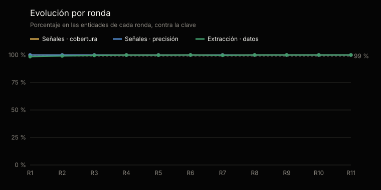
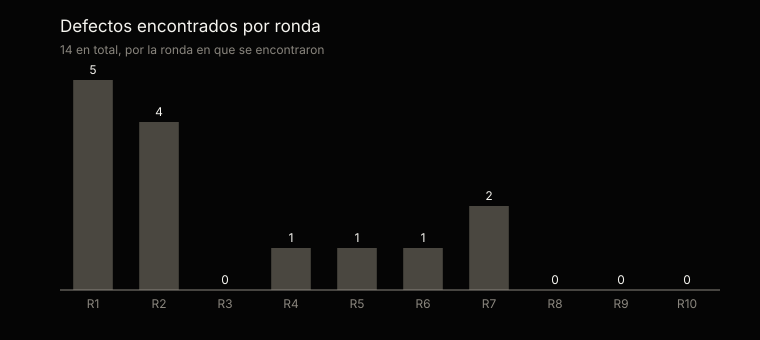

# Análisis estadístico de las pruebas · familia CLO

Generado por `scripts/analisis_familias.py` desde `tests/evidencias/familias/clo/` · ronda completa más reciente: 2 · [English](ANALISIS.md)

No se edita a mano: cada cifra sale de la evidencia y el análisis se regenera con cada ronda.

## En una mirada

La ronda completa más reciente, la 2, sobre las 6 entidades del material: 37 de 37 señales sembradas encontradas (margen del 95 %: 90,5–100 %) y 0 de más; 808 de 815 datos extraídos bien (99,1 %, margen del 95 %: 98,2–99,6 %); y 2 de 2 entidades de control sin ninguna señal.

Sumando las rondas 1–3, 51 de 51 señales encontradas, 0 de más y 1453 de 1467 datos bien. Las rondas repiten el mismo material: no son muestras independientes, y el margen se calcula sobre los casos de cada una.

## Qué se probó y cómo

Cada entidad corre todos los comandos de los dos agentes, con un tope de tokens fijado antes de empezar, sobre un material que trae su clave aparte: el agente nunca la ve. Las señales se comparan por su nombre y su clave; la extracción, campo por campo, contra lo que traen los documentos escritos. Las entidades de control no tienen ningún defecto sembrado: cualquier señal en ellas es una falla.

Cobertura: de las señales sembradas, cuántas encontró. Precisión: de las que levantó, cuántas eran correctas. Margen del 95 %: intervalo de confianza de Wilson sobre los casos.

|   |   |
|---|---|
| Rondas | 3; la completa más reciente es la 2 |
| Material | Banca · Colombia, Cooperativas · Ecuador, Minería · Ecuador, Retail · Colombia |
| Entidades de control | Control · Colombia, Control · Ecuador |
| Corridas de una entidad | 11 |
| Señales sembradas | 51 |
| Datos calificados | 1467 |

## Resultados acumulados · rondas 1–3

| Métrica | Casos | Resultado | Margen del 95 % |
|---|---|---|---|
| Señales · cobertura | 51 de 51 | 100 % | 92,9–100 % |
| Señales · precisión | 51 de 51 | 100 % | 92,9–100 % |
| Extracción · datos correctos | 1453 de 1467 | 99 % | 98,4–99,5 % |
| Control · sin ninguna señal | 5 de 5 | 100 % | 56,5–100 % |

## Evolución por ronda

Una ronda que no corre todas las entidades es parcial: la primera, pequeña, antes de la completa, o una de verificación, que repite las corridas que un defecto corregido dejó pendientes.

| Ronda | Entidades | Señales · cobertura | Señales · precisión | Extracción | Control sin señales | Tokens | Defectos |
|---|---|---|---|---|---|---|---|
| 1 | 3 | 100 % | 100 % | 98,5 % | 2 de 2 | 19,1 M | 5 |
| 2 | 6 | 100 % | 100 % | 99,1 % | 2 de 2 | 43,7 M | 4 |
| 3 | 2 | 100 % | 100 % | 99,6 % | 1 de 1 | 11 M | 0 |

## La ronda completa más reciente · ronda 2

| Métrica | Casos | Resultado | Margen del 95 % |
|---|---|---|---|
| Señales · cobertura | 37 de 37 | 100 % | 90,5–100 % |
| Señales · precisión | 37 de 37 | 100 % | 90,5–100 % |
| Extracción · datos correctos | 808 de 815 | 99,1 % | 98,2–99,6 % |
| Control · sin ninguna señal | 2 de 2 | 100 % | 34,2–100 % |

## Por industria y país · ronda 2

| Material | Agentes | Señales | De más | Extracción | Tokens |
|---|---|---|---|---|---|
| Banca · Colombia | Constanza, Fidel | 10 de 10 | 0 | 131 de 132 | 7,9 M |
| Cooperativas · Ecuador | Constanza, Fidel | 9 de 9 | 0 | 153 de 153 | 7,8 M |
| Minería · Ecuador | Constanza, Fidel | 9 de 9 | 0 | 130 de 132 | 7,7 M |
| Retail · Colombia | Constanza, Fidel | 9 de 9 | 0 | 132 de 132 | 7,2 M |
| Control · Colombia | Constanza, Fidel | 0 de 0 | 0 | 128 de 132 | 5,3 M |
| Control · Ecuador | Constanza, Fidel | 0 de 0 | 0 | 134 de 134 | 7,7 M |

## Lo que falló, uno por uno · rondas 1–3

14 fallas en 11 corridas, cada una con el defecto que la explica: su origen dice si falló el agente o la prueba. Las cifras son las de la calificación original: 4 de esas fallas vinieron de la prueba —el arnés o la clave—, no del agente, y con la prueba corregida se califican como correctas.

| Ronda | Material | Qué | Dónde | Defecto | Origen |
|---|---|---|---|---|---|
| 1 | Control · Colombia | Dato calificado como mal | contratos/CTR-501 · obligations | CLO-4 | Instrucciones del agente |
| 1 | Control · Colombia | Dato calificado como mal | contratos/CTR-502 · obligations | CLO-4 | Instrucciones del agente |
| 1 | Control · Colombia | Dato calificado como mal | contratos/CTR-503 · obligations | CLO-4 | Instrucciones del agente |
| 1 | Control · Colombia | Dato calificado como mal | contratos/CTR-504 · obligations | CLO-4 | Instrucciones del agente |
| 1 | Control · Colombia | Dato calificado como mal | contratos/CTR-505 · obligations | CLO-4 | Instrucciones del agente |
| 1 | Control · Colombia | Dato calificado como mal | cumplimiento · new_rules | CLO-5 | Arnés de pruebas |
| 2 | Banca · Colombia | Dato calificado como mal | contratos/CTR-101 · obligations | CLO-9 | Arnés de pruebas |
| 2 | Control · Colombia | Dato calificado como mal | cumplimiento · declared.status | CLO-6 | Instrucciones del agente |
| 2 | Control · Colombia | Dato calificado como mal | cumplimiento · declared.date | CLO-6 | Instrucciones del agente |
| 2 | Control · Colombia | Dato calificado como mal | cumplimiento · declared.source | CLO-6 | Instrucciones del agente |
| 2 | Control · Colombia | Dato calificado como mal | cumplimiento · new_rules | CLO-6 | Instrucciones del agente |
| 2 | Minería · Ecuador | Dato calificado como mal | contratos/CTR-405 · signed_on | CLO-8 | Instrucciones del agente |
| 2 | Minería · Ecuador | Dato calificado como mal | contratos/CTR-405 · signatories | CLO-7 | Clave de calificación |
| 3 | Control · Colombia | Dato calificado como mal | contratos/CTR-501 · obligations | CLO-9 | Arnés de pruebas |

## Defectos

9 defectos registrados, cada uno con su origen, su corrección y la corrida que la verificó: 9 verificados y 0 por verificar. 4 vinieron del material, la clave o el arnés de pruebas, no de los agentes.

| Origen | Defectos |
|---|---|
| Arnés de pruebas | 3 |
| Instrucciones del agente | 3 |
| Código | 2 |
| Clave de calificación | 1 |

| Agente | Defectos |
|---|---|
| Constanza | 4 |
| Fidel | 4 |
| Ninguno | 1 |

## Consumo y próximo paso

Las 3 rondas usaron 76,3 millones de tokens: 73,8 millones en las corridas calificadas y 2,4 en las que se repitieron después de corregir un defecto. En promedio, 6,7 millones por entidad.

El material es sintético. El próximo paso es el despliegue en una organización, con su propia documentación.

---

La evidencia completa de cada ronda: [`tests/evidencias/familias/clo/`](https://github.com/josenanez/criterio/tree/main/tests/evidencias/familias/clo).
