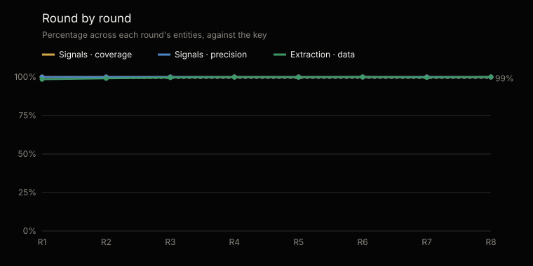
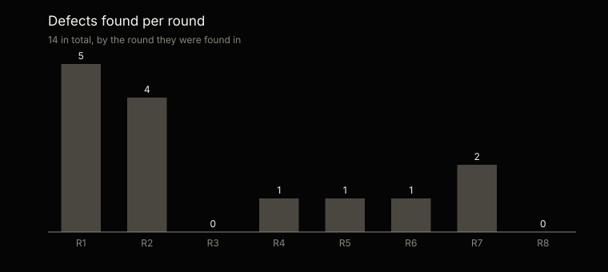

# Statistical analysis of the tests · CLO family

Generated by `scripts/analisis_familias.py` from `tests/evidencias/familias/clo/` · most recent round: 5 · [Español](ANALISIS.es.md)

Not edited by hand: every figure comes from the evidence and the analysis is regenerated with every round.

## At a glance

The most recent round, round 5, partial, on 4 of the material's 15 entities: 20 of 20 seeded signals found (95% margin: 83.8–100%) and 0 extra; 523 of 524 data items extracted right (99.8%, 95% margin: 98.9–100%); and 2 of 2 control entities with no signal at all.

Across rounds 1–5, 108 of 108 signals found, 0 extra and 2916 of 2932 data items right. The rounds repeat the same material: they are not independent samples, and the margin is computed over each round's cases.

## What was tested and how

Each entity runs every command of the two agents, with a token cap set before starting, on material whose key is kept apart: the agent never sees it. Signals are compared by name and key; extraction, field by field, against what the written documents say. Control entities carry no seeded defect: any signal in them is a failure.

Coverage: of the seeded signals, how many were found. Precision: of those raised, how many were right. 95% margin: Wilson confidence interval over the cases.

|   |   |
|---|---|
| Rounds | 5; the most recent, round 5, is partial |
| Material | Banking · Mexico, Retail · Mexico |
| Control entities | Control · Mexico |
| Entity runs | 22 |
| Seeded signals | 108 |
| Data items graded | 2932 |

## Cumulative results · rounds 1–5

| Measure | Cases | Result | 95% margin |
|---|---|---|---|
| Signals · coverage | 108 of 108 | 100% | 96.5–100% |
| Signals · precision | 108 of 108 | 100% | 96.5–100% |
| Extraction · data right | 2916 of 2932 | 99.5% | 99.1–99.7% |
| Control · with no signal | 10 of 10 | 100% | 72.2–100% |

## Round by round

A round that does not run every entity is partial: the first, small one, before the complete one, or a verification round, which repeats the runs a fixed defect left pending.

| Round | Entities | Signals · coverage | Signals · precision | Extraction | Control with no signal | Tokens | Defects |
|---|---|---|---|---|---|---|---|
| 1 | 3 | 100% | 100% | 98.5% | 2 of 2 | 19.1 M | 5 |
| 2 | 6 | 100% | 100% | 99.1% | 2 of 2 | 43.7 M | 4 |
| 3 | 2 | 100% | 100% | 99.6% | 1 of 1 | 11 M | 0 |
| 4 | 7 | 100% | 100% | 99.9% | 3 of 3 | 21.6 M | 1 |
| 5 | 4 | 100% | 100% | 99.8% | 2 of 2 | 12.1 M | 1 |

## The most recent round · round 5

| Measure | Cases | Result | 95% margin |
|---|---|---|---|
| Signals · coverage | 20 of 20 | 100% | 83.8–100% |
| Signals · precision | 20 of 20 | 100% | 83.8–100% |
| Extraction · data right | 523 of 524 | 99.8% | 98.9–100% |
| Control · with no signal | 2 of 2 | 100% | 34.2–100% |

## By industry and country · round 5

| Material | Agents | Signals | Extra | Extraction | Tokens |
|---|---|---|---|---|---|
| Banking · Mexico | Constanza, Fidel | 10 of 10 | 0 | 132 of 132 | 3.6 M |
| Retail · Mexico | Constanza, Fidel | 10 of 10 | 0 | 132 of 132 | 3.3 M |
| Control · Mexico | Constanza, Fidel | 0 of 0 | 0 | 131 of 132 | 3.1 M |
| Control · Mexico | Fidel | 0 of 0 | 0 | 128 of 128 | 2 M |

## What failed, one by one · rounds 1–5

16 failures in 22 runs, each with the defect that explains it: its origin says whether the agent or the test failed. The figures are those of the original grading: 4 of those failures came from the test —the harness or the key—, not from the agent, and with the test fixed they grade as right.

| Round | Material | What | Where | Defect | Origin |
|---|---|---|---|---|---|
| 1 | Control · Colombia | Data item graded wrong | contratos/CTR-501 · obligations | CLO-4 | Agent instructions |
| 1 | Control · Colombia | Data item graded wrong | contratos/CTR-502 · obligations | CLO-4 | Agent instructions |
| 1 | Control · Colombia | Data item graded wrong | contratos/CTR-503 · obligations | CLO-4 | Agent instructions |
| 1 | Control · Colombia | Data item graded wrong | contratos/CTR-504 · obligations | CLO-4 | Agent instructions |
| 1 | Control · Colombia | Data item graded wrong | contratos/CTR-505 · obligations | CLO-4 | Agent instructions |
| 1 | Control · Colombia | Data item graded wrong | cumplimiento · new_rules | CLO-5 | Test harness |
| 2 | Banking · Colombia | Data item graded wrong | contratos/CTR-101 · obligations | CLO-9 | Test harness |
| 2 | Control · Colombia | Data item graded wrong | cumplimiento · declared.status | CLO-6 | Agent instructions |
| 2 | Control · Colombia | Data item graded wrong | cumplimiento · declared.date | CLO-6 | Agent instructions |
| 2 | Control · Colombia | Data item graded wrong | cumplimiento · declared.source | CLO-6 | Agent instructions |
| 2 | Control · Colombia | Data item graded wrong | cumplimiento · new_rules | CLO-6 | Agent instructions |
| 2 | Mining · Ecuador | Data item graded wrong | contratos/CTR-405 · signed_on | CLO-8 | Agent instructions |
| 2 | Mining · Ecuador | Data item graded wrong | contratos/CTR-405 · signatories | CLO-7 | Grading key |
| 3 | Control · Colombia | Data item graded wrong | contratos/CTR-501 · obligations | CLO-9 | Test harness |
| 4 | Control · Peru | Data item graded wrong | contratos/CTR-902 · obligations | CLO-10 | Agent instructions |
| 5 | Control · Mexico | Data item graded wrong | contratos/CTR-1502 · obligations | CLO-11 | Agent instructions |

## Defects

11 defects logged, each with its origin, its fix and the run that verified it: 11 verified and 0 to verify. 4 came from the material, the key or the test harness, not from the agents.

| Origin | Defects |
|---|---|
| Agent instructions | 5 |
| Test harness | 3 |
| Code | 2 |
| Grading key | 1 |

| Agent | Defects |
|---|---|
| Fidel | 6 |
| Constanza | 4 |
| None | 1 |

## Cost and next step

The 5 rounds used 110 million tokens: 107.5 million in the graded runs and 2.4 in the ones repeated after fixing a defect. On average, 4.9 million per entity.

The material is synthetic. The next step is deployment in an organisation, with its own documentation.

---

The full evidence of every round: [`tests/evidencias/familias/clo/`](https://github.com/josenanez/criterio/tree/main/tests/evidencias/familias/clo).
