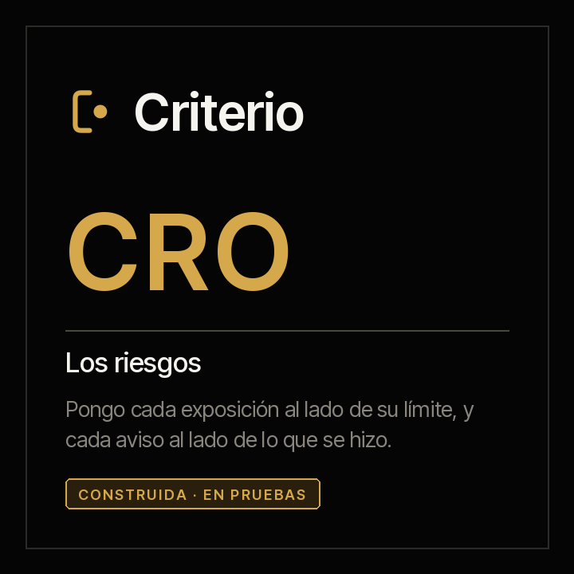

<picture><source media="(prefers-color-scheme: dark)" srcset="../../docs/img/marca/es/criterio-cro-oscuro.svg"></picture>

# criterio-cro · la familia de los riesgos

**Dos agentes y un portal, alrededor de sus fichas.** Cada uno extiende a una persona distinta del área de
riesgos —quien responde por el apetito y sus límites y quien responde por los indicadores y los eventos de
pérdida— y comparten la carpeta y el marco de apetito de la entidad: cada uno escribe solo su ficha.

[English](README.md) · [← Criterio](../../README.es.md) · Apache 2.0



---

## Qué hace la familia

El marco de apetito dice cuánto riesgo acepta la junta, y los límites lo vuelven cifras. Entre la
declaración y el comité de riesgos pasan muchos reportes: la exposición de cada área, los indicadores que
avisan antes y la base de eventos de pérdida. Cuando un límite se excede sin que nadie lo trate, casi nunca
es porque faltara el dato: es un reporte que llegó tarde, un aviso sin acción o un evento que se repite y no
está en la matriz. Ese cruce hoy se revisa a mano, reporte por reporte. La familia lo calcula, sobre el
proceso de ISO 31000 (F-01) y, en una entidad vigilada, la norma de su país
([decisión 0035](../../docs/decisions/0035-la-familia-cro.md)).

- **Severo** pone cada exposición que reportan las áreas al lado de su límite y su plan, y dice qué límite
  no tiene dueño o pasó su revisión, qué riesgo alto de la matriz no tiene con qué medirse y si la junta
  revisó la declaración de apetito a tiempo.
- **Casandra** sigue cada indicador clave hasta su umbral y cada evento de pérdida hasta su registro: el
  aviso sin acción, el indicador sin reportar, el evento incompleto o tardío, el que se repite y el que la
  matriz no ve.

## Lo que sigue siendo de las personas

Fijar el apetito, un límite o un umbral, aprobar un exceso, aceptar o calificar un riesgo, cerrar un evento
y calcular el capital o la pérdida esperada. Los agentes dicen qué está fuera y dónde; la decisión es siempre
de la junta, del comité de riesgos y de las áreas.

## La estructura de carpetas recomendada

<!-- cro:carpetas · generado por scripts/familias.py; no se edita a mano -->
Una carpeta por entidad, con su identificación fiscal al inicio del nombre. Dentro, el marco de apetito con la matriz de riesgos, los límites y los indicadores clave; la exposición que reportan las áreas con sus planes de acción; los valores y las acciones de los indicadores; la base de eventos de pérdida, y las actas del comité de riesgos y de la junta.

```
riesgos/
└── <entidad>/
    ├── 00-marco/
    ├── 10-exposicion/
    ├── 20-indicadores/
    ├── 30-eventos/
    └── 40-actas/
estado-riesgos/
```

**`<entidad>/`** · Lo que el área de riesgos lleva de la entidad

| Carpeta | Qué va | Agente |
|---|---|---|
| `00-marco/` | La declaración de apetito, la política de riesgo operacional con sus plazos, la matriz de riesgos de la segunda línea, los límites del marco y los indicadores clave con sus umbrales | Severo, Casandra |
| `10-exposicion/` | La exposición que reporta cada área contra cada límite, por periodo, con su fecha de reporte, y los planes de acción de los excesos | Severo |
| `20-indicadores/` | El valor de cada indicador clave por periodo y las acciones acordadas sobre los que están en alerta | Casandra |
| `30-eventos/` | La exportación de la base de eventos de pérdida: cada evento con sus fechas, su proceso, su tipo, su causa, su monto y su riesgo | Casandra |
| `40-actas/` | Las actas del comité de riesgos y de la junta, con los excesos aprobados, la revisión de la declaración y las acciones sobre los indicadores | Severo, Casandra |

**`estado-riesgos/`** · Lo que escriben Severo y Casandra: la configuración, la ficha de cada periodo, los informes y los índices. Ninguna persona lo edita, y ningún agente escribe fuera de aquí.
<!-- /cro:carpetas -->

Un archivo sin el formato esperado no se adivina: se reporta con lo que le falta.

## Instalación de la familia

Necesita Claude Code 2.1.110 o posterior; si algo falla, [la instalación paso a paso](../../docs/instalacion.es.md).

**La familia se instala de una vez.** El plugin `criterio-cro` trae a sus agentes y a Rostrum, y
`/criterio-cro:cro-setup` los configura en orden, en una sola conversación: lo que ya se respondió
no se vuelve a preguntar.

```
/plugin marketplace add josenanez/criterio
/plugin install criterio-cro@criterio
/criterio-cro:cro-setup
```

Después, a cada agente se le pide en tus palabras, sin saber cómo se llama cada comando:
`/criterio-risk-appetite:severo` y `/criterio-risk-events:casandra`
([decisión 0027](../../docs/decisions/0027-cada-agente-se-pide-en-palabras.md)).

## De qué responde cada agente, y dónde está su detalle

<!-- cro:familia-agentes · generado por scripts/familias.py; no se edita a mano -->
| | De qué responde | Lo que nunca hace | Su página | Sus pruebas |
|---|---|---|---|---|
| **Severo** · el apetito por riesgo | La declaración de apetito contra sus límites y cada límite contra la exposición que reportan las áreas: el límite excedido sin plan ni aprobación, el reporte fuera de plazo, el límite sin dueño o con la revisión vencida, el riesgo alto de la matriz sin límite ni indicador y la declaración que la junta no ha revisado en el plazo del marco | No fija ni cambia un límite, no aprueba un exceso, no acepta un riesgo, no calcula capital ni valor en riesgo y no se conecta a un sistema | [criterio-risk-appetite](../../plugins/criterio-risk-appetite/README.es.md) · 8 comandos, 3 skills | [resultados](../../tests/criterio-risk-appetite/RESULTADOS.md) |
| **Casandra** · los indicadores y los eventos | Los indicadores clave de riesgo contra sus umbrales y la base de eventos de pérdida contra sus registros: el indicador en alerta sin acción, el que no se reportó, el evento sin causa, sin monto o sin proceso, el que se registró fuera de plazo, el que se repite en el mismo proceso y el que no está en la matriz de riesgos | No fija un umbral, no califica un riesgo, no calcula una pérdida esperada ni capital, no cierra un evento y no se conecta a un sistema | [criterio-risk-events](../../plugins/criterio-risk-events/README.es.md) · 8 comandos, 3 skills | [resultados](../../tests/criterio-risk-events/RESULTADOS.md) |
| **Rostrum** · el portal | Publicar lo que escriben los agentes donde el equipo lo vea, y recibir la pregunta de quien no abre una carpeta | **No escribe en el estado ni recalcula nada**, y no decide nada | [criterio-server](../../plugins/criterio-server/README.es.md) · 3 comandos, uno para todas las familias | [resultados](../../tests/criterio-server/RESULTADOS.md) |
<!-- /cro:familia-agentes -->

## Cómo se configura y cada cuánto corre cada uno

<!-- cro:configuracion · generado por scripts/familias.py; no se edita a mano -->
| | Severo | Casandra |
|---|---|---|
| **Se instala** | `criterio-risk-appetite` | `criterio-risk-events` |
| **Instancias** | Una por entidad | Una por entidad |
| **Se configura con** | `/criterio-risk-appetite:appetite-setup` | `/criterio-risk-events:events-setup` |
| **Cuánto tarda eso** | Quince minutos | Quince minutos |
| **Qué le tienes que decir** | Entidad y su identificación fiscal, país, el último periodo cerrado y los plazos del marco: los días para reportar la exposición y cada cuántos meses revisa la junta la declaración | Entidad y su identificación fiscal, país, el último periodo cerrado y los plazos de la política: los días para registrar un evento y la ventana en que dos eventos cuentan como repetidos |
| **Dónde queda** | `.criterio/apetito/<entidad>/config.json`, escrito por el comando | `.criterio/eventos/<entidad>/config.json`, escrito por el comando |
| **El que se le pone a un reloj** | `/criterio-risk-appetite:appetite-wake` | `/criterio-risk-events:events-wake` |
| **Qué toca cada día** | Decide si toca procesar el apetito —documentos nuevos o la revisión semanal— o un reporte con señales abiertas, y lo corre; si no toca nada, se calla | Decide si toca procesar los eventos —documentos nuevos o la revisión semanal— o un reporte con señales abiertas, y lo corre; si no toca nada, se calla |
| **Qué lo despierta además del reloj** | Una pregunta que alguien dejó en Rostrum | Una pregunta que alguien dejó en Rostrum |
<!-- /cro:configuracion -->

**Nadie edita un archivo de configuración a mano.** Se dice en la conversación y el comando lo reescribe.
El apetito, los límites, los umbrales y los plazos salen del marco de apetito de la organización.

## Las pruebas de la familia

**Una sola puerta corre todo lo que este repositorio comprueba**, de todas las familias a la vez:

```
python3 scripts/verificar.py
```

Lo propio de la CRO está en [`tests/criterio-cro/`](../../tests/criterio-cro/): material sintético con
una clave que el motor no ve y dos entidades de control, donde cualquier señal es una falla. **Una señal
de más cuenta igual que una de menos.** Qué se siembra y qué no prueba el material, en
[`EVIDENCIA.md`](../../tests/criterio-cro/EVIDENCIA.md).

## Hoja de ruta

<!-- hoja de ruta: generado por scripts/hoja.py desde hoja-de-ruta.json; no se edita a mano -->
<!-- /hoja de ruta -->

## Los skills de la familia

<!-- cro:skills-familia · generado por scripts/familias.py; no se edita a mano -->
Cuatro skills distintos entre los dos agentes. **Los que comparten son copias literales, no un módulo importado**: un plugin instalado tiene que correr solo. `scripts/sincronizar.py` las copia y `scripts/sincronizar.py --check` falla si se separan.

| Skill | Severo | Casandra |
|---|:--:|:--:|
| `appetite-record` | ● | · |
| `kri-record` | · | ● |
| `risk-intake` | ● | ● |
| `risk-policy` | ● | ● |
<!-- /cro:skills-familia -->

## Estado

<!-- cro:estado · generado por scripts/familias.py; no se edita a mano -->
| Agente | Se instala | Su prueba |
|---|---|---|
| **Severo** · El apetito por riesgo | `criterio-risk-appetite` · 8 comandos, 3 skills | El motor, probado; una primera ronda con el agente; la completa, pendiente · [resultados](../../tests/criterio-risk-appetite/RESULTADOS.md) |
| **Casandra** · Los indicadores y los eventos | `criterio-risk-events` · 8 comandos, 3 skills | El motor, probado; una primera ronda con el agente; la completa, pendiente · [resultados](../../tests/criterio-risk-events/RESULTADOS.md) |
| **Rostrum** · el portal | `criterio-server` · 3 comandos, para todas las familias | — |

Las pruebas usan material sintético construido sobre información real de empresas, anonimizada antes de procesarse: ningún nombre, identificación, cifra ni dato personal que permita reconocer a una empresa o a una persona se conserva ni se publica. Lo que se publica de cada prueba son sus resultados, sin datos.
<!-- /cro:estado -->
