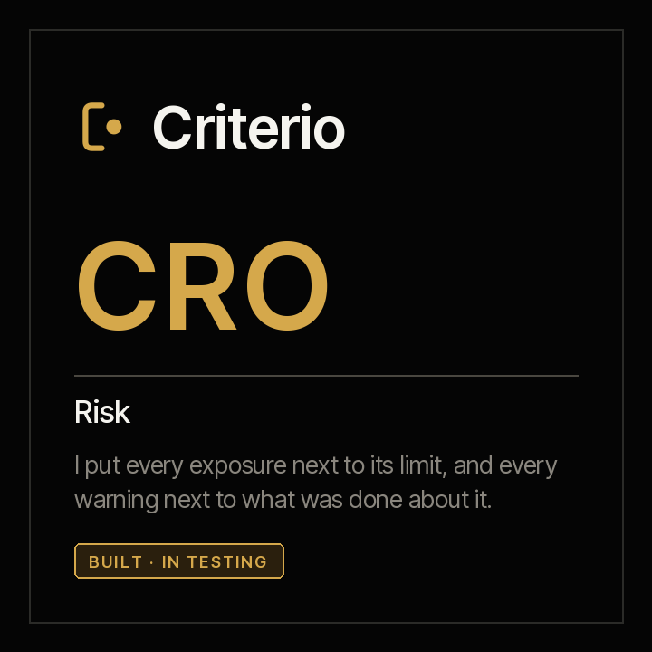

<picture><source media="(prefers-color-scheme: dark)" srcset="../../docs/img/marca/en/criterio-cro-oscuro.svg"></picture>

# criterio-cro · the risk family

**Two agents and a portal, around their records.** Each extends a different person in the risk office
—whoever answers for the appetite and its limits and whoever answers for the indicators and loss events—
and they share the entity's folder and appetite framework: each writes only its own record.

[Español](README.es.md) · [← Criterio](../../README.md) · Apache 2.0



---

## What the family does

The appetite framework says how much risk the board accepts, and the limits turn it into figures. Between
the statement and the risk committee there are many reports: each area's exposure, the indicators that warn
ahead and the loss event database. When a limit is breached without anyone dealing with it, it is rarely
because the data was missing: it is a report that came late, a warning with no action or an event that
repeats and is not in the register. Today that cross-check is done by hand, report by report. The family
calculates it, on the ISO 31000 process (F-01) and, in a supervised entity, its country's regulation
([decision 0035](../../docs/decisions/0035-la-familia-cro.md)).

- **Severo** puts each exposure the areas report next to its limit and its plan, and says which limit has
  no owner or is past its review, which high risk in the register has nothing to be measured against and
  whether the board reviewed the appetite statement on time.
- **Casandra** follows each key indicator to its threshold and each loss event to its record: the warning
  with no action, the unreported indicator, the incomplete or late event, the one that repeats and the one
  the register does not see.

## What remains with people

Setting the appetite, a limit or a threshold, approving a breach, accepting or rating a risk, closing an
event and calculating capital or expected loss. The agents say what is outside and where; the decision is
always the board's, the risk committee's and the areas'.

## The recommended folder structure

<!-- cro:carpetas · generado por scripts/familias.py; no se edita a mano -->
One folder per entity, with its tax id at the start of the name. Inside it, the appetite framework with the risk register, the limits and the key indicators; the exposure the areas report with its action plans; the values and actions of the indicators; the loss event database, and the minutes of the risk committee and the board.

```
riesgos/
└── <entidad>/
    ├── 00-marco/
    ├── 10-exposicion/
    ├── 20-indicadores/
    ├── 30-eventos/
    └── 40-actas/
estado-riesgos/
```

**`<entidad>/`** · What the risk office keeps for the entity

| Folder | What goes in | Agent |
|---|---|---|
| `00-marco/` | The appetite statement, the operational risk policy with its deadlines, the second-line risk register, the framework's limits and the key indicators with their thresholds | Severo, Casandra |
| `10-exposicion/` | The exposure each area reports against each limit, by period, with its report date, and the action plans for breaches | Severo |
| `20-indicadores/` | Each key indicator's value by period and the actions agreed on those on alert | Casandra |
| `30-eventos/` | The loss event database export: each event with its dates, process, type, cause, amount and risk | Casandra |
| `40-actas/` | The minutes of the risk committee and the board, with the approved breaches, the statement's review and the actions on indicators | Severo, Casandra |

**`estado-riesgos/`** · What Severo and Casandra write: the configuration, each period's record, the reports and the indexes. No person edits it, and no agent writes anywhere else.
<!-- /cro:carpetas -->

A file without the expected format is not guessed: it is reported with what it lacks.

## Installing the family

It needs Claude Code 2.1.110 or later; if something fails, [the step-by-step installation](../../docs/instalacion.md).

**The family installs at once.** The `criterio-cro` plugin brings its agents and Rostrum, and
`/criterio-cro:cro-setup` configures them in order, in a single conversation: what has already been
answered is not asked again.

```
/plugin marketplace add josenanez/criterio
/plugin install criterio-cro@criterio
/criterio-cro:cro-setup
```

Then you ask each agent in your own words, without knowing each command's name:
`/criterio-risk-appetite:severo` and `/criterio-risk-events:casandra`
([decision 0027](../../docs/decisions/0027-cada-agente-se-pide-en-palabras.md)).

## What each agent answers for, and where its detail is

<!-- cro:familia-agentes · generado por scripts/familias.py; no se edita a mano -->
| | What it answers for | What it never does | Its page | Its tests |
|---|---|---|---|---|
| **Severo** · risk appetite | The appetite statement against its limits and each limit against the exposure the areas report: a limit breached with no plan or approval, a late report, a limit with no owner or past its review, a high risk in the register with no limit or indicator and a statement the board has not reviewed within the framework's period | It does not set or change a limit, approve a breach, accept a risk, calculate capital or value at risk, or connect to a system | [criterio-risk-appetite](../../plugins/criterio-risk-appetite/README.md) · 8 commands, 3 skills | [results](../../tests/criterio-risk-appetite/RESULTADOS.md) |
| **Casandra** · indicators and events | The key risk indicators against their thresholds and the loss event database against its records: an indicator on alert with no action, one not reported, an event with no cause, amount or process, one registered late, one repeating in the same process and one missing from the risk register | It does not set a threshold, rate a risk, calculate expected loss or capital, close an event, or connect to a system | [criterio-risk-events](../../plugins/criterio-risk-events/README.md) · 8 commands, 3 skills | [results](../../tests/criterio-risk-events/RESULTADOS.md) |
| **Rostrum** · the portal | Publishing what the agents write where the team will see it, and taking the question from whoever will not open a folder | **Never writes the state or recalculates anything**, and decides nothing | [criterio-server](../../plugins/criterio-server/README.md) · 3 commands, one for every family | [results](../../tests/criterio-server/RESULTADOS.md) |
<!-- /cro:familia-agentes -->

## How each one is configured and how often it runs

<!-- cro:configuracion · generado por scripts/familias.py; no se edita a mano -->
| | Severo | Casandra |
|---|---|---|
| **Installs as** | `criterio-risk-appetite` | `criterio-risk-events` |
| **Instances** | One per entity | One per entity |
| **Configured with** | `/criterio-risk-appetite:appetite-setup` | `/criterio-risk-events:events-setup` |
| **How long that takes** | Fifteen minutes | Fifteen minutes |
| **What you have to tell it** | Entity and its tax ID, country, the last closed period and the framework's deadlines: the days to report exposure and how often, in months, the board reviews the statement | Entity and its tax ID, country, the last closed period and the policy's deadlines: the days to register an event and the window in which two events count as repeated |
| **Where it lands** | `.criterio/apetito/<entity>/config.json`, written by the command | `.criterio/eventos/<entity>/config.json`, written by the command |
| **The one you put on a clock** | `/criterio-risk-appetite:appetite-wake` | `/criterio-risk-events:events-wake` |
| **What it does each day** | Decides whether the limits need processing —new documents or the weekly review— or a report with open signals, and runs it; if nothing is due, it stays quiet | Decides whether the events need processing —new documents or the weekly review— or a report with open signals, and runs it; if nothing is due, it stays quiet |
| **What wakes it besides the clock** | A question somebody left in Rostrum | A question somebody left in Rostrum |
<!-- /cro:configuracion -->

**Nobody edits a configuration file by hand.** You say it in the conversation and the command rewrites it.
The appetite, limits, thresholds and deadlines come from the organisation's appetite framework.

## The family's tests

**A single gate runs everything this repository checks**, for all families at once:

```
python3 scripts/verificar.py
```

What belongs to the CRO is in [`tests/criterio-cro/`](../../tests/criterio-cro/): synthetic material with
a key the engine never sees and two control entities, where any signal is a failure. **One signal too
many counts the same as one too few.** What is planted and what the material does not test, in
[`EVIDENCIA.md`](../../tests/criterio-cro/EVIDENCIA.md).

## Roadmap

<!-- hoja de ruta: generado por scripts/hoja.py desde hoja-de-ruta.json; no se edita a mano -->
<!-- /hoja de ruta -->

## The family's skills

<!-- cro:skills-familia · generado por scripts/familias.py; no se edita a mano -->
Four distinct skills across the two agents. **The ones they share are literal copies, not an imported module**: an installed plugin has to run on its own. `scripts/sincronizar.py` copies them and `scripts/sincronizar.py --check` fails if they drift.

| Skill | Severo | Casandra |
|---|:--:|:--:|
| `appetite-record` | ● | · |
| `kri-record` | · | ● |
| `risk-intake` | ● | ● |
| `risk-policy` | ● | ● |
<!-- /cro:skills-familia -->

## Status

<!-- cro:estado · generado por scripts/familias.py; no se edita a mano -->
| Agent | Installs as | Its test |
|---|---|---|
| **Severo** · Risk appetite | `criterio-risk-appetite` · 8 commands, 3 skills | The engine, tested; a first round with the agent; the full one, pending · [results](../../tests/criterio-risk-appetite/RESULTADOS.md) |
| **Casandra** · Indicators and events | `criterio-risk-events` · 8 commands, 3 skills | The engine, tested; a first round with the agent; the full one, pending · [results](../../tests/criterio-risk-events/RESULTADOS.md) |
| **Rostrum** · the portal | `criterio-server` · 3 commands, for every family | — |

Tests use synthetic material built on real company information, anonymised before processing: no name, identifier, figure or personal data that could identify a company or a person is kept or published. What is published from each test is its results, without data.
<!-- /cro:estado -->
