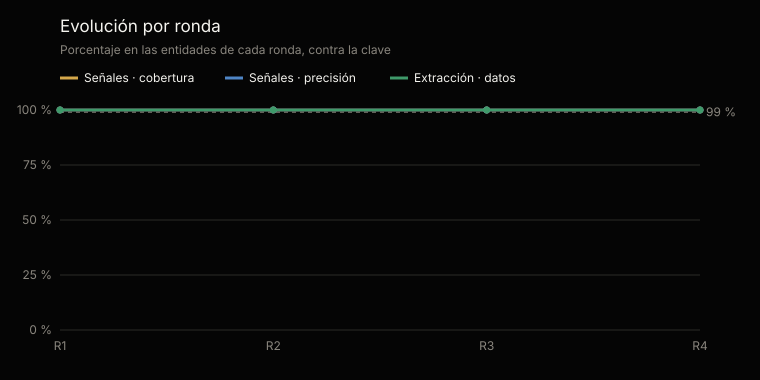

# Análisis estadístico de las pruebas · familia CRO

Generado por `scripts/analisis_familias.py` desde `tests/evidencias/familias/cro/` · ronda completa más reciente: 2 · [English](ANALISIS.md)

No se edita a mano: cada cifra sale de la evidencia y el análisis se regenera con cada ronda.

## En una mirada

La ronda completa más reciente, la 2, sobre las 5 entidades del material: 80 de 80 señales sembradas encontradas (margen del 95 %: 95,4–100 %) y 0 de más; 91 de 91 datos extraídos bien (100 %, margen del 95 %: 95,9–100 %); y 2 de 2 entidades de control sin ninguna señal.

Sumando las rondas 1–2, 104 de 104 señales encontradas, 0 de más y 126 de 126 datos bien. Las rondas repiten el mismo material: no son muestras independientes, y el margen se calcula sobre los casos de cada una.

## Qué se probó y cómo

En cada entidad corren el setup y el procesamiento de Severo y Casandra —los comandos que procesan los documentos y escriben las fichas—, con un tope de tokens fijado antes de empezar, sobre un material que trae su clave aparte, que nadie ve. Los demás comandos calculan sobre esas fichas con el motor, que se prueba con cada cambio del repositorio. Las señales se comparan por su nombre y su clave; la extracción, campo por campo, contra lo que traen los documentos escritos. Las entidades de control no tienen ningún defecto sembrado: cualquier señal en ellas es una falla.

Cobertura: de las señales sembradas, cuántas encontró. Precisión: de las que levantó, cuántas eran correctas. Margen del 95 %: intervalo de confianza de Wilson sobre los casos.

|   |   |
|---|---|
| Rondas | 2; la completa más reciente es la 2 |
| Material | Banca · Colombia, Cooperativas · Brasil, Seguros · Perú |
| Entidades de control | Control · Brasil, Control · Colombia |
| Corridas de una entidad | 10 |
| Señales sembradas | 104 |
| Datos calificados | 126 |

## Resultados acumulados · rondas 1–2

| Métrica | Casos | Resultado | Margen del 95 % |
|---|---|---|---|
| Señales · cobertura | 104 de 104 | 100 % | 96,4–100 % |
| Señales · precisión | 104 de 104 | 100 % | 96,4–100 % |
| Extracción · datos correctos | 126 de 126 | 100 % | 97–100 % |
| Control · sin ninguna señal | 4 de 4 | 100 % | 51–100 % |

## Evolución por ronda

| Ronda | Entidades | Señales · cobertura | Señales · precisión | Extracción | Control sin señales | Tokens | Defectos |
|---|---|---|---|---|---|---|---|
| 1 | 5 | 100 % | 100 % | 100 % | 2 de 2 | 32,7 M | 0 |
| 2 | 5 | 100 % | 100 % | 100 % | 2 de 2 | 33,3 M | 0 |

## La ronda completa más reciente · ronda 2

| Métrica | Casos | Resultado | Margen del 95 % |
|---|---|---|---|
| Señales · cobertura | 80 de 80 | 100 % | 95,4–100 % |
| Señales · precisión | 80 de 80 | 100 % | 95,4–100 % |
| Extracción · datos correctos | 91 de 91 | 100 % | 95,9–100 % |
| Control · sin ninguna señal | 2 de 2 | 100 % | 34,2–100 % |

## Por industria y país · ronda 2

| Material | Agentes | Señales | De más | Extracción | Tokens |
|---|---|---|---|---|---|
| Banca · Colombia | Casandra, Severo | 34 de 34 | 0 | 17 de 17 | 6,7 M |
| Cooperativas · Brasil | Casandra, Severo | 23 de 23 | 0 | 17 de 17 | 6,8 M |
| Seguros · Perú | Casandra, Severo | 23 de 23 | 0 | 17 de 17 | 6,5 M |
| Control · Brasil | Casandra, Severo | 0 de 0 | 0 | 20 de 20 | 6,7 M |
| Control · Colombia | Casandra, Severo | 0 de 0 | 0 | 20 de 20 | 6,7 M |

## Lo que falló, uno por uno · rondas 1–2

Ninguna falla.

| Ronda | Material | Qué | Dónde | Defecto | Origen |
|---|---|---|---|---|---|

## Defectos

0 defectos registrados, cada uno con su origen, su corrección y la corrida que la verificó: 0 verificados y 0 por verificar. 0 vinieron del material, la clave o el arnés de pruebas, no de los agentes.

| Origen | Defectos |
|---|---|

| Agente | Defectos |
|---|---|

## Consumo y próximo paso

Las 2 rondas usaron 66 millones de tokens: 66 millones en las corridas calificadas y 0 en las que se repitieron después de corregir un defecto. En promedio, 6,6 millones por entidad.

El material es sintético. Si una versión es estable o de laboratorio lo dice esta evidencia, no su número: estable, con el piso del margen del 95 % en 95 % o más en señales y en datos sobre la corrida más reciente de cada entidad, y ninguna señal en los controles (decisión 0020).

---

La evidencia completa de cada ronda: [`tests/evidencias/familias/cro/`](https://github.com/josenanez/criterio/tree/main/tests/evidencias/familias/cro).
