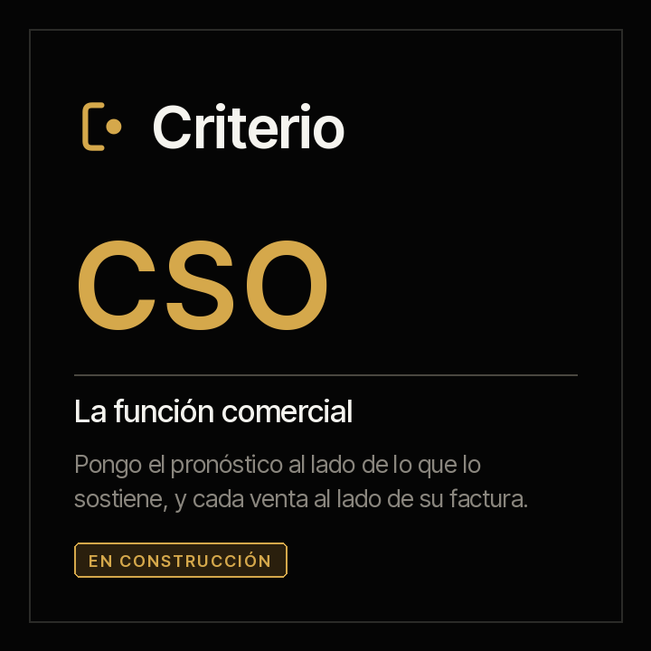

<picture><source media="(prefers-color-scheme: dark)" srcset="../../docs/img/marca/es/criterio-cso-oscuro.svg"></picture>

# criterio-cso · la familia de la función comercial

**Dos agentes y un portal, alrededor de sus fichas.** Cada uno extiende a una persona distinta de
la función comercial —quien responde por el pronóstico y quien responde por lo vendido hasta la
factura— y ninguno habla con el otro directamente: se hablan por sus fichas, y con Fidel y con
Clara por las de ellos.

[English](README.md) · [← Criterio](../../README.es.md) · Apache 2.0



| | |
|---|---|
| **Alcance** | La función comercial de una entidad: el embudo del CRM contra su evidencia, el pronóstico contra lo que lo sostiene, la meta contra lo cerrado, el descuento contra su política, lo ganado contra lo firmado y lo facturado, y la comisión contra el plan |
| **Objetivo** | Que lo que se compromete en el comité comercial tenga detrás los documentos que lo sostienen, y que ninguna venta se quede entre el cierre y la factura |
| **Compuesta por** | [Augusto](../../plugins/criterio-sales/README.es.md) · [Valeria](../../plugins/criterio-revenue/README.es.md) · [Rostrum](../../plugins/criterio-server/README.es.md) |
| **El soporte** | El marco de trabajo que define el rol, el formato de cada exportación del CRM y lo que cuesta hoy a una organización, con su fuente, su año y su muestra: [`FUENTES.es.md`](FUENTES.es.md) |
| **Estado** | En construcción: el motor, con su prueba determinista sobre material sintético de Colombia y México; la ronda con los agentes, el siguiente paso. **Todavía no se publica en el marketplace** |
| **Enfoque** | Exportaciones, nunca sistemas: ningún agente se conecta al CRM ni escribe en él |
| **Compromiso** | Generar, difundir y conservar el conocimiento es una obligación profesional |
| **Qué no es** | No reemplaza al responsable comercial ni a su equipo, y no decide por ellos: no fija metas, no aprueba descuentos, no liquida comisiones, no contacta clientes y no califica a quien vende |
| **Licencia** | [Apache 2.0](../../LICENSE) |
| **Qué viene** | La ronda con los agentes, y su primera versión, la 0.1.0: [la hoja de ruta](#hoja-de-ruta) |

---

## Qué hace la familia

La función comercial tiene dos roles que trabajan sobre las mismas exportaciones del CRM y
responden por cosas distintas, y por eso la familia tiene dos agentes. Llevan nombre de persona
porque **son capacidades extendidas de personas**, y el significado de cada nombre apunta a lo que
hace: **Augusto** —de *augur*, el que lee las señales antes de que pasen— pone el pronóstico al
lado de lo que lo sostiene; **Valeria** —de *valere*, valer— dice lo que vale lo vendido cuando está
firmado y facturado.

**Augusto**, el del pronóstico, pone el embudo al lado de su evidencia: cada oportunidad contra el
documento que exige su etapa —la propuesta enviada, la orden de compra—, las que llevan semanas sin
actividad, las fechas de cierre que se corren una y otra vez, lo comprometido en el comité contra lo
cerrado y lo ponderado con evidencia, y la meta contra lo cerrado al corte. Lo que hoy no hace nadie
y él sí: **revisar todas las oportunidades, no una muestra, contra la evidencia de su etapa**, y
separar lo comprometido que tiene documentos de lo que no.

**Valeria**, la de la venta a la factura, pone cada venta al lado de su política, su contrato y su
factura: el descuento contra el nivel de la matriz que lo aprueba, lo ganado contra el contrato que
firmó Fidel, lo firmado contra la factura que emitió Clara, y la comisión contra lo que da el plan
sobre lo ganado y facturado.

**Cuatro de cada cinco** líderes de ventas y de finanzas no acertaron al menos un pronóstico
trimestral en el último año, y **el 84 %** de los líderes de ventas dice que la analítica comercial
influyó menos de lo esperado; casi la mitad de ellos señala la calidad de los datos. Las cifras, con
su fuente, su año y su muestra, en [`FUENTES.es.md`](FUENTES.es.md).

Países: Colombia y México. **No califica personas**: dice qué oportunidad no tiene evidencia y qué
comisión no es la del plan, nunca quién vende mejor.

---

## Cómo operan los dos

El modelo de lenguaje (LLM) extrae; el código calcula; la decisión —el pronóstico que se compromete,
el descuento que se aprueba, la meta— la toma siempre una persona. **El motor procesa las tablas
directamente** —las exportaciones del CRM con su fecha, el historial de la fecha de cierre, la tabla
de etapas, las metas, la matriz de descuentos, la tabla de cuentas, el plan y la liquidación de
comisiones—, y el agente lleva a la ficha lo que solo trae un documento escrito: cada documento de
evidencia de una oportunidad, el pronóstico comprometido del acta del comité y cada cotización con
su descuento y su aprobación.

**Las exportaciones, desde su fuente.** Salesforce por el nombre de cada campo o su etiqueta;
HubSpot por la etiqueta de cada propiedad; cualquier otro CRM en CSV o Excel con el mapeo de
columnas que deja el setup. Cada campo que se procesa está verificado en su fuente, en
[`FUENTES.es.md`](FUENTES.es.md).

**Automatizados**: procesan los documentos, calculan las señales y preparan cada entregable sin
intervención. **Semiautomatizados** cuando falta un dato que ningún documento trae —de qué CRM sale
la exportación, qué columna trae cada dato, en cuántos días se factura—: entonces le preguntan a la
persona, dicen qué preguntaron y siguen con la respuesta.

## Los dos agentes y sus fichas

Nada se habla con nada directamente. **Cada agente escribe sus fichas, y la ficha es el contrato.**

| Ficha | Una por | Qué lleva | Quién la escribe |
|---|---|---|---|
| Ficha del pronóstico | Entidad y periodo | Cada documento de evidencia de una oportunidad con su tipo, su monto y su fecha, y el pronóstico comprometido del acta del comité | Augusto; el pronóstico, el comité que lo compromete |
| Ficha de lo vendido | Entidad y periodo | Cada cotización o pedido con su precio de lista, su descuento y su aprobación | Valeria; la aprobación, quien la da |

Valeria lee, además, dos fichas que no escribe: **la de cada contrato de Fidel** y **la de cada
cierre de Clara**, con sus facturas emitidas. No vuelve a procesar un contrato ni una factura
electrónica.

Cada dato cita el documento del que sale y su fecha. «No encontrado» es una respuesta válida.

### Las siete invariantes

1. **Los agentes no se hablan entre sí.** Se hablan por sus fichas, y con Fidel y Clara por las de
   ellos.
2. **Rostrum, el portal, no escribe.** Sirve lo que el motor ya escribió y lo dice con su fecha; no
   recalcula nada. Las comisiones no salen ahí salvo que la configuración lo diga.
3. **Exportaciones, nunca sistemas.** Ningún agente se conecta al CRM, y ninguno escribe en él.
4. **Comprometido y respaldado nunca se fusionan.** Lo que el comité compromete va en la ficha; lo
   que lo sostiene lo calcula el motor, y la diferencia es la señal.
5. **El modelo extrae, el código calcula.** Todo monto, porcentaje, día o conteo de un reporte sale
   de `ventas.py`; si el motor no lo da, no se escribe.
6. **Ningún agente decide.** El pronóstico, el descuento, la meta y la comisión son de una persona.
7. **No califica personas, y no guarda datos de contacto.** La señal es de la oportunidad, no de
   quien la lleva, y la ficha guarda la cuenta, no el correo ni el teléfono de nadie.

## Lo que sigue siendo de las personas

Los dos roles siguen existiendo completos. Esto extiende capacidad; no sustituye función.

> **El insumo de cada agente lo produce el trabajo no delegable de su persona.**

Augusto necesita que el equipo deje la propuesta y la orden de compra de cada oportunidad, y que el
comité comprometa un pronóstico por escrito: sin evidencia no hay contra qué revisar una etapa, y sin
compromiso no hay contra qué comparar el respaldo. Valeria necesita que alguien apruebe cada
descuento por escrito, que la organización lleve su matriz y su plan, y que Fidel y Clara lleven sus
fichas.

**Y ninguno de los dos contacta a un cliente, negocia, aprueba un descuento, fija una meta ni
liquida una comisión.**

## La estructura de carpetas recomendada

Recomendada, no obligatoria ([ADR 0007](../../docs/decisions/0007-estructura-recomendada.md)): los
agentes procesan la carpeta como esté. `sales-setup` y `revenue-setup` comparan lo que encuentran con
esta estructura y, en cada corrida, dicen qué archivo está fuera de su lugar y dónde iría; no crean,
mueven ni renombran nada en los documentos de la organización. La numeración va de diez en diez,
como en las demás familias.

<!-- cso:carpetas · generado por scripts/familias.py; no se edita a mano -->
Una carpeta por entidad, con el NIT o el RFC al inicio del nombre. Dentro, la referencia de la función comercial, las exportaciones del CRM con su fecha, el comité, la evidencia de cada oportunidad, las cotizaciones y las liquidaciones de comisiones.

```
comercial/
└── <entidad>/
    ├── 00-referencia/
    ├── 10-crm/
    ├── 20-comite/
    ├── 30-evidencia/
    ├── 40-cotizaciones/
    └── 50-comisiones/
estado-comercial/
```

**`<entidad>/`** · Lo que la organización lleva para toda la función comercial

| Carpeta | Qué va | Agente |
|---|---|---|
| `00-referencia/` | La tabla de etapas —el documento que exige cada una y su probabilidad—, las metas del año, la matriz de descuentos, el plan de comisiones y la tabla de cuentas con la identificación de cada cliente | Augusto, Valeria |
| `10-crm/` | Las exportaciones de oportunidades del CRM, en CSV o Excel, con la fecha de la exportación en el nombre, y el historial de la fecha de cierre si el CRM lo exporta | Augusto, Valeria |
| `20-comite/` | Las actas y los paquetes del comité comercial, con el pronóstico que se compromete para el periodo | Augusto |
| `30-evidencia/` | Las propuestas enviadas, las órdenes de compra y las actas de aceptación, con el id de la oportunidad al inicio del nombre | Augusto |
| `40-cotizaciones/` | Las cotizaciones y los pedidos con su precio, su descuento y su aprobación, con el id de la cotización al inicio del nombre | Valeria |
| `50-comisiones/` | La liquidación de comisiones de cada periodo, con el periodo en el nombre | Valeria |

**`estado-comercial/`** · Lo que escriben Augusto y Valeria: la configuración, la ficha de cada periodo, los informes y los índices. Ninguna persona lo edita, y ningún agente escribe fuera de aquí.
<!-- /cso:carpetas -->

Un archivo sin el formato esperado no se adivina: se reporta con lo que le falta.

## Instalación de la familia

**La familia está en construcción y todavía no se publica en el marketplace.** Cuando pase su ronda
con los agentes, cada uno será un plugin que se instala solo:

```
/plugin marketplace add josenanez/criterio

/plugin install criterio-sales@criterio     si respondes por el pronóstico
/plugin install criterio-revenue@criterio   si respondes por la venta hasta la factura
```

Después de instalar, cada agente tiene su propio comando de instalación que mira la carpeta, reconoce
cada exportación del CRM, hace las preguntas que ningún documento responde y produce un primer
resultado. **Nadie edita un archivo de configuración a mano.** Y si instalas los dos, se encuentran
solos: comparten el estado de la entidad, y cada uno escribe solo lo suyo.

## De qué responde cada agente, y dónde está su detalle

Lo mismo para cada pieza: de qué responde, qué no hace, y dónde está todo su detalle. **Cada página
de agente se lee sola.**

<!-- cso:familia-agentes · generado por scripts/familias.py; no se edita a mano -->
| | De qué responde | Lo que nunca hace | Su página | Sus pruebas |
|---|---|---|---|---|
| **Augusto** · el pronóstico | El embudo contra su evidencia y el pronóstico contra lo que lo sostiene: cada oportunidad contra el documento que exige su etapa, las detenidas, los cierres que se corren, lo comprometido contra lo ponderado con evidencia y la meta contra lo cerrado | No escribe en el CRM, no contacta a un cliente, no fija ni cambia una meta y no califica a las personas del equipo: dice qué oportunidad no tiene evidencia, no quién vende mejor | [criterio-sales](../../plugins/criterio-sales/README.es.md) · 6 comandos, 4 skills | [resultados](../../tests/criterio-sales/RESULTADOS.md) |
| **Valeria** · de la venta a la factura | El precio y el descuento contra su política, y lo ganado contra lo firmado y lo facturado: cada descuento contra el nivel que lo aprueba, cada venta ganada contra su contrato en las fichas de Fidel, cada contrato firmado contra su factura en las de Clara, y cada comisión contra el plan | No escribe en el CRM, no aprueba un descuento ni una excepción de precio y no liquida ni corrige una comisión: dice dónde la liquidación no es la del plan | [criterio-revenue](../../plugins/criterio-revenue/README.es.md) · 6 comandos, 6 skills | [resultados](../../tests/criterio-revenue/RESULTADOS.md) |
| **Rostrum** · el portal | Publicar lo que escriben los agentes donde el equipo lo vea, y recibir la pregunta de quien no abre una carpeta | **No escribe en el estado ni recalcula nada**, y no decide nada | [criterio-server](../../plugins/criterio-server/README.es.md) · 2 comandos, uno para todas las familias | [resultados](../../tests/criterio-server/RESULTADOS.md) |
<!-- /cso:familia-agentes -->

Su entrada, su proceso y su reporte, con las señales que calcula el motor, en el
[diseño de la familia](DISENO.es.md); y las respuestas a lo que más se pregunta, en las
[preguntas frecuentes](PREGUNTAS.es.md).

## En Rostrum, el portal de todas las familias

**Un director comercial no abre una carpeta de archivos**: abre un enlace. Para eso está
**Rostrum**, `criterio-server`, que sirve a la CSO junto con las demás familias, sin que el servidor
sepa nada de ventas ([ADR 0010](../../docs/decisions/0010-rostrum-plugin-propio.md)).
`/criterio-sales:sales-setup` y `/criterio-revenue:revenue-setup` dejan su configuración en
`.criterio/comercial/<entidad>/` y `.criterio/ingresos/<entidad>/`, con la carpeta comercial marcada
con `_CRITERIO_COMERCIAL.txt`, y `/criterio-server:server-setup` las suma al mapa. **El reporte de
comisiones no se publica** salvo que la configuración de Valeria lo diga: es la remuneración de
personas identificables (ADR 0019).

## Cómo se configura y cada cuánto corre cada uno

<!-- cso:configuracion · generado por scripts/familias.py; no se edita a mano -->
| | Augusto | Valeria |
|---|---|---|
| **Se instala** | `criterio-sales` | `criterio-revenue` |
| **Instancias** | Una por entidad | Una por entidad |
| **Se configura con** | `/criterio-sales:sales-setup` | `/criterio-revenue:revenue-setup` |
| **Cuánto tarda eso** | Quince minutos | Quince minutos |
| **Qué le tienes que decir** | Entidad y NIT o RFC, país, el periodo, de qué CRM sale la exportación de `10-crm/` —Salesforce, HubSpot u otro, en CSV o Excel— y, si es otro, qué columna trae cada dato, la tabla de etapas de `00-referencia/` con el documento que exige cada una y su probabilidad, cuántos días sin actividad detienen una oportunidad y cuántas veces puede correrse un cierre | Entidad y NIT o RFC, país, el periodo, la matriz de descuentos, el plan de comisiones y la tabla de cuentas de `00-referencia/`, dónde están las fichas de los contratos de Fidel y las de la facturación de Clara, y en cuántos días se factura un contrato firmado |
| **Dónde queda** | `.criterio/comercial/<entidad>/config.json`, escrito por el comando | `.criterio/ingresos/<entidad>/config.json`, escrito por el comando |
| **El que se le pone a un reloj** | `/criterio-sales:sales-wake` | `/criterio-revenue:revenue-wake` |
| **Qué toca cada día** | Decide qué toca: una exportación nueva en `10-crm/`, un acta nueva del comité, el cierre del periodo que se acerca y una revisión semanal | Decide qué toca: cotizaciones nuevas, una oportunidad ganada sin contrato ni factura cuando vence su plazo, la liquidación del periodo cuando llega y una revisión semanal |
| **Qué lo despierta además del reloj** | Una pregunta que alguien dejó en Rostrum | Una pregunta que alguien dejó en Rostrum |
<!-- /cso:configuracion -->

**Nadie edita un archivo de configuración a mano.** Se dice en la conversación y el comando lo
reescribe. Cada plugin trae su `scripts/config.example.json` para ver la forma completa; los días
sin actividad, las veces que se puede correr un cierre, las tolerancias y el plazo de facturación son
configuración de cada organización, no norma.

### Los dos se callan cuando no hay nada

Los dos comandos de reloj no producen nada cuando no toca nada, y entonces la salida es una línea.
Con una pregunta abierta en Rostrum nunca se callan: la responden primero.

## Las pruebas de la familia

**Una sola puerta corre todo lo que este repositorio comprueba**, de todas las familias a la vez:

```
python3 scripts/verificar.py
```

Lo propio de la CSO está en [`tests/criterio-cso/`](../../tests/criterio-cso/): material sintético de
Colombia y México —una exportación de Salesforce, una de HubSpot y una de CSV con su mapeo— con una
clave que el motor no ve, y una entidad de control por país, donde cualquier señal es una falla.
Cada una de las nueve señales se siembra al menos una vez, y las fichas de Fidel y de Clara de cada
entidad vienen en el material. `evaluar.py` corre el motor de Augusto y el de Valeria y compara cada
señal por su nombre y su clave: **una de más cuenta igual que una de menos.** Qué se siembra y qué no
prueba el material, en [`EVIDENCIA.md`](../../tests/criterio-cso/EVIDENCIA.md).

## Hoja de ruta

<!-- hoja de ruta: generado por scripts/hoja.py desde hoja-de-ruta.json; no se edita a mano -->

La familia crece por incrementos. Cada uno es una versión con su prueba completa y su análisis estadístico publicados, con las mismas métricas, para que la evolución se pueda comparar.

| Versión | Estado | Qué entra | Prueba |
|---|---|---|---|
| 0.1.0 | En curso | **Augusto y Valeria, construidos y probados con la ronda completa con los agentes**<br>· Los doce comandos, sus skills y el motor, con las nueve señales: el embudo, el pronóstico y la meta de Augusto; el descuento, el contrato, la factura y la comisión de Valeria<br>· Las exportaciones de Salesforce y de HubSpot, y cualquier CSV o Excel con su mapeo de columnas<br>· Lo ganado contra los contratos de Fidel y lo firmado contra las facturas de Clara, por sus fichas<br>· Colombia y México, con entidades de control | La ronda con los dos agentes sobre todas las entidades del material, con una clave que no ven |
| Incremento 2 | Siguiente | **Ecuador, Perú y Chile, y Microsoft Dynamics y Zoho**<br>· Los tres países que ya están en el registro de países, con su material y su ronda<br>· Las exportaciones de Microsoft Dynamics y de Zoho, cada una desde su fuente verificada | La ronda con los agentes en los tres países y sobre las dos exportaciones nuevas |

<!-- /hoja de ruta -->

## Los ocho skills de la familia

<!-- cso:skills-familia · generado por scripts/familias.py; no se edita a mano -->
Ocho skills distintos entre los dos agentes. **Los que comparten son copias literales, no un módulo importado**: un plugin instalado tiene que correr solo. `scripts/sincronizar.py` las copia y `scripts/sincronizar.py --check` falla si se separan.

| Skill | Augusto | Valeria |
|---|:--:|:--:|
| `commission-plan` | · | ● |
| `crm-exports` | ● | ● |
| `deal-record` | · | ● |
| `discount-policy` | · | ● |
| `forecast-backing` | ● | · |
| `pipeline-record` | ● | · |
| `sales-intake` | ● | ● |
| `won-to-cash` | · | ● |
<!-- /cso:skills-familia -->

## Estado

**Los dos están en construcción.** El motor pasa su prueba determinista; la ronda con los agentes
sobre el mismo material es lo que la declara probada, y con ella sale su primera versión, la de
laboratorio.

<!-- cso:estado · generado por scripts/familias.py; no se edita a mano -->
| Agente | Se instala | Su prueba |
|---|---|---|
| **Augusto** · El pronóstico | `criterio-sales` · 6 comandos, 4 skills | El motor, probado; la ronda con el agente, pendiente · [resultados](../../tests/criterio-sales/RESULTADOS.md) |
| **Valeria** · De la venta a la factura | `criterio-revenue` · 6 comandos, 6 skills | El motor, probado; la ronda con el agente, pendiente · [resultados](../../tests/criterio-revenue/RESULTADOS.md) |
| **Rostrum** · el portal | `criterio-server` · 2 comandos, para todas las familias | — |
<!-- /cso:estado -->

Las decisiones que siguen abiertas, en el [diseño](DISENO.es.md#decisiones-abiertas).
