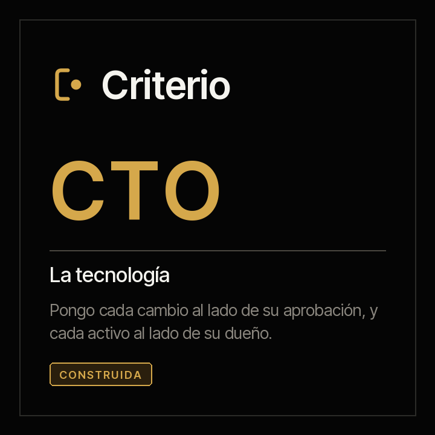

<picture><source media="(prefers-color-scheme: dark)" srcset="../../docs/img/marca/es/criterio-cto-oscuro.svg"></picture>

# criterio-cto · la familia de la tecnología

**Dos agentes y un portal, alrededor de sus fichas.** Cada uno extiende a una persona distinta del área de
tecnología —quien responde por lo que llega a producción y quien responde por los activos y los proveedores— y
comparten la carpeta y la política de tecnología de la entidad: cada uno escribe solo su ficha.

[English](README.md) · [← Criterio](../../README.es.md) · Apache 2.0



---

## Qué hace la familia

Un cambio llega a producción después de pasar por el equipo que lo construye, el comité de cambios y quien lo
despliega. Lo que se rompe se vuelve un incidente, y lo que se paga por la tecnología se factura aparte: el
proveedor, la licencia, la nube. Cuando un cambio llega sin aprobación o un proveedor incumple sin que se le
descuente, casi nunca es por mala fe: es un acta que nadie cruzó con la exportación, un despliegue que no se
registró o una factura que nadie puso al lado del nivel de servicio. Ese cruce hoy se hace a mano, cambio por
cambio y factura por factura. La familia lo calcula, sobre ISO/IEC 20000-1 (F-01) e ISO/IEC 19770-1 (F-02)
([decisión 0037](../../docs/decisions/0037-la-familia-cto.md)).

- **Fausto** pone cada cambio en producción al lado de su aprobación y su revisión, cada despliegue al lado de
  su cambio, cada incidente mayor al lado de su causa y cada servicio al lado del nivel acordado.
- **Domingo** pone cada activo al lado de su dueño y su soporte, cada licencia al lado de su uso, cada
  proveedor al lado de su nivel de servicio y la nube al lado de su presupuesto.

## Lo que sigue siendo de las personas

Aprobar un cambio, decidir una arquitectura, calificar un incidente, elegir un proveedor, renovar o retirar
un activo e interpretar un contrato. Los agentes dicen qué falta y dónde; la decisión es siempre del comité de
cambios, del comité de arquitectura, del área de tecnología y de legal. **La seguridad es de la familia CISO.**

## La estructura de carpetas recomendada

<!-- cto:carpetas · generado por scripts/familias.py; no se edita a mano -->
Una carpeta por entidad, con su identificación fiscal al inicio del nombre. Dentro, la política de cambios y de niveles de servicio con el catálogo de servicios; los cambios, los despliegues y las actas del comité de cambios; los incidentes, los problemas y la disponibilidad; el inventario de activos y las licencias; los contratos, el cumplimiento y las facturas de los proveedores, y la factura y el presupuesto de la nube.

```
tecnologia/
└── <entidad>/
    ├── 00-politica/
    ├── 10-cambios/
    ├── 20-servicio/
    ├── 30-activos/
    ├── 40-proveedores/
    └── 50-nube/
estado-tecnologia/
```

**`<entidad>/`** · Lo que el área de tecnología lleva de la entidad

| Carpeta | Qué va | Agente |
|---|---|---|
| `00-politica/` | La política de cambios y de niveles de servicio, con sus plazos y umbrales, y el catálogo de servicios con el nivel acordado de cada uno | Fausto, Domingo |
| `10-cambios/` | La exportación de cambios de la herramienta de gestión del servicio, el registro de despliegues en producción y las actas del comité de cambios | Fausto |
| `20-servicio/` | Las exportaciones de incidentes y de problemas, y la disponibilidad de cada servicio en el periodo | Fausto |
| `30-activos/` | El inventario de activos con su dueño, su ambiente y su fin de soporte; las licencias compradas y su uso, y las actas del comité de arquitectura con sus excepciones | Domingo |
| `40-proveedores/` | Los contratos de nivel de servicio de cada proveedor, el cumplimiento que reporta y sus facturas | Domingo |
| `50-nube/` | La factura de la nube por cuenta y el presupuesto de cada cuenta | Domingo |

**`estado-tecnologia/`** · Lo que escriben Fausto y Domingo: la configuración, la ficha de cada periodo, los informes y los índices. Ninguna persona lo edita, y ningún agente escribe fuera de aquí.
<!-- /cto:carpetas -->

Un archivo sin el formato esperado no se adivina: se reporta con lo que le falta.

## Instalación de la familia

Necesita Claude Code 2.1.110 o posterior; si algo falla, [la instalación paso a paso](../../docs/instalacion.es.md).

**La familia se instala de una vez.** El plugin `criterio-cto` trae a sus agentes y a Rostrum, y
`/criterio-cto:cto-setup` los configura en orden, en una sola conversación: lo que ya se respondió
no se vuelve a preguntar.

```
/plugin marketplace add josenanez/criterio
/plugin install criterio-cto@criterio
/criterio-cto:cto-setup
```

Después, a cada agente se le pide en tus palabras, sin saber cómo se llama cada comando:
`/criterio-changes:fausto` y `/criterio-assets:domingo`
([decisión 0027](../../docs/decisions/0027-cada-agente-se-pide-en-palabras.md)).

## De qué responde cada agente, y dónde está su detalle

<!-- cto:familia-agentes · generado por scripts/familias.py; no se edita a mano -->
| | De qué responde | Lo que nunca hace | Su página | Sus pruebas |
|---|---|---|---|---|
| **Fausto** · los cambios y el servicio | Cada cambio en producción contra su aprobación y su revisión, cada despliegue contra su cambio, cada incidente mayor contra su problema y cada servicio contra el nivel acordado: el cambio sin aprobar o aprobado después, el de emergencia sin su revisión, el despliegue sin cambio, el cambio fallido sin revisión, el incidente mayor sin causa y el servicio por debajo de su nivel | No aprueba un cambio, no decide una arquitectura, no califica un incidente y no se conecta a una herramienta de gestión del servicio ni a un servidor | [criterio-changes](../../plugins/criterio-changes/README.es.md) · 8 comandos, 3 skills | [resultados](../../tests/criterio-changes/RESULTADOS.md) |
| **Domingo** · los activos y los proveedores | El inventario de activos contra sus dueños y el soporte del fabricante, las licencias contra su uso, cada proveedor contra su nivel de servicio y la nube contra su presupuesto: el activo sin dueño, el que pasó su fin de soporte sin una excepción aprobada, la licencia que falta y la que sobra, el incumplimiento de un proveedor sin su crédito en la factura y la factura de la nube por encima de su presupuesto | No elige un proveedor, no decide renovar o retirar un activo, no interpreta un contrato y no se conecta a la nube, a una herramienta de inventario ni a un servidor | [criterio-assets](../../plugins/criterio-assets/README.es.md) · 9 comandos, 3 skills | [resultados](../../tests/criterio-assets/RESULTADOS.md) |
| **Rostrum** · el portal | Publicar lo que escriben los agentes donde el equipo lo vea, y recibir la pregunta de quien no abre una carpeta | **No escribe en el estado ni recalcula nada**, y no decide nada | [criterio-server](../../plugins/criterio-server/README.es.md) · 3 comandos, uno para todas las familias | [resultados](../../tests/criterio-server/RESULTADOS.md) |
<!-- /cto:familia-agentes -->

## Cómo se configura y cada cuánto corre cada uno

<!-- cto:configuracion · generado por scripts/familias.py; no se edita a mano -->
| | Fausto | Domingo |
|---|---|---|
| **Se instala** | `criterio-changes` | `criterio-assets` |
| **Instancias** | Una por entidad | Una por entidad |
| **Se configura con** | `/criterio-changes:changes-setup` | `/criterio-assets:assets-setup` |
| **Cuánto tarda eso** | Quince minutos | Quince minutos |
| **Qué le tienes que decir** | Entidad y su identificación fiscal, país, el periodo y los plazos de la política: los días para revisar un cambio de emergencia y para registrar el problema de un incidente mayor | Entidad y su identificación fiscal, país, el periodo y los umbrales de la política: el porcentaje de licencias sin uso que tolera y la tolerancia sobre el presupuesto de la nube |
| **Dónde queda** | `.criterio/cambios/<entidad>/config.json`, escrito por el comando | `.criterio/activos/<entidad>/config.json`, escrito por el comando |
| **El que se le pone a un reloj** | `/criterio-changes:changes-wake` | `/criterio-assets:assets-wake` |
| **Qué toca cada día** | Decide si toca procesar los cambios —documentos nuevos o la revisión semanal— o un reporte con señales abiertas, y lo corre; si no toca nada, se calla | Decide si toca procesar los activos —documentos nuevos o la revisión semanal— o un reporte con señales abiertas, y lo corre; si no toca nada, se calla |
| **Qué lo despierta además del reloj** | Una pregunta que alguien dejó en Rostrum | Una pregunta que alguien dejó en Rostrum |
<!-- /cto:configuracion -->

**Nadie edita un archivo de configuración a mano.** Se dice en la conversación y el comando lo reescribe.
Los plazos, los niveles de servicio y los umbrales salen de la política de tecnología de la organización.

## Las pruebas de la familia

**Una sola puerta corre todo lo que este repositorio comprueba**, de todas las familias a la vez:

```
python3 scripts/verificar.py
```

Lo propio de la CTO está en [`tests/criterio-cto/`](../../tests/criterio-cto/): material sintético con
una clave que el motor no ve y dos entidades de control, donde cualquier señal es una falla. **Una señal
de más cuenta igual que una de menos.** Qué se siembra y qué no prueba el material, en
[`EVIDENCIA.md`](../../tests/criterio-cto/EVIDENCIA.md).

## Hoja de ruta

<!-- hoja de ruta: generado por scripts/hoja.py desde hoja-de-ruta.json; no se edita a mano -->
<!-- /hoja de ruta -->

## Los skills de la familia

<!-- cto:skills-familia · generado por scripts/familias.py; no se edita a mano -->
Cuatro skills distintos entre los dos agentes. **Los que comparten son copias literales, no un módulo importado**: un plugin instalado tiene que correr solo. `scripts/sincronizar.py` las copia y `scripts/sincronizar.py --check` falla si se separan.

| Skill | Fausto | Domingo |
|---|:--:|:--:|
| `change-record` | ● | · |
| `technology-intake` | ● | ● |
| `technology-policy` | ● | ● |
| `vendor-record` | · | ● |
<!-- /cto:skills-familia -->

## Estado

<!-- cto:estado · generado por scripts/familias.py; no se edita a mano -->
| Agente | Se instala | Su prueba |
|---|---|---|
| **Fausto** · Los cambios y el servicio | `criterio-changes` · 8 comandos, 3 skills | El motor, probado; la ronda con el agente, pendiente · [resultados](../../tests/criterio-changes/RESULTADOS.md) |
| **Domingo** · Los activos y los proveedores | `criterio-assets` · 9 comandos, 3 skills | El motor, probado; la ronda con el agente, pendiente · [resultados](../../tests/criterio-assets/RESULTADOS.md) |
| **Rostrum** · el portal | `criterio-server` · 3 comandos, para todas las familias | — |

Las pruebas usan material sintético construido sobre información real de empresas, anonimizada antes de procesarse: ningún nombre, identificación, cifra ni dato personal que permita reconocer a una empresa o a una persona se conserva ni se publica. Lo que se publica de cada prueba son sus resultados, sin datos.
<!-- /cto:estado -->
