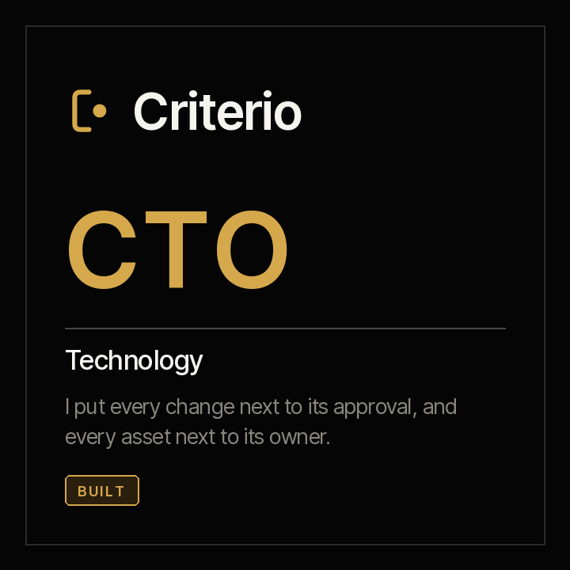

<picture><source media="(prefers-color-scheme: dark)" srcset="../../docs/img/marca/en/criterio-cto-oscuro.svg"></picture>

# criterio-cto · the technology family

**Two agents and a portal, around their records.** Each extends a different person in the technology office
—whoever answers for what reaches production and whoever answers for the assets and vendors— and they share the
entity's folder and technology policy: each writes only its own record.

[Español](README.es.md) · [← Criterio](../../README.md) · Apache 2.0



---

## What the family does

A change reaches production after passing through the team that builds it, the change board and whoever deploys
it. What breaks becomes an incident, and what is paid for technology is invoiced separately: the vendor, the
licence, the cloud. When a change arrives without approval or a vendor breaches without a deduction, it is rarely
bad faith: it is minutes nobody matched with the export, a deployment that was not registered or an invoice
nobody put next to the service level. Today that cross-check is done by hand, change by change and invoice by
invoice. The family calculates it, on ISO/IEC 20000-1 (F-01) and ISO/IEC 19770-1 (F-02)
([decision 0037](../../docs/decisions/0037-la-familia-cto.md)).

- **Fausto** puts each production change next to its approval and review, each deployment next to its change,
  each major incident next to its cause and each service next to its agreed level.
- **Domingo** puts each asset next to its owner and support, each licence next to its use, each vendor next to
  its service level and the cloud next to its budget.

## What remains with people

Approving a change, deciding an architecture, rating an incident, choosing a vendor, renewing or retiring an
asset and interpreting a contract. The agents say what is missing and where; the decision is always the change
board's, the architecture board's, the technology office's and legal's. **Security belongs to the CISO family.**

## The recommended folder structure

<!-- cto:carpetas · generado por scripts/familias.py; no se edita a mano -->
One folder per entity, with its tax id at the start of the name. Inside it, the change and service level policy with the service catalogue; the changes, deployments and change board minutes; the incidents, problems and availability; the asset inventory and licences; the vendors' contracts, compliance and invoices, and the cloud bill and budget.

```
tecnologia/
└── <entidad>/
    ├── 00-politica/
    ├── 10-cambios/
    ├── 20-servicio/
    ├── 30-activos/
    ├── 40-proveedores/
    └── 50-nube/
estado-tecnologia/
```

**`<entidad>/`** · What the technology office keeps for the entity

| Folder | What goes in | Agent |
|---|---|---|
| `00-politica/` | The change and service level policy, with its deadlines and thresholds, and the service catalogue with each service's agreed level | Fausto, Domingo |
| `10-cambios/` | The change export from the service management tool, the production deployment log and the change board minutes | Fausto |
| `20-servicio/` | The incident and problem exports, and each service's availability in the period | Fausto |
| `30-activos/` | The asset inventory with its owner, environment and end of support; the purchased licences and their use, and the architecture board minutes with their exceptions | Domingo |
| `40-proveedores/` | Each vendor's service level contracts, the compliance it reports and its invoices | Domingo |
| `50-nube/` | The cloud bill by account and each account's budget | Domingo |

**`estado-tecnologia/`** · What Fausto and Domingo write: the configuration, each period's record, the reports and the indexes. No person edits it, and no agent writes anywhere else.
<!-- /cto:carpetas -->

A file without the expected format is not guessed: it is reported with what it lacks.

## Installing the family

It needs Claude Code 2.1.110 or later; if something fails, [the step-by-step installation](../../docs/instalacion.md).

**The family installs at once.** The `criterio-cto` plugin brings its agents and Rostrum, and
`/criterio-cto:cto-setup` configures them in order, in a single conversation: what has already been
answered is not asked again.

```
/plugin marketplace add josenanez/criterio
/plugin install criterio-cto@criterio
/criterio-cto:cto-setup
```

Then you ask each agent in your own words, without knowing each command's name:
`/criterio-changes:fausto` and `/criterio-assets:domingo`
([decision 0027](../../docs/decisions/0027-cada-agente-se-pide-en-palabras.md)).

## What each agent answers for, and where its detail is

<!-- cto:familia-agentes · generado por scripts/familias.py; no se edita a mano -->
| | What it answers for | What it never does | Its page | Its tests |
|---|---|---|---|---|
| **Fausto** · changes and service | Each production change against its approval and review, each deployment against its change, each major incident against its problem and each service against its agreed level: a change not approved or approved afterwards, an emergency change with no review, a deployment with no change, a failed change with no review, a major incident with no cause and a service below its level | It does not approve a change, decide an architecture, rate an incident or connect to a service management tool or a server | [criterio-changes](../../plugins/criterio-changes/README.md) · 8 commands, 3 skills | [results](../../tests/criterio-changes/RESULTADOS.md) |
| **Domingo** · assets and vendors | The asset inventory against its owners and the manufacturer's support, the licences against their use, each vendor against its service level and the cloud against its budget: an asset with no owner, one past its end of support with no approved exception, a licence shortfall and a surplus, a vendor breach with no credit on the invoice and a cloud bill above its budget | It does not choose a vendor, decide to renew or retire an asset, interpret a contract or connect to the cloud, an inventory tool or a server | [criterio-assets](../../plugins/criterio-assets/README.md) · 9 commands, 3 skills | [results](../../tests/criterio-assets/RESULTADOS.md) |
| **Rostrum** · the portal | Publishing what the agents write where the team will see it, and taking the question from whoever will not open a folder | **Never writes the state or recalculates anything**, and decides nothing | [criterio-server](../../plugins/criterio-server/README.md) · 3 commands, one for every family | [results](../../tests/criterio-server/RESULTADOS.md) |
<!-- /cto:familia-agentes -->

## How each one is configured and how often it runs

<!-- cto:configuracion · generado por scripts/familias.py; no se edita a mano -->
| | Fausto | Domingo |
|---|---|---|
| **Installs as** | `criterio-changes` | `criterio-assets` |
| **Instances** | One per entity | One per entity |
| **Configured with** | `/criterio-changes:changes-setup` | `/criterio-assets:assets-setup` |
| **How long that takes** | Fifteen minutes | Fifteen minutes |
| **What you have to tell it** | Entity and its tax ID, country, the period and the policy's deadlines: the days to review an emergency change and to register a major incident's problem | Entity and its tax ID, country, the period and the policy's thresholds: the share of unused licences it tolerates and the tolerance over the cloud budget |
| **Where it lands** | `.criterio/cambios/<entity>/config.json`, written by the command | `.criterio/activos/<entity>/config.json`, written by the command |
| **The one you put on a clock** | `/criterio-changes:changes-wake` | `/criterio-assets:assets-wake` |
| **What it does each day** | Decides whether the changes need processing —new documents or the weekly review— or a report with open signals, and runs it; if nothing is due, it stays quiet | Decides whether the assets need processing —new documents or the weekly review— or a report with open signals, and runs it; if nothing is due, it stays quiet |
| **What wakes it besides the clock** | A question somebody left in Rostrum | A question somebody left in Rostrum |
<!-- /cto:configuracion -->

**Nobody edits a configuration file by hand.** You say it in the conversation and the command rewrites it.
The deadlines, service levels and thresholds come from the organisation's technology policy.

## The family's tests

**A single gate runs everything this repository checks**, for all families at once:

```
python3 scripts/verificar.py
```

What belongs to the CMO is in [`tests/criterio-cto/`](../../tests/criterio-cto/): synthetic material with
a key the engine never sees and two control entities, where any signal is a failure. **One signal too
many counts the same as one too few.** What is planted and what the material does not test, in
[`EVIDENCIA.md`](../../tests/criterio-cto/EVIDENCIA.md).

## Roadmap

<!-- hoja de ruta: generado por scripts/hoja.py desde hoja-de-ruta.json; no se edita a mano -->
<!-- /hoja de ruta -->

## The family's skills

<!-- cto:skills-familia · generado por scripts/familias.py; no se edita a mano -->
Four distinct skills across the two agents. **The ones they share are literal copies, not an imported module**: an installed plugin has to run on its own. `scripts/sincronizar.py` copies them and `scripts/sincronizar.py --check` fails if they drift.

| Skill | Fausto | Domingo |
|---|:--:|:--:|
| `change-record` | ● | · |
| `technology-intake` | ● | ● |
| `technology-policy` | ● | ● |
| `vendor-record` | · | ● |
<!-- /cto:skills-familia -->

## Status

<!-- cto:estado · generado por scripts/familias.py; no se edita a mano -->
| Agent | Installs as | Its test |
|---|---|---|
| **Fausto** · Changes and service | `criterio-changes` · 8 commands, 3 skills | The engine, tested; a first round with the agent; the full one, pending · [results](../../tests/criterio-changes/RESULTADOS.md) |
| **Domingo** · Assets and vendors | `criterio-assets` · 9 commands, 3 skills | The engine, tested; a first round with the agent; the full one, pending · [results](../../tests/criterio-assets/RESULTADOS.md) |
| **Rostrum** · the portal | `criterio-server` · 3 commands, for every family | — |

Tests use synthetic material built on real company information, anonymised before processing: no name, identifier, figure or personal data that could identify a company or a person is kept or published. What is published from each test is its results, without data.
<!-- /cto:estado -->
