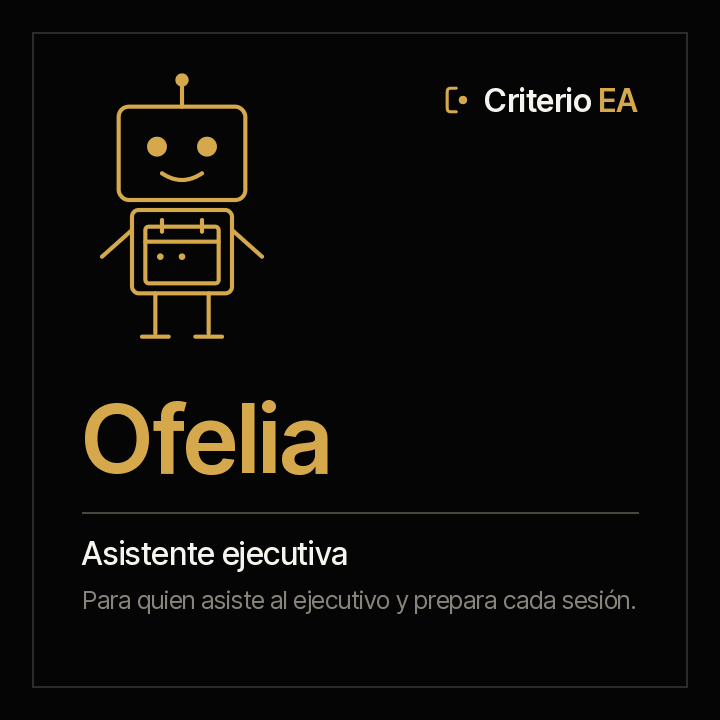

<picture><source media="(prefers-color-scheme: dark)" srcset="../../docs/img/marca/es/criterio-ea-oscuro.svg"></picture>

# criterio-ea · la familia de la oficina de dirección

**Una agente y un portal, alrededor de sus fichas.** Ofelia extiende a quien asiste al ejecutivo
—al presidente, al gerente general—: llega con la semana contra las sesiones y los compromisos, el
paquete de la próxima sesión de cada órgano, el borrador del acta y la correspondencia que pide
respuesta. **Prepara; no recomienda ni decide, y nunca envía nada.**

[English](README.md) · [← Criterio](../../README.es.md) · Apache 2.0



| | |
|---|---|
| **Alcance** | La oficina de un ejecutivo: su agenda, las sesiones de los órganos que sigue —junta, comité de presidencia, comités de la junta—, sus actas, sus compromisos y su correspondencia |
| **Objetivo** | Que el ejecutivo llegue a cada sesión preparado y que ningún acuerdo quede sin dueño ni fecha |
| **Compuesta por** | [Ofelia](../../plugins/criterio-assistant/README.es.md) · [Rostrum](../../plugins/criterio-server/README.es.md), solo si la oficina decide publicar |
| **El soporte** | El marco de trabajo que define el rol y lo que cuesta hoy, con su fuente, su año y su muestra: [`FUENTES.es.md`](FUENTES.es.md) |
| **Estado** | Construida y probada sobre material sintético de dos países —Colombia y Ecuador—: el motor, contra las cuatro oficinas del material; la agente, en [las rondas con la agente](../../tests/evidencias/familias/ea/RONDAS.md). **No se ha probado todavía sobre la oficina de un ejecutivo concreto** |
| **Enfoque** | Preparar, sin recomendar: cada decisión llega con sus opciones en el orden en que las traen los documentos |
| **Compromiso** | Generar, difundir y conservar el conocimiento es una obligación profesional |
| **Qué no es** | No reemplaza a quien asiste al ejecutivo ni al secretario de la junta: no envía, no agenda, no acepta ni mueve nada, no prioriza por el ejecutivo y no evalúa a una persona ni a un área |
| **Licencia** | [Apache 2.0](../../LICENSE) |
| **Qué viene** | Los viajes y las exportaciones de cada proveedor de calendario y de correo: [la hoja de ruta](#hoja-de-ruta) |

---

## Qué hace la familia

La oficina de dirección tiene un rol que lo cruza todo —la agenda, las sesiones, las actas, los
compromisos y la correspondencia—, y por eso la familia tiene una sola agente. Lleva nombre de
persona porque **es una capacidad extendida de una persona**, y su nombre apunta a lo que hace:
**Ofelia** —del griego *ōphéleia*, «ayuda»— es la que prepara.

Ofelia pone la semana del ejecutivo al lado de sus sesiones y sus compromisos: qué reuniones se
cruzan, qué sesión no tiene material a los días configurados, qué acta sigue sin firmar, qué acuerdo
no tiene responsable o fecha, qué compromiso venció sin un documento que lo sostenga y qué correo
espera respuesta. Lo que hoy no hace nadie y ella sí: **revisar cada acuerdo de cada acta contra su
responsable y su fecha, y contar cuántas veces se movió cada compromiso.**

Para cada punto que pide una decisión arma su ficha —las opciones que traen los documentos, la
evidencia de cada una con su cita, lo que falta saber y las fechas que fijan el plazo— y **no las
ordena.** La secretaría de junta es un modo de Ofelia, no un agente aparte
([ADR 0012](../../docs/decisions/0012-scope-asistente-ejecutivo.md)).

**Se instala hoy**, con su propio plugin, y tiene la deuda de las demás familias, escrita en su
página: **el motor y la extracción de la agente están probados sobre material sintético; nada se ha
probado todavía sobre la oficina de un ejecutivo.**

---

## Cómo opera

El modelo de lenguaje (LLM) extrae; el código calcula; la decisión —qué se acepta, qué se envía, qué
se prioriza— la toma siempre una persona. **El motor procesa directamente** la agenda exportada en
.ics —repeticiones, excepciones, ocurrencias movidas y zonas horarias, con su autoprueba—, los
encabezados de cada correo guardado y lo que hay en la carpeta de cada sesión. La agente lleva a la
ficha lo que solo trae un documento escrito: los acuerdos y los compromisos del acta o de las notas,
las decisiones con sus opciones y lo que pide cada correo, cada uno con su cita.

**Exportaciones, no cuentas.** Ofelia no se conecta al buzón ni al calendario: procesa lo que la
oficina exporta. Una conexión directa es otra decisión, con su revisión de privacidad.

**Automatizada**: procesa los documentos, calcula las señales y prepara cada entregable sin
intervención. **Semiautomatizada** cuando falta un dato que ningún documento trae —quién integra un
órgano, los umbrales—: entonces le pregunta a la persona, dice qué preguntó y sigue con la
respuesta.

## La agente y sus fichas

| Ficha | Una por | Qué lleva | Quién la escribe |
|---|---|---|---|
| Ficha de la reunión | Sesión de un órgano | El orden del día, los acuerdos con su responsable y su fecha, los compromisos y cada decisión con sus opciones y su evidencia | Ofelia; el acta la firma el órgano |
| Ficha de la correspondencia | Correo guardado | Quién escribe, qué pide, para cuándo y si hay una respuesta guardada | Ofelia; la respuesta la envía una persona |

Cada dato cita el documento del que sale y su fecha. «No encontrado» es una respuesta válida.

### Las siete invariantes

1. **Prepara; no recomienda ni decide.** Las opciones de una decisión van en el orden en que las
   traen los documentos, sin una que convenga más.
2. **Nunca envía, agenda, acepta ni mueve nada.** Escribe borradores solo en `90-borradores/`, con
   «BORRADOR» en el nombre y en el texto, y nunca archiva uno en `40-acta/`.
3. **Escribe solo en lo suyo**: `estado-direccion/`, `.criterio/direccion/` y `90-borradores/`.
   No edita actas, agendas ni correos originales.
4. **Un compromiso no se declara cumplido sin un documento que lo sostenga.** Cada uno es del acta
   donde nació; los de proyecto son de Samuel y se citan de su ficha, sin recalcularlos.
5. **El modelo extrae, el código calcula.** Toda fecha, cruce, plazo o conteo de un reporte sale de
   `asistente.py`; si el motor no lo da, no se escribe.
6. **No procesa lo que se excluye**, y dice en cada informe qué carpetas excluyó.
7. **Su informe no se publica en Rostrum por omisión.** La oficina del ejecutivo es de lo más
   sensible que tiene una organización; publicar es una decisión de la configuración.

La primera es la más fácil de romper por conveniencia: una asistente que ordena las opciones ya
decidió cuál ve primero el ejecutivo. No es una recomendación de la documentación: es una
restricción de lo que escribe la ficha, y el motor rechaza una ficha que traiga un orden o una
opción recomendada.

## Lo que sigue siendo de las personas

El rol sigue existiendo completo. Esto extiende capacidad; no sustituye función. Y el argumento no
es de cortesía, es estructural:

> **El insumo de la agente lo produce el trabajo no delegable de su persona.**

Ofelia necesita que alguien exporte la agenda y guarde los correos que importan, porque no se
conecta a ninguna cuenta; que el órgano firme su acta, porque sin acta no hay acuerdos que revisar;
y que alguien registre cuándo un compromiso se cumplió, porque sin evidencia no hay cumplimiento.

Quitar a la persona no deja a la agente sola: la deja sin insumo. **Y Ofelia no envía, no negocia
una fecha, no representa al ejecutivo ni decide qué entra al orden del día.**

## La estructura de carpetas recomendada

Recomendada, no obligatoria ([ADR 0007](../../docs/decisions/0007-estructura-recomendada.md)): la
agente procesa la carpeta como esté. `ea-setup` compara lo que encuentra con esta estructura y, en
cada corrida, dice qué archivo está fuera de su lugar y dónde iría; no crea, mueve ni renombra nada
en los documentos de la oficina. La numeración va de diez en diez, como en las demás familias.

<!-- ea:carpetas · generado por scripts/familias.py; no se edita a mano -->
Una carpeta por ejecutivo que se asiste. Dentro, la referencia de su oficina, su agenda, su correspondencia, los borradores que prepara Ofelia y una carpeta por reunión de cada órgano.

```
direccion/
└── <ejecutivo>/
    ├── 00-referencia/
    ├── 10-agenda/
    ├── 20-correspondencia/
    ├── 90-borradores/
    └── organos/<órgano>/<AAAA-MM-DD>/
        ├── 10-convocatoria/
        ├── 20-material/
        ├── 30-notas/
        └── 40-acta/
estado-direccion/
```

**`<ejecutivo>/`** · La oficina de un ejecutivo

| Carpeta | Qué va | Agente |
|---|---|---|
| `00-referencia/` | Los órganos que se siguen —junta, comité de presidencia, comités de la junta—, quién los integra y su calendario de sesiones | Ofelia |
| `10-agenda/` | Las exportaciones de la agenda en .ics, con la fecha de la exportación en el nombre | Ofelia |
| `20-correspondencia/` | Los correos guardados como archivo, uno por mensaje | Ofelia |
| `90-borradores/` | Lo único que escribe Ofelia entre los documentos: borradores de actas y de respuestas, con «BORRADOR» en el nombre | Ofelia |

**`organos/<órgano>/<AAAA-MM-DD>/`** · Una sesión de un órgano, con su fecha como nombre de la carpeta

| Carpeta | Qué va | Agente |
|---|---|---|
| `10-convocatoria/` | La convocatoria y el orden del día | Ofelia |
| `20-material/` | El material que se envía a los miembros antes de la sesión | Ofelia |
| `30-notas/` | Las notas o la transcripción de la sesión | Ofelia |
| `40-acta/` | El acta firmada. Ofelia nunca archiva un borrador aquí | Ofelia |

**`estado-direccion/`** · Lo que escribe Ofelia: la configuración, las fichas de cada reunión, de cada hilo y de cada exportación, y los informes. Ninguna persona lo edita, y Ofelia no escribe fuera de aquí ni de `90-borradores/`.
<!-- /ea:carpetas -->

Un archivo sin el formato esperado no se adivina: se reporta con lo que le falta.

## Instalación de la familia

```
/plugin marketplace add josenanez/criterio
/plugin install criterio-assistant@criterio
```

**En Claude Cowork** — Personalizar → Explorar plugins → Personal → **+** → Agregar
marketplace desde GitHub → `josenanez/criterio`.

Después de instalar, `/criterio-assistant:ea-setup` mira la carpeta, hace las preguntas que ningún
documento responde y produce un primer resultado sobre los documentos de la oficina. **Nadie edita
un archivo de configuración a mano.**

## De qué responde la agente, y dónde está su detalle

<!-- ea:familia-agentes · generado por scripts/familias.py; no se edita a mano -->
| | De qué responde | Lo que nunca hace | Su página | Sus pruebas |
|---|---|---|---|---|
| **Ofelia** · asistente ejecutiva | El día a día del ejecutivo: la agenda contra sus compromisos, la preparación de cada sesión de un órgano con la ficha de cada decisión, el borrador del acta, el seguimiento de los compromisos y la correspondencia que pide respuesta | No envía, no agenda, no acepta ni mueve nada; no recomienda una opción, no prioriza por el ejecutivo, no declara cumplido un compromiso sin evidencia y no evalúa a una persona ni a un área | [criterio-assistant](../../plugins/criterio-assistant/README.es.md) · 9 comandos, 6 skills | [resultados](../../tests/criterio-assistant/RESULTADOS.md) |
| **Rostrum** · el portal | Publicar lo que escriben los agentes donde el equipo lo vea, y recibir la pregunta de quien no abre una carpeta | **No escribe en el estado ni recalcula nada**, y no decide nada | [criterio-server](../../plugins/criterio-server/README.es.md) · 2 comandos, uno para todas las familias | [resultados](../../tests/criterio-server/RESULTADOS.md) |
<!-- /ea:familia-agentes -->

Los comandos, uno por uno —qué hacen, qué reciben, qué procesan y qué escriben—, están en el
[manual de los comandos](../../docs/manual.es.md); su entrada, su proceso y su reporte, con las
señales que calcula el motor, en el [diseño de la familia](DISENO.es.md); y las respuestas a lo que más se
pregunta, en las [preguntas frecuentes](PREGUNTAS.es.md).

## En Rostrum, solo si la oficina lo decide

**El informe de Ofelia no se publica en Rostrum por omisión.** Si la configuración lo dice,
`/criterio-server:server-setup` encuentra su configuración en `.criterio/direccion/<ejecutivo>/` y
la suma al mapa, con la carpeta de la oficina marcada con `_CRITERIO_DIRECCION.txt`. Rostrum no
recalcula nada, no escribe en el estado y no autentica a nadie: se publica detrás del control de
acceso que la organización ya tiene.

→ [Rostrum: su README, con las rutas y qué pedirle a tu organización](../../plugins/criterio-server/README.es.md)

## Cómo se configura y cada cuánto corre

<!-- ea:configuracion · generado por scripts/familias.py; no se edita a mano -->
| | Ofelia |
|---|---|
| **Se instala** | `criterio-assistant` |
| **Instancias** | Una por ejecutivo |
| **Se configura con** | `/criterio-assistant:ea-setup` |
| **Cuánto tarda eso** | Quince minutos |
| **Qué le tienes que decir** | El ejecutivo y quién lo asiste, los órganos de `00-referencia`, las carpetas excluidas, los umbrales —días antes de una sesión para el material, días para el acta, cambios de fecha que cuentan, antigüedad máxima de la agenda—, si publica en Rostrum y los términos |
| **Dónde queda** | `.criterio/direccion/<ejecutivo>/config.json`, escrito por el comando |
| **El que se le pone a un reloj** | `/criterio-assistant:ea-wake` |
| **Qué toca cada día** | Decide qué toca: las sesiones que entran en la ventana, las actas pendientes, los plazos de la correspondencia y una revisión semanal |
| **Qué lo despierta además del reloj** | Una pregunta que alguien dejó en Rostrum |
<!-- /ea:configuracion -->

**Nadie edita un archivo de configuración a mano.** Se dice en la conversación y el comando lo
reescribe. El plugin trae su `scripts/config.example.json` para ver la forma completa sin instalar
nada; los días, las veces y la antigüedad máxima de la agenda son configuración de cada oficina, con
un valor por defecto declarado.

### Se calla cuando no hay nada

El comando de reloj no produce nada cuando no toca nada, y entonces la salida es una línea: qué se
revisó y cuándo vuelve. Un solo resumen a la semana. Una asistente que produce un informe para decir
que no hay novedad enseña a ignorarla.

### Qué es lo que **no** está programado

**No se programa sola.** Trae el comando que un reloj invoca, y el reloj vive fuera del plugin —una
tarea programada de Claude Cowork, o el programador del sistema operativo invocando Claude en modo
no interactivo—. Si la oficina no quiere corridas desatendidas, los comandos sirven corridos a mano.

## Las pruebas de la familia

**Una sola puerta corre todo lo que este repositorio comprueba**, de todas las familias a la vez:

```
python3 scripts/verificar.py
```

Lo propio de la EA está en [`tests/criterio-ea/`](../../tests/criterio-ea/): la oficina de una
presidencia y la de una gerencia general con defectos sembrados, y una oficina de control por país
que no trae ningún defecto —y sí los casos que se parecen a uno—, donde cualquier señal es una
falla. Cada señal se siembra al menos una vez. `evaluar.py` corre el motor y compara cada señal por
su nombre y su clave: **una de más cuenta igual que una de menos.**

| Qué se comprueba | Por qué |
|---|---|
| Que cada señal sembrada se levante, y ninguna en los controles | Es lo que separa una señal de un ruido |
| Que una reunión en otra zona horaria se cruce solo después del cambio de hora, y que un evento libre o cancelado no cruce | La agenda real tiene repeticiones, excepciones y zonas horarias |
| Que la agenda vieja avise y no dé cruces | Un cruce calculado sobre una agenda vieja es falso |
| Que un borrador en `40-acta/` se diga y la carpeta excluida no se procese | Son las reglas de la operación real |
| Que el informe no se publique en Rostrum por omisión | La oficina del ejecutivo es sensible |

**El resultado de la agente, generado desde la corrida**, en
[su página](../../tests/criterio-assistant/RESULTADOS.md). Qué se siembra en cada oficina y la señal
que tiene que levantar, **y qué no prueba el material**, en
[`EVIDENCIA.md`](../../tests/criterio-ea/EVIDENCIA.md). Cada salida de la agente, su costo y su
calificación, en [las rondas de la familia](../../tests/evidencias/familias/ea/RONDAS.md).

## Hoja de ruta

<!-- hoja de ruta: generado por scripts/hoja.py desde hoja-de-ruta.json; no se edita a mano -->

La familia crece por incrementos. Cada uno es una versión con su prueba completa y su análisis estadístico publicados, con las mismas métricas, para que la evolución se pueda comparar.

| Versión | Estado | Qué entra | Prueba |
|---|---|---|---|
| 0.12.0 | Liberada | **Ofelia, construida y probada con la ronda completa con la agente**<br>· Los nueve comandos de Ofelia, sus skills y el motor: la agenda .ics con repeticiones y cambio de hora, el correo guardado, las sesiones de los órganos y los compromisos con las reglas de Samuel<br>· Prepara cada decisión con sus opciones y su evidencia, sin ordenarlas ni recomendar<br>· Colombia y Ecuador, en la oficina de una presidencia y de una gerencia general, y dos oficinas de control | La ronda 1: Ofelia sobre las cuatro oficinas, 14 de 14 señales y 76 de 78 datos, con una señal de más en un control; cada defecto que encontró, con su corrección y su verificación |
| Incremento 2 | Siguiente | **Los viajes, y las exportaciones de cada proveedor**<br>· Los itinerarios contra la agenda<br>· El .ics que exportan Outlook y Google Calendar y el correo .msg de Outlook, cada uno con su material: lo que de verdad cambia de una oficina a otra, no el país | La ronda con la agente sobre las exportaciones de cada proveedor |
| Incremento 3 | Reservada | **El despliegue en una organización**<br>· El primer uso sobre la oficina de un ejecutivo concreto | La documentación de esa oficina |

<!-- /hoja de ruta -->

## Los seis skills de la familia

<!-- ea:skills-familia · generado por scripts/familias.py; no se edita a mano -->
Seis skills, todos de Ofelia.

| Skill | Ofelia |
|---|:--:|
| `commitment-tracking` | ● |
| `correspondence-record` | ● |
| `decision-brief` | ● |
| `ea-intake` | ● |
| `meeting-record` | ● |
| `minutes-draft` | ● |
<!-- /ea:skills-familia -->

## Estado

**Ofelia está construida y se puede instalar hoy**, con la misma deuda que las demás familias, que
conviene no esconder: **el motor y la extracción de la agente están probados sobre material
sintético, no sobre la oficina de un ejecutivo real.**

<!-- ea:estado · generado por scripts/familias.py; no se edita a mano -->
| Agente | Se instala | Su prueba |
|---|---|---|
| **Ofelia** · Asistente ejecutiva | `criterio-assistant` · 9 comandos, 6 skills | El motor, probado; con la agente, todas las oficinas del material, hasta la ronda 1 · [resultados](../../tests/criterio-assistant/RESULTADOS.md) |
| **Rostrum** · el portal | `criterio-server` · 2 comandos, para todas las familias | — |
<!-- /ea:estado -->

Los viajes —los itinerarios contra la agenda— y las exportaciones de cada proveedor vienen en el incremento 2; el
primer uso sobre la oficina de un ejecutivo concreto, después. Las decisiones que siguen abiertas, en
el [diseño](DISENO.es.md#decisiones-abiertas).
