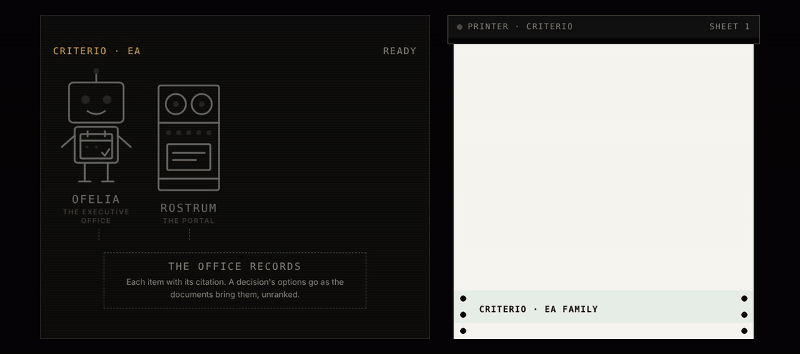

<picture><source media="(prefers-color-scheme: dark)" srcset="../../docs/img/marca/en/criterio-ea-oscuro.svg"></picture>

# criterio-ea · the executive office family

**One agent and a portal, around her records.** Ofelia extends whoever assists the executive —the
president, the general manager—: she arrives with the week against the meetings and commitments,
the pack for each governing body's next meeting, the draft minutes and the correspondence that needs
a reply. **She prepares; she does not recommend or decide, and she never sends anything.**

[Español](README.es.md) · [← Criterio](../../README.md) · Apache 2.0



| | |
|---|---|
| **Scope** | One executive's office: the calendar, the meetings of the governing bodies it follows —board, executive committee, board committees—, their minutes, the commitments and the correspondence |
| **Goal** | That the executive arrives at every meeting prepared and no agreement is left without an owner or a date |
| **Made up of** | [Ofelia](../../plugins/criterio-assistant/README.md) · [Rostrum](../../plugins/criterio-server/README.md), only if the office decides to publish |
| **The support** | The work framework that defines the role and what it costs today, with its source, year and sample: [`FUENTES.es.md`](FUENTES.es.md) |
| **Status** | Built and tested on synthetic material from two countries —Colombia and Ecuador—: the engine, against the material's four offices; the agent, in [the rounds with the agent](../../tests/evidencias/familias/ea/RONDAS.md). **Not yet tested on a specific executive's office** |
| **Approach** | Prepare, without recommending: each decision arrives with its options in the order the documents bring them |
| **Commitment** | Creating, sharing and preserving knowledge is a professional obligation |
| **What it is not** | It does not replace whoever assists the executive or the board secretary: it does not send, schedule, accept or move anything, does not prioritise for the executive and does not evaluate a person or a team |
| **Licence** | [Apache 2.0](../../LICENSE) |
| **What comes next** | Travel and each calendar and email provider's exports: [the roadmap](#roadmap) |

---

## What the family does

The executive office has one role that cuts across everything —the calendar, the meetings, the
minutes, the commitments and the correspondence—, so the family has a single agent. She carries a
person's name because **she is the extended capability of a person**, and her name points at what
she does: **Ofelia** —from the Greek *ōphéleia*, «help»— is the one who prepares.

Ofelia sets the executive's week beside the meetings and commitments: which meetings clash, which
meeting has no materials by the configured number of days, which minutes are still unsigned, which
agreement has no owner or date, which commitment fell due without a document to back it and which
email is waiting for a reply. What nobody does today and she does: **check every agreement in every
set of minutes against its owner and its date, and count how many times each commitment moved.**

For each item that calls for a decision she builds its record —the options the documents bring, the
evidence for each one with its citation, what is still unknown and the dates that set the deadline—
and **does not rank them.** Board secretariat is a mode of Ofelia, not a separate agent
([ADR 0012](../../docs/decisions/0012-scope-asistente-ejecutivo.md)).

**She can be installed today**, with her own plugin, and carries the same debt as the other
families, written on her page: **the engine and the agent's extraction are tested on synthetic
material; nothing has yet been tested on an executive's office.**

---

## How she operates

The language model (LLM) extracts; the code calculates; the decision —what is accepted, what is
sent, what comes first— is always made by a person. **The engine processes directly** the calendar
exported as .ics —recurrences, exceptions, moved occurrences and time zones, with its self-test—, the
headers of each saved email and what is in each meeting's folder. The agent brings to the record what
only a written document holds: the agreements and commitments in the minutes or notes, the decisions
with their options and what each email asks for, each with its citation.

**Exports, not accounts.** Ofelia does not connect to the mailbox or the calendar: she processes what
the office exports. A direct connection is a separate decision, with its own privacy review.

**Automated**: she processes the documents, calculates the signals and prepares each deliverable
without intervention. **Semi-automated** when a fact is missing that no document holds —who sits on
a governing body, the thresholds—: then she asks the person, says what she asked and carries on with
the answer.

## The agent and her records

| Record | One per | What it holds | Who writes it |
|---|---|---|---|
| Meeting record | Meeting of a governing body | The agenda, the agreements with their owner and date, the commitments and each decision with its options and evidence | Ofelia; the governing body signs the minutes |
| Correspondence record | Saved email | Who wrote, what they ask, by when and whether a reply is saved | Ofelia; a person sends the reply |

Every item cites the document it comes from and its date. «Not found» is a valid answer.

### The seven invariants

1. **She prepares; she does not recommend or decide.** A decision's options go in the order the
   documents bring them, with none marked as better.
2. **She never sends, schedules, accepts or moves anything.** She writes drafts only in
   `90-borradores/`, with «BORRADOR» in the name and in the text, and never files one in `40-acta/`.
3. **She writes only in what is hers**: `estado-direccion/`, `.criterio/direccion/` and
   `90-borradores/`. She does not edit original minutes, calendars or emails.
4. **A commitment is not declared done without a document to back it.** Each belongs to the minutes
   where it was born; project commitments are Samuel's and are cited from his record, not recomputed.
5. **The model extracts, the code calculates.** Every date, clash, deadline or count in a report
   comes from `asistente.py`; if the engine does not give it, it is not written.
6. **She does not process what is excluded**, and every report says which folders she excluded.
7. **Her report is not published in Rostrum by default.** The executive's office is among the most
   sensitive things an organisation has; publishing is a configuration decision.

The first is the easiest to break for convenience: an assistant who ranks the options has already
decided which one the executive sees first. It is not a documentation recommendation: it is a
constraint on what the record holds, and the engine rejects a record that carries a ranking or a
recommended option.

## What stays with people

The role remains whole. This extends capacity; it does not replace a function. And the argument is
not one of courtesy, it is structural:

> **The agent's input is produced by her person's non-delegable work.**

Ofelia needs someone to export the calendar and save the emails that matter, because she connects
to no account; the governing body to sign its minutes, because without minutes there are no
agreements to check; and someone to record when a commitment was met, because without evidence
there is no completion.

Removing the person does not leave the agent on her own: it leaves her without input. **And Ofelia
does not send, negotiate a date, represent the executive or decide what goes on the agenda.**

## The recommended folder structure

Recommended, not mandatory ([ADR 0007](../../docs/decisions/0007-estructura-recomendada.md)): the
agent processes the folder as it is. `ea-setup` compares what it finds with this structure and, on
every run, says which file is out of place and where it would go; it does not create, move or rename
anything in the office's documents. Numbering goes in tens, as in the other families.

<!-- ea:carpetas · generado por scripts/familias.py; no se edita a mano -->
One folder per executive being assisted. Inside it, the office's reference files, the calendar, the correspondence, the drafts Ofelia prepares and one folder per meeting of each governing body.

```
direccion/
└── <ejecutivo>/
    ├── 00-referencia/
    ├── 10-agenda/
    ├── 20-correspondencia/
    ├── 90-borradores/
    └── organos/<órgano>/<AAAA-MM-DD>/
        ├── 10-convocatoria/
        ├── 20-material/
        ├── 30-notas/
        └── 40-acta/
estado-direccion/
```

**`<ejecutivo>/`** · One executive's office

| Folder | What goes in | Agent |
|---|---|---|
| `00-referencia/` | The governing bodies being followed —board, executive committee, board committees—, their members and their meeting calendar | Ofelia |
| `10-agenda/` | The calendar exports in .ics, with the export date in the name | Ofelia |
| `20-correspondencia/` | The emails saved as files, one per message | Ofelia |
| `90-borradores/` | The only place among the documents where Ofelia writes: draft minutes and draft replies, with «BORRADOR» in the name | Ofelia |

**`organos/<órgano>/<AAAA-MM-DD>/`** · One meeting of a governing body, with its date as the folder name

| Folder | What goes in | Agent |
|---|---|---|
| `10-convocatoria/` | The notice of meeting and the agenda | Ofelia |
| `20-material/` | The materials sent to members before the meeting | Ofelia |
| `30-notas/` | The notes or transcript of the meeting | Ofelia |
| `40-acta/` | The signed minutes. Ofelia never files a draft here | Ofelia |

**`estado-direccion/`** · What Ofelia writes: the configuration, the record of each meeting, thread and export, and the reports. No person edits it, and Ofelia writes nowhere else except `90-borradores/`.
<!-- /ea:carpetas -->

A file without the expected format is not guessed: it is reported with what it lacks.

## Installing the family

```
/plugin marketplace add josenanez/criterio
/plugin install criterio-assistant@criterio
```

**In Claude Cowork** — Customize → Browse plugins → Personal → **+** → Add marketplace from GitHub
→ `josenanez/criterio`.

After installing, `/criterio-assistant:ea-setup` looks at the folder, asks the questions no document
answers and produces a first result on the office's documents. **Nobody edits a configuration file
by hand.**

## What the agent answers for, and where her detail is

<!-- ea:familia-agentes · generado por scripts/familias.py; no se edita a mano -->
| | What it answers for | What it never does | Its page | Its tests |
|---|---|---|---|---|
| **Ofelia** · executive assistant | The executive's day to day: the calendar against their commitments, the preparation of each governing-body meeting with the record of each decision, the draft minutes, the follow-up of commitments and the correspondence that needs a reply | It does not send, schedule, accept or move anything; it does not recommend an option, prioritise for the executive, declare a commitment done without evidence or evaluate a person or a team | [criterio-assistant](../../plugins/criterio-assistant/README.md) · 9 commands, 6 skills | [results](../../tests/criterio-assistant/RESULTADOS.md) |
| **Rostrum** · the portal | Publishing what the agents write where the team will see it, and taking the question from whoever will not open a folder | **Never writes the state or recalculates anything**, and decides nothing | [criterio-server](../../plugins/criterio-server/README.md) · 2 commands, one for every family | [results](../../tests/criterio-server/RESULTADOS.md) |
<!-- /ea:familia-agentes -->

The commands, one by one —what they do, what they take, what they process and what they write—, are
in the [command manual](../../docs/manual.md); their input, process and report, with the signals the
engine calculates, in the [family design](DISENO.md); and the answers to what people ask most, in the
[frequently asked questions](PREGUNTAS.md).

## In Rostrum, only if the office decides

**Ofelia's report is not published in Rostrum by default.** If the configuration says so,
`/criterio-server:server-setup` finds her configuration in `.criterio/direccion/<ejecutivo>/` and adds
it to the map, with the office folder marked with `_CRITERIO_DIRECCION.txt`. Rostrum recalculates
nothing, does not write to the state and authenticates no one: it is published behind the access
control the organisation already has.

→ [Rostrum: its README, with the routes and what to ask your organisation for](../../plugins/criterio-server/README.md)

## How she is configured and how often she runs

<!-- ea:configuracion · generado por scripts/familias.py; no se edita a mano -->
| | Ofelia |
|---|---|
| **Installs as** | `criterio-assistant` |
| **Instances** | One per executive |
| **Configured with** | `/criterio-assistant:ea-setup` |
| **How long that takes** | Fifteen minutes |
| **What you have to tell it** | The executive and who assists them, the governing bodies in `00-referencia`, the excluded folders, the thresholds —days before a meeting for the materials, days for the minutes, date changes that count, maximum age of the calendar—, whether it publishes to Rostrum and the terms |
| **Where it lands** | `.criterio/direccion/<executive>/config.json`, written by the command |
| **The one you put on a clock** | `/criterio-assistant:ea-wake` |
| **What it does each day** | Decides what is due: the meetings entering the window, pending minutes, correspondence deadlines and a weekly review |
| **What wakes it besides the clock** | A question somebody left in Rostrum |
<!-- /ea:configuracion -->

**Nobody edits a configuration file by hand.** It is said in the conversation and the command
rewrites it. The plugin ships its `scripts/config.example.json` to see the full shape without
installing anything; the days, the counts and the calendar's maximum age are each office's
configuration, with a declared default.

### She stays quiet when there is nothing

The clock command produces nothing when nothing is due, and then the output is one line: what was
checked and when it comes back. One summary a week. An assistant that produces a report to say there
is no news teaches people to ignore her.

### What is **not** scheduled

**She does not schedule herself.** She brings the command a clock invokes, and the clock lives
outside the plugin —a Claude Cowork scheduled task, or the operating system's scheduler invoking
Claude non-interactively—. If the office does not want unattended runs, the commands work run by
hand.

## The family's tests

**One gate runs everything this repository checks**, for every family at once:

```
python3 scripts/verificar.py
```

What belongs to the EA is in [`tests/criterio-ea/`](../../tests/criterio-ea/): a president's office
and a general manager's office with seeded defects, and one control office per country with no
defect —and with the cases that look like one—, where any signal is a failure. Every signal is
seeded at least once. `evaluar.py` runs the engine and compares each signal by name and key: **one
too many counts the same as one too few.**

| What is checked | Why |
|---|---|
| That every seeded signal is raised, and none in the controls | It is what separates a signal from noise |
| That a meeting in another time zone clashes only after the clock change, and that a free or cancelled event does not | The real calendar has recurrences, exceptions and time zones |
| That an old calendar warns and gives no clashes | A clash computed on an old calendar is false |
| That a draft in `40-acta/` is reported and the excluded folder is not processed | They are the rules of real operation |
| That the report is not published in Rostrum by default | The executive's office is sensitive |

**The agent's result, generated from the run**, on
[its page](../../tests/criterio-assistant/RESULTADOS.md). What is seeded in each office and the
signal it must raise, **and what the material does not test**, in
[`EVIDENCIA.md`](../../tests/criterio-ea/EVIDENCIA.md). Every output of the agent, its cost and its
grade, in [the family's rounds](../../tests/evidencias/familias/ea/RONDAS.md).

## Roadmap

<!-- hoja de ruta: generado por scripts/hoja.py desde hoja-de-ruta.json; no se edita a mano -->

The family grows in increments. Each one is a version with its full test and its statistical analysis published, with the same metrics, so the evolution can be compared.

| Version | Status | What goes in | Test |
|---|---|---|---|
| 0.12.0 | Released | **Ofelia, built and tested with the full round with the agent**<br>· Ofelia's nine commands, her skills and the engine: the .ics calendar with recurrences and the clock change, saved email, the governing bodies' meetings and commitments with Samuel's rules<br>· She prepares each decision with its options and evidence, without ranking or recommending<br>· Colombia and Ecuador, in a president's office and a general manager's office, and two control offices | Round 1: Ofelia on the four offices, 14 of 14 signals and 76 of 78 data points, with one extra signal in a control; every defect it found, with its fix and its verification |
| Increment 2 | Next | **Travel, and each provider's exports**<br>· Itineraries against the calendar<br>· The .ics that Outlook and Google Calendar export and Outlook's .msg email, each with its material: what really changes from one office to another, not the country | The round with the agent on each provider's exports |
| 1.0.0 | Reserved | **The stable version**<br>· Its planned scope, released: every earlier increment with its version<br>· Two full rounds in a row with no new defects, no extra signals in the control entities and the floor of the 95% confidence margin at 95% or higher, for signals and for data<br>· The record schema, fixed: from here on, breaking it is a version 2.0 | The two full rounds, published with their statistical analysis |

<!-- /hoja de ruta -->

## The family's six skills

<!-- ea:skills-familia · generado por scripts/familias.py; no se edita a mano -->
Six skills, all of them Ofelia's.

| Skill | Ofelia |
|---|:--:|
| `commitment-tracking` | ● |
| `correspondence-record` | ● |
| `decision-brief` | ● |
| `ea-intake` | ● |
| `meeting-record` | ● |
| `minutes-draft` | ● |
<!-- /ea:skills-familia -->

## Status

**Ofelia is built and can be installed today**, with the same debt as the other families, which is
better not hidden: **the engine and the agent's extraction are tested on synthetic material, not on
a real executive's office.**

<!-- ea:estado · generado por scripts/familias.py; no se edita a mano -->
| Agent | Installs as | Its test |
|---|---|---|
| **Ofelia** · Executive assistant | `criterio-assistant` · 9 commands, 6 skills | The engine, tested; with the agent, every office in the material, up to round 1 · [results](../../tests/criterio-assistant/RESULTADOS.md) |
| **Rostrum** · the portal | `criterio-server` · 2 commands, for every family | — |
<!-- /ea:estado -->

Travel —itineraries against the calendar— and each provider's exports come in increment 2; the first use
on a specific executive's office, after that. The decisions still open, in the
[design](DISENO.md#open-decisions).
