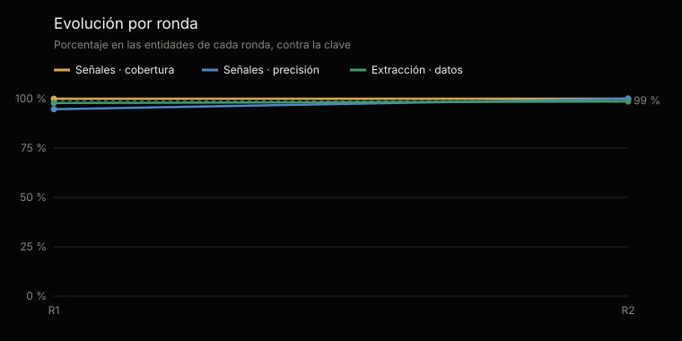
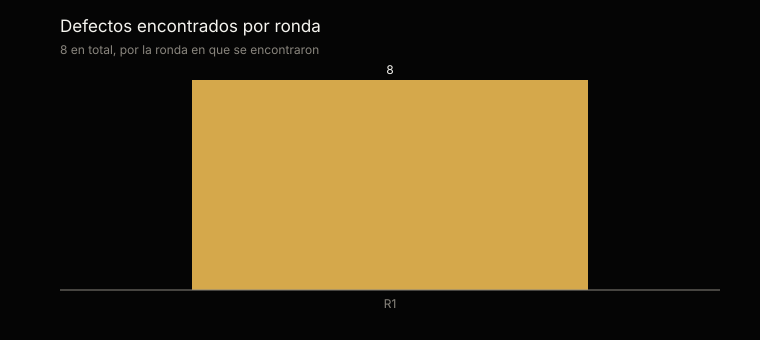

# Análisis estadístico de las pruebas · familia EA

Generado por `scripts/analisis_familias.py` desde `tests/evidencias/familias/ea/` · ronda completa más reciente: 1 · [English](ANALISIS.md)

No se edita a mano: cada cifra sale de la evidencia y el análisis se regenera con cada ronda.

## En una mirada

La ronda completa más reciente, la 1, sobre las 6 entidades del material: 18 de 18 señales sembradas encontradas (margen del 95 %: 82,4–100 %) y 1 de más; 114 de 117 datos extraídos bien (97,4 %, margen del 95 %: 92,7–99,2 %); y 2 de 3 entidades de control sin ninguna señal.

Sumando las rondas 1–1, 18 de 18 señales encontradas, 1 de más y 114 de 117 datos bien. Las rondas repiten el mismo material: no son muestras independientes, y el margen se calcula sobre los casos de cada una.

## Qué se probó y cómo

Cada entidad corre todos los comandos de los dos agentes, con un tope de tokens fijado antes de empezar, sobre un material que trae su clave aparte: el agente nunca la ve. Las señales se comparan por su nombre y su clave; la extracción, campo por campo, contra lo que traen los documentos escritos. Las entidades de control no tienen ningún defecto sembrado: cualquier señal en ellas es una falla.

Cobertura: de las señales sembradas, cuántas encontró. Precisión: de las que levantó, cuántas eran correctas. Margen del 95 %: intervalo de confianza de Wilson sobre los casos.

|   |   |
|---|---|
| Rondas | 1; la completa más reciente es la 1 |
| Material | Banca · Colombia, Cooperativas · Ecuador |
| Entidades de control | Control · Colombia, Control · Ecuador |
| Corridas de una entidad | 6 |
| Señales sembradas | 18 |
| Datos calificados | 117 |

## Resultados acumulados · rondas 1–1

| Métrica | Casos | Resultado | Margen del 95 % |
|---|---|---|---|
| Señales · cobertura | 18 de 18 | 100 % | 82,4–100 % |
| Señales · precisión | 18 de 19 | 94,7 % | 75,3–99,1 % |
| Extracción · datos correctos | 114 de 117 | 97,4 % | 92,7–99,2 % |
| Control · sin ninguna señal | 2 de 3 | 66,7 % | 20,7–93,9 % |

## Evolución por ronda

| Ronda | Entidades | Señales · cobertura | Señales · precisión | Extracción | Control sin señales | Tokens | Defectos |
|---|---|---|---|---|---|---|---|
| 1 | 6 | 100 % | 94,7 % | 97,4 % | 2 de 3 | 9,2 M | 8 |

## La ronda completa más reciente · ronda 1

| Métrica | Casos | Resultado | Margen del 95 % |
|---|---|---|---|
| Señales · cobertura | 18 de 18 | 100 % | 82,4–100 % |
| Señales · precisión | 18 de 19 | 94,7 % | 75,3–99,1 % |
| Extracción · datos correctos | 114 de 117 | 97,4 % | 92,7–99,2 % |
| Control · sin ninguna señal | 2 de 3 | 66,7 % | 20,7–93,9 % |

## Por industria y país · ronda 1

| Material | Agentes | Señales | De más | Extracción | Tokens |
|---|---|---|---|---|---|
| Banca · Colombia | Ofelia | 10 de 10 | 0 | 17 de 17 | 1,4 M |
| Cooperativas · Ecuador | Ofelia | 4 de 4 | 0 | 16 de 17 | 1,7 M |
| Cooperativas · Ecuador | Ofelia | 4 de 4 | 0 | 17 de 17 | 1,8 M |
| Control · Colombia | Ofelia | 0 de 0 | 1 | 21 de 22 | 1,3 M |
| Control · Colombia | Ofelia | 0 de 0 | 0 | 21 de 22 | 1,5 M |
| Control · Ecuador | Ofelia | 0 de 0 | 0 | 22 de 22 | 1,5 M |

## Lo que falló, uno por uno · rondas 1–1

4 fallas en 6 corridas, cada una con el defecto que la explica: su origen dice si falló el agente o la prueba. Las cifras son las de la calificación original: 0 de esas fallas vinieron de la prueba —el arnés o la clave—, no del agente, y con la prueba corregida se califican como correctas.

| Ronda | Material | Qué | Dónde | Defecto | Origen |
|---|---|---|---|---|---|
| 1 | Control · Colombia | Señal de más | ["commitment_overdue", "compromiso:junta-directiva:2026-09-24:C-1"] | — | — |
| 1 | Control · Colombia | Dato calificado como mal | reuniones/junta-directiva-2026-09-24 · commitments | EA-7 | Instrucciones del agente |
| 1 | Control · Colombia | Dato calificado como mal | reuniones/junta-directiva-2026-09-24 · decisions | EA-8 | Instrucciones del agente |
| 1 | Cooperativas · Ecuador | Dato calificado como mal | reuniones/consejo-de-administracion-2026-09-24 · agreements | EA-6 | Instrucciones del agente |

## Defectos

8 defectos registrados, cada uno con su origen, su corrección y la corrida que la verificó: 7 verificados y 1 por verificar. 2 vinieron del material, la clave o el arnés de pruebas, no de los agentes.

| Origen | Defectos |
|---|---|
| Instrucciones del agente | 4 |
| Código | 2 |
| Clave de calificación | 1 |
| Arnés de pruebas | 1 |

| Agente | Defectos |
|---|---|
| Ofelia | 8 |

## Consumo y próximo paso

Las 1 rondas usaron 10,4 millones de tokens: 9,2 millones en las corridas calificadas y 1,2 en las que se repitieron después de corregir un defecto. En promedio, 1,5 millones por entidad.

El material es sintético. El próximo paso es el despliegue en una organización, con su propia documentación.

---

La evidencia completa de cada ronda: [`tests/evidencias/familias/ea/`](https://github.com/josenanez/criterio/tree/main/tests/evidencias/familias/ea).
