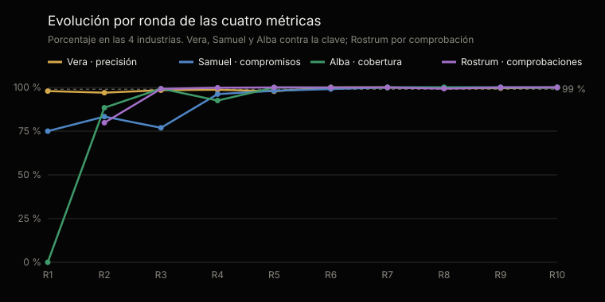
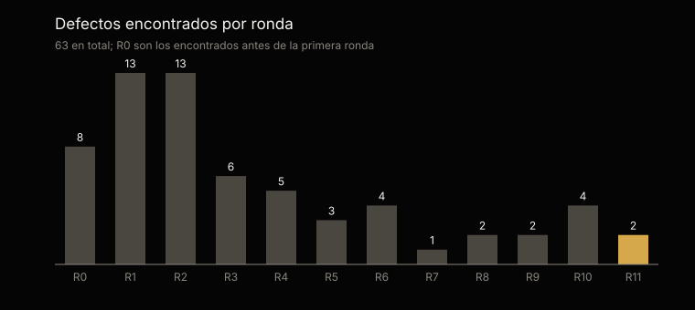

# Análisis estadístico de las pruebas · familia PMO

Generado por `scripts/analisis.py` desde `tests/evidencias/` · ronda más reciente: 11 (2026-10-23), versión probada 0.8.0 · [English](ANALISIS.md)

No se edita a mano: cada cifra sale de la evidencia y el análisis se regenera con cada ronda.

## En una mirada

La versión más reciente probada, 0.8.0, en la ronda 11: Vera con 100 % de precisión (margen del 95 %: 98–100 %) y 100 % de cobertura; Samuel con 100 % de compromisos correctos; Alba con 100 % de alertas encontradas; Rostrum con 99,9 % de comprobaciones.

Sumando las rondas 1–11, Vera acertó en el 99 % de las 2629 alertas que emitió y encontró el 99,7 % de las 2613 que había. Desde la ronda 6, las cuatro métricas se mantienen por encima del 99 %.

## Qué se probó y cómo

Cada ronda sortea hechos nuevos y escribe una clave que ningún agente ve. Los datos de prueba se construyeron para ser más exigentes que la documentación de una PMO promedio, y cada industria lleva un proyecto sano que no debe levantar ninguna alerta.

Precisión: de las alertas emitidas, cuántas eran correctas. Cobertura: de las que había, cuántas encontró. Margen del 95 %: intervalo de confianza de Wilson sobre los casos; para Vera en la última ronda, el que remuestrea proyectos.

|   |   |
|---|---|
| Periodo | 11 rondas, 2026-10-15 → 2026-10-23, versiones 0.3.6 → 0.8.0 |
| Industrias | Construcción, Minería, Oil & gas |
| Proyectos analizados | 559 |
| Documentos procesados | 5540: Markdown 2997, Word 1306, PDF 548, Excel 341, CSV 241, texto 47, JSON 43, xml 17 |
| Ejecuciones | 1594 |
| Lecturas de la clave | 0 |
| Proyectos de control | 43 |

## Resultados acumulados · rondas 1–11

Los acumulados de Samuel, Alba y Rostrum incluyen las primeras rondas, cuando esas capacidades se estaban construyendo; su valor actual es el de la versión más reciente.

| Agente · métrica | Casos | Resultado | Margen del 95 % |
|---|---|---|---|
| Vera · precisión | 2604 de 2629 | 99 % | 98,5–99,4 % |
| Vera · cobertura | 2604 de 2613 | 99,7 % | 99,3–99,9 % |
| Vera · proyectos de control sin alertas | 43 de 43 | 100 % | 91,7–100 % |
| Samuel · compromisos correctos | 921 de 957 | 96,2 % | 94,8–97,3 % |
| Alba · cobertura | 1240 de 1289 | 96,2 % | 95–97,2 % |
| Alba · precisión | 1240 de 1252 | 99 % | 98,3–99,5 % |
| Rostrum · comprobaciones (10 rondas) | 20 291 de 20 767 | 97,7 % | 97,4–98 % |
| Contratos cumplidos | 1576 de 1594 | 98,9 % | 98,2–99,3 % |

## Evolución por ronda

| Ronda · versión | Proyectos | Documentos | Vera · precisión | Samuel | Alba · cobertura | Rostrum | Contratos | Defectos |
|---|---|---|---|---|---|---|---|---|
| 1 · 0.3.6 | 52 | 457 | 97,9 % | 75 % | 0 % | No medido | 100 % | 13 |
| 2 · 0.3.8 | 52 | 490 | 97 % | 83,3 % | 88,4 % | 79,8 % | 95,9 % | 13 |
| 3 · 0.3.9 | 52 | 528 | 98,4 % | 76,9 % | 99,3 % | 99,2 % | 98 % | 6 |
| 4 · 0.3.10 | 52 | 506 | 98,7 % | 96,2 % | 92,5 % | 99,8 % | 97,3 % | 5 |
| 5 · 0.3.11 | 52 | 498 | 97,8 % | 98,1 % | 100 % | 100 % | 100 % | 3 |
| 6 · 0.3.12 | 52 | 534 | 100 % | 99,1 % | 100 % | 99,9 % | 98 % | 4 |
| 7 · 0.3.13 | 52 | 534 | 100 % | 100 % | 100 % | 100 % | 100 % | 1 |
| 8 · 0.3.13 | 52 | 527 | 99,6 % | 100 % | 100 % | 99,3 % | 99,3 % | 2 |
| 9 · 0.4.0 | 52 | 532 | 99,6 % | 100 % | 100 % | 100 % | 100 % | 2 |
| 10 · 0.5.0 | 52 | 531 | 100 % | 100 % | 100 % | 100 % | 100 % | 4 |
| 11 · 0.8.0 | 39 | 403 | 100 % | 100 % | 100 % | 99,9 % | 99,1 % | 2 |

## La versión más reciente probada · 0.8.0, ronda 11

Vera no emitió ninguna alerta falsa.

| Agente · métrica | Casos | Resultado | Margen del 95 % |
|---|---|---|---|
| Vera · precisión | 185 de 185 | 100 % | 98–100 % |
| Vera · cobertura | 185 de 185 | 100 % | 98–100 % |
| Samuel · compromisos correctos | 81 de 81 | 100 % | 95,4–100 % |
| Alba · cobertura | 92 de 92 | 100 % | 95,9–100 % |
| Alba · precisión | 92 de 92 | 100 % | 95,9–100 % |
| Rostrum · comprobaciones | 1568 de 1569 | 99,9 % | 99,6–100 % |
| Contratos cumplidos | 113 de 114 | 99,1 % | 95,1–99,9 % |

## Por industria · rondas 1–11

| Industria | Vera · precisión | Vera · cobertura | Samuel | Alba · cobertura | Alba · precisión | Rostrum |
|---|---|---|---|---|---|---|
| Banca | 98,6 % | 100 % | 89 % | 93,4 % | 98,4 % | 97,4 % |
| Cooperativas | 99,5 % | 100 % | 98,2 % | 97,7 % | 99,7 % | 97,6 % |
| Minería | 98,6 % | 98,6 % | 98,4 % | 97 % | 98,5 % | 98 % |
| Retail | 99,4 % | 100 % | 98,2 % | 95,9 % | 99,6 % | 97,3 % |
| Construcción | 100 % | 100 % | 100 % | 100 % | 100 % | 99,8 % |
| Oil & gas | 100 % | 100 % | 100 % | 100 % | 100 % | 100 % |

## Por tipo de alerta · Vera, rondas 1–11

Vera emitió alertas de 18 tipos; en 15 no tuvo una sola alerta falsa, y las 25 falsas se concentran en 3. «Gerente y PMO no dicen lo mismo» todavía no se sostiene: 18 falsas y ninguna correcta, la última en la ronda 9, ninguna en la ronda 11. Es la que hay que reforzar.

| Tipo de alerta | Correctas | Falsas | No detectadas | Precisión | Cobertura |
|---|---|---|---|---|---|
| Hito dado por cumplido sin evidencia | 876 | 0 | 0 | 100 % | 100 % |
| Compromiso vencido sin evidencia | 312 | 0 | 4 | 100 % | 98,7 % |
| Avance declarado que el plan no sostiene | 281 | 0 | 0 | 100 % | 100 % |
| Verde que la evidencia no sostiene | 247 | 0 | 0 | 100 % | 100 % |
| Entregable de proveedor vencido | 177 | 0 | 0 | 100 % | 100 % |
| Compromiso que nadie fechó | 149 | 0 | 1 | 100 % | 99,3 % |
| Desviación en tiempo | 102 | 0 | 1 | 100 % | 99 % |
| Desviación en costo | 96 | 0 | 0 | 100 % | 100 % |
| Compromiso prometido una y otra vez | 86 | 2 | 2 | 97,7 % | 97,7 % |
| Línea base movida más de lo autorizado | 59 | 0 | 1 | 100 % | 98,3 % |
| Hito vencido | 53 | 0 | 0 | 100 % | 100 % |
| Entrega dada por aceptada sin evidencia | 48 | 5 | 0 | 90,6 % | 100 % |
| Cambio aprobado sin línea base nueva | 33 | 0 | 0 | 100 % | 100 % |
| Facturado sin entregable aceptado | 32 | 0 | 0 | 100 % | 100 % |
| Facturado por encima de lo aceptado | 24 | 0 | 0 | 100 % | 100 % |
| Proyecto sin actividad | 23 | 0 | 0 | 100 % | 100 % |
| Presupuesto comprometido sin holgura | 6 | 0 | 0 | 100 % | 100 % |
| Gerente y PMO no dicen lo mismo | 0 | 18 | 0 | 0 % | — |

## Defectos

63 defectos registrados, cada uno con su origen, su corrección y la ronda que la verificó: 63 verificados y 0 por verificar. 18 vinieron del material, la clave o el arnés de pruebas, no de los agentes.

| Origen | Defectos |
|---|---|
| Código | 24 |
| Instrucciones del agente | 20 |
| Material de prueba | 10 |
| Clave de calificación | 4 |
| Arnés de pruebas | 4 |
| Comportamiento del modelo | 1 |

| Agente | Defectos |
|---|---|
| Vera | 29 |
| Samuel | 11 |
| Rostrum | 10 |
| Alba | 9 |
| Los tres | 4 |

## Tiempo, consumo y próximo paso

Las 11 rondas tomaron 32 horas de ejecución para 559 proyectos: 3,5 minutos por proyecto, con todos los comandos de los tres agentes y el servidor. Usaron 1242 millones de tokens; en promedio, 113 millones por ronda.

Las actas, los informes y las síntesis que redacta el modelo de lenguaje (LLM) se verifican por el contrato de cada comando y por la aritmética de sus cifras. El próximo paso es el despliegue en una organización, que lleva la familia a la versión 1.0.

---

La evidencia completa de cada ronda: [`tests/evidencias/`](https://github.com/josenanez/criterio/tree/main/tests/evidencias).
