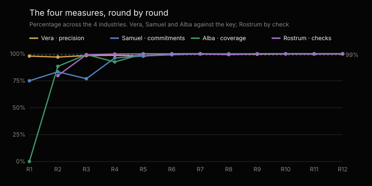
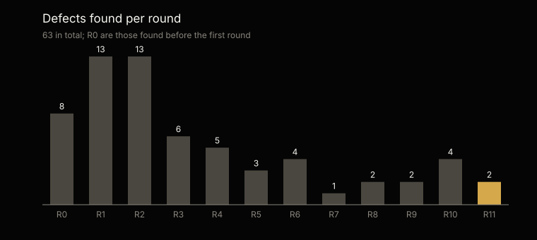

# Statistical analysis of the tests · PMO family

Generated by `scripts/analisis.py` from `tests/evidencias/` · latest round: 12 (2026-10-28), version tested 1.0.0 · [Español](ANALISIS.es.md)

Not edited by hand: every figure comes from the evidence and the analysis is regenerated with every round.

## At a glance

The most recent version tested, 1.0.0, in round 12: Vera at 100% precision (95% margin: 96.9–100%) and 100% coverage; Samuel at 100% commitments right; Alba at 100% of alerts found; Rostrum at 100% of checks.

Across rounds 1–12, Vera was right on 99.2% of the 2944 alerts she raised and found 99.7% of the 2928 there were. Since round 6, all four measures have stayed above 99%.

## What was tested and how

Every round draws new facts and writes a key no agent sees. The test data was built to be more demanding than an average PMO's documentation, and every industry carries one healthy project that must raise no alert.

Precision: of the alerts raised, how many were right. Coverage: of those there were, how many were found. 95% margin: Wilson confidence interval over the cases; for Vera in the latest round, the one that resamples projects.

|   |   |
|---|---|
| Period | 12 rounds, 2026-10-15 → 2026-10-28, versions 0.3.6 → 1.0.0 |
| Industries | Logistics, Telecommunications |
| Projects analyzed | 624 |
| Documents processed | 6246: Markdown 3392, Word 1455, PDF 623, Excel 376, CSV 253, text 60, JSON 48, xml 39 |
| Runs | 1784 |
| Reads of the key | 0 |
| Control projects | 48 |

## Cumulative results · rounds 1–12

The totals for Samuel, Alba and Rostrum include the first rounds, while those capabilities were being built; their current value is the latest version's.

| Agent · measure | Cases | Result | 95% margin |
|---|---|---|---|
| Vera · precision | 2919 of 2944 | 99.2% | 98.7–99.5% |
| Vera · coverage | 2919 of 2928 | 99.7% | 99.4–99.9% |
| Vera · control projects with no alerts | 48 of 48 | 100% | 92.5–100% |
| Samuel · commitments right | 1056 of 1092 | 96.7% | 95.4–97.7% |
| Alba · coverage | 1413 of 1462 | 96.6% | 95.5–97.5% |
| Alba · precision | 1413 of 1425 | 99.2% | 98.5–99.6% |
| Rostrum · checks (11 rounds) | 23,011 of 23,487 | 98% | 97.7–98.2% |
| Contracts kept | 1766 of 1784 | 99% | 98.4–99.4% |

## Round by round

| Round · version | Projects | Documents | Vera · precision | Samuel | Alba · coverage | Rostrum | Contracts | Defects |
|---|---|---|---|---|---|---|---|---|
| 1 · 0.3.6 | 52 | 457 | 97.9% | 75% | 0% | Not measured | 100% | 13 |
| 2 · 0.3.8 | 52 | 490 | 97% | 83.3% | 88.4% | 79.8% | 95.9% | 13 |
| 3 · 0.3.9 | 52 | 528 | 98.4% | 76.9% | 99.3% | 99.2% | 98% | 6 |
| 4 · 0.3.10 | 52 | 506 | 98.7% | 96.2% | 92.5% | 99.8% | 97.3% | 5 |
| 5 · 0.3.11 | 52 | 498 | 97.8% | 98.1% | 100% | 100% | 100% | 3 |
| 6 · 0.3.12 | 52 | 534 | 100% | 99.1% | 100% | 99.9% | 98% | 4 |
| 7 · 0.3.13 | 52 | 534 | 100% | 100% | 100% | 100% | 100% | 1 |
| 8 · 0.3.13 | 52 | 527 | 99.6% | 100% | 100% | 99.3% | 99.3% | 2 |
| 9 · 0.4.0 | 52 | 532 | 99.6% | 100% | 100% | 100% | 100% | 2 |
| 10 · 0.5.0 | 52 | 531 | 100% | 100% | 100% | 100% | 100% | 4 |
| 11 · 0.8.0 | 78 | 823 | 100% | 100% | 100% | 99.9% | 99.6% | 2 |
| 12 · 1.0.0 | 26 | 286 | 100% | 100% | 100% | 100% | 100% | 0 |

## The most recent version tested · 1.0.0, round 12

Vera raised no false alert.

| Agent · measure | Cases | Result | 95% margin |
|---|---|---|---|
| Vera · precision | 119 of 119 | 100% | 96.9–100% |
| Vera · coverage | 119 of 119 | 100% | 96.9–100% |
| Samuel · commitments right | 54 of 54 | 100% | 93.3–100% |
| Alba · coverage | 61 of 61 | 100% | 94–100% |
| Alba · precision | 61 of 61 | 100% | 94–100% |
| Rostrum · checks | 1072 of 1072 | 100% | 99.6–100% |
| Contracts kept | 76 of 76 | 100% | 95.1–100% |

## By industry · rounds 1–12

| Industry | Vera · precision | Vera · coverage | Samuel | Alba · coverage | Alba · precision | Rostrum |
|---|---|---|---|---|---|---|
| Banking | 98.7% | 100% | 90.2% | 94.1% | 98.5% | 97.6% |
| Credit unions | 99.6% | 100% | 98.4% | 98% | 99.7% | 97.9% |
| Mining | 98.6% | 98.6% | 98.4% | 97% | 98.5% | 98% |
| Retail | 99.4% | 100% | 98.4% | 96.5% | 99.7% | 97.6% |
| Construction | 100% | 100% | 100% | 100% | 100% | 99.8% |
| Oil & gas | 100% | 100% | 100% | 100% | 100% | 100% |
| Logistics | 100% | 100% | 100% | 100% | 100% | 100% |
| Telecommunications | 100% | 100% | 100% | 100% | 100% | 100% |

## By alert type · Vera, rounds 1–12

Vera raised alerts of 18 types; 15 had not a single false alert, and the 25 false ones sit in 3. “Manager and PMO do not say the same” does not hold yet: 18 false and none right, the latest in round 9, none in round 12. It is the one to strengthen.

| Alert type | Right | False | Missed | Precision | Coverage |
|---|---|---|---|---|---|
| Milestone marked met with no evidence | 986 | 0 | 0 | 100% | 100% |
| Overdue commitment with no evidence | 355 | 0 | 4 | 100% | 98.9% |
| Declared progress the plan does not support | 314 | 0 | 0 | 100% | 100% |
| Green the evidence does not support | 270 | 0 | 0 | 100% | 100% |
| Late vendor deliverable | 202 | 0 | 0 | 100% | 100% |
| Commitment nobody dated | 168 | 0 | 1 | 100% | 99.4% |
| Time variance | 116 | 0 | 1 | 100% | 99.1% |
| Commitment promised again and again | 106 | 2 | 2 | 98.1% | 98.1% |
| Cost variance | 101 | 0 | 0 | 100% | 100% |
| Baseline moved beyond what was authorised | 67 | 0 | 1 | 100% | 98.5% |
| Delivery accepted with no evidence | 53 | 5 | 0 | 91.4% | 100% |
| Overdue milestone | 53 | 0 | 0 | 100% | 100% |
| Approved change with no new baseline | 35 | 0 | 0 | 100% | 100% |
| Invoiced with no accepted deliverable | 34 | 0 | 0 | 100% | 100% |
| Project with no activity | 27 | 0 | 0 | 100% | 100% |
| Invoiced above what was accepted | 26 | 0 | 0 | 100% | 100% |
| Budget committed with no headroom | 6 | 0 | 0 | 100% | 100% |
| Manager and PMO do not say the same | 0 | 18 | 0 | 0% | — |

## Defects

63 defects logged, each with its origin, its fix and the round that verified it: 63 verified and 0 to verify. 18 came from the material, the key or the test harness, not from the agents.

| Origin | Defects |
|---|---|
| Code | 24 |
| Agent instructions | 20 |
| Test material | 10 |
| Grading key | 4 |
| Test harness | 4 |
| Model behavior | 1 |

| Agent | Defects |
|---|---|
| Vera | 29 |
| Samuel | 11 |
| Rostrum | 10 |
| Alba | 9 |
| All three | 4 |

## Time, cost and next step

The 12 rounds took 37 hours of run time for 624 projects: 3.5 minutes per project, with every command of the three agents and the server. They used 1391 million tokens; on average, 116 million per round.

The minutes, reports and syntheses the language model (LLM) writes are checked through each command's contract and the arithmetic of their figures. Whether a version is stable or laboratory is said by this evidence, not its number: stable, with the floor of the 95% margin at 95% or more for every agent and no alert in the control projects (decision 0020).

---

The full evidence of every round: [`tests/evidencias/`](https://github.com/josenanez/criterio/tree/main/tests/evidencias).
