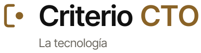
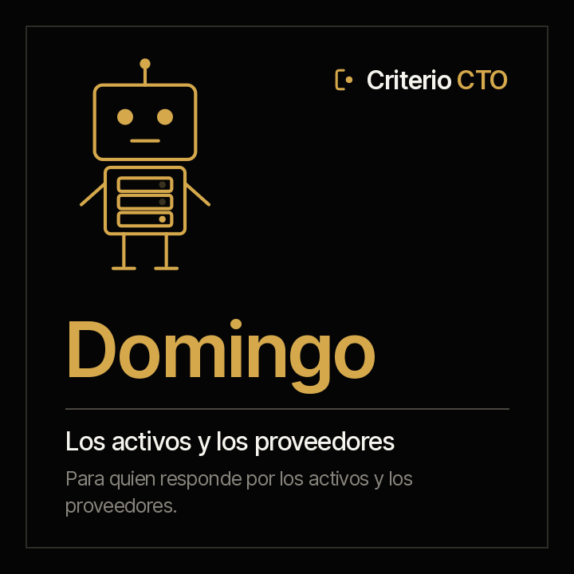

<picture><source media="(prefers-color-scheme: dark)" srcset="../../docs/img/marca/es/criterio-cto-oscuro.svg"></picture>

# Domingo · los activos y los proveedores



**Domingo pone cada activo al lado de quien responde por él.**
Tú respondes por los activos de tecnología y por lo que se les paga a los proveedores. Él llega con cada activo al lado de su dueño y su soporte, cada licencia al lado de su uso, cada proveedor al lado de su nivel de servicio y la nube al lado de su presupuesto: el activo sin dueño, el que pasó su fin de soporte sin una excepción aprobada, la licencia que falta y la que se paga sin uso, el incumplimiento de un proveedor sin su crédito en la factura y la cuenta de la nube por encima de su presupuesto.

<!-- agente:nombre · generado por scripts/familias.py; no se edita a mano -->
**El nombre.** Domingo, del latín *dominicus*, el del dueño: cada activo con quien responde por él.
<!-- /agente:nombre -->

[English](README.md) · `criterio-assets` · Apache 2.0 · Una instancia por entidad

**Estado: construido, en laboratorio, con la familia CTO.** El motor de cálculo, probado contra todo el material sintético de la familia con una clave que el agente no ve y entidades de control. La ronda con el agente viene en la 0.2.0; no se ha probado sobre la documentación de una organización concreta.

**Esta página se lee sola.** Domingo funciona sin el otro agente de la familia. La familia —cómo se encuentran entre sí y con Rostrum— está en la [familia criterio-cto](../../families/criterio-cto/README.es.md).

---

## Qué es

| | |
|---|---|
| **A quién extiende** | A quien responde por los activos y los proveedores de tecnología —el gerente de infraestructura, de activos de TI o de proveedores— y a quien sigue el gasto en la nube |
| **Sobre qué trabaja** | **El inventario, las licencias, los proveedores y la nube de una entidad, periodo a periodo** |
| **Qué mira** | El inventario de activos, las licencias compradas y su uso, las actas del comité de arquitectura, los contratos de nivel de servicio, el cumplimiento y las facturas de los proveedores, y la factura y el presupuesto de la nube |
| **Cadencia** | Cuando llega un acta, un contrato, una factura o una exportación nueva, y una vez por semana |
| **Instancias** | Una por entidad |

## Qué hace

**Lo que hace y hoy no se hace a mano: poner todo, no una muestra, al lado de su fuente.**

**Lo que puede responder:** qué activo no tiene dueño, qué activo en producción pasó su fin de soporte sin excepción, qué software se usa sin licencia y cuál se paga sin usarse, qué proveedor incumplió sin el crédito en su factura y qué cuenta de la nube se pasó de su presupuesto.

<!-- cto:comandos · generado por scripts/familias.py; no se edita a mano -->
### Los nueve comandos

> Se escriben con el prefijo del plugin: `/criterio-assets:` y autocompletar hace el resto. Es la única forma que resuelve en una sesión de Claude Code.

| Comando | Qué hace |
|---|---|
| `/criterio-assets:assets-setup` | La configuración, el inventario y las tablas reconocidas |
| `/criterio-assets:domingo` | Lo que necesites, en tus palabras: Domingo elige el comando que lo resuelve y lo corre |
| `/criterio-assets:assets-scan` | La ficha del periodo al día |
| `/criterio-assets:asset-check` | Qué corre en producción sin quién responda o sin quién lo soporte |
| `/criterio-assets:license-check` | Qué se usa sin licencia y qué se paga sin usar |
| `/criterio-assets:vendor-check` | Qué incumplimiento se pagó completo |
| `/criterio-assets:cloud-check` | Qué cuenta de la nube se pasó |
| `/criterio-assets:assets-wake` | Los activos al día sin que nadie se acuerde |
| `/criterio-assets:share-findings` | Un resumen sin datos, solo si se dice que sí |
<!-- /cto:comandos -->

`assets-setup` va primero porque los demás lo necesitan, y `assets-wake` es el que se le pone a un reloj.

<!-- cto:skills · generado por scripts/familias.py; no se edita a mano -->
### Los tres skills

Se cargan solos cuando el tema aparece. Son el conocimiento que los comandos comparten, y se consultan como un manual.

| Skill | Qué encapsula | De quién es |
|---|---|---|
| `technology-intake` | La estructura recomendada de la carpeta de tecnología, qué va en cada carpeta y qué agente la usa | Copia de Fausto |
| `technology-policy` | La política de cambios y de niveles de servicio en la configuración: los plazos, los umbrales y lo que nunca se decide | Copia de Fausto |
| `vendor-record` | Cómo se lleva a la ficha cada excepción aprobada sobre un activo y cada nivel de servicio de un contrato con su crédito, con la cita | Propio |
<!-- /cto:skills -->

## Lo que cuesta hoy

<!-- cto:cifras · generado por scripts/familias.py; no se edita a mano -->
<!-- /cto:cifras -->

## Para qué sirve

`/criterio-assets:asset-check` pone cada caso al lado de su fuente. **Lo que falta se dice con su cita.**

### Y para qué no sirve

- **No elige un proveedor, no decide renovar o retirar un activo y no interpreta un contrato.** Dice qué no tiene dueño, soporte o crédito; la decisión es del área, del comité de arquitectura y de legal.
- **No procesa la seguridad.** Los activos que no se escanean y las vulnerabilidades son de la familia CISO.
- **No se conecta a la nube, a una herramienta de inventario ni a un servidor.** Procesa los documentos y las exportaciones que la organización le entrega.

Y una que hay que decir en voz alta: **tus documentos se procesan en la infraestructura de la plataforma de IA**, no solo en tu equipo. Un contrato con un proveedor o la factura de la nube pueden traer información confidencial: confirma que sea admisible bajo tu política antes de apuntarla a esa carpeta. Descargo completo en [DISCLAIMER.es.md](../../DISCLAIMER.es.md), términos en [TERMS.es.md](../../TERMS.es.md).

## Instalación y configuración

```
/plugin marketplace add josenanez/criterio
/plugin install criterio-assets@criterio
/criterio-assets:assets-setup
```

### El primer resultado

`/criterio-assets:assets-setup` no te pide que ordenes nada antes de empezar. Mira la carpeta de tecnología de la entidad, la compara con la [estructura recomendada](../../families/criterio-cto/README.es.md#la-estructura-de-carpetas-recomendada), procesa la política de tecnología y hace las preguntas que ningún documento responde. En los primeros quince minutos deja ver el primer resultado.

### Cada cuánto corre

`/criterio-assets:assets-wake` es el comando que el reloj invoca: hace lo que toca, responde primero las preguntas que alguien dejó en Rostrum, y **si no toca nada no produce nada.** La decisión de qué toca es aritmética de fechas, y la toma el código:

```
python3 scripts/tecnologia.py despertar --config <archivo>
```

## Trabajo en equipo

| Con quién | Qué pasa |
|---|---|
| **Fausto** | Comparten la carpeta y la política de tecnología; cada uno escribe solo su ficha |
| **Rostrum** | Solo si la configuración lo dice (`publish_rostrum`): publica sus reportes, lo que vence y sus señales para quien no abre una carpeta, y le devuelve las preguntas que deja quien lo mira. **No escribe en el estado** |

## Pruebas

[`scripts/tecnologia.py`](scripts/tecnologia.py), con la librería estándar, hace todo lo que es cálculo: procesa cada tabla con su fila de origen, compara cada fin de soporte con la fecha y con su excepción, cuenta las licencias contra su uso, cruza el cumplimiento de cada proveedor con su nivel y su factura, y suma la nube contra su presupuesto, el mismo resultado cada vez. Vive en `criterio-changes` y se copia aquí; `scripts/sincronizar.py --check` falla si la copia se separa.

```
python3 scripts/tecnologia.py selftest
python3 tests/criterio-cto/generar.py
python3 tests/criterio-cto/evaluar.py
```

Qué se siembra en cada entidad y **qué no prueba el material**, en [`EVIDENCIA.md`](../../tests/criterio-cto/EVIDENCIA.md). El diseño, con la entrada, el proceso y el reporte de cada comando, en el [diseño de la familia](../../families/criterio-cto/DISENO.es.md).
