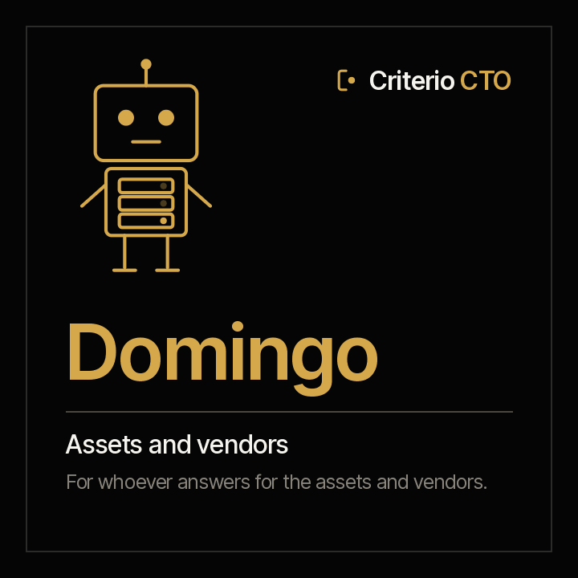

<picture><source media="(prefers-color-scheme: dark)" srcset="../../docs/img/marca/en/criterio-cto-oscuro.svg"></picture>

# Domingo · assets and vendors



**Domingo puts each asset next to whoever answers for it.**
You are responsible for the technology assets and what is paid to vendors. He comes with each asset next to its owner and support, each licence next to its use, each vendor next to its service level and the cloud next to its budget: an asset with no owner, one past its end of support with no approved exception, a licence shortfall and licences paid for and unused, a vendor breach with no credit on the invoice and a cloud account above its budget.

<!-- agente:nombre · generado por scripts/familias.py; no se edita a mano -->
**The name.** Domingo, from the Latin *dominicus*, the owner's: each asset with whoever answers for it.
<!-- /agente:nombre -->

[Español](README.es.md) · `criterio-assets` · Apache 2.0 · One instance per entity

**Status: built, in the lab, with the CTO family.** The calculation engine, tested against all the family’s synthetic material with a key the agent never sees and control entities. The round with the agent comes in 0.2.0; it has not been tested on a specific organisation’s documentation.

**This page stands on its own.** Domingo works without the family’s other agent. The family —how they meet each other and Rostrum— is in the [criterio-cto family](../../families/criterio-cto/README.md).

---

## What it is

| | |
|---|---|
| **Who it extends** | Whoever answers for technology assets and vendors —the infrastructure, IT asset or vendor manager— and whoever follows cloud spend |
| **What it works on** | **An entity's inventory, licences, vendors and cloud, period by period** |
| **What it looks at** | The asset inventory, the purchased licences and their use, the architecture board minutes, the service level contracts, the vendors' compliance and invoices, and the cloud bill and budget |
| **Cadence** | When new minutes, a contract, an invoice or an export arrive, and once a week |
| **Instances** | One per entity |

## What it does

**What it does that is not done by hand today: putting everything, not a sample, next to its source.**

**What it can answer:** which asset has no owner, which production asset is past its end of support with no exception, which software is used without a licence and which is paid for and unused, which vendor breached with no credit on its invoice and which cloud account overspent its budget.

<!-- cto:comandos · generado por scripts/familias.py; no se edita a mano -->
### The nine commands

> They are typed with the plugin prefix: `/criterio-assets:` and autocomplete does the rest. It is the only form that resolves in a Claude Code session.

| Command | What it does |
|---|---|
| `/criterio-assets:assets-setup` | The configuration, the inventory and the recognised tables |
| `/criterio-assets:domingo` | Whatever you need, in your own words: Domingo picks the command that does it and runs it |
| `/criterio-assets:assets-scan` | The period's record up to date |
| `/criterio-assets:asset-check` | What runs in production with no one to answer for it or support it |
| `/criterio-assets:license-check` | What is used without a licence and what is paid for and not used |
| `/criterio-assets:vendor-check` | Which breach was paid in full |
| `/criterio-assets:cloud-check` | Which cloud account overspent |
| `/criterio-assets:assets-wake` | The assets up to date without anyone having to remember |
| `/criterio-assets:share-findings` | A summary with no data, only if the answer is yes |
<!-- /cto:comandos -->

`assets-setup` goes first because the others need it, and `assets-wake` is the one you put on a clock.

<!-- cto:skills · generado por scripts/familias.py; no se edita a mano -->
### The three skills

They load on their own when the subject comes up. They are the knowledge the commands share, and they are consulted like a manual.

| Skill | What it encapsulates | Whose it is |
|---|---|---|
| `technology-intake` | The recommended structure of the technology folder, what goes in each folder and which agent uses it | Copy of Fausto's |
| `technology-policy` | The change and service level policy in the configuration: the deadlines, the thresholds and what is never decided | Copy of Fausto's |
| `vendor-record` | How each approved exception for an asset and each contract service level with its credit go into the record, with their citation | Own |
<!-- /cto:skills -->

## What it costs today

<!-- cto:cifras · generado por scripts/familias.py; no se edita a mano -->
<!-- /cto:cifras -->

## What it is for

`/criterio-assets:asset-check` puts each case next to its source. **What is missing is said with its citation.**

### And what it is not for

- **It does not choose a vendor, decide to renew or retire an asset or interpret a contract.** It says what has no owner, support or credit; the decision belongs to the area, the architecture board and legal.
- **It does not process security.** Unscanned assets and vulnerabilities belong to the CISO family.
- **It does not connect to the cloud, an inventory tool or a server.** It processes the documents and exports the organisation gives it.

And one that has to be said out loud: **your documents are processed on the AI platform’s infrastructure**, not only on your computer. A vendor contract or the cloud bill may contain confidential information: confirm it is admissible under your policy before pointing it at that folder. Full disclaimer in [DISCLAIMER.md](../../DISCLAIMER.md), terms in [TERMS.md](../../TERMS.md).

## Installation and setup

```
/plugin marketplace add josenanez/criterio
/plugin install criterio-assets@criterio
/criterio-assets:assets-setup
```

### The first result

`/criterio-assets:assets-setup` does not ask you to tidy anything before starting. It looks at the entity’s technology folder, compares it with the [recommended structure](../../families/criterio-cto/README.md#the-recommended-folder-structure), processes the technology policy and asks the questions no document answers. Within the first fifteen minutes it shows the first result.

### How often it runs

`/criterio-assets:assets-wake` is the command the clock calls: it does what is due, first answers the questions someone left in Rostrum, and **if nothing is due it produces nothing.** Deciding what is due is date arithmetic, and the code does it:

```
python3 scripts/tecnologia.py despertar --config <file>
```

## Teamwork

| With whom | What happens |
|---|---|
| **Fausto** | They share the folder and the technology policy; each writes only its own record |
| **Rostrum** | Only if the configuration says so (`publish_rostrum`): it publishes its reports, what is due and its signals for whoever does not open a folder, and returns the questions left by whoever views it. **It does not write to the state** |

## Tests

[`scripts/tecnologia.py`](scripts/tecnologia.py), with the standard library, does everything that is calculation: it processes each table with its source row, compares each end of support with the date and its exception, counts licences against their use, matches each vendor's compliance with its level and invoice, and adds up the cloud against its budget, the same result every time. It lives in `criterio-changes` and is copied here; `scripts/sincronizar.py --check` fails if the copy drifts.

```
python3 scripts/tecnologia.py selftest
python3 tests/criterio-cto/generar.py
python3 tests/criterio-cto/evaluar.py
```

What is planted in each entity and **what the material does not test**, in [`EVIDENCIA.md`](../../tests/criterio-cto/EVIDENCIA.md). The design, with the input, process and report of each command, in the [family design](../../families/criterio-cto/DISENO.md).
