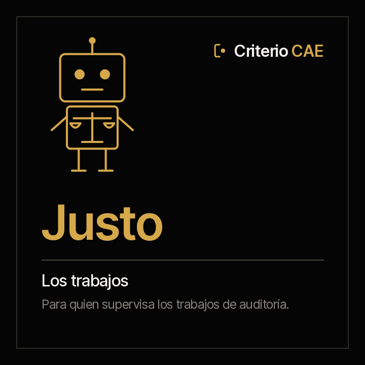

<picture><source media="(prefers-color-scheme: dark)" srcset="../../docs/img/marca/es/criterio-cae-oscuro.svg"></picture>

# Justo · los trabajos de auditoría



**Justo pone cada hallazgo al lado de su criterio.**
Tú respondes por los trabajos de auditoría. Él llega con cada trabajo al lado de su programa y de sus papeles: el programa sin aprobar, el hallazgo sin su criterio, su condición, su causa, su efecto o su prioridad, el hallazgo que no cita un papel, el paso sin ejecutar, el papel sin revisión, el informe que no dice lo que dicen los papeles, la prioridad que no da la metodología y el auditor asignado a lo que tuvo a su cargo.

<!-- agente:nombre · generado por scripts/familias.py; no se edita a mano -->
**El nombre.** Justo, del latín *iustus*, «conforme a derecho»: cada hallazgo contra su criterio.
<!-- /agente:nombre -->

[English](README.md) · `criterio-audit-work` · Apache 2.0 · Una instancia por entidad

**Estado: lanzado y estable, con la familia CAE.** El motor de cálculo, probado contra todo el material sintético de la familia con una clave que el agente no ve y entidades de control. En la 0.2.0, el agente corrió sobre todas las entidades del material, con una clave que no ve. En la 1.0.0, con la ronda 2, la familia es estable: un piso del 95 % o más en las señales y en los datos. No se ha probado sobre la documentación de una organización concreta.

**Esta página se lee sola.** Justo funciona sin los otros agentes de la familia. La familia —cómo se encuentran entre sí y con Rostrum— está en la [familia criterio-cae](../../families/criterio-cae/README.es.md).

---

## Qué es

| | |
|---|---|
| **A quién extiende** | A quien supervisa los trabajos de auditoría —el gerente o el supervisor de auditoría— y a quien los ejecuta |
| **Sobre qué trabaja** | **Los trabajos de auditoría de una entidad, periodo a periodo** |
| **Qué mira** | Los programas, los índices de papeles, los papeles de trabajo, los informes y las asignaciones del equipo |
| **Cadencia** | Cuando llega un papel o un informe, y una vez por semana |
| **Instancias** | Una por entidad |

## Qué hace

**Lo que hace y hoy no se hace a mano: poner todo, no una muestra, al lado de su norma y de su evidencia.**

**Lo que puede responder:** qué hallazgo está incompleto, qué hallazgo no tiene un papel que lo soporte, qué paso del programa no se ejecutó, qué papel no se revisó antes del informe, en qué no coincide el informe con los papeles, qué prioridad no es la que da la metodología y qué asignación tiene un posible impedimento.

<!-- cae:comandos · generado por scripts/familias.py; no se edita a mano -->
### Los nueve comandos

> Se escriben con el prefijo del plugin: `/criterio-audit-work:` y autocompletar hace el resto. Es la única forma que resuelve en una sesión de Claude Code.

| Comando | Qué hace |
|---|---|
| `/criterio-audit-work:work-setup` | La configuración, el inventario y los trabajos reconocidos |
| `/criterio-audit-work:justo` | Lo que necesites, en tus palabras: Justo elige el comando que lo resuelve y lo corre |
| `/criterio-audit-work:work-scan` | La ficha del periodo al día |
| `/criterio-audit-work:finding-check` | Qué hallazgo está incompleto y por qué |
| `/criterio-audit-work:workpaper-check` | Qué falta en la documentación de cada trabajo |
| `/criterio-audit-work:report-check` | Si el informe dice lo que dicen los papeles |
| `/criterio-audit-work:objectivity-check` | Qué asignación hay que revisar |
| `/criterio-audit-work:work-wake` | Los trabajos al día sin que nadie se acuerde |
| `/criterio-audit-work:share-findings` | Un resumen sin datos, solo si se dice que sí |
<!-- /cae:comandos -->

`work-setup` va primero porque los demás lo necesitan, y `work-wake` es el que se le pone a un reloj.

<!-- cae:skills · generado por scripts/familias.py; no se edita a mano -->
### Los tres skills

Se cargan solos cuando el tema aparece. Son el conocimiento que los comandos comparten, y se consultan como un manual.

| Skill | Qué encapsula | De quién es |
|---|---|---|
| `audit-intake` | La estructura recomendada de la carpeta de auditoría, qué va en cada carpeta y qué agente la usa, cómo se nombran los trabajos y qué hacer con lo que no encaja | Copia de Prudencia · también en Remedios |
| `audit-methodology` | La metodología de auditoría en la configuración: los ciclos por nivel de riesgo, la escala de prioridad con su impacto y su probabilidad, quién aprueba el plan, el programa y los papeles, y cuántas reprogramaciones se permiten | Copia de Prudencia · también en Remedios |
| `finding-record` | Cómo se lleva a la ficha cada hallazgo: su criterio, su condición, su causa o la razón por la que no se identificó, su efecto, su impacto, su probabilidad, su prioridad, los papeles que cita y lo que dice el informe, con la cita | Propio |
<!-- /cae:skills -->

## Lo que cuesta hoy

<!-- cae:cifras · generado por scripts/familias.py; no se edita a mano -->
<!-- /cae:cifras -->

## Para qué sirve

`/criterio-audit-work:finding-check` pone cada caso al lado de su norma y de su evidencia. **Lo que falta se dice con su cita.**

### Y para qué no sirve

- **No emite una opinión ni cambia la prioridad de un hallazgo.** Dice qué falta y dónde; la opinión es del auditor.
- **No entra a los sistemas auditados ni a la herramienta de auditoría.** Procesa lo que la organización le entrega.
- **No copia el texto de las Normas.** Las Normas Globales de Auditoría Interna se citan por su número y su título.

Y una que hay que decir en voz alta: **tus documentos se procesan en la infraestructura de la plataforma de IA**, no solo en tu equipo. Un papel de trabajo puede traer información confidencial: confirma que sea admisible bajo tu política antes de apuntarla a esa carpeta. Descargo completo en [DISCLAIMER.es.md](../../DISCLAIMER.es.md), términos en [TERMS.es.md](../../TERMS.es.md).

## Instalación y configuración

```
/plugin marketplace add josenanez/criterio
/plugin install criterio-audit-work@criterio
/criterio-audit-work:work-setup
```

### El primer resultado

`/criterio-audit-work:work-setup` no te pide que ordenes nada antes de empezar. Mira la carpeta de auditoría de la entidad, la compara con la [estructura recomendada](../../families/criterio-cae/README.es.md#la-estructura-de-carpetas-recomendada), procesa la metodología y hace las preguntas que ningún documento responde. En los primeros quince minutos deja ver el primer resultado.

### Cada cuánto corre

`/criterio-audit-work:work-wake` es el comando que el reloj invoca: hace lo que toca, responde primero las preguntas que alguien dejó en Rostrum, y **si no toca nada no produce nada.** La decisión de qué toca es aritmética de fechas, y la toma el código:

```
python3 scripts/auditoria.py despertar --config <archivo>
```

## Trabajo en equipo

| Con quién | Qué pasa |
|---|---|
| **Prudencia** | Comparten la carpeta y la metodología; cada uno escribe solo su ficha |
| **Remedios** | Comparten la carpeta y la metodología; cada uno escribe solo su ficha |
| **Rostrum** | Solo si la configuración lo dice (`publish_rostrum`; por omisión no, decisión 0014): publica sus reportes, lo que vence y sus señales para quien no abre una carpeta, y le devuelve las preguntas que deja quien lo mira. **No escribe en el estado** |

## Pruebas

[`scripts/auditoria.py`](scripts/auditoria.py), con la librería estándar, hace todo lo que es cálculo: procesa cada tabla con su fila de origen, cuenta los días contra los plazos de la metodología y de las Normas y cruza cada hallazgo con su evidencia, el mismo resultado cada vez. Vive en `criterio-audit-plan` y se copia a los otros dos agentes; `scripts/sincronizar.py --check` falla si la copia se separa.

```
python3 scripts/auditoria.py selftest
python3 tests/criterio-cae/generar.py
python3 tests/criterio-cae/evaluar.py
```

Qué se siembra en cada entidad y **qué no prueba el material**, en [`EVIDENCIA.md`](../../tests/criterio-cae/EVIDENCIA.md). El diseño, con la entrada, el proceso y el reporte de cada comando, en el [diseño de la familia](../../families/criterio-cae/DISENO.es.md).
