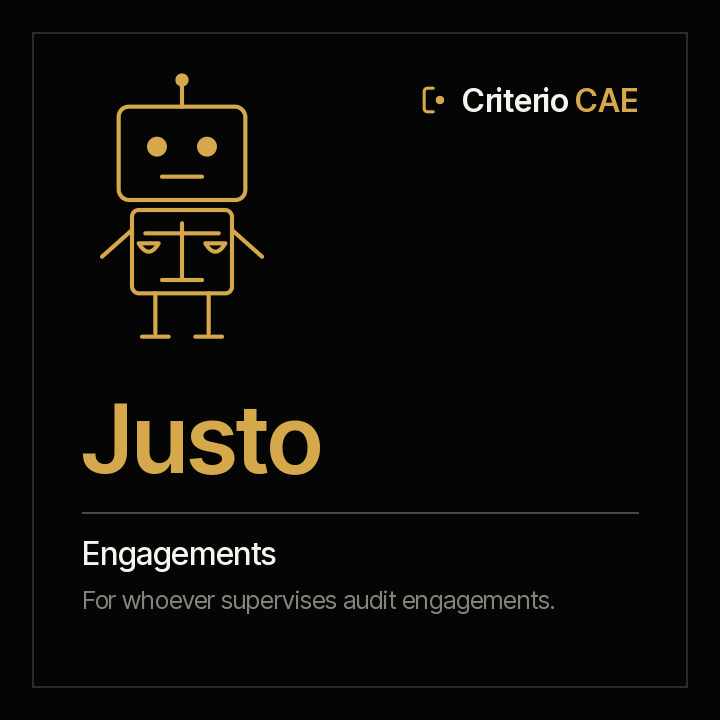

<picture><source media="(prefers-color-scheme: dark)" srcset="../../docs/img/marca/en/criterio-cae-oscuro.svg"></picture>

# Justo · audit engagements



**Justo puts each finding next to its criteria.**
You are responsible for audit engagements. He comes with each engagement next to its program and its working papers: the unapproved program, the finding without its criteria, condition, cause, effect or priority, the finding that cites no paper, the unexecuted step, the unreviewed paper, the report that does not say what the papers say, the priority the methodology does not give and the auditor assigned to what they were in charge of.

<!-- agente:nombre · generado por scripts/familias.py; no se edita a mano -->
**The name.** Justo, from the Latin *iustus*, «according to law»: every finding against its criteria.
<!-- /agente:nombre -->

[Español](README.es.md) · `criterio-audit-work` · Apache 2.0 · One instance per entity

**Status: built, in testing, with the CAE family.** The calculation engine, tested against all the family's synthetic material with a key the agent never sees and control entities. The round with the agent comes in 0.2.0, and it has not been tested on a specific organisation's documentation.

**This page stands on its own.** Justo works without the family's other agents. The family —how they meet each other and Rostrum— is in the [criterio-cae family](../../families/criterio-cae/README.md).

---

## What it is

| | |
|---|---|
| **Who it extends** | Whoever supervises audit engagements —the audit manager or supervisor— and whoever carries them out |
| **What it works on** | **An entity's audit engagements, period by period** |
| **What it looks at** | Programs, working-paper indexes, working papers, reports and team assignments |
| **Cadence** | When a paper or a report arrives, and once a week |
| **Instances** | One per entity |

## What it does

**What it does that is not done by hand today: putting everything, not a sample, next to its standard and its evidence.**

**What it can answer:** which finding is incomplete, which finding has no paper behind it, which program step was not executed, which paper was not reviewed before the report, where the report differs from the papers, which priority is not the methodology's and which assignment has a possible impairment.

<!-- cae:comandos · generado por scripts/familias.py; no se edita a mano -->
### The nine commands

> They are typed with the plugin prefix: `/criterio-audit-work:` and autocomplete does the rest. It is the only form that resolves in a Claude Code session.

| Command | What it does |
|---|---|
| `/criterio-audit-work:work-setup` | The configuration, the inventory and the recognised engagements |
| `/criterio-audit-work:justo` | Whatever you need, in your own words: Justo picks the command that does it and runs it |
| `/criterio-audit-work:work-scan` | The period's record up to date |
| `/criterio-audit-work:finding-check` | Which finding is incomplete and why |
| `/criterio-audit-work:workpaper-check` | What is missing in each engagement's documentation |
| `/criterio-audit-work:report-check` | Whether the report says what the papers say |
| `/criterio-audit-work:objectivity-check` | Which assignment needs a look |
| `/criterio-audit-work:work-wake` | The engagements up to date without anyone remembering |
| `/criterio-audit-work:share-findings` | A summary with no data, only on a yes |
<!-- /cae:comandos -->

`work-setup` goes first because the others need it, and `work-wake` is the one you put on a clock.

<!-- cae:skills · generado por scripts/familias.py; no se edita a mano -->
### The three skills

They load on their own when the subject comes up. They are the knowledge the commands share, and they are consulted like a manual.

| Skill | What it encapsulates | Whose it is |
|---|---|---|
| `audit-intake` | The recommended structure of the audit folder, what goes in each folder and which agent uses it, how engagements are named and what to do with what does not fit | Copy of Prudencia's · also in Remedios |
| `audit-methodology` | The audit methodology in the configuration: the cycles by risk level, the priority scale with its impact and likelihood, who approves the plan, the program and the papers, and how many reschedules are allowed | Copy of Prudencia's · also in Remedios |
| `finding-record` | How each finding goes into the record: its criteria, condition, cause or the reason it was not identified, effect, impact, likelihood, priority, the papers it cites and what the report says, with the citation | Own |
<!-- /cae:skills -->

## What it costs today

<!-- cae:cifras · generado por scripts/familias.py; no se edita a mano -->
<!-- /cae:cifras -->

## What it is for

`/criterio-audit-work:finding-check` puts each case next to its standard and its evidence. **What is missing is stated with its citation.**

### And what it is not for

- **It does not issue an opinion or change a finding's priority.** It says what is missing and where; the opinion is the auditor's.
- **It does not go into the audited systems or the audit tool.** It processes what the organisation hands it.
- **It does not copy the text of the Standards.** The Global Internal Audit Standards are cited by number and title.

And one that needs saying out loud: **your documents are processed on the AI platform's infrastructure**, not only on your computer. A working paper may carry confidential information: confirm that this is acceptable under your policy before pointing it at that folder. Full disclaimer in [DISCLAIMER.md](../../DISCLAIMER.md), terms in [TERMS.md](../../TERMS.md).

## Installation and setup

```
/plugin marketplace add josenanez/criterio
/plugin install criterio-audit-work@criterio
/criterio-audit-work:work-setup
```

### The first result

`/criterio-audit-work:work-setup` does not ask you to tidy anything before starting. It looks at the entity's audit folder, compares it with the [recommended structure](../../families/criterio-cae/README.md#the-recommended-folder-structure), processes the methodology and asks the questions no document answers. Within the first fifteen minutes it shows the first result.

### How often it runs

`/criterio-audit-work:work-wake` is the command the clock calls: it does what is due, first answers the questions someone left in Rostrum, and **if nothing is due it produces nothing.** Deciding what is due is date arithmetic, and the code does it:

```
python3 scripts/auditoria.py despertar --config <file>
```

## Teamwork

| With whom | What happens |
|---|---|
| **Prudencia** | They share the folder and the methodology; each writes only its own record |
| **Remedios** | They share the folder and the methodology; each writes only its own record |
| **Rostrum** | Only if the configuration says so (`publish_rostrum`; off by default, decision 0014): it publishes its reports, what falls due and its signals for whoever does not open a folder, and hands back the questions left by whoever reads it. **It does not write to the state** |

## Tests

[`scripts/auditoria.py`](scripts/auditoria.py), with the standard library, does everything that is calculation: it processes each table with its source row, counts days against the methodology's and the Standards' deadlines and matches each finding with its evidence, the same result every time. It lives in `criterio-audit-plan` and is copied to the other two agents; `scripts/sincronizar.py --check` fails if the copy drifts.

```
python3 scripts/auditoria.py selftest
python3 tests/criterio-cae/generar.py
python3 tests/criterio-cae/evaluar.py
```

What is planted in each entity and **what the material does not test**, in [`EVIDENCIA.md`](../../tests/criterio-cae/EVIDENCIA.md). The design, with each command's input, process and report, in the [family design](../../families/criterio-cae/DISENO.md).
