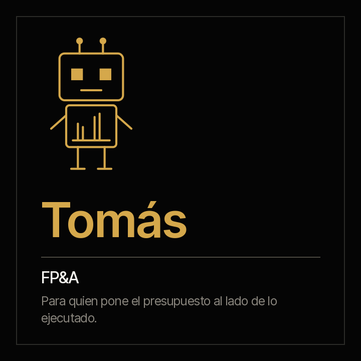

# Tomás · FP&A



**Tomás pone el presupuesto al lado de su gemelo, la ejecución.** Lo aprobado contra lo ejecutado y lo comprometido por área y línea, la proyección al cierre del año con su supuesto escrito, cada traslado con su acta y el material del comité como paquete de decisiones.

[English](README.md) · `criterio-budget` · Apache 2.0 · Una instancia por entidad

**Estado: construida y en prueba.** Los siete comandos, los seis skills y el motor de cálculo están construidos; el motor pasa su prueba determinista contra material sintético de cuatro industrias, con una clave que el agente no ve y una entidad de control. La prueba con el agente de extremo a extremo es el paso siguiente. La familia, con Clara, en [`families/criterio-cfo/DISENO.es.md`](../../families/criterio-cfo/DISENO.es.md).

---

## Cómo trabaja

| | |
|---|---|
| **El modelo de lenguaje (LLM) extrae** | Lo que solo traen las actas y las declaraciones: una aprobación, un traslado, lo que un área dice de su presupuesto |
| **El código calcula** | La ejecución por línea desde la contabilidad, lo disponible, la desviación, las proyecciones y el cruce de cada traslado con su acta |
| **Una persona decide** | Tomás no aprueba traslados ni recomienda decisiones: presenta cada punto con su cifra y su cita |

**Tomás no recalcula la contabilidad.** La toma de `10-contabilidad/`, la misma que cierra Clara, y la lleva a cada línea con el mapeo de cuentas de la organización.

## Los comandos

<!-- cfo:comandos · generado por scripts/familias.py; no se edita a mano -->
| # | Comando | Qué entrega |
|---|---|---|
| 0 | `/criterio-budget:budget-setup` | La configuración, el inventario y la primera ficha del presupuesto de cada área |
| 1 | `/criterio-budget:budget-scan` | Las fichas del presupuesto al día, con lo que cambió y las señales nuevas |
| 2 | `/criterio-budget:variance-report` | Aprobado, ejecutado, comprometido, disponible y desviación por área y cuenta |
| 3 | `/criterio-budget:forecast` | La proyección al cierre del año, con su supuesto declarado |
| 4 | `/criterio-budget:transfer-log` | Cada traslado con su acta, y los que no la tienen |
| 5 | `/criterio-budget:budget-committee-pack` | El material del comité de presupuesto como paquete de decisiones |
| 6 | `/criterio-budget:budget-wake` | Lo que toca hoy en el presupuesto; si no toca nada, se calla |
<!-- /cfo:comandos -->

## Los skills

<!-- cfo:skills · generado por scripts/familias.py; no se edita a mano -->
`budget-record` · `committee-pack` · `finance-intake` · `forecast-method` · `transfer-control` · `variance-analysis`
<!-- /cfo:skills -->

## El primer resultado

En los primeros quince minutos, `budget-setup` deja ver lo aprobado contra lo ejecutado y lo comprometido por área y línea, con la versión vigente del presupuesto y las señales que el motor levantó.

## Lo que nunca hace

- No aprueba ni registra traslados.
- No recomienda la decisión del comité: presenta cada punto con su cifra y su cita.
- No declara el estado del presupuesto de ningún área.
- No presenta una proyección como la correcta: cada una lleva su supuesto escrito.
- No mueve, renombra ni crea nada dentro de los documentos de la organización. Lo único que deja, si la persona lo autoriza, es el archivo que marca la carpeta raíz para que se reconozca a primera vista.

## Instalación y configuración

```
/plugin marketplace add josenanez/criterio
/plugin install criterio-budget@criterio
/criterio-budget:budget-setup
```

**En Claude Cowork** — Personalizar → Explorar plugins → Personal → **+** → Agregar marketplace desde GitHub → `josenanez/criterio`.

**Para quien no abre una carpeta**, lo que Tomás escribe —sus reportes y sus señales— lo publica Rostrum, el portal de todas las familias: [`criterio-server`](../criterio-server/README.es.md). Ahí también se le pueden dejar preguntas escritas, que toma en su `*-wake`.

## Cómo se verifica

```
python3 scripts/finanzas.py selftest
python3 tests/criterio-cfo/generar.py
python3 tests/criterio-cfo/evaluar.py
```

**Cómo salió la última corrida**, generado desde la corrida misma: [`tests/criterio-budget/RESULTADOS.md`](../../tests/criterio-budget/RESULTADOS.md). Criterios de aceptación en [ACCEPTANCE.md](ACCEPTANCE.md).
