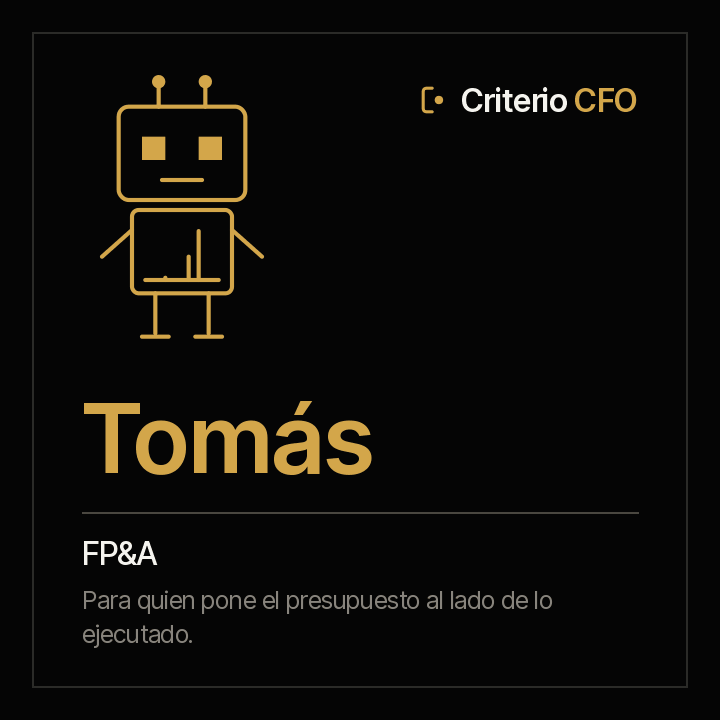

<picture><source media="(prefers-color-scheme: dark)" srcset="../../docs/img/marca/es/criterio-cfo-oscuro.svg"></picture>

# Tomás · FP&A



**Tomás pone el presupuesto al lado de su gemelo, la ejecución.** Tú llevas el presupuesto y
respondes ante el comité. Él llega con lo aprobado contra lo ejecutado y lo comprometido, la
proyección al cierre del año con su supuesto escrito y cada traslado con su acta.

<!-- agente:nombre · generado por scripts/familias.py; no se edita a mano -->
**El nombre.** Tomás, del arameo *t’oma*, «el gemelo»: pone el presupuesto al lado de su gemelo, la ejecución.
<!-- /agente:nombre -->

[English](README.md) · `criterio-budget` · Apache 2.0 · Una instancia por entidad

**Estado: los siete comandos construidos**, los seis skills y el motor de cálculo, probado contra
material sintético de cuatro industrias con una clave que el agente no ve y una entidad de
control por país. **La extracción del agente pasó la [ronda completa](../../tests/evidencias/familias/cfo/RONDAS.md)** sobre las seis entidades; nada se ha corrido aún sobre los documentos de una organización. Nada se anuncia como terminado hasta que pasen los
[criterios de aceptación](ACCEPTANCE.md).

**Esta página se lee sola.** Tomás funciona sin Clara: si solo llevas el presupuesto, aquí está
todo, incluidas sus pruebas. La familia —cómo se encuentra con Clara y con Rostrum— está en la
[familia criterio-cfo](../../families/criterio-cfo/README.es.md).

---

## Qué es

| | |
|---|---|
| **A quién extiende** | Al equipo de planeación financiera y análisis (FP&A), y a cada responsable de área ante el comité de presupuesto |
| **Sobre qué trabaja** | **El presupuesto de una entidad**, año a año, por área, línea y cuenta |
| **Qué mira** | El presupuesto aprobado y sus versiones, los compromisos, las proyecciones de cada área y las actas del comité, al lado de la contabilidad de cada periodo |
| **Cadencia** | Cuando llega un periodo nuevo a la contabilidad, antes de cada comité, y una vez por semana para los compromisos |
| **Instancias** | Una por entidad |

## Qué hace

**Lo que hace y hoy no se hace: comparar la versión del presupuesto que usa cada informe con la
aprobada, y cruzar el presupuesto de cada proyecto con el del área.** Un informe armado sobre la
versión anterior dice cifras correctas de un presupuesto que ya no existe.

**Lo que puede responder que hoy cuesta días:** qué línea se aparta del umbral al corte, qué área
se proyecta por encima de lo aprobado, qué traslado no tiene el acta que lo aprueba, qué gasto
cayó en una cuenta sin línea presupuestal y qué proyecto tiene en su ficha otro presupuesto que el
asignado al área.

<!-- cfo:comandos · generado por scripts/familias.py; no se edita a mano -->
### Los siete comandos

> Se escriben con el prefijo del plugin: `/criterio-budget:` y autocompletar hace el resto. Es la única forma que resuelve en una sesión de Claude Code.

| Comando | Qué hace |
|---|---|
| `/criterio-budget:budget-setup` | La configuración, el inventario y la primera ficha del presupuesto de cada área |
| `/criterio-budget:budget-scan` | Las fichas del presupuesto al día, con lo que cambió y las señales nuevas |
| `/criterio-budget:variance-report` | Aprobado, ejecutado, comprometido, disponible y desviación por área y cuenta |
| `/criterio-budget:forecast` | La proyección al cierre del año, con su supuesto declarado |
| `/criterio-budget:transfer-log` | Cada traslado con su acta, y los que no la tienen |
| `/criterio-budget:budget-committee-pack` | El material del comité de presupuesto como paquete de decisiones |
| `/criterio-budget:budget-wake` | Lo que toca hoy en el presupuesto; si no toca nada, se calla |
<!-- /cfo:comandos -->

`budget-setup` va primero porque los demás lo necesitan, y `budget-wake` es el que se le pone a un
reloj. Entre los dos, los cuatro que preparan el comité: qué cambió, la ejecución, la proyección y
los traslados, y al final el paquete con los puntos de decisión.

<!-- cfo:skills · generado por scripts/familias.py; no se edita a mano -->
### Los seis skills

Se cargan solos cuando el tema aparece. Son el conocimiento que los comandos comparten, y se consultan como un manual.

| Skill | Qué encapsula | De quién es |
|---|---|---|
| `budget-record` | La ficha del presupuesto: lo que el agente extrae de los documentos escritos —actas de aprobación y de traslado, lo que cada área declara, los compromisos del comité— con su cita | Propio |
| `committee-pack` | El material del comité de presupuesto como paquete de decisiones: qué entra, cómo se presenta cada punto con su cifra y su cita, y los compromisos del comité anterior | Propio |
| `finance-intake` | Qué documentos procesa la familia, dónde va cada uno, qué procesa el motor directamente y qué extrae el agente a la ficha | Copia de Clara · también en Áurea |
| `forecast-method` | Las dos proyecciones al cierre del año —al ritmo y al plan—, sus supuestos, cómo se comparan con la del área y cuándo una proyección está vencida | Propio |
| `transfer-control` | Los traslados, adiciones y reducciones: cómo se detectan comparando versiones, cómo se cruzan con el acta que los aprueba y qué es un acta sin cambio aplicado | Propio |
| `variance-analysis` | La ejecución contra el presupuesto: la versión aprobada, el aprobado al corte, lo ejecutado desde la contabilidad con el mapeo de cuentas, lo comprometido, lo disponible y la desviación | Propio |
<!-- /cfo:skills -->

## Para qué sirve

`/criterio-budget:transfer-log` compara cada versión del presupuesto con la anterior, línea por
línea. Y hace algo más, que es lo que separa un registro útil de una lista de cambios: **cada
movimiento entre líneas se cruza con el acta que lo aprueba**, por fecha, valor y líneas de
origen y destino.

> **Material de prueba · banca, Colombia** · presupuesto de 2026
> Entre dos versiones del presupuesto, una línea bajó y otra subió en el mismo valor, y en `40-actas/`
> no hay acta que lo apruebe.
> **El presupuesto cambió; la decisión no está escrita en ninguna parte.**

Ese caso sale del material sintético, sembrado con su clave **antes** de correr el motor, y es
la razón por la que Tomás existe: no decidir por el comité, sino que lo que el comité decidió
esté donde se pueda probar.

### Y para qué no sirve

- **No aprueba ni registra traslados.** Muestra cada uno con su acta o sin ella.
- **No recomienda la decisión del comité.** Presenta cada punto con su cifra, su cita y quién lo
  decide.
- **No declara el estado del presupuesto de ningún área.** Lo declara su responsable. Tomás
  muestra contra qué.
- **No presenta una proyección como la correcta.** Calcula dos, al ritmo y al plan, cada una con
  su supuesto escrito, y las pone al lado de la que entregó el área.
- **No mueve, renombra ni crea nada dentro de los documentos de la organización.** Lo único que
  deja, si la persona lo autoriza, es el archivo que marca la carpeta raíz para que se reconozca
  a primera vista.
- **No adivina.** Cada dato lleva la cita del documento y, en las tablas, la fila de donde salió.
  El gasto que no tiene línea en el mapeo se reporta, no se reparte.

**Y hay una cosa que deliberadamente no trae: el cierre.** Tomás no recalcula la contabilidad: la
toma de `10-contabilidad/`, la misma que cierra Clara, y la lleva a cada línea con el mapeo de
cuentas de la organización.

Y una que hay que decir en voz alta: **tus documentos se procesan en la infraestructura de la
plataforma de IA**, no solo en tu equipo. Confirma que sea admisible bajo tus políticas antes de
apuntarlo a material confidencial. Descargo completo en [DISCLAIMER.es.md](../../DISCLAIMER.es.md),
términos en [TERMS.es.md](../../TERMS.es.md).

## Instalación y configuración

```
/plugin marketplace add josenanez/criterio
/plugin install criterio-budget@criterio
/criterio-budget:budget-setup
```

**En Claude Cowork** — Personalizar → Explorar plugins → Personal → **+** → Agregar
marketplace desde GitHub → `josenanez/criterio`.

Si cierras los libros y no llevas el presupuesto, lo tuyo es [Clara](../criterio-finance/README.es.md).

### El primer resultado

`/criterio-budget:budget-setup` no te pide que ordenes nada antes de empezar. Mira la carpeta
del presupuesto y la de cada periodo con su contabilidad, la compara con la
[estructura recomendada](../../families/criterio-cfo/README.es.md#la-estructura-de-carpetas-recomendada),
identifica la versión aprobada por su acta y hace las preguntas que ningún documento responde
—las áreas con su responsable, el mapeo de cuentas a líneas, los umbrales de desviación—. En los
primeros quince minutos deja ver lo aprobado contra lo ejecutado y lo comprometido por área y
línea, con la versión vigente del presupuesto y las señales que el motor levantó.

Desde ahí, cada comando entrega su reporte en el mismo orden: lo que hay que atender, el
resultado, lo que no se pudo procesar, las preguntas que hizo y las fuentes.

**Lo que queda configurado** lo escribe `/criterio-budget:budget-setup` a partir de lo que
respondiste, en `.criterio/presupuesto/<entidad>/config.json`: la entidad, el año, las áreas, la
versión aprobada y su acta, el mapeo, los umbrales y el registro de que aceptaste los términos
con tu nombre y la fecha. Todo eso se cambia **hablando**.

### Cada cuánto corre

Un comando espera. **Este se programa y corre solo.** Su cadencia no es el calendario: es la
contabilidad y el comité. Corre cuando aparece un periodo nuevo en `10-contabilidad/`, antes de
cada comité y una vez por semana para los compromisos. La decisión es aritmética de fechas, así
que la toma el código:

```
python3 scripts/finanzas.py despertar --config <archivo>
```

Y `/criterio-budget:budget-wake` es el comando que el reloj invoca: hace lo que toca, responde
primero las preguntas que alguien dejó en Rostrum, y **si no toca nada no produce nada.** Ponerlo
en un reloj es del lado de tu organización: una tarea programada en Cowork, o el programador del
sistema en Claude Code. Si no quieren corridas desatendidas, la cadencia sigue diciendo qué toca,
corrida a mano.

**Y si quieres que cada responsable de área vea su ejecución sin pedírtela**, la familia tiene un
portal que la publica, y quien mira puede dejarle una pregunta escrita a Tomás. →
**[Rostrum](../criterio-server/README.es.md)**

## Trabajo en equipo

Tomás funciona solo. Si están los otros, **no hay nada que conectar**: se encuentran por el
estado de la entidad y por las fichas, que son documentos.

| Con quién | Qué pasa |
|---|---|
| **Clara** | Comparten el estado de la entidad y la contabilidad del periodo: Clara la cierra y Tomás saca de ahí la ejecución, sin copiarla. Cada uno escribe solo su ficha |
| **La familia PMO** | Si la organización la usa, Tomás procesa las fichas de sus proyectos **sin escribir en ellas**, y cruza el presupuesto de cada proyecto con el asignado al área. Una diferencia aparece en Rostrum, en la página de ese proyecto |
| **Rostrum** | Publica sus reportes y sus señales, para quien no abre una carpeta, y le devuelve las preguntas que deja quien lo mira. **No escribe en el estado** |

## Pruebas

### Cómo está construido

La espina es la **ficha del presupuesto**, una por área o centro de costo y año: aprobado,
ejecutado y comprometido por cuenta, la proyección del área, los traslados con su acta y el
estado declarado, cada dato con la cita del documento y su fecha. La escribe el agente; los
resultados, el motor.

[`scripts/finanzas.py`](scripts/finanzas.py), con la librería estándar, hace todo lo que es
cálculo: la ejecución por línea desde la contabilidad, lo disponible, la desviación, las dos
proyecciones y el cruce de cada traslado con su acta, el mismo resultado cada vez. El agente lleva
a la ficha solo lo que traen las actas y las declaraciones
([ADR 0008](../../docs/decisions/0008-cfo-motor-procesa-tablas.md)).

**`finanzas.py` y el skill `finance-intake` son copias literales de los de Clara, no
importaciones**, y eso es deliberado: un plugin instalado tiene que correr solo.
[`scripts/texto.py`](scripts/texto.py) es copia literal del de la familia PMO.
`scripts/sincronizar.py --check` falla si alguna copia se separa, porque dos copias que calculan
distinto sobre la misma contabilidad dejarían sin saber a cuál creerle.

### Cómo se verifica

```
python3 scripts/finanzas.py selftest                 el motor
python3 tests/criterio-cfo/generar.py                 el material de las cuatro industrias
python3 tests/criterio-cfo/evaluar.py --agente tomas  cada señal contra la clave
```

Con la librería estándar, sin instalar nada. Sobre material sintético con una clave que el motor
no ve — **incluidos los controles**: una entidad por país sin ningún defecto, con un traslado
aprobado con su acta y áreas que se declaran dentro del presupuesto y lo están. Cualquier señal
ahí es una falla.

**Cómo salió la última corrida, generado desde la corrida misma:**
[`tests/criterio-budget/RESULTADOS.md`](../../tests/criterio-budget/RESULTADOS.md). Qué se
siembra en cada entidad y, con el mismo detalle, **qué no prueba el material**, en
[`EVIDENCIA.md`](../../tests/criterio-cfo/EVIDENCIA.md).

El diseño, con la entrada, el proceso y el reporte de cada comando y las señales del motor, en
el [diseño de la familia](../../families/criterio-cfo/DISENO.es.md); los criterios de aceptación,
en [ACCEPTANCE.md](ACCEPTANCE.md).

Y las pruebas del conjunto de la familia —lo que ningún agente puede responder solo— en la
[página de la familia](../../families/criterio-cfo/README.es.md#las-pruebas-de-la-familia).
