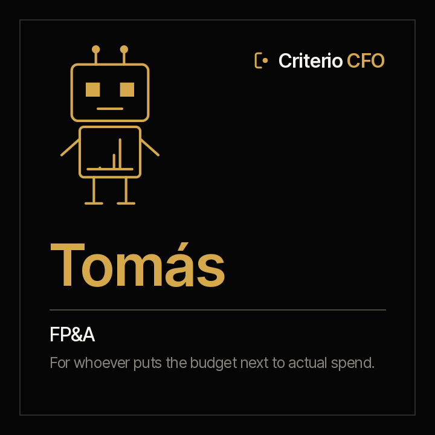

<picture><source media="(prefers-color-scheme: dark)" srcset="../../docs/img/marca/en/criterio-cfo-oscuro.svg"></picture>

# Tomás · FP&A



**Tomás puts the budget next to its twin, actual spend.** Approved against actual and committed by area and line, the year-end forecast with its stated assumption, every transfer with its approval minutes, and the committee material as a decision pack.

[Español](README.es.md) · `criterio-budget` · Apache 2.0 · One instance per entity

**Status: built and in testing.** The seven commands, the six skills and the calculation engine are built; the engine passes its deterministic test against synthetic material from four industries, with a key the agent never sees and a control entity. The end-to-end test with the agent is the next step. The family, with Clara, is in [`families/criterio-cfo/DISENO.es.md`](../../families/criterio-cfo/DISENO.es.md) (Spanish).

---

## How it works

| | |
|---|---|
| **The large language model (LLM) extracts** | What only minutes and statements carry: an approval, a transfer, what an area says about its budget |
| **The code calculates** | Actual spend by line from the books, availability, variance, forecasts and every transfer against its minutes |
| **A person decides** | Tomás does not approve transfers or recommend decisions: he presents each point with its figure and citation |

**Tomás does not recompute the books.** He takes `10-contabilidad/`, the same books Clara closes, and maps them to each line with the organisation's account mapping.

## The commands

<!-- cfo:comandos · generado por scripts/familias.py; no se edita a mano -->
| # | Command | What it delivers |
|---|---|---|
| 0 | `/criterio-budget:budget-setup` | The configuration, the inventory and each area's first budget record |
| 1 | `/criterio-budget:budget-scan` | The budget records up to date, with what changed and the new signals |
| 2 | `/criterio-budget:variance-report` | Approved, actual, committed, available and variance by area and account |
| 3 | `/criterio-budget:forecast` | The year-end forecast, with its stated assumption |
| 4 | `/criterio-budget:transfer-log` | Every transfer with its approval minutes, and those without |
| 5 | `/criterio-budget:budget-committee-pack` | The budget committee material as a decision pack |
| 6 | `/criterio-budget:budget-wake` | What the budget needs today; silent when nothing does |
<!-- /cfo:comandos -->

## The skills

<!-- cfo:skills · generado por scripts/familias.py; no se edita a mano -->
`budget-record` · `committee-pack` · `finance-intake` · `forecast-method` · `transfer-control` · `variance-analysis`
<!-- /cfo:skills -->

## The first result

In the first fifteen minutes, `budget-setup` shows approved against actual and committed by area and line, with the budget version in force and the signals the engine raised.

## What it never does

- It does not approve or post transfers.
- It does not recommend the committee's decision: it presents each point with its figure and citation.
- It does not declare any area's budget status.
- It does not present a forecast as the correct one: each carries its stated assumption.
- It never moves, renames or creates anything inside the organisation's documents. The only thing it leaves, if the person allows it, is the file that marks the root folder so it is recognised at a glance.

## Installing and configuring

```
/plugin marketplace add josenanez/criterio
/plugin install criterio-budget@criterio
/criterio-budget:budget-setup
```

**For whoever does not open a folder**, what Tomás writes —reports and signals— is published by Rostrum, the portal for every family: [`criterio-server`](../criterio-server/README.md). Written questions can be left there too, and Tomás takes them in the `*-wake` command.

## Acceptance criteria

See [ACCEPTANCE.md](ACCEPTANCE.md). **How the latest run went**, generated from the run itself: [`tests/criterio-budget/RESULTADOS.md`](../../tests/criterio-budget/RESULTADOS.md) (Spanish).
