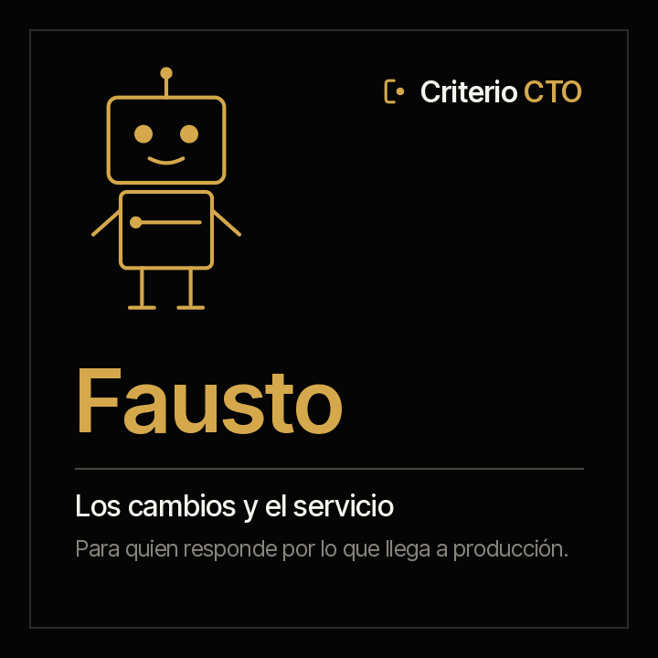

<picture><source media="(prefers-color-scheme: dark)" srcset="../../docs/img/marca/es/criterio-cto-oscuro.svg"></picture>

# Fausto · los cambios y el servicio



**Fausto pone cada cambio en producción al lado de su aprobación.**
Tú respondes por lo que llega a producción. Él llega con cada cambio al lado de su aprobación y su revisión, y con cada servicio al lado del nivel que se le prometió al negocio: el cambio implementado sin aprobar o aprobado después, el de emergencia sin su revisión, el despliegue que no corresponde a ningún cambio, el cambio fallido sin revisión, el incidente mayor sin su causa y el servicio por debajo de su nivel.

<!-- agente:nombre · generado por scripts/familias.py; no se edita a mano -->
**El nombre.** Fausto, del latín *faustus*, el que trae buena fortuna: cada cambio que sale bien.
<!-- /agente:nombre -->

[English](README.md) · `criterio-changes` · Apache 2.0 · Una instancia por entidad

**Estado: construido, en laboratorio, con la familia CTO.** El motor de cálculo, probado contra todo el material sintético de la familia con una clave que el agente no ve y entidades de control. La ronda con el agente viene en la 0.2.0; no se ha probado sobre la documentación de una organización concreta.

**Esta página se lee sola.** Fausto funciona sin el otro agente de la familia. La familia —cómo se encuentran entre sí y con Rostrum— está en la [familia criterio-cto](../../families/criterio-cto/README.es.md).

---

## Qué es

| | |
|---|---|
| **A quién extiende** | A quien responde por los cambios y el servicio —el gerente de operaciones de TI o quien preside el comité de cambios— y a quien rinde cuentas del nivel de servicio |
| **Sobre qué trabaja** | **Los cambios, los despliegues, los incidentes y el nivel de servicio de una entidad, periodo a periodo** |
| **Qué mira** | La exportación de cambios, el registro de despliegues, las actas del comité de cambios, los incidentes, los problemas, la disponibilidad y el catálogo de servicios |
| **Cadencia** | Cuando llega un acta o una exportación nueva, y una vez por semana |
| **Instancias** | Una por entidad |

## Qué hace

**Lo que hace y hoy no se hace a mano: poner todo, no una muestra, al lado de su fuente.**

**Lo que puede responder:** qué cambio llegó a producción sin aprobación o antes de ella, qué cambio de emergencia o fallido no tiene su revisión, qué despliegue no corresponde a ningún cambio, qué incidente mayor no tiene su causa y qué servicio quedó por debajo de su nivel.

<!-- cto:comandos · generado por scripts/familias.py; no se edita a mano -->
### Los ocho comandos

> Se escriben con el prefijo del plugin: `/criterio-changes:` y autocompletar hace el resto. Es la única forma que resuelve en una sesión de Claude Code.

| Comando | Qué hace |
|---|---|
| `/criterio-changes:changes-setup` | La configuración, el inventario y las tablas reconocidas |
| `/criterio-changes:fausto` | Lo que necesites, en tus palabras: Fausto elige el comando que lo resuelve y lo corre |
| `/criterio-changes:changes-scan` | La ficha del periodo al día |
| `/criterio-changes:change-check` | Qué llegó a producción sin el sí del comité |
| `/criterio-changes:incident-check` | Qué falla grande no tiene todavía su porqué |
| `/criterio-changes:service-check` | Qué servicio no cumplió lo que se le prometió al negocio |
| `/criterio-changes:changes-wake` | Los cambios al día sin que nadie se acuerde |
| `/criterio-changes:share-findings` | Un resumen sin datos, solo si se dice que sí |
<!-- /cto:comandos -->

`changes-setup` va primero porque los demás lo necesitan, y `changes-wake` es el que se le pone a un reloj.

<!-- cto:skills · generado por scripts/familias.py; no se edita a mano -->
### Los tres skills

Se cargan solos cuando el tema aparece. Son el conocimiento que los comandos comparten, y se consultan como un manual.

| Skill | Qué encapsula | De quién es |
|---|---|---|
| `change-record` | Cómo se lleva a la ficha cada aprobación de un cambio y cada revisión posterior que quedó en un acta, con la cita | Propio |
| `technology-intake` | La estructura recomendada de la carpeta de tecnología, qué va en cada carpeta y qué agente la usa | Propio · también en Domingo |
| `technology-policy` | La política de cambios y de niveles de servicio en la configuración: los plazos, los umbrales y lo que nunca se decide | Propio · también en Domingo |
<!-- /cto:skills -->

## Lo que cuesta hoy

<!-- cto:cifras · generado por scripts/familias.py; no se edita a mano -->
| Cifra | Fuente |
|---|---|
| **84 %** de las organizaciones dice que gestionar el gasto en la nube es su mayor reto | [Flexera, 2025 State of the Cloud Report, 2025](https://www.flexera.com/about-us/press-center/new-flexera-report-finds-84-percent-of-organizations-struggle-to-manage-cloud-spend) — más de 750 profesionales técnicos y directivos de todo el mundo |
| **57 %** dice que su última caída mayor costó más de 100.000 dólares | [Uptime Institute, Annual Global Data Center Survey 2025, citada en su Annual Outage Analysis 2026, 2025](https://www.businesswire.com/news/home/20260513289344/en) — más de 800 dueños y operadores de centros de datos |
| **1 de cada 5** reporta caídas de más de un millón de dólares, por segundo año seguido | [Uptime Institute, Annual Global Data Center Survey 2025, citada en su Annual Outage Analysis 2026, 2025](https://www.businesswire.com/news/home/20260513289344/en) — más de 800 dueños y operadores de centros de datos |
<!-- /cto:cifras -->

## Para qué sirve

`/criterio-changes:change-check` pone cada caso al lado de su fuente. **Lo que falta se dice con su cita.**

### Y para qué no sirve

- **No aprueba un cambio, no decide una arquitectura y no califica un incidente.** Dice qué no tiene su aprobación, su revisión o su causa; la decisión es del comité de cambios y del área.
- **No procesa la seguridad.** Las vulnerabilidades, los controles y los incidentes de seguridad son de la familia CISO.
- **No se conecta a una herramienta ni a un servidor.** Procesa los documentos y las exportaciones que la organización le entrega.

Y una que hay que decir en voz alta: **tus documentos se procesan en la infraestructura de la plataforma de IA**, no solo en tu equipo. Un acta del comité de cambios o la exportación de una herramienta pueden traer información confidencial: confirma que sea admisible bajo tu política antes de apuntarla a esa carpeta. Descargo completo en [DISCLAIMER.es.md](../../DISCLAIMER.es.md), términos en [TERMS.es.md](../../TERMS.es.md).

## Instalación y configuración

```
/plugin marketplace add josenanez/criterio
/plugin install criterio-changes@criterio
/criterio-changes:changes-setup
```

### El primer resultado

`/criterio-changes:changes-setup` no te pide que ordenes nada antes de empezar. Mira la carpeta de tecnología de la entidad, la compara con la [estructura recomendada](../../families/criterio-cto/README.es.md#la-estructura-de-carpetas-recomendada), procesa la política de cambios y de niveles de servicio y hace las preguntas que ningún documento responde. En los primeros quince minutos deja ver el primer resultado.

### Cada cuánto corre

`/criterio-changes:changes-wake` es el comando que el reloj invoca: hace lo que toca, responde primero las preguntas que alguien dejó en Rostrum, y **si no toca nada no produce nada.** La decisión de qué toca es aritmética de fechas, y la toma el código:

```
python3 scripts/tecnologia.py despertar --config <archivo>
```

## Trabajo en equipo

| Con quién | Qué pasa |
|---|---|
| **Domingo** | Comparten la carpeta y la política de tecnología; cada uno escribe solo su ficha |
| **Rostrum** | Solo si la configuración lo dice (`publish_rostrum`): publica sus reportes, lo que vence y sus señales para quien no abre una carpeta, y le devuelve las preguntas que deja quien lo mira. **No escribe en el estado** |

## Pruebas

[`scripts/tecnologia.py`](scripts/tecnologia.py), con la librería estándar, hace todo lo que es cálculo: procesa cada tabla con su fila de origen, compara cada fecha de implementación con su aprobación, cuenta los días de cada revisión, cruza cada despliegue con su cambio y cada servicio con su nivel, el mismo resultado cada vez. Vive en `criterio-changes` y se copia a Domingo; `scripts/sincronizar.py --check` falla si la copia se separa.

```
python3 scripts/tecnologia.py selftest
python3 tests/criterio-cto/generar.py
python3 tests/criterio-cto/evaluar.py
```

Qué se siembra en cada entidad y **qué no prueba el material**, en [`EVIDENCIA.md`](../../tests/criterio-cto/EVIDENCIA.md). El diseño, con la entrada, el proceso y el reporte de cada comando, en el [diseño de la familia](../../families/criterio-cto/DISENO.es.md).
