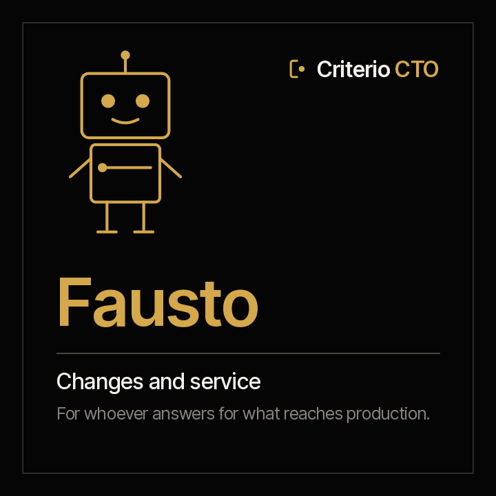

<picture><source media="(prefers-color-scheme: dark)" srcset="../../docs/img/marca/en/criterio-cto-oscuro.svg"></picture>

# Fausto · changes and service



**Fausto puts each production change next to its approval.**
You are responsible for what reaches production. He comes with each change next to its approval and review, and with each service next to the level the business was promised: a change implemented without approval or approved afterwards, an emergency change with no review, a deployment that matches no change, a failed change with no review, a major incident with no cause and a service below its level.

<!-- agente:nombre · generado por scripts/familias.py; no se edita a mano -->
**The name.** Fausto, from the Latin *faustus*, the one who brings good fortune: each change that goes well.
<!-- /agente:nombre -->

[Español](README.es.md) · `criterio-changes` · Apache 2.0 · One instance per entity

**Status: built, in the lab, with the CTO family.** The calculation engine, tested against all the family’s synthetic material with a key the agent never sees and control entities. The round with the agent comes in 0.2.0; it has not been tested on a specific organisation’s documentation.

**This page stands on its own.** Fausto works without the family’s other agent. The family —how they meet each other and Rostrum— is in the [criterio-cto family](../../families/criterio-cto/README.md).

---

## What it is

| | |
|---|---|
| **Who it extends** | Whoever answers for changes and service —the IT operations manager or whoever chairs the change board— and whoever reports on the service level |
| **What it works on** | **An entity's changes, deployments, incidents and service level, period by period** |
| **What it looks at** | The change export, the deployment log, the change board minutes, the incidents, the problems, the availability and the service catalogue |
| **Cadence** | When new minutes or a new export arrive, and once a week |
| **Instances** | One per entity |

## What it does

**What it does that is not done by hand today: putting everything, not a sample, next to its source.**

**What it can answer:** which change reached production without approval or before it, which emergency or failed change has no review, which deployment matches no change, which major incident has no cause and which service fell below its level.

<!-- cto:comandos · generado por scripts/familias.py; no se edita a mano -->
### The eight commands

> They are typed with the plugin prefix: `/criterio-changes:` and autocomplete does the rest. It is the only form that resolves in a Claude Code session.

| Command | What it does |
|---|---|
| `/criterio-changes:changes-setup` | The configuration, the inventory and the recognised tables |
| `/criterio-changes:fausto` | Whatever you need, in your own words: Fausto picks the command that does it and runs it |
| `/criterio-changes:changes-scan` | The period's record up to date |
| `/criterio-changes:change-check` | What reached production without the board's yes |
| `/criterio-changes:incident-check` | Which big failure still has no reason |
| `/criterio-changes:service-check` | Which service did not deliver what the business was promised |
| `/criterio-changes:changes-wake` | The changes up to date without anyone having to remember |
| `/criterio-changes:share-findings` | A summary with no data, only if the answer is yes |
<!-- /cto:comandos -->

`changes-setup` goes first because the others need it, and `changes-wake` is the one you put on a clock.

<!-- cto:skills · generado por scripts/familias.py; no se edita a mano -->
### The three skills

They load on their own when the subject comes up. They are the knowledge the commands share, and they are consulted like a manual.

| Skill | What it encapsulates | Whose it is |
|---|---|---|
| `change-record` | How each change approval and each post-implementation review recorded in the minutes go into the record, with their citation | Own |
| `technology-intake` | The recommended structure of the technology folder, what goes in each folder and which agent uses it | Own · also in Domingo |
| `technology-policy` | The change and service level policy in the configuration: the deadlines, the thresholds and what is never decided | Own · also in Domingo |
<!-- /cto:skills -->

## What it costs today

<!-- cto:cifras · generado por scripts/familias.py; no se edita a mano -->
| Figure | Source |
|---|---|
| **84%** of organisations say managing cloud spend is their top cloud challenge | [Flexera, 2025 State of the Cloud Report, 2025](https://www.flexera.com/about-us/press-center/new-flexera-report-finds-84-percent-of-organizations-struggle-to-manage-cloud-spend) — more than 750 technical professionals and executive leaders worldwide |
| **57%** say their most recent major outage cost more than 100,000 dollars | [Uptime Institute, Annual Global Data Center Survey 2025, citada en su Annual Outage Analysis 2026, 2025](https://www.businesswire.com/news/home/20260513289344/en) — more than 800 data center owners and operators |
| **1 in 5** report outages costing more than one million dollars, for the second year running | [Uptime Institute, Annual Global Data Center Survey 2025, citada en su Annual Outage Analysis 2026, 2025](https://www.businesswire.com/news/home/20260513289344/en) — more than 800 data center owners and operators |
<!-- /cto:cifras -->

## What it is for

`/criterio-changes:change-check` puts each case next to its source. **What is missing is said with its citation.**

### And what it is not for

- **It does not approve a change, decide an architecture or rate an incident.** It says what has no approval, review or cause; the decision belongs to the change board and the area.
- **It does not process security.** Vulnerabilities, controls and security incidents belong to the CISO family.
- **It does not connect to a tool or a server.** It processes the documents and exports the organisation gives it.

And one that has to be said out loud: **your documents are processed on the AI platform’s infrastructure**, not only on your computer. Change board minutes or a tool export may contain confidential information: confirm it is admissible under your policy before pointing it at that folder. Full disclaimer in [DISCLAIMER.md](../../DISCLAIMER.md), terms in [TERMS.md](../../TERMS.md).

## Installation and setup

```
/plugin marketplace add josenanez/criterio
/plugin install criterio-changes@criterio
/criterio-changes:changes-setup
```

### The first result

`/criterio-changes:changes-setup` does not ask you to tidy anything before starting. It looks at the entity’s technology folder, compares it with the [recommended structure](../../families/criterio-cto/README.md#the-recommended-folder-structure), processes the change and service level policy and asks the questions no document answers. Within the first fifteen minutes it shows the first result.

### How often it runs

`/criterio-changes:changes-wake` is the command the clock calls: it does what is due, first answers the questions someone left in Rostrum, and **if nothing is due it produces nothing.** Deciding what is due is date arithmetic, and the code does it:

```
python3 scripts/tecnologia.py despertar --config <file>
```

## Teamwork

| With whom | What happens |
|---|---|
| **Domingo** | They share the folder and the technology policy; each writes only its own record |
| **Rostrum** | Only if the configuration says so (`publish_rostrum`): it publishes its reports, what is due and its signals for whoever does not open a folder, and returns the questions left by whoever views it. **It does not write to the state** |

## Tests

[`scripts/tecnologia.py`](scripts/tecnologia.py), with the standard library, does everything that is calculation: it processes each table with its source row, compares each implementation date with its approval, counts the days of each review, matches each deployment with its change and each service with its level, the same result every time. It lives in `criterio-changes` and is copied to Domingo; `scripts/sincronizar.py --check` fails if the copy drifts.

```
python3 scripts/tecnologia.py selftest
python3 tests/criterio-cto/generar.py
python3 tests/criterio-cto/evaluar.py
```

What is planted in each entity and **what the material does not test**, in [`EVIDENCIA.md`](../../tests/criterio-cto/EVIDENCIA.md). The design, with the input, process and report of each command, in the [family design](../../families/criterio-cto/DISENO.md).
