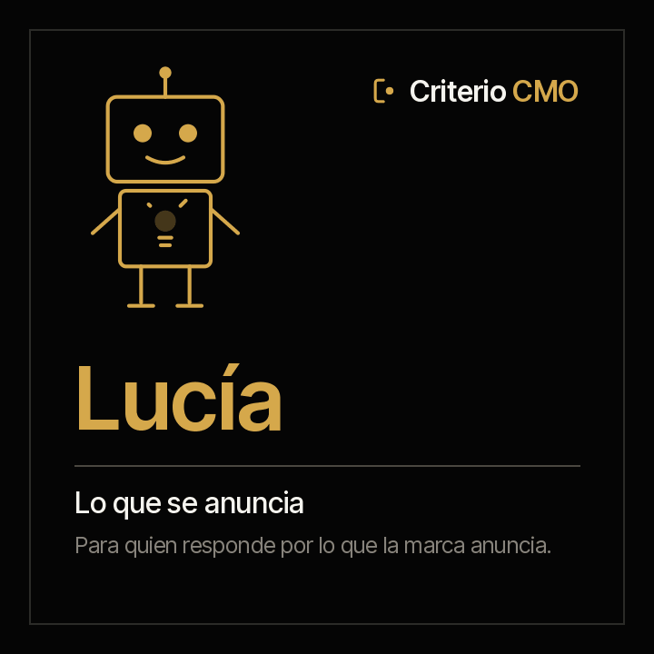

<picture><source media="(prefers-color-scheme: dark)" srcset="../../docs/img/marca/es/criterio-cmo-oscuro.svg"></picture>

# Lucía · lo que se anuncia



**Lucía pone cada afirmación al lado de su soporte.**
Tú respondes por lo que la marca anuncia. Ella llega con cada pieza aprobada al lado de su soporte, su aprobación y su identificación: la afirmación sin soporte, la comparativa sin fuente, la promoción que no dice cuándo ni cómo, la pieza pagada a un influenciador que no se identifica como publicidad, la pieza publicada sin aprobación y la base de contactos usada sin autorización para mercadeo.

<!-- agente:nombre · generado por scripts/familias.py; no se edita a mano -->
**El nombre.** Lucía, del latín *lux*, la luz: cada afirmación, a la luz de su soporte.
<!-- /agente:nombre -->

[English](README.md) · `criterio-claims` · Apache 2.0 · Una instancia por entidad

**Estado: construida y probada, en laboratorio, con la familia CMO.** El motor de cálculo, probado contra todo el material sintético de la familia con una clave que la agente no ve y entidades de control. En la 0.2.0, la agente corrió sobre todas las entidades del material, con una clave que no ve; no se ha probado sobre la documentación de una organización concreta.

**Esta página se lee sola.** Lucía funciona sin el otro agente de la familia. La familia —cómo se encuentran entre sí y con Rostrum— está en la [familia criterio-cmo](../../families/criterio-cmo/README.es.md).

---

## Qué es

| | |
|---|---|
| **A quién extiende** | A quien responde por lo que la marca anuncia —legal de mercadeo o el director de comunicaciones— y a quien aprueba las piezas |
| **Sobre qué trabaja** | **Las piezas, las promociones y las bases de contactos de una entidad, periodo a periodo** |
| **Qué mira** | Las piezas aprobadas con su texto, el registro de piezas, los soportes de cada afirmación, las bases de cada promoción, el registro de bases de contactos y el plan de mercadeo |
| **Cadencia** | Cuando llega una pieza, una promoción o una base nueva, y una vez por semana |
| **Instancias** | Una por entidad |

## Qué hace

**Lo que hace y hoy no se hace a mano: poner todo, no una muestra, al lado de su fuente.**

**Lo que puede responder:** qué afirmación no tiene soporte, qué comparativa no cita su fuente, qué promoción no publica su vigencia o sus condiciones, qué pieza pagada no se identifica como publicidad, qué pieza salió sin aprobación y qué base de contactos se usó sin autorización.

<!-- cmo:comandos · generado por scripts/familias.py; no se edita a mano -->
### Los ocho comandos

> Se escriben con el prefijo del plugin: `/criterio-claims:` y autocompletar hace el resto. Es la única forma que resuelve en una sesión de Claude Code.

| Comando | Qué hace |
|---|---|
| `/criterio-claims:claims-setup` | La configuración, el inventario y las tablas reconocidas |
| `/criterio-claims:lucia` | Lo que necesites, en tus palabras: Lucía elige el comando que lo resuelve y lo corre |
| `/criterio-claims:claims-scan` | La ficha del periodo al día |
| `/criterio-claims:claim-check` | Qué se anunció sin con qué sostenerlo |
| `/criterio-claims:promo-check` | Qué promoción no dice cuándo ni cómo |
| `/criterio-claims:approval-check` | Qué salió sin el sí que pide la política |
| `/criterio-claims:claims-wake` | Las piezas al día sin que nadie se acuerde |
| `/criterio-claims:share-findings` | Un resumen sin datos, solo si se dice que sí |
<!-- /cmo:comandos -->

`claims-setup` va primero porque los demás lo necesitan, y `claims-wake` es el que se le pone a un reloj.

<!-- cmo:skills · generado por scripts/familias.py; no se edita a mano -->
### Los tres skills

Se cargan solos cuando el tema aparece. Son el conocimiento que los comandos comparten, y se consultan como un manual.

| Skill | Qué encapsula | De quién es |
|---|---|---|
| `claim-record` | Cómo se lleva a la ficha cada afirmación de una pieza con su soporte y cada promoción con sus condiciones, con la cita | Propio |
| `marketing-intake` | La estructura recomendada de la carpeta de mercadeo, qué va en cada carpeta y qué agente la usa | Propio · también en Próspero |
| `marketing-policy` | La política de publicidad en la configuración: las tolerancias, quién aprueba y lo que nunca se decide | Propio · también en Próspero |
<!-- /cmo:skills -->

## Lo que cuesta hoy

<!-- cmo:cifras · generado por scripts/familias.py; no se edita a mano -->
| Cifra | Fuente |
|---|---|
| **7,7 %** de los ingresos de la empresa es el presupuesto de mercadeo, igual que el año anterior | [Gartner, 2025 CMO Spend Survey, 2025](https://www.gartner.com/en/newsroom/press-releases/2025-05-12-gartner-2025-cmo-spend-survey-reveals-marketing-budgets-have-flatlined-at-seven-percent-of-overall-company-revenue) — 402 líderes de mercadeo de Norteamérica, el Reino Unido y Europa |
| **59 %** de los CMO dicen que no tienen presupuesto suficiente para ejecutar su estrategia | [Gartner, 2025 CMO Spend Survey, 2025](https://www.gartner.com/en/newsroom/press-releases/2025-05-12-gartner-2025-cmo-spend-survey-reveals-marketing-budgets-have-flatlined-at-seven-percent-of-overall-company-revenue) — 402 líderes de mercadeo de Norteamérica, el Reino Unido y Europa |
| **36 centavos** de cada dólar que entra a una plataforma de compra programática llegan al consumidor | [Association of National Advertisers (ANA), Programmatic Media Supply Chain Transparency Study, 2023](https://www.ana.net/content/show/id/media-programmatic-transparency) — los datos de registro de 21 anunciantes |
<!-- /cmo:cifras -->

## Para qué sirve

`/criterio-claims:claim-check` pone cada caso al lado de su fuente. **Lo que falta se dice con su cita.**

### Y para qué no sirve

- **No aprueba una pieza, no juzga la creatividad y no dice si una afirmación es verdadera.** Dice si tiene soporte; si el soporte basta lo decide legal.
- **No procesa los datos de una persona.** De una base de contactos, solo su registro: cuántos registros, con qué autorización y desde cuándo.
- **No se conecta a una plataforma.** Procesa los documentos y las exportaciones que la organización le entrega.

Y una que hay que decir en voz alta: **tus documentos se procesan en la infraestructura de la plataforma de IA**, no solo en tu equipo. Una pieza sin lanzar o un soporte pueden traer información confidencial: confirma que sea admisible bajo tu política antes de apuntarla a esa carpeta. Descargo completo en [DISCLAIMER.es.md](../../DISCLAIMER.es.md), términos en [TERMS.es.md](../../TERMS.es.md).

## Instalación y configuración

```
/plugin marketplace add josenanez/criterio
/plugin install criterio-claims@criterio
/criterio-claims:claims-setup
```

### El primer resultado

`/criterio-claims:claims-setup` no te pide que ordenes nada antes de empezar. Mira la carpeta de mercadeo de la entidad, la compara con la [estructura recomendada](../../families/criterio-cmo/README.es.md#la-estructura-de-carpetas-recomendada), procesa la política de publicidad y hace las preguntas que ningún documento responde. En los primeros quince minutos deja ver el primer resultado.

### Cada cuánto corre

`/criterio-claims:claims-wake` es el comando que el reloj invoca: hace lo que toca, responde primero las preguntas que alguien dejó en Rostrum, y **si no toca nada no produce nada.** La decisión de qué toca es aritmética de fechas, y la toma el código:

```
python3 scripts/mercadeo.py despertar --config <archivo>
```

## Trabajo en equipo

| Con quién | Qué pasa |
|---|---|
| **Próspero** | Comparten la carpeta y la política de publicidad; cada uno escribe solo su ficha |
| **Rostrum** | Solo si la configuración lo dice (`publish_rostrum`): publica sus reportes, lo que vence y sus señales para quien no abre una carpeta, y le devuelve las preguntas que deja quien lo mira. **No escribe en el estado** |

## Pruebas

[`scripts/mercadeo.py`](scripts/mercadeo.py), con la librería estándar, hace todo lo que es cálculo: procesa cada tabla con su fila de origen, comprueba que el soporte de cada afirmación esté en la carpeta, compara cada fecha de publicación con su aprobación y cruza cada base que usa una campaña con su autorización, el mismo resultado cada vez. Vive en `criterio-claims` y se copia a Próspero; `scripts/sincronizar.py --check` falla si la copia se separa.

```
python3 scripts/mercadeo.py selftest
python3 tests/criterio-cmo/generar.py
python3 tests/criterio-cmo/evaluar.py
```

Qué se siembra en cada entidad y **qué no prueba el material**, en [`EVIDENCIA.md`](../../tests/criterio-cmo/EVIDENCIA.md). El diseño, con la entrada, el proceso y el reporte de cada comando, en el [diseño de la familia](../../families/criterio-cmo/DISENO.es.md).
