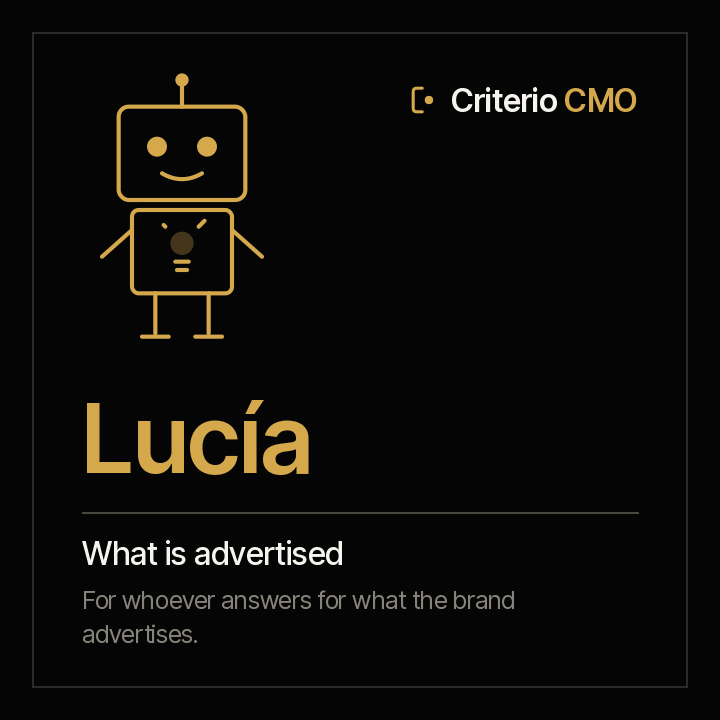

<picture><source media="(prefers-color-scheme: dark)" srcset="../../docs/img/marca/en/criterio-cmo-oscuro.svg"></picture>

# Lucía · what is advertised



**Lucía puts each claim next to its substantiation.**
You are responsible for what the brand advertises. She comes with each approved piece next to its substantiation, approval and identification: the claim with no substantiation, the comparison with no source, the promotion that does not say when or how, the piece paid to an influencer not identified as advertising, the piece published without approval and the contact base used without marketing consent.

<!-- agente:nombre · generado por scripts/familias.py; no se edita a mano -->
**The name.** Lucía, from the Latin *lux*, light: each claim, in the light of its substantiation.
<!-- /agente:nombre -->

[Español](README.es.md) · `criterio-claims` · Apache 2.0 · One instance per entity

**Status: launched and stable, with the CMO family.** The calculation engine, tested against all the family’s synthetic material with a key the agent never sees and control entities. In 0.2.0, the agent ran on every entity in the material, with a key it never sees. In 1.0.0, with round 2, the family is stable: a floor of 95% or more on signals and data. It has not been tested on a specific organisation’s documentation.

**This page stands on its own.** Lucía works without the family’s other agent. The family —how they meet each other and Rostrum— is in the [criterio-cmo family](../../families/criterio-cmo/README.md).

---

## What it is

| | |
|---|---|
| **Who it extends** | Whoever answers for what the brand advertises —marketing legal or the communications director— and whoever approves the pieces |
| **What it works on** | **An entity's pieces, promotions and contact bases, period by period** |
| **What it looks at** | The approved pieces with their text, the piece register, the substantiation for each claim, each promotion's terms, the contact base register and the marketing plan |
| **Cadence** | When a new piece, promotion or base arrives, and once a week |
| **Instances** | One per entity |

## What it does

**What it does that is not done by hand today: putting everything, not a sample, next to its source.**

**What it can answer:** which claim has no substantiation, which comparison does not cite its source, which promotion does not publish its dates or terms, which paid piece is not identified as advertising, which piece went out without approval and which contact base was used without consent.

<!-- cmo:comandos · generado por scripts/familias.py; no se edita a mano -->
### The eight commands

> They are typed with the plugin prefix: `/criterio-claims:` and autocomplete does the rest. It is the only form that resolves in a Claude Code session.

| Command | What it does |
|---|---|
| `/criterio-claims:claims-setup` | The configuration, the inventory and the recognised tables |
| `/criterio-claims:lucia` | Whatever you need, in your own words: Lucía picks the command that does it and runs it |
| `/criterio-claims:claims-scan` | The period's record up to date |
| `/criterio-claims:claim-check` | What was advertised with nothing to back it |
| `/criterio-claims:promo-check` | Which promotion does not say when or how |
| `/criterio-claims:approval-check` | What went out without the yes the policy requires |
| `/criterio-claims:claims-wake` | The pieces up to date without anyone having to remember |
| `/criterio-claims:share-findings` | A summary with no data, only if the answer is yes |
<!-- /cmo:comandos -->

`claims-setup` goes first because the others need it, and `claims-wake` is the one you put on a clock.

<!-- cmo:skills · generado por scripts/familias.py; no se edita a mano -->
### The three skills

They load on their own when the subject comes up. They are the knowledge the commands share, and they are consulted like a manual.

| Skill | What it encapsulates | Whose it is |
|---|---|---|
| `claim-record` | How each claim in a piece with its substantiation and each promotion with its terms go into the record, with their citation | Own |
| `marketing-intake` | The recommended structure of the marketing folder, what goes in each folder and which agent uses it | Own · also in Próspero |
| `marketing-policy` | The advertising policy in the configuration: the tolerances, who approves and what is never decided | Own · also in Próspero |
<!-- /cmo:skills -->

## What it costs today

<!-- cmo:cifras · generado por scripts/familias.py; no se edita a mano -->
| Figure | Source |
|---|---|
| **7.7%** of company revenue is the marketing budget, the same as the year before | [Gartner, 2025 CMO Spend Survey, 2025](https://www.gartner.com/en/newsroom/press-releases/2025-05-12-gartner-2025-cmo-spend-survey-reveals-marketing-budgets-have-flatlined-at-seven-percent-of-overall-company-revenue) — 402 marketing leaders in North America, the UK and Europe |
| **59%** of CMOs say they lack the budget to execute their strategy | [Gartner, 2025 CMO Spend Survey, 2025](https://www.gartner.com/en/newsroom/press-releases/2025-05-12-gartner-2025-cmo-spend-survey-reveals-marketing-budgets-have-flatlined-at-seven-percent-of-overall-company-revenue) — 402 marketing leaders in North America, the UK and Europe |
| **36 cents** of every dollar entering a programmatic buying platform reach the consumer | [Association of National Advertisers (ANA), Programmatic Media Supply Chain Transparency Study, 2023](https://www.ana.net/content/show/id/media-programmatic-transparency) — the log-level data of 21 advertisers |
<!-- /cmo:cifras -->

## What it is for

`/criterio-claims:claim-check` puts each case next to its source. **What is missing is said with its citation.**

### And what it is not for

- **It does not approve a piece, judge the creative or say whether a claim is true.** It says whether it has substantiation; whether that is enough is legal's decision.
- **It does not process a person's data.** From a contact base, only its register entry: how many records, with what consent and since when.
- **It does not connect to a platform.** It processes the documents and exports the organisation gives it.

And one that has to be said out loud: **your documents are processed on the AI platform’s infrastructure**, not only on your computer. An unreleased piece or a piece of substantiation may contain confidential information: confirm it is admissible under your policy before pointing it at that folder. Full disclaimer in [DISCLAIMER.md](../../DISCLAIMER.md), terms in [TERMS.md](../../TERMS.md).

## Installation and setup

```
/plugin marketplace add josenanez/criterio
/plugin install criterio-claims@criterio
/criterio-claims:claims-setup
```

### The first result

`/criterio-claims:claims-setup` does not ask you to tidy anything before starting. It looks at the entity’s marketing folder, compares it with the [recommended structure](../../families/criterio-cmo/README.md#the-recommended-folder-structure), processes the advertising policy and asks the questions no document answers. Within the first fifteen minutes it shows the first result.

### How often it runs

`/criterio-claims:claims-wake` is the command the clock calls: it does what is due, first answers the questions someone left in Rostrum, and **if nothing is due it produces nothing.** Deciding what is due is date arithmetic, and the code does it:

```
python3 scripts/mercadeo.py despertar --config <file>
```

## Teamwork

| With whom | What happens |
|---|---|
| **Próspero** | They share the folder and the advertising policy; each writes only its own record |
| **Rostrum** | Only if the configuration says so (`publish_rostrum`): it publishes its reports, what is due and its signals for whoever does not open a folder, and returns the questions left by whoever views it. **It does not write to the state** |

## Tests

[`scripts/mercadeo.py`](scripts/mercadeo.py), with the standard library, does everything that is calculation: it processes each table with its source row, checks that each claim's substantiation is in the folder, compares each publication date with its approval and matches each base a campaign uses against its consent, the same result every time. It lives in `criterio-claims` and is copied to Próspero; `scripts/sincronizar.py --check` fails if the copy drifts.

```
python3 scripts/mercadeo.py selftest
python3 tests/criterio-cmo/generar.py
python3 tests/criterio-cmo/evaluar.py
```

What is planted in each entity and **what the material does not test**, in [`EVIDENCIA.md`](../../tests/criterio-cmo/EVIDENCIA.md). The design, with the input, process and report of each command, in the [family design](../../families/criterio-cmo/DISENO.md).
