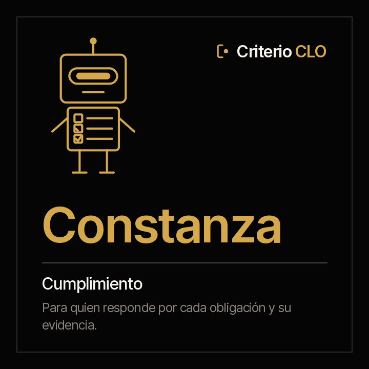

<picture><source media="(prefers-color-scheme: dark)" srcset="../../docs/img/marca/es/criterio-clo-oscuro.svg"></picture>

# Constanza · el cumplimiento



**Constanza pone cada obligación de la organización al lado de su evidencia, todos los días y no
solo el de la auditoría.** Tú respondes por el cumplimiento. Ella llega con lo que está cumplido
con evidencia, lo que se declara cumplido sin ella y lo que venció.

[English](README.md) · `criterio-compliance` · Apache 2.0 · Una instancia por entidad

**Estado: los siete comandos construidos**, los seis skills y el motor de cálculo, probado contra
material sintético de cuatro industrias con una clave que el agente no ve y una entidad de
control por país. **La extracción del agente pasó una [primera ronda pequeña](../../tests/evidencias/familias/clo/RONDAS.md)** —banca y el control de Colombia—; la ronda completa es el paso siguiente, y nada se ha corrido aún sobre los documentos de una organización. Nada se anuncia como terminado hasta que pasen los
[criterios de aceptación](ACCEPTANCE.md).

**Esta página se lee sola.** Constanza funciona sin Fidel: si solo respondes por el
cumplimiento, aquí está todo, incluidas sus pruebas. La familia —cómo se encuentra con Fidel y
con Rostrum— está en la [familia criterio-clo](../../families/criterio-clo/README.es.md).

---

## Qué es

| | |
|---|---|
| **A quién extiende** | Al oficial de cumplimiento y a su equipo |
| **Sobre qué trabaja** | **El cumplimiento de una entidad**, periodo a periodo |
| **Qué mira** | La matriz de obligaciones de la organización, la evidencia de cada periodo, el índice de políticas, el registro normativo y el registro de casos del canal de denuncias |
| **Cadencia** | Cuando una obligación vence en la ventana configurada, cuando llega un documento nuevo, y una vez por semana |
| **Instancias** | Una por entidad |

## Qué hace

**Lo que hace y hoy no se hace: llevar al día la matriz de obligaciones con lo que los contratos
obligan, y cada obligación contra su evidencia en la ventana de su periodicidad**, todos los
periodos y no solo antes de la auditoría.

**Lo que puede responder que hoy cuesta días:** qué obligación venció sin evidencia, cuál figura
cumplida sin nada que la sostenga, cuál no tiene responsable o no cita su fuente, qué política
pasó su fecha de revisión, qué norma nueva lleva días sin evaluar y qué caso del canal pasó su
plazo de respuesta.

<!-- clo:comandos · generado por scripts/familias.py; no se edita a mano -->
### Los siete comandos

> Se escriben con el prefijo del plugin: `/criterio-compliance:` y autocompletar hace el resto. Es la única forma que resuelve en una sesión de Claude Code.

| Comando | Qué hace |
|---|---|
| `/criterio-compliance:compliance-setup` | La configuración, la matriz revisada y el primer estado del cumplimiento |
| `/criterio-compliance:compliance-scan` | La ficha del cumplimiento al día, con lo que cambió y las señales nuevas |
| `/criterio-compliance:compliance-status` | El estado del cumplimiento: declarado contra evidenciado, obligación por obligación |
| `/criterio-compliance:policy-review` | Cada política con su próxima revisión, y las vencidas |
| `/criterio-compliance:regulatory-watch` | Las normas nuevas con su evaluación, y las que aplican sin obligación |
| `/criterio-compliance:reports-cases` | Los casos del canal de denuncias contra su plazo |
| `/criterio-compliance:compliance-wake` | Lo que toca hoy en el cumplimiento; si no toca nada, se calla |
<!-- /clo:comandos -->

`compliance-setup` va primero porque los demás lo necesitan, y `compliance-wake` es el que se le
pone a un reloj. Entre los dos, los cinco que preparan el trabajo: qué cambió, el estado del
periodo, las políticas, las normas nuevas y el canal de denuncias.

<!-- clo:skills · generado por scripts/familias.py; no se edita a mano -->
### Los seis skills

Se cargan solos cuando el tema aparece. Son el conocimiento que los comandos comparten, y se consultan como un manual.

| Skill | Qué encapsula | De quién es |
|---|---|---|
| `compliance-record` | La ficha del periodo: lo que solo dicen los documentos escritos de cumplimiento —el estado que declara el informe, las normas nuevas de un boletín o un correo—, cada dato con su cita | Propio |
| `legal-intake` | Qué documentos procesa la familia, dónde va cada uno, qué tablas procesa el motor directamente y qué extrae el agente a la ficha | Copia de Fidel |
| `obligations-matrix` | El modelo de la matriz de obligaciones —id, fuente, responsable, periodicidad, fecha límite, evidencia esperada y criticidad— y cuándo una obligación está cumplida, vencida o sin evidencia | Propio |
| `policy-control` | El índice de políticas —código, versión, responsable, aprobación y próxima revisión— y cuándo una revisión está vencida | Propio |
| `regulatory-change` | Una norma nueva desde que llega hasta que la organización evalúa su impacto y la lleva a la matriz: el registro normativo, los días sin evaluación y la norma que aplica y ninguna obligación cita | Propio |
| `whistleblowing-channel` | Los plazos del canal de denuncias sin procesar quién denunció ni qué dijo: el registro de casos con su fecha de recepción y de respuesta, y el caso abierto más allá del plazo | Propio |
<!-- /clo:skills -->

## Para qué sirve

`/criterio-compliance:compliance-status` pone cada obligación de la matriz al lado de su evidencia
en la ventana de su periodicidad. Y hace algo más, que es lo que separa una matriz útil de una
lista de casillas: **una obligación que la matriz declara cumplida y ninguna evidencia sostiene no
está cumplida**, y el informe la pone al lado de lo que el informe del periodo declara.

> **Material de prueba · cooperativas, Ecuador** · cumplimiento de septiembre de 2026
> La matriz declara cumplida una obligación, y en `10-evidencias/` no hay nada con su id.
> **La matriz dice que está cumplida; la evidencia no.**

Ese caso sale del material sintético, sembrado con su clave **antes** de correr el motor, y es
la razón por la que Constanza existe: no declarar por ti, sino que lo que se declara cumplido
tenga detrás lo que lo sostiene, todos los días.

### Y para qué no sirve

- **No agrega, quita ni reescribe obligaciones de la matriz.** Las define la organización, con su
  fuente y su responsable.
- **No dice si una norma aplica, qué exige ni desde cuándo**, y no cita de memoria una norma ni
  un plazo. Lo que es criterio jurídico queda como pregunta para la persona.
- **No presenta reportes a supervisores ni firma.**
- **No procesa el contenido de una denuncia ni quién denunció**: solo los plazos del registro de
  casos.
- **No declara el estado de cumplimiento.** Lo declara el oficial de cumplimiento. Constanza
  muestra contra qué.
- **No mueve, renombra ni crea nada dentro de los documentos de la organización.** Lo único que
  deja, si la persona lo autoriza, es el archivo que marca la carpeta raíz para que se reconozca
  a primera vista.
- **No adivina.** Cada dato lleva la cita del documento y, en las tablas, la fila de donde salió.
  *«No encontrado»* es una respuesta válida.

**Y hay una cosa que deliberadamente no trae: los contratos.** El registro, los vencimientos, las
firmas y los pagos son de Fidel; Constanza toma de sus fichas solo las obligaciones de
cumplimiento que traen. Un modelo de matriz recomendado por industria es una decisión abierta de
la familia.

Y una que hay que decir en voz alta: **tus documentos se procesan en la infraestructura de la
plataforma de IA**, no solo en tu equipo. Confirma que sea admisible bajo tus políticas antes de
apuntarla a material confidencial. Descargo completo en [DISCLAIMER.es.md](../../DISCLAIMER.es.md),
términos en [TERMS.es.md](../../TERMS.es.md).

## Instalación y configuración

```
/plugin marketplace add josenanez/criterio
/plugin install criterio-compliance@criterio
/criterio-compliance:compliance-setup
```

**En Claude Cowork** — Personalizar → Explorar plugins → Personal → **+** → Agregar
marketplace desde GitHub → `josenanez/criterio`.

Si llevas los contratos y no el cumplimiento, lo tuyo es [Fidel](../criterio-legal/README.es.md).

### El primer resultado

`/criterio-compliance:compliance-setup` no te pide que ordenes nada antes de empezar. Mira la
carpeta de la entidad, la compara con la
[estructura recomendada](../../families/criterio-clo/README.es.md#la-estructura-de-carpetas-recomendada),
revisa la matriz de obligaciones —qué le falta a cada una: responsable, fuente— y hace las
preguntas que ningún documento responde —el periodo, el plazo del canal, los días para evaluar una
norma—. En los primeros quince minutos deja ver el estado del periodo: cada obligación de la
matriz con su evidencia o sin ella, lo declarado al lado de lo evidenciado y el avance ponderado
por criticidad.

Desde ahí, cada comando entrega su reporte en el mismo orden: lo que hay que atender, el
resultado, lo que no se pudo procesar, las preguntas que hizo y las fuentes.

**Lo que queda configurado** lo escribe `/criterio-compliance:compliance-setup` a partir de lo que
respondiste, en `.criterio/cumplimiento/<entidad>/config.json`: la entidad, la matriz, el periodo,
el plazo del canal, los días para evaluar una norma, dónde están las fichas de Fidel si la
organización lo usa, y el registro de que aceptaste los términos con tu nombre y la fecha. Todo
eso se cambia **hablando**.

### Cada cuánto corre

Un comando espera. **Este se programa y corre solo.** Su cadencia es la periodicidad de cada
obligación: corre cuando una vence en la ventana configurada, cuando llega un documento nuevo y
una vez por semana. La decisión es aritmética de fechas, así que la toma el código:

```
python3 scripts/legal.py despertar --config <archivo>
```

Y `/criterio-compliance:compliance-wake` es el comando que el reloj invoca: hace lo que toca,
responde primero las preguntas que alguien dejó en Rostrum, y **si no toca nada no produce
nada.** Ponerlo en un reloj es del lado de tu organización: una tarea programada en Cowork, o el
programador del sistema en Claude Code. Si no quieren corridas desatendidas, la cadencia sigue
diciendo qué toca, corrida a mano.

**Y si quieres que la junta o el comité vean el estado del cumplimiento sin pedírtelo**, la
familia tiene un portal que lo publica, y quien mira puede dejarle una pregunta escrita a
Constanza. → **[Rostrum](../criterio-server/README.es.md)**

## Trabajo en equipo

Constanza funciona sola. Si están los otros, **no hay nada que conectar**: se encuentran por el
estado de la entidad y por las fichas, que son documentos.

| Con quién | Qué pasa |
|---|---|
| **Fidel** | Comparten el estado de la entidad. Constanza toma de la ficha de cada contrato las obligaciones de cumplimiento que trae y señala las que la matriz no tiene. Cada uno escribe solo sus fichas |
| **Rostrum** | Publica sus reportes, lo que vence en el cumplimiento y sus señales, para quien no abre una carpeta, y le devuelve las preguntas que deja quien lo mira. **No escribe en el estado** |

## Pruebas

### Cómo está construido

La espina es la **ficha del periodo**, una por entidad y periodo de cumplimiento: lo que declara
el informe del periodo, las normas nuevas que trae un boletín o un correo y las preguntas que se
le hicieron a la persona, cada dato con la cita del documento y su fecha. La escribe el agente;
los resultados, el motor.

[`scripts/legal.py`](scripts/legal.py), con la librería estándar, hace todo lo que es cálculo:
cada obligación contra su evidencia en la ventana de su periodicidad, el avance ponderado por
criticidad, las revisiones vencidas, los días sin evaluación y los plazos del canal, el mismo
resultado cada vez. Procesa las tablas directamente —la matriz, el índice de políticas, el
registro normativo y el de casos— y el agente lleva a la ficha solo lo que trae un documento
escrito.

**`legal.py` y el skill `legal-intake` son copias literales de los de Fidel, no
importaciones**, y eso es deliberado: un plugin instalado tiene que correr solo.
[`scripts/texto.py`](scripts/texto.py) es copia literal del de la familia PMO.
`scripts/sincronizar.py --check` falla si alguna copia se separa.

Cada marco que se usa está en
[`families/criterio-clo/FUENTES.es.md`](../../families/criterio-clo/FUENTES.es.md), con su
versión, su enlace y su estado.

### Cómo se verifica

```
python3 scripts/legal.py selftest                         el motor
python3 tests/criterio-clo/generar.py                      el material de las cuatro industrias
python3 tests/criterio-clo/evaluar.py --agente constanza   cada señal contra la clave
```

Con la librería estándar, sin instalar nada. Sobre material sintético con una clave que el motor
no ve — **incluidos los controles**: una entidad por país sin ningún defecto, con los casos que
se parecen a uno, como un caso del canal abierto dentro de su plazo o un informe que declara
cumplido un periodo que lo está. Cualquier señal ahí es una falla.

**Cómo salió la última corrida, generado desde la corrida misma:**
[`tests/criterio-compliance/RESULTADOS.md`](../../tests/criterio-compliance/RESULTADOS.md). Qué
se siembra en cada entidad y, con el mismo detalle, **qué no prueba el material**, en
[`EVIDENCIA.md`](../../tests/criterio-clo/EVIDENCIA.md).

El diseño, con la entrada, el proceso y el reporte de cada comando y las señales del motor, en
el [diseño de la familia](../../families/criterio-clo/DISENO.es.md); los criterios de aceptación,
en [ACCEPTANCE.md](ACCEPTANCE.md).

Y las pruebas del conjunto de la familia —lo que ningún agente puede responder solo— en la
[página de la familia](../../families/criterio-clo/README.es.md#las-pruebas-de-la-familia).
