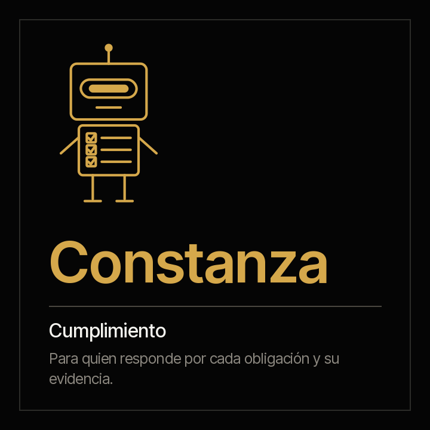

# Constanza · el cumplimiento



**Constanza pone cada obligación de la organización al lado de su evidencia, todos los días y no solo el de la auditoría.** La matriz de obligaciones periodo a periodo, las obligaciones de cumplimiento que vienen de los contratos, las políticas por revisar, las normas nuevas sin evaluar y los plazos del canal de denuncias. Dice qué está cumplido con evidencia, qué se declara cumplido sin ella y qué venció.

[English](README.md) · `criterio-compliance` · Apache 2.0 · Una instancia por entidad

**Estado: construida y en prueba.** Los siete comandos, los seis skills y el motor de cálculo están construidos; el motor pasa su prueba determinista contra material sintético de cuatro industrias, con una clave que el agente no ve y dos entidades de control. La prueba con el agente de extremo a extremo es el paso siguiente. La familia, con Fidel, en [`families/criterio-clo/DISENO.es.md`](../../families/criterio-clo/DISENO.es.md).

---

## Cómo trabaja

| | |
|---|---|
| **El modelo de lenguaje (LLM) extrae** | Lo que solo trae un documento escrito: el estado que declara el informe del periodo, la norma nueva que anuncia un boletín |
| **El código calcula** | Cada obligación contra su evidencia en la ventana de su periodicidad, el avance ponderado por criticidad, las revisiones vencidas, los días sin evaluación y los plazos del canal: `scripts/legal.py`, librería estándar, el mismo resultado cada vez |
| **La organización define** | Las obligaciones, su fuente, su responsable y su fecha. Constanza no trae obligaciones ni dice qué exige una norma |

El modelo de la matriz sigue ISO 37301: cada obligación con su fuente, su responsable y su evidencia. Primera versión: Colombia y Ecuador.

## Los comandos

<!-- clo:comandos · generado por scripts/familias.py; no se edita a mano -->
| # | Comando | Qué entrega |
|---|---|---|
| 0 | `/criterio-compliance:compliance-setup` | La configuración, la matriz revisada y el primer estado del cumplimiento |
| 1 | `/criterio-compliance:compliance-scan` | La ficha del cumplimiento al día, con lo que cambió y las señales nuevas |
| 2 | `/criterio-compliance:compliance-status` | El estado del cumplimiento: declarado contra evidenciado, obligación por obligación |
| 3 | `/criterio-compliance:policy-review` | Cada política con su próxima revisión, y las vencidas |
| 4 | `/criterio-compliance:regulatory-watch` | Las normas nuevas con su evaluación, y las que aplican sin obligación |
| 5 | `/criterio-compliance:reports-cases` | Los casos del canal de denuncias contra su plazo |
| 6 | `/criterio-compliance:compliance-wake` | Lo que toca hoy en el cumplimiento; si no toca nada, se calla |
<!-- /clo:comandos -->

## Los skills

<!-- clo:skills · generado por scripts/familias.py; no se edita a mano -->
`compliance-record` · `legal-intake` · `obligations-matrix` · `policy-control` · `regulatory-change` · `whistleblowing-channel`
<!-- /clo:skills -->

## El primer resultado

En los primeros quince minutos, `compliance-setup` deja ver el estado del periodo: cada obligación de la matriz con su evidencia o sin ella, lo declarado al lado de lo evidenciado y el avance ponderado por criticidad. Desde ahí, cada comando entrega su reporte en el mismo orden: lo que hay que atender, el resultado, lo que no se pudo procesar, las preguntas que hizo y las fuentes.

## Lo que nunca hace

- No agrega, quita ni reescribe obligaciones de la matriz: las define la organización.
- No dice si una norma aplica, qué exige ni desde cuándo, y no cita de memoria una norma ni un plazo.
- No presenta reportes a supervisores ni firma.
- No lee el contenido de una denuncia ni procesa quién denunció: solo los plazos del registro de casos.
- No declara el estado de cumplimiento: lo declara el oficial de cumplimiento.
- No mueve, renombra ni crea nada dentro de los documentos de la organización.

## Instalación y configuración

```
/plugin marketplace add josenanez/criterio
/plugin install criterio-compliance@criterio
/criterio-compliance:compliance-setup
```

**En Claude Cowork** — Personalizar → Explorar plugins → Personal → **+** → Agregar marketplace desde GitHub → `josenanez/criterio`.

`compliance-setup` mira la carpeta, revisa la matriz de obligaciones, hace las preguntas que ningún documento responde —el periodo, el plazo del canal, los días para evaluar una norma— y muestra el primer estado. Si la organización usa a Fidel, Constanza toma de sus fichas las obligaciones de cumplimiento de los contratos. La estructura de carpetas recomendada está en el skill `legal-intake`.

## Las fuentes

Cada marco que se usa está en [`families/criterio-clo/FUENTES.es.md`](../../families/criterio-clo/FUENTES.es.md), con su versión, su enlace y su estado.

## Cómo se verifica

```
python3 scripts/legal.py selftest
python3 tests/criterio-clo/generar.py
python3 tests/criterio-clo/evaluar.py --agente constanza
```

Con la librería estándar, sin instalar nada. **Cómo salió la última corrida**, generado desde la corrida misma: [`tests/criterio-compliance/RESULTADOS.md`](../../tests/criterio-compliance/RESULTADOS.md). Criterios de aceptación en [ACCEPTANCE.md](ACCEPTANCE.md).
