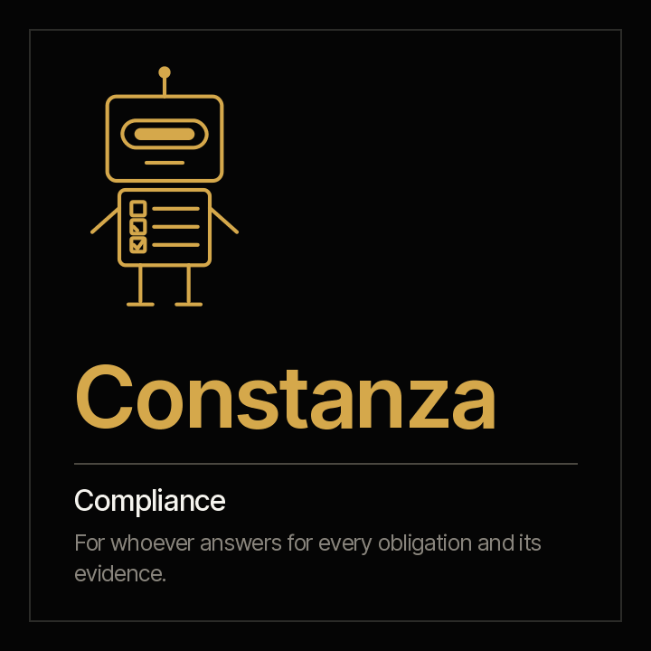

<picture><source media="(prefers-color-scheme: dark)" srcset="../../docs/img/marca/en/criterio-clo-oscuro.svg"></picture>

# Constanza · compliance



**Constanza puts every obligation of the organisation next to its evidence, every day and not
only on audit day.** You answer for compliance. She arrives with what is met with evidence, what
is declared met without it and what is overdue.

[Español](README.es.md) · `criterio-compliance` · Apache 2.0 · One instance per entity

**Status: the seven commands are built**, along with the six skills and the calculation engine,
tested against synthetic material from four industries with a key the agent never sees and one
control entity per country. **The agent's extraction passed the [full round](../../tests/evidencias/familias/clo/RONDAS.md)** on the six entities; nothing has been run yet on an organisation's documents. Nothing is announced as finished until the
[acceptance criteria](ACCEPTANCE.md) pass.

**This page stands on its own.** Constanza works without Fidel: if you only answer for
compliance, everything is here, including her tests. The family —how she meets Fidel and
Rostrum— is in the [criterio-clo family](../../families/criterio-clo/README.md).

---

## What it is

| | |
|---|---|
| **Whom it extends** | The compliance officer and their team |
| **What it works on** | **The compliance of one entity**, period after period |
| **What it looks at** | The organisation's obligations matrix, each period's evidence, the policy index, the regulatory register and the whistleblowing channel's case register |
| **Cadence** | When an obligation falls due within the configured window, when a new document arrives, and once a week |
| **Instances** | One per entity |

## What it does

**What it does that is not done today: keep the obligations matrix up to date with what the
contracts oblige, and each obligation against its evidence within its frequency window**, every
period and not only before the audit.

**What it can answer that today takes days:** which obligation fell due with no evidence, which
one is marked met with nothing behind it, which has no owner or does not cite its source, which
policy passed its review date, which new regulation has gone days without assessment and which
channel case passed its response deadline.

<!-- clo:comandos · generado por scripts/familias.py; no se edita a mano -->
### The seven commands

> They are typed with the plugin prefix: `/criterio-compliance:` and autocomplete does the rest. It is the only form that resolves in a Claude Code session.

| Command | What it does |
|---|---|
| `/criterio-compliance:compliance-setup` | The configuration, the reviewed matrix and the first compliance status |
| `/criterio-compliance:compliance-scan` | The compliance record up to date, with what changed and the new signals |
| `/criterio-compliance:compliance-status` | Compliance status: declared against evidenced, obligation by obligation |
| `/criterio-compliance:policy-review` | Every policy with its next review, and the overdue ones |
| `/criterio-compliance:regulatory-watch` | New rules with their assessment, and the applicable ones without an obligation |
| `/criterio-compliance:reports-cases` | Whistleblowing cases against their deadline |
| `/criterio-compliance:compliance-wake` | What compliance needs today; silent when nothing does |
<!-- /clo:comandos -->

`compliance-setup` goes first because the others need it, and `compliance-wake` is the one you put
on a clock. Between them, the five that prepare the work: what changed, the period's status, the
policies, the new regulations and the whistleblowing channel.

<!-- clo:skills · generado por scripts/familias.py; no se edita a mano -->
### The six skills

They load on their own when the subject comes up. They are the knowledge the commands share, and they are consulted like a manual.

| Skill | What it encapsulates | Whose it is |
|---|---|---|
| `compliance-record` | The period record: what only the written compliance documents say —the status the report declares, new regulations from a bulletin or an email—, each item with its citation | Own |
| `legal-intake` | Which documents the family processes, where each one goes, which tables the engine processes directly and what the agent extracts to the record | Copy of Fidel's |
| `obligations-matrix` | The obligations matrix model —id, source, owner, frequency, deadline, expected evidence and criticality— and when an obligation is met, overdue or without evidence | Own |
| `policy-control` | The policy index —code, version, owner, approval and next review— and when a review is overdue | Own |
| `regulatory-change` | A new regulation from arrival until the organisation assesses its impact and takes it to the matrix: the regulatory register, the days without assessment and the regulation that applies and no obligation cites | Own |
| `whistleblowing-channel` | The whistleblowing channel's deadlines without processing who reported or what they said: the case register with its receipt and response dates, and the case open beyond the deadline | Own |
<!-- /clo:skills -->

## What it is for

`/criterio-compliance:compliance-status` puts each obligation of the matrix next to its evidence
within its frequency window. And it does something more, which is what separates a useful matrix
from a list of boxes: **an obligation the matrix declares met and no evidence supports is not
met**, and the report puts it next to what the period's report declares.

> **Test material · credit unions, Ecuador** · September 2026 compliance
> The matrix declares an obligation met, and there is nothing with its id in `10-evidencias/`.
> **The matrix says it is met; the evidence does not.**

That case comes from the synthetic material, planted with its key **before** the engine runs, and
it is the reason Constanza exists: not to declare for you, but so that what is declared met has
behind it what supports it, every day.

### And what it is not for

- **It does not add, remove or rewrite obligations in the matrix.** The organisation defines them,
  with their source and owner.
- **It does not say whether a regulation applies, what it requires or since when**, and states no
  regulation or deadline from memory. Legal judgement is left as a question for the person.
- **It does not file supervisory reports or sign.**
- **It does not process the content of a report or who reported**: only the case register's
  deadlines.
- **It does not declare the compliance status.** The compliance officer does. Constanza shows
  what against.
- **It never moves, renames or creates anything inside the organisation's documents.** The only
  thing it leaves, if the person allows it, is the file that marks the root folder so it is
  recognised at a glance.
- **It does not guess.** Every data point carries the citation of the document and, for tables,
  the row it came from. *"Not found"* is a valid answer.

**And one thing is deliberately absent: the contracts.** The register, the expiries, the
signatures and the payments are Fidel's; Constanza takes from his records only the compliance
obligations they carry. A recommended matrix model per industry is an open decision of the
family.

And one that has to be said out loud: **your documents are processed on the AI platform's
infrastructure**, not only on your machine. Confirm that this is admissible under your policies
before pointing it at confidential material. Full disclaimer in [DISCLAIMER.md](../../DISCLAIMER.md),
terms in [TERMS.md](../../TERMS.md).

## Installing and configuring

```
/plugin marketplace add josenanez/criterio
/plugin install criterio-compliance@criterio
/criterio-compliance:compliance-setup
```

**In Claude Cowork** — Customise → Explore plugins → Personal → **+** → Add marketplace from
GitHub → `josenanez/criterio`.

If you handle the contracts and not compliance, yours is [Fidel](../criterio-legal/README.md).

### The first result

`/criterio-compliance:compliance-setup` does not ask you to tidy anything up before starting. It
looks at the entity's folder, compares it with the
[recommended structure](../../families/criterio-clo/README.md#the-recommended-folder-structure),
reviews the obligations matrix —what each one is missing: owner, source— and asks the questions
no document answers —the period, the channel's deadline, the days to assess a regulation—. In the
first fifteen minutes it shows the period's status: every obligation in the matrix with or
without its evidence, declared next to evidenced and progress weighted by criticality.

From there, every command delivers its report in the same order: what needs attention, the
result, what could not be processed, the questions it asked and the sources.

**What ends up configured** is written by `/criterio-compliance:compliance-setup` from your
answers, in `.criterio/cumplimiento/<entidad>/config.json`: the entity, the matrix, the period,
the channel's deadline, the days to assess a regulation, where Fidel's records are if the
organisation uses him, and the record that you accepted the terms, with your name and the date.
All of that is changed **by talking**.

### How often it runs

A command waits. **This one is scheduled and runs on its own.** Its cadence is each obligation's
frequency: it runs when one falls due within the configured window, when a new document arrives
and once a week. The decision is date arithmetic, so the code takes it:

```
python3 scripts/legal.py despertar --config <file>
```

And `/criterio-compliance:compliance-wake` is the command the clock invokes: it does what is due,
answers first the questions somebody left in Rostrum, and **if nothing is due it produces
nothing.** Putting it on a clock is on your organisation's side: a scheduled task in Cowork, or
the system's scheduler in Claude Code. If unattended runs are not welcome, the cadence still says
what is due, run by hand.

**And if you want the board or the committee to see the compliance status without asking you
for it**, the family has a portal that publishes it, where whoever is looking can leave Constanza
a written question. → **[Rostrum](../criterio-server/README.md)**

## Working with the others

Constanza works alone. If the others are installed, **there is nothing to connect**: they meet
through the entity's state and the records, which are documents.

| With whom | What happens |
|---|---|
| **Fidel** | They share the entity's state. Constanza takes from each contract's record the compliance obligations it carries and flags those the matrix does not have. Each one writes only its own records |
| **Rostrum** | Publishes her reports, what falls due in compliance and her signals, for whoever will not open a folder, and hands her the questions left by whoever is looking. **It does not write the state** |

## Tests

### How it is built

The spine is the **period record**, one per entity and compliance period: what the period's
report declares, the new regulations a bulletin or an email brings and the questions the person
was asked, each data point with the citation of its document and date. The agent writes it; the
engine writes the results.

[`scripts/legal.py`](scripts/legal.py), on the standard library, does everything that is
calculation: each obligation against its evidence within its frequency window, progress weighted
by criticality, overdue reviews, days without assessment and the channel's deadlines, the same
result every time. It processes the tables directly —the matrix, the policy index, the regulatory
register and the case register— and the agent takes to the record only what a written document
carries.

**`legal.py` and the `legal-intake` skill are literal copies of Fidel's, not imports**, and that
is deliberate: an installed plugin has to run on its own. [`scripts/texto.py`](scripts/texto.py)
is a literal copy of the PMO family's. `scripts/sincronizar.py --check` fails if any copy drifts.

Every framework used is in
[`families/criterio-clo/FUENTES.es.md`](../../families/criterio-clo/FUENTES.es.md) (Spanish),
with its version, its link and its status.

### How it is verified

```
python3 scripts/legal.py selftest                         the engine
python3 tests/criterio-clo/generar.py                      the material of the four industries
python3 tests/criterio-clo/evaluar.py --agente constanza   every signal against the key
```

On the standard library, with nothing installed. Over synthetic material with a key the engine
never sees — **including the controls**: one entity per country with no defects at all, with the
cases that look like one, such as a channel case open within its deadline or a report that
declares met a period that is. Any signal there is a failure.

**How the last run came out, generated from the run itself:**
[`tests/criterio-compliance/RESULTADOS.md`](../../tests/criterio-compliance/RESULTADOS.md)
(Spanish). What is planted in each entity and, in the same detail, **what the material does not
test**, in [`EVIDENCIA.md`](../../tests/criterio-clo/EVIDENCIA.md) (Spanish).

The design, with the input, process and report of each command and the engine's signals, in the
[family design](../../families/criterio-clo/DISENO.md); the acceptance criteria, in
[ACCEPTANCE.md](ACCEPTANCE.md).

And the family's tests — what no agent can answer alone — on the
[family page](../../families/criterio-clo/README.md#the-familys-tests).
