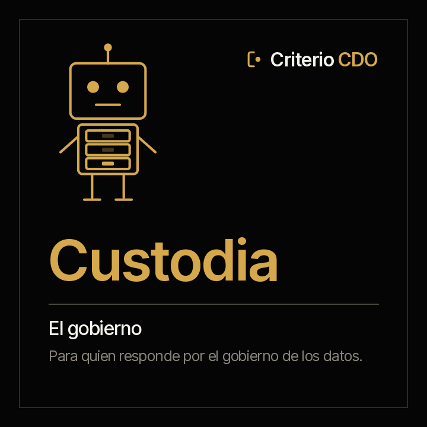

<picture><source media="(prefers-color-scheme: dark)" srcset="../../docs/img/marca/es/criterio-cdo-oscuro.svg"></picture>

# Custodia · el gobierno de los datos



**Custodia pone cada dato al lado de quien responde por él.**
Tú respondes por el gobierno de los datos. Ella llega con el catálogo al lado de sus dueños, su clasificación y sus políticas: el conjunto que no tiene dueño, el que nadie clasificó, la política con la revisión vencida, el dato que se conserva más de lo que dice la política, el término del informe que el glosario no define y la base con datos personales que no está en el registro de la organización.

<!-- agente:nombre · generado por scripts/familias.py; no se edita a mano -->
**El nombre.** Custodia, del latín *custodia*, la guarda: cada dato con quien responde por él.
<!-- /agente:nombre -->

[English](README.md) · `criterio-data-governance` · Apache 2.0 · Una instancia por entidad

**Estado: lanzada y estable, con la familia CDO.** El motor de cálculo, probado contra todo el material sintético de la familia con una clave que la agente no ve y entidades de control. En la 0.2.0, la agente corrió sobre todas las entidades del material, con una clave que no ve. En la 1.0.0, con la ronda 2, la familia es estable: un piso del 95 % o más en las señales y en los datos. No se ha probado sobre la documentación de una organización concreta.

**Esta página se lee sola.** Custodia funciona sin la otra agente de la familia. La familia —cómo se encuentran entre sí y con Rostrum— está en la [familia criterio-cdo](../../families/criterio-cdo/README.es.md).

---

## Qué es

| | |
|---|---|
| **A quién extiende** | A quien responde por el gobierno de los datos —el CDO o el líder de gobierno de datos— y a quien lleva el catálogo y las políticas |
| **Sobre qué trabaja** | **El catálogo y las políticas de datos de una entidad, periodo a periodo** |
| **Qué mira** | La exportación del catálogo, el registro de bases de datos personales, las políticas de datos y de conservación, el glosario de negocio y los informes de dirección |
| **Cadencia** | Cuando cambia el catálogo o llega una política o un informe, y una vez por semana |
| **Instancias** | Una por entidad |

## Qué hace

**Lo que hace y hoy no se hace a mano: poner todo, no una muestra, al lado de su fuente.**

**Lo que puede responder:** qué conjunto no tiene dueño o no está clasificado, qué política pasó su fecha de revisión, qué dato se conserva más allá del plazo de su tipo, qué término de los informes no define el glosario y qué base con datos personales no está en el registro.

<!-- cdo:comandos · generado por scripts/familias.py; no se edita a mano -->
### Los ocho comandos

> Se escriben con el prefijo del plugin: `/criterio-data-governance:` y autocompletar hace el resto. Es la única forma que resuelve en una sesión de Claude Code.

| Comando | Qué hace |
|---|---|
| `/criterio-data-governance:governance-setup` | La configuración, el inventario y las tablas reconocidas |
| `/criterio-data-governance:custodia` | Lo que necesites, en tus palabras: Custodia elige el comando que lo resuelve y lo corre |
| `/criterio-data-governance:governance-scan` | La ficha del periodo al día |
| `/criterio-data-governance:catalog-check` | Qué conjunto no tiene quién responda por él |
| `/criterio-data-governance:retention-check` | Qué política se venció y qué dato pasó su plazo |
| `/criterio-data-governance:glossary-check` | Qué término no está definido y qué base falta en el registro |
| `/criterio-data-governance:governance-wake` | El gobierno al día sin que nadie se acuerde |
| `/criterio-data-governance:share-findings` | Un resumen sin datos, solo si se dice que sí |
<!-- /cdo:comandos -->

`governance-setup` va primero porque los demás lo necesitan, y `governance-wake` es el que se le pone a un reloj.

<!-- cdo:skills · generado por scripts/familias.py; no se edita a mano -->
### Los tres skills

Se cargan solos cuando el tema aparece. Son el conocimiento que los comandos comparten, y se consultan como un manual.

| Skill | Qué encapsula | De quién es |
|---|---|---|
| `data-intake` | La estructura recomendada de la carpeta de datos, qué va en cada carpeta y qué agente la usa | Propio · también en Ariadna |
| `data-policy` | La política de datos en la configuración: la tolerancia entre una cifra y su fuente, y lo que nunca se procesa | Propio · también en Ariadna |
| `governance-record` | Cómo se lleva a la ficha cada política con su fecha de revisión, cada plazo de conservación y cada término de los informes, con la cita | Propio |
<!-- /cdo:skills -->

## Lo que cuesta hoy

<!-- cdo:cifras · generado por scripts/familias.py; no se edita a mano -->
| Cifra | Fuente |
|---|---|
| **2 de 31** bancos sistémicos globales cumplían todos los principios de agregación de datos de riesgo en la evaluación del Comité de Basilea | [Comité de Supervisión Bancaria de Basilea, Progress in adopting the Principles for effective risk data aggregation and risk reporting, 2023](https://www.bis.org/bcbs/publ/d559.htm) — 31 bancos sistémicos globales designados entre 2011 y 2021 |
| **3 %** de las evaluaciones de calidad de datos alcanzaron el nivel aceptable, 97 de cada 100 registros sin errores | [Nagle, Redman y Sammon, Assessing data quality: A managerial call to action, Business Horizons, vol. 63, n.º 3, 2020](https://research.ucc.ie/en/publications/assessing-data-quality-a-managerial-call-to-action/) — 75 evaluaciones de calidad de datos recogidas durante dos años |
| **47 %** de los registros recién creados tiene al menos un error crítico | [Nagle, Redman y Sammon, Assessing data quality: A managerial call to action, Business Horizons, vol. 63, n.º 3, 2020](https://research.ucc.ie/en/publications/assessing-data-quality-a-managerial-call-to-action/) — 75 evaluaciones de calidad de datos recogidas durante dos años |
<!-- /cdo:cifras -->

## Para qué sirve

`/criterio-data-governance:catalog-check` pone cada caso al lado de su fuente. **Lo que falta se dice con su cita.**

### Y para qué no sirve

- **No asigna un dueño, no decide una clasificación y no borra nada.** Dice qué falta y dónde; la decisión es del área de datos y del dueño de cada dato.
- **No se conecta a una base ni a un sistema.** Procesa las exportaciones que la organización le entrega.
- **No procesa un dato personal.** De una base con datos personales, solo sus metadatos.

Y una que hay que decir en voz alta: **tus documentos se procesan en la infraestructura de la plataforma de IA**, no solo en tu equipo. Un catálogo o una política pueden traer información confidencial: confirma que sea admisible bajo tu política antes de apuntarla a esa carpeta. Descargo completo en [DISCLAIMER.es.md](../../DISCLAIMER.es.md), términos en [TERMS.es.md](../../TERMS.es.md).

## Instalación y configuración

```
/plugin marketplace add josenanez/criterio
/plugin install criterio-data-governance@criterio
/criterio-data-governance:governance-setup
```

### El primer resultado

`/criterio-data-governance:governance-setup` no te pide que ordenes nada antes de empezar. Mira la carpeta de datos de la entidad, la compara con la [estructura recomendada](../../families/criterio-cdo/README.es.md#la-estructura-de-carpetas-recomendada), procesa la política de datos y hace las preguntas que ningún documento responde. En los primeros quince minutos deja ver el primer resultado.

### Cada cuánto corre

`/criterio-data-governance:governance-wake` es el comando que el reloj invoca: hace lo que toca, responde primero las preguntas que alguien dejó en Rostrum, y **si no toca nada no produce nada.** La decisión de qué toca es aritmética de fechas, y la toma el código:

```
python3 scripts/datos.py despertar --config <archivo>
```

## Trabajo en equipo

| Con quién | Qué pasa |
|---|---|
| **Ariadna** | Comparten la carpeta y la política de datos; cada una escribe solo su ficha |
| **Rostrum** | Solo si la configuración lo dice (`publish_rostrum`): publica sus reportes, lo que vence y sus señales para quien no abre una carpeta, y le devuelve las preguntas que deja quien lo mira. **No escribe en el estado** |

## Pruebas

[`scripts/datos.py`](scripts/datos.py), con la librería estándar, hace todo lo que es cálculo: procesa cada tabla con su fila de origen, cuenta los días contra los plazos de la política y cruza el catálogo con el registro y el glosario, el mismo resultado cada vez. Vive en `criterio-data-governance` y se copia a Ariadna; `scripts/sincronizar.py --check` falla si la copia se separa.

```
python3 scripts/datos.py selftest
python3 tests/criterio-cdo/generar.py
python3 tests/criterio-cdo/evaluar.py
```

Qué se siembra en cada entidad y **qué no prueba el material**, en [`EVIDENCIA.md`](../../tests/criterio-cdo/EVIDENCIA.md). El diseño, con la entrada, el proceso y el reporte de cada comando, en el [diseño de la familia](../../families/criterio-cdo/DISENO.es.md).
