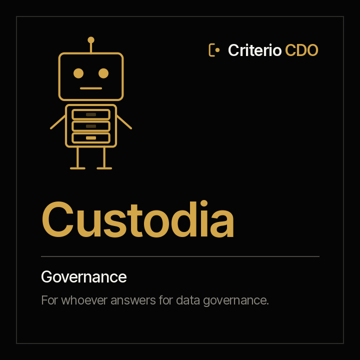

<picture><source media="(prefers-color-scheme: dark)" srcset="../../docs/img/marca/en/criterio-cdo-oscuro.svg"></picture>

# Custodia · data governance



**Custodia puts each piece of data next to whoever answers for it.**
You are responsible for data governance. She comes with the catalog next to its owners, classification and policies: the dataset with no owner, the one nobody classified, the policy past its review, the data kept longer than the policy says, the report term the glossary does not define and the database with personal data missing from the organisation's register.

<!-- agente:nombre · generado por scripts/familias.py; no se edita a mano -->
**The name.** Custodia, from the Latin *custodia*, safekeeping: each piece of data with whoever answers for it.
<!-- /agente:nombre -->

[Español](README.es.md) · `criterio-data-governance` · Apache 2.0 · One instance per entity

**Status: built and tested, in the lab, with the CDO family.** The calculation engine, tested against all the family’s synthetic material with a key the agent never sees and control entities. In 0.2.0, the agent ran on every entity in the material, with a key it never sees; it has not been tested on a specific organisation’s documentation.

**This page stands on its own.** Custodia works without the family’s other agent. The family —how they meet each other and Rostrum— is in the [criterio-cdo family](../../families/criterio-cdo/README.md).

---

## What it is

| | |
|---|---|
| **Who it extends** | Whoever answers for data governance —the CDO or the data governance lead— and whoever keeps the catalog and the policies |
| **What it works on** | **An entity's data catalog and policies, period by period** |
| **What it looks at** | The catalog export, the register of personal databases, the data and retention policies, the business glossary and the management reports |
| **Cadence** | When the catalog changes or a policy or report arrives, and once a week |
| **Instances** | One per entity |

## What it does

**What it does that is not done by hand today: putting everything, not a sample, next to its source.**

**What it can answer:** which dataset has no owner or is unclassified, which policy is past its review date, which data is kept beyond its type's period, which report term the glossary does not define and which database with personal data is missing from the register.

<!-- cdo:comandos · generado por scripts/familias.py; no se edita a mano -->
### The eight commands

> They are typed with the plugin prefix: `/criterio-data-governance:` and autocomplete does the rest. It is the only form that resolves in a Claude Code session.

| Command | What it does |
|---|---|
| `/criterio-data-governance:governance-setup` | The configuration, the inventory and the recognised tables |
| `/criterio-data-governance:custodia` | Whatever you need, in your own words: Custodia picks the command that does it and runs it |
| `/criterio-data-governance:governance-scan` | The period's record up to date |
| `/criterio-data-governance:catalog-check` | Which dataset has nobody answering for it |
| `/criterio-data-governance:retention-check` | Which policy is overdue and which data is past its period |
| `/criterio-data-governance:glossary-check` | Which term is undefined and which database is missing from the register |
| `/criterio-data-governance:governance-wake` | Governance up to date without anyone having to remember |
| `/criterio-data-governance:share-findings` | A summary with no data, only if the answer is yes |
<!-- /cdo:comandos -->

`governance-setup` goes first because the others need it, and `governance-wake` is the one you put on a clock.

<!-- cdo:skills · generado por scripts/familias.py; no se edita a mano -->
### The three skills

They load on their own when the subject comes up. They are the knowledge the commands share, and they are consulted like a manual.

| Skill | What it encapsulates | Whose it is |
|---|---|---|
| `data-intake` | The recommended structure of the data folder, what goes in each folder and which agent uses it | Own · also in Ariadna |
| `data-policy` | The data policy in the configuration: the tolerance between a figure and its source, and what is never processed | Own · also in Ariadna |
| `governance-record` | How each policy with its review date, each retention period and each term in the reports goes into the record, with its citation | Own |
<!-- /cdo:skills -->

## What it costs today

<!-- cdo:cifras · generado por scripts/familias.py; no se edita a mano -->
| Figure | Source |
|---|---|
| **2 of 31** global systemically important banks complied with all the risk data aggregation principles in the Basel Committee's assessment | [Comité de Supervisión Bancaria de Basilea, Progress in adopting the Principles for effective risk data aggregation and risk reporting, 2023](https://www.bis.org/bcbs/publ/d559.htm) — 31 global systemically important banks designated between 2011 and 2021 |
| **3%** of data quality assessments reached the acceptable level, 97 of every 100 records error-free | [Nagle, Redman y Sammon, Assessing data quality: A managerial call to action, Business Horizons, vol. 63, n.º 3, 2020](https://research.ucc.ie/en/publications/assessing-data-quality-a-managerial-call-to-action/) — 75 data quality assessments collected over two years |
| **47%** of newly created records have at least one critical error | [Nagle, Redman y Sammon, Assessing data quality: A managerial call to action, Business Horizons, vol. 63, n.º 3, 2020](https://research.ucc.ie/en/publications/assessing-data-quality-a-managerial-call-to-action/) — 75 data quality assessments collected over two years |
<!-- /cdo:cifras -->

## What it is for

`/criterio-data-governance:catalog-check` puts each case next to its source. **What is missing is said with its citation.**

### And what it is not for

- **It assigns no owner, decides no classification and deletes nothing.** It says what is missing and where; the decision is the data office's and each data owner's.
- **It does not connect to a database or a system.** It processes the exports the organisation gives it.
- **It does not process personal data.** From a database with personal data, only its metadata.

And one that has to be said out loud: **your documents are processed on the AI platform’s infrastructure**, not only on your computer. A catalog or a policy may contain confidential information: confirm it is admissible under your policy before pointing it at that folder. Full disclaimer in [DISCLAIMER.md](../../DISCLAIMER.md), terms in [TERMS.md](../../TERMS.md).

## Installation and setup

```
/plugin marketplace add josenanez/criterio
/plugin install criterio-data-governance@criterio
/criterio-data-governance:governance-setup
```

### The first result

`/criterio-data-governance:governance-setup` does not ask you to tidy anything before starting. It looks at the entity’s data folder, compares it with the [recommended structure](../../families/criterio-cdo/README.md#the-recommended-folder-structure), processes the data policy and asks the questions no document answers. Within the first fifteen minutes it shows the first result.

### How often it runs

`/criterio-data-governance:governance-wake` is the command the clock calls: it does what is due, first answers the questions someone left in Rostrum, and **if nothing is due it produces nothing.** Deciding what is due is date arithmetic, and the code does it:

```
python3 scripts/datos.py despertar --config <file>
```

## Teamwork

| With whom | What happens |
|---|---|
| **Ariadna** | They share the folder and the data policy; each writes only its own record |
| **Rostrum** | Only if the configuration says so (`publish_rostrum`): it publishes its reports, what is due and its signals for whoever does not open a folder, and returns the questions left by whoever looks at it. **It does not write to the state** |

## Tests

[`scripts/datos.py`](scripts/datos.py), with the standard library, does everything that is calculation: it processes each table with its source row, counts days against the policy's periods and matches the catalog against the register and the glossary, the same result every time. It lives in `criterio-data-governance` and is copied to Ariadna; `scripts/sincronizar.py --check` fails if the copy drifts.

```
python3 scripts/datos.py selftest
python3 tests/criterio-cdo/generar.py
python3 tests/criterio-cdo/evaluar.py
```

What is planted in each entity and **what the material does not test**, in [`EVIDENCIA.md`](../../tests/criterio-cdo/EVIDENCIA.md). The design, with the input, process and report of each command, in the [family design](../../families/criterio-cdo/DISENO.md).
