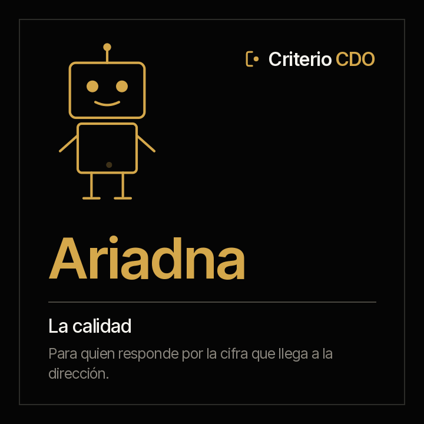

<picture><source media="(prefers-color-scheme: dark)" srcset="../../docs/img/marca/es/criterio-cdo-oscuro.svg"></picture>

# Ariadna · la calidad y el linaje



**Ariadna sigue cada cifra hasta su fuente.**
Tú respondes por la cifra que llega a la dirección. Ella llega con cada cifra de los informes al lado de su fuente, su corte y su linaje: la cifra que no tiene fuente, la que no coincide con su fuente al mismo corte, la que sale de otro corte, el paso del linaje que no tiene sistema de origen, la regla de calidad bajo su umbral, la que no corrió y el dato crítico que ninguna regla mide.

<!-- agente:nombre · generado por scripts/familias.py; no se edita a mano -->
**El nombre.** Ariadna, la del hilo que lleva de vuelta por el laberinto: cada cifra hasta su fuente.
<!-- /agente:nombre -->

[English](README.md) · `criterio-data-quality` · Apache 2.0 · Una instancia por entidad

**Estado: lanzada y estable, con la familia CDO.** El motor de cálculo, probado contra todo el material sintético de la familia con una clave que la agente no ve y entidades de control. En la 0.2.0, la agente corrió sobre todas las entidades del material, con una clave que no ve. En la 1.0.0, con la ronda 2, la familia es estable: un piso del 95 % o más en las señales y en los datos. No se ha probado sobre la documentación de una organización concreta.

**Esta página se lee sola.** Ariadna funciona sin la otra agente de la familia. La familia —cómo se encuentran entre sí y con Rostrum— está en la [familia criterio-cdo](../../families/criterio-cdo/README.es.md).

---

## Qué es

| | |
|---|---|
| **A quién extiende** | A quien responde por la calidad y el linaje de los datos y a quien arma los informes de dirección, de junta y al supervisor |
| **Sobre qué trabaja** | **Las cifras de los informes de una entidad y las reglas de calidad, periodo a periodo** |
| **Qué mira** | Los informes de dirección, la exportación del linaje, las cifras de la fuente por corte, las reglas de calidad con sus resultados y la lista de datos críticos |
| **Cadencia** | Cuando llega un informe o cambian el linaje o los resultados de calidad, y una vez por semana |
| **Instancias** | Una por entidad |

## Qué hace

**Lo que hace y hoy no se hace a mano: poner todo, no una muestra, al lado de su fuente.**

**Lo que puede responder:** qué cifra del informe no tiene fuente, cuál no coincide con su fuente al mismo corte y por cuánto, cuál sale de otro corte, dónde se corta el linaje, qué regla no pasa su umbral, cuál no corrió y qué dato crítico no se mide.

<!-- cdo:comandos · generado por scripts/familias.py; no se edita a mano -->
### Los ocho comandos

> Se escriben con el prefijo del plugin: `/criterio-data-quality:` y autocompletar hace el resto. Es la única forma que resuelve en una sesión de Claude Code.

| Comando | Qué hace |
|---|---|
| `/criterio-data-quality:lineage-setup` | La configuración, el inventario y las tablas reconocidas |
| `/criterio-data-quality:ariadna` | Lo que necesites, en tus palabras: Ariadna elige el comando que lo resuelve y lo corre |
| `/criterio-data-quality:lineage-scan` | La ficha del periodo al día |
| `/criterio-data-quality:figure-check` | Qué cifra no se sostiene en su fuente |
| `/criterio-data-quality:lineage-check` | Dónde se corta el hilo de una cifra |
| `/criterio-data-quality:rule-check` | Qué dato crítico no se está midiendo o no pasa |
| `/criterio-data-quality:lineage-wake` | La calidad al día sin que nadie se acuerde |
| `/criterio-data-quality:share-findings` | Un resumen sin datos, solo si se dice que sí |
<!-- /cdo:comandos -->

`lineage-setup` va primero porque los demás lo necesitan, y `lineage-wake` es el que se le pone a un reloj.

<!-- cdo:skills · generado por scripts/familias.py; no se edita a mano -->
### Los tres skills

Se cargan solos cuando el tema aparece. Son el conocimiento que los comandos comparten, y se consultan como un manual.

| Skill | Qué encapsula | De quién es |
|---|---|---|
| `data-intake` | La estructura recomendada de la carpeta de datos, qué va en cada carpeta y qué agente la usa | Copia de Custodia |
| `data-policy` | La política de datos en la configuración: la tolerancia entre una cifra y su fuente, y lo que nunca se procesa | Copia de Custodia |
| `figure-record` | Cómo se lleva a la ficha cada cifra de un informe de dirección: su indicador, su valor y su corte, con la cita | Propio |
<!-- /cdo:skills -->

## Lo que cuesta hoy

<!-- cdo:cifras · generado por scripts/familias.py; no se edita a mano -->
<!-- /cdo:cifras -->

## Para qué sirve

`/criterio-data-quality:figure-check` pone cada caso al lado de su fuente. **Lo que falta se dice con su cita.**

### Y para qué no sirve

- **No corrige una cifra ni decide cuál de dos cifras es la correcta.** Dice cuál no coincide y por cuánto; la decisión es de quien firma el informe.
- **No se conecta a una base ni a un sistema.** Procesa las exportaciones que la organización le entrega.
- **No procesa un dato personal.**

Y una que hay que decir en voz alta: **tus documentos se procesan en la infraestructura de la plataforma de IA**, no solo en tu equipo. Un informe de junta o al supervisor puede traer información confidencial: confirma que sea admisible bajo tu política antes de apuntarla a esa carpeta. Descargo completo en [DISCLAIMER.es.md](../../DISCLAIMER.es.md), términos en [TERMS.es.md](../../TERMS.es.md).

## Instalación y configuración

```
/plugin marketplace add josenanez/criterio
/plugin install criterio-data-quality@criterio
/criterio-data-quality:lineage-setup
```

### El primer resultado

`/criterio-data-quality:lineage-setup` no te pide que ordenes nada antes de empezar. Mira la carpeta de datos de la entidad, la compara con la [estructura recomendada](../../families/criterio-cdo/README.es.md#la-estructura-de-carpetas-recomendada), procesa la política de datos y hace las preguntas que ningún documento responde. En los primeros quince minutos deja ver el primer resultado.

### Cada cuánto corre

`/criterio-data-quality:lineage-wake` es el comando que el reloj invoca: hace lo que toca, responde primero las preguntas que alguien dejó en Rostrum, y **si no toca nada no produce nada.** La decisión de qué toca es aritmética de fechas, y la toma el código:

```
python3 scripts/datos.py despertar --config <archivo>
```

## Trabajo en equipo

| Con quién | Qué pasa |
|---|---|
| **Custodia** | Comparten la carpeta y la política de datos; cada una escribe solo su ficha |
| **Rostrum** | Solo si la configuración lo dice (`publish_rostrum`): publica sus reportes y sus señales para quien no abre una carpeta, y le devuelve las preguntas que deja quien lo mira. **No escribe en el estado** |

## Pruebas

[`scripts/datos.py`](scripts/datos.py), con la librería estándar, hace todo lo que es cálculo: procesa cada tabla con su fila de origen, compara cada cifra con la de su fuente con la tolerancia de la política, encuentra el corte del que sale y recorre el linaje, el mismo resultado cada vez. Vive en `criterio-data-governance` y se copia aquí; `scripts/sincronizar.py --check` falla si la copia se separa.

```
python3 scripts/datos.py selftest
python3 tests/criterio-cdo/generar.py
python3 tests/criterio-cdo/evaluar.py
```

Qué se siembra en cada entidad y **qué no prueba el material**, en [`EVIDENCIA.md`](../../tests/criterio-cdo/EVIDENCIA.md). El diseño, con la entrada, el proceso y el reporte de cada comando, en el [diseño de la familia](../../families/criterio-cdo/DISENO.es.md).
