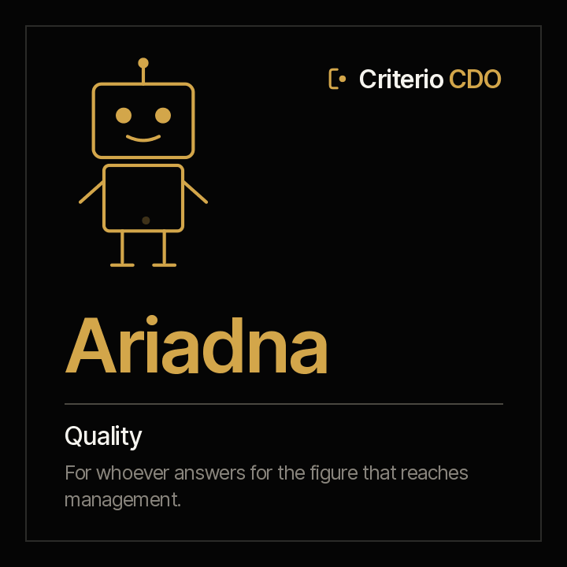

<picture><source media="(prefers-color-scheme: dark)" srcset="../../docs/img/marca/en/criterio-cdo-oscuro.svg"></picture>

# Ariadna · quality and lineage



**Ariadna follows each figure back to its source.**
You are responsible for the figure that reaches management. She comes with each figure in the reports next to its source, cut-off and lineage: the figure with no source, the one that does not match its source at the same cut-off, the one taken from another cut-off, the lineage step with no source system, the quality rule below its threshold, the one that did not run and the critical data element no rule measures.

<!-- agente:nombre · generado por scripts/familias.py; no se edita a mano -->
**The name.** Ariadna, the one whose thread leads back through the labyrinth: each figure back to its source.
<!-- /agente:nombre -->

[Español](README.es.md) · `criterio-data-quality` · Apache 2.0 · One instance per entity

**Status: built, in testing, with the CDO family.** The calculation engine, tested against all the family’s synthetic material with a key the agent never sees and control entities. The round with the agent comes in 0.2.0, and it has not been tested on a specific organisation’s documentation.

**This page stands on its own.** Ariadna works without the family’s other agent. The family —how they meet each other and Rostrum— is in the [criterio-cdo family](../../families/criterio-cdo/README.md).

---

## What it is

| | |
|---|---|
| **Who it extends** | Whoever answers for data quality and lineage and whoever builds the management, board and supervisory reports |
| **What it works on** | **An entity's report figures and quality rules, period by period** |
| **What it looks at** | The management reports, the lineage export, the source figures by cut-off, the quality rules with their results and the list of critical data |
| **Cadence** | When a report arrives or the lineage or quality results change, and once a week |
| **Instances** | One per entity |

## What it does

**What it does that is not done by hand today: putting everything, not a sample, next to its source.**

**What it can answer:** which report figure has no source, which does not match its source at the same cut-off and by how much, which comes from another cut-off, where the lineage breaks, which rule fails its threshold, which did not run and which critical data is not measured.

<!-- cdo:comandos · generado por scripts/familias.py; no se edita a mano -->
### The eight commands

> They are typed with the plugin prefix: `/criterio-data-quality:` and autocomplete does the rest. It is the only form that resolves in a Claude Code session.

| Command | What it does |
|---|---|
| `/criterio-data-quality:lineage-setup` | The configuration, the inventory and the recognised tables |
| `/criterio-data-quality:ariadna` | Whatever you need, in your own words: Ariadna picks the command that does it and runs it |
| `/criterio-data-quality:lineage-scan` | The period's record up to date |
| `/criterio-data-quality:figure-check` | Which figure does not hold up against its source |
| `/criterio-data-quality:lineage-check` | Where a figure's thread breaks |
| `/criterio-data-quality:rule-check` | Which critical data is not being measured or does not pass |
| `/criterio-data-quality:lineage-wake` | Quality up to date without anyone having to remember |
| `/criterio-data-quality:share-findings` | A summary with no data, only if the answer is yes |
<!-- /cdo:comandos -->

`lineage-setup` goes first because the others need it, and `lineage-wake` is the one you put on a clock.

<!-- cdo:skills · generado por scripts/familias.py; no se edita a mano -->
### The three skills

They load on their own when the subject comes up. They are the knowledge the commands share, and they are consulted like a manual.

| Skill | What it encapsulates | Whose it is |
|---|---|---|
| `data-intake` | The recommended structure of the data folder, what goes in each folder and which agent uses it | Copy of Custodia's |
| `data-policy` | The data policy in the configuration: the tolerance between a figure and its source, and what is never processed | Copy of Custodia's |
| `figure-record` | How each figure in a management report goes into the record: its indicator, value and cut-off, with its citation | Own |
<!-- /cdo:skills -->

## What it costs today

<!-- cdo:cifras · generado por scripts/familias.py; no se edita a mano -->
<!-- /cdo:cifras -->

## What it is for

`/criterio-data-quality:figure-check` puts each case next to its source. **What is missing is said with its citation.**

### And what it is not for

- **It corrects no figure and does not decide which of two figures is right.** It says which one does not match and by how much; the decision is whoever signs the report.
- **It does not connect to a database or a system.** It processes the exports the organisation gives it.
- **It does not process personal data.**

And one that has to be said out loud: **your documents are processed on the AI platform’s infrastructure**, not only on your computer. A board or supervisory report may contain confidential information: confirm it is admissible under your policy before pointing it at that folder. Full disclaimer in [DISCLAIMER.md](../../DISCLAIMER.md), terms in [TERMS.md](../../TERMS.md).

## Installation and setup

```
/plugin marketplace add josenanez/criterio
/plugin install criterio-data-quality@criterio
/criterio-data-quality:lineage-setup
```

### The first result

`/criterio-data-quality:lineage-setup` does not ask you to tidy anything before starting. It looks at the entity’s data folder, compares it with the [recommended structure](../../families/criterio-cdo/README.md#the-recommended-folder-structure), processes the data policy and asks the questions no document answers. Within the first fifteen minutes it shows the first result.

### How often it runs

`/criterio-data-quality:lineage-wake` is the command the clock calls: it does what is due, first answers the questions someone left in Rostrum, and **if nothing is due it produces nothing.** Deciding what is due is date arithmetic, and the code does it:

```
python3 scripts/datos.py despertar --config <file>
```

## Teamwork

| With whom | What happens |
|---|---|
| **Custodia** | They share the folder and the data policy; each writes only its own record |
| **Rostrum** | Only if the configuration says so (`publish_rostrum`): it publishes its reports and signals for whoever does not open a folder, and returns the questions left by whoever looks at it. **It does not write to the state** |

## Tests

[`scripts/datos.py`](scripts/datos.py), with the standard library, does everything that is calculation: it processes each table with its source row, compares each figure with its source's within the policy's tolerance, finds the cut-off it comes from and walks the lineage, the same result every time. It lives in `criterio-data-governance` and is copied here; `scripts/sincronizar.py --check` fails if the copy drifts.

```
python3 scripts/datos.py selftest
python3 tests/criterio-cdo/generar.py
python3 tests/criterio-cdo/evaluar.py
```

What is planted in each entity and **what the material does not test**, in [`EVIDENCIA.md`](../../tests/criterio-cdo/EVIDENCIA.md). The design, with the input, process and report of each command, in the [family design](../../families/criterio-cdo/DISENO.md).
