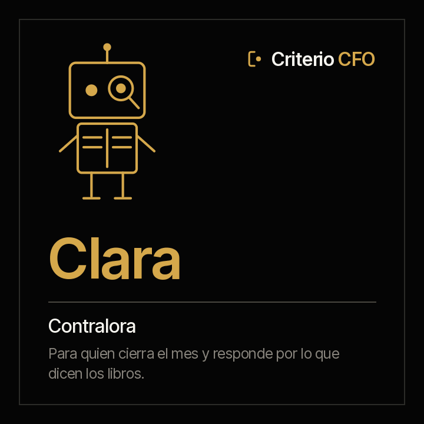

<picture><source media="(prefers-color-scheme: dark)" srcset="../../docs/img/marca/es/criterio-cfo-oscuro.svg"></picture>

# Clara · la contralora



**Clara pone los libros al lado de sus soportes.** Tú cierras el mes y respondes por él. Ella
llega con el cierre preparado: cada tarea contra su evidencia, cada cuenta conciliada y cada
factura electrónica contra su registro.

[English](README.md) · `criterio-finance` · Apache 2.0 · Una instancia por entidad

**Estado: los nueve comandos construidos**, los siete skills y el motor de cálculo, probado
contra material sintético de cuatro industrias con una clave que el agente no ve y una entidad
de control por país. **La extracción del agente pasó la [ronda completa](../../tests/evidencias/familias/cfo/RONDAS.md)** sobre las seis entidades; nada se ha corrido aún sobre los documentos de una organización. Nada se anuncia como terminado hasta que pasen los
[criterios de aceptación](ACCEPTANCE.md).

**Esta página se lee sola.** Clara funciona sin Tomás: si solo cierras los libros, aquí está
todo, incluidas sus pruebas. La familia —cómo se encuentra con Tomás y con Rostrum— está en la
[familia criterio-cfo](../../families/criterio-cfo/README.es.md).

---

## Qué es

| | |
|---|---|
| **A quién extiende** | Al contralor y a su equipo de contabilidad |
| **Sobre qué trabaja** | **El cierre de una entidad**, mes a mes |
| **Qué mira** | La carpeta de finanzas de la entidad, como esté: la contabilidad, los bancos, las facturas, los soportes del cierre y lo que pide el auditor |
| **Cadencia** | A diario mientras dura la ventana del cierre, y una vez por semana fuera de ella |
| **Instancias** | Una por entidad |

## Qué hace

**Lo que hace y hoy no se hace: procesar todas las facturas electrónicas del periodo contra la
contabilidad, no una muestra, y todas las tareas del cierre contra su evidencia.** Una muestra
encuentra lo que cae en la muestra; el duplicado, la factura sin registro o el registro sin
factura están en cualquier parte.

**Lo que puede responder que hoy cuesta días:** qué tarea figura cumplida sin un documento que
la sostenga, qué partida conciliatoria lleva más días de los aceptables, qué factura de la DIAN, del
SRI o de la SUNAT no tiene registro —o qué registro no tiene factura—, qué cuenta no cuadra con su auxiliar
y qué requerimiento del auditor sigue sin respuesta con soporte.

<!-- cfo:comandos · generado por scripts/familias.py; no se edita a mano -->
### Los nueve comandos

> Se escriben con el prefijo del plugin: `/criterio-finance:` y autocompletar hace el resto. Es la única forma que resuelve en una sesión de Claude Code.

| Comando | Qué hace |
|---|---|
| `/criterio-finance:finance-setup` | La configuración, el inventario de la carpeta y la primera ficha del cierre |
| `/criterio-finance:close-scan` | La ficha del cierre al día, con lo que cambió y las señales nuevas |
| `/criterio-finance:close-status` | El estado del cierre: declarado contra evidenciado, tarea por tarea |
| `/criterio-finance:bank-reconcile` | La conciliación de cada cuenta bancaria, con sus partidas abiertas por antigüedad |
| `/criterio-finance:account-reconcile` | La conciliación de cada cuenta contra su auxiliar |
| `/criterio-finance:ledger-check` | El cuadre del balance y del mayor, cuenta por cuenta |
| `/criterio-finance:einvoice-check` | Todas las facturas electrónicas del periodo contra la contabilidad, no una muestra |
| `/criterio-finance:audit-pack` | El índice del paquete del auditor, con el estado de cada requerimiento |
| `/criterio-finance:finance-wake` | Lo que toca hoy en el cierre; si no toca nada, se calla |
<!-- /cfo:comandos -->

`finance-setup` va primero porque los demás lo necesitan, y `finance-wake` es el que se le pone a
un reloj. Entre los dos, los seis que preparan el cierre en el orden en que se trabaja: qué
cambió, el estado, los bancos, las cuentas, el cuadre y las facturas, y al final el paquete del
auditor.

<!-- cfo:skills · generado por scripts/familias.py; no se edita a mano -->
### Los siete skills

Se cargan solos cuando el tema aparece. Son el conocimiento que los comandos comparten, y se consultan como un manual.

| Skill | Qué encapsula | De quién es |
|---|---|---|
| `audit-support` | El paquete del auditor: el índice de requerimientos, cómo se nombra cada respuesta y cuándo un requerimiento está respondido con soporte | Propio |
| `close-checklist` | El checklist del cierre: el modelo de columnas, cómo se prueba cada tarea con su soporte, el calendario en días hábiles y el checklist recomendado por industria como borrador | Propio |
| `close-record` | La ficha del cierre: lo que el agente extrae de los documentos escritos —el estado declarado, los requerimientos que llegaron por correo o en Word— con su cita | Propio |
| `einvoice-matching` | La factura electrónica de la DIAN, del SRI o de la SUNAT contra la contabilidad: los campos que se procesan y su fuente, las reglas del cruce, los duplicados, y lo que queda sin opinión fiscal | Propio |
| `finance-intake` | Qué documentos procesa la familia, dónde va cada uno, qué procesa el motor directamente y qué extrae el agente a la ficha | Propio · también en Tomás y Áurea |
| `ledger-tieout` | El cuadre del balance de comprobación y del mayor: débitos contra créditos, saldo inicial más movimientos contra saldo final, cuenta por cuenta, y los saldos contrarios a su naturaleza | Propio |
| `reconciliation` | Cómo concilia el motor: el extracto contra el auxiliar de libros en tres pasadas, la clasificación de cada partida abierta, su antigüedad, y el mayor contra el auxiliar de cada cuenta | Propio |
<!-- /cfo:skills -->

## Para qué sirve

`/criterio-finance:close-status` pone cada tarea del checklist al lado de su evidencia. Y hace
algo más, que es lo que separa un checklist útil de una lista de casillas: **una tarea marcada
cumplida sin el documento que la prueba no está cumplida**, y el informe lo dice con la tarea y su
responsable.

> **Material de prueba · banca, Colombia** · cierre de septiembre de 2026
> Una tarea del checklist figura cumplida y en `40-soportes/` no hay nada con su id.
> **El checklist dice que está hecha; la evidencia no.**

Ese caso sale del material sintético, sembrado con su clave **antes** de correr el motor, y es
la razón por la que Clara existe: no cerrar por ti, sino que lo que se declara cerrado tenga
detrás lo que lo sostiene.

### Lo que cuesta hoy

<!-- cfo:cifras · generado por scripts/familias.py; no se edita a mano -->
| Cifra | Fuente |
|---|---|
| **44 %** cerraba el trimestre en seis días hábiles en 2023, contra 49 % en 2019 | [Ventana Research / ISG, Smart Financial Close, 2023](https://research.isg-one.com/analyst-perspectives/research-reveals-the-importance-of-technology-in-shortening-the-close) — No indicada en la nota |
| **45 %** de los controles SOX son manuales en las organizaciones encuestadas; las horas del programa subieron 32 % en dos años, de 11.800 a 15.580 | [KPMG, SOX Survey, 2025](https://kpmg.com/us/en/articles/2025/2025-kpmg-sox-survey.html) — Cerca de 150 profesionales SOX |
| **18 días** es la mediana del cierre anual; los mejores lo hacen en 10 días o menos y los más lentos en 35 | [APQC, blog del 8 de abril de 2026, y su medida de Open Standards Benchmarking del cierre anual a nivel de sitio, 2026](https://www.apqc.org/resources/blog/how-streamline-annual-closing-process-and-speed-year-end-close) — La nota no la indica; la medida de benchmarking reporta la mediana de 18,0 días con 2.214 organizaciones |
| **18 %** de las personas de la función de contraloría comete errores al menos a diario, y 59 % varios al mes, por restricciones de capacidad | [Gartner, comunicado del 21 de febrero de 2024, 2024](https://www.gartner.com/en/newsroom/press-releases/2024-02-21-gartner-survey-shows-that-a-third-of-accountants-make-several-error-per-weeo-due-to-capacity-constraints) — 497 personas de la función de contraloría, encuesta de julio de 2023 |
| **79 %** de las organizaciones sufrió en 2024 un intento de fraude en pagos o un fraude consumado; el 63 % señala la suplantación por correo corporativo como la vía principal | [Association for Financial Professionals, 2025 Payments Fraud and Control Survey, 2025](https://www.financialprofessionals.org/about/learn-more/press-releases/Details/survey-79-percent-of-organizations-were-victims-of-attempted-or-actual-payments-fraud-activity-in-2024) — 521 profesionales de finanzas corporativas |
<!-- /cfo:cifras -->

El dato que debería incomodar es el primero: **el cierre no mejoró en cuatro años**, a pesar de
todo lo que se gastó en tecnología.

### Y para qué no sirve

- **No registra ni corrige asientos.** Señala la diferencia; el asiento lo hace una persona.
- **No presenta declaraciones ni reportes a supervisores, y no firma.**
- **No opina sobre deducibilidad, tarifas ni tratamientos NIIF**, y no dice de memoria una
  tarifa, un plazo ni el valor de una unidad tributaria. Lo que es criterio contable o fiscal
  queda como pregunta para la persona.
- **No declara el estado del cierre.** Lo declara el contralor. Clara muestra contra qué, y la
  diferencia entre las dos cosas es el hallazgo de más valor.
- **No mueve, renombra ni crea nada dentro de los documentos de la organización.** Lo único que
  deja, si la persona lo autoriza, es el archivo que marca la carpeta raíz para que se reconozca
  a primera vista.
- **No adivina.** Cada dato lleva la cita del documento y, en las tablas, la fila de donde salió.
  Un archivo sin el formato esperado se reporta con lo que le falta.

**Y hay una cosa que deliberadamente no trae: el presupuesto.** Lo aprobado contra lo ejecutado
es de Tomás, que toma la ejecución de la misma contabilidad que Clara cierra. La consolidación
de varias entidades queda fuera de la primera versión.

Y una que hay que decir en voz alta: **tus documentos se procesan en la infraestructura de la
plataforma de IA**, no solo en tu equipo. Confirma que sea admisible bajo tus políticas antes de
apuntarla a material confidencial. Descargo completo en [DISCLAIMER.es.md](../../DISCLAIMER.es.md),
términos en [TERMS.es.md](../../TERMS.es.md).

## Instalación y configuración

```
/plugin marketplace add josenanez/criterio
/plugin install criterio-finance@criterio
/criterio-finance:finance-setup
```

**En Claude Cowork** — Personalizar → Explorar plugins → Personal → **+** → Agregar
marketplace desde GitHub → `josenanez/criterio`.

Si llevas el presupuesto y no el cierre, lo tuyo es [Tomás](../criterio-budget/README.es.md).

### El primer resultado

`/criterio-finance:finance-setup` no te pide que ordenes nada antes de empezar. Mira la carpeta
de la entidad, la compara con la [estructura recomendada](../../families/criterio-cfo/README.es.md#la-estructura-de-carpetas-recomendada)
y hace las preguntas que ningún documento responde —la entidad, el marco, las cuentas que cruzan
las facturas, quién aprueba—. En los primeros quince minutos deja ver el estado del cierre del
periodo: cada tarea del checklist con su evidencia o sin ella, y las señales que el motor levantó
en el cuadre, los bancos, las cuentas y las facturas.

Desde ahí, cada comando entrega su reporte en el mismo orden: lo que hay que atender, el
resultado, lo que no se pudo procesar, las preguntas que hizo y las fuentes. Si la organización
no tiene checklist, Clara recomienda uno de su industria **como borrador**, y el reporte dice que
no está aprobado hasta que una persona lo apruebe.

**Lo que queda configurado** lo escribe `/criterio-finance:finance-setup` a partir de lo que
respondiste, en `.criterio/finanzas/<entidad>/config.json`: la entidad, el marco, las cuentas,
el checklist, los umbrales y el registro de que aceptaste los términos con tu nombre y la fecha.
Todo eso se cambia **hablando**.

### Cada cuánto corre

Un comando espera. **Este se programa y corre solo.** Su cadencia es la ventana del cierre: a
diario mientras dura, una vez por semana fuera de ella. La decisión es aritmética de fechas, así
que la toma el código:

```
python3 scripts/finanzas.py despertar --config <archivo>
```

Y `/criterio-finance:finance-wake` es el comando que el reloj invoca: hace lo que toca, responde
primero las preguntas que alguien dejó en Rostrum, y **si no toca nada no produce nada.** Ponerlo
en un reloj es del lado de tu organización: una tarea programada en Cowork, o el programador del
sistema en Claude Code. Si no quieren corridas desatendidas, la cadencia sigue diciendo qué toca,
corrida a mano.

**Y si quieres que el director financiero vea el cierre sin pedírtelo**, la familia tiene un
portal que lo publica, y quien mira puede dejarle una pregunta escrita a Clara. →
**[Rostrum](../criterio-server/README.es.md)**

## Trabajo en equipo

Clara funciona sola. Si están los otros, **no hay nada que conectar**: se encuentran por el
estado de la entidad, que es una carpeta en el equipo de quien los corre.

| Con quién | Qué pasa |
|---|---|
| **Tomás** | Comparten el estado de la entidad y la contabilidad del periodo: Clara la cierra y Tomás saca de ahí la ejecución del presupuesto, sin copiarla. Cada uno escribe solo su ficha |
| **Rostrum** | Publica sus reportes, lo que vence en el cierre y sus señales, para quien no abre una carpeta, y le devuelve las preguntas que deja quien lo mira. **No escribe en el estado** |

## Pruebas

### Cómo está construido

La espina es la **ficha del cierre**, una por entidad y periodo: las tareas del checklist con su
evidencia, cada conciliación con sus partidas abiertas, las facturas contra sus registros y el
estado declarado, cada dato con la cita del documento y su fecha. La escribe el agente; los
resultados, el motor.

[`scripts/finanzas.py`](scripts/finanzas.py), con la librería estándar, hace todo lo que es
cálculo: procesa las tablas y las facturas directamente —el balance, el mayor, los extractos,
los auxiliares, el XML de la DIAN, del SRI y de la SUNAT— y calcula cada señal, el mismo resultado cada vez.
El agente lleva a la ficha solo lo que trae un documento escrito: lo que alguien declara, un
requerimiento que llegó por correo
([ADR 0008](../../docs/decisions/0008-cfo-motor-procesa-tablas.md)).
[`scripts/texto.py`](scripts/texto.py) convierte a texto el Word, el Excel, el PowerPoint, el
PDF y el correo, y es copia literal del de la familia PMO; `finanzas.py` viaja copiado en
`criterio-budget`. `scripts/sincronizar.py --check` falla si alguna copia se separa.

Cada formato y cada norma que se usa está en
[`families/criterio-cfo/FUENTES.es.md`](../../families/criterio-cfo/FUENTES.es.md), con su
versión, su enlace y su estado; cada campo de factura que procesa el motor, con su identificador
en el anexo técnico.

### Cómo se verifica

```
python3 scripts/finanzas.py selftest                 el motor
python3 tests/criterio-cfo/generar.py                 el material de las cuatro industrias
python3 tests/criterio-cfo/evaluar.py --agente clara  cada señal contra la clave
```

Con la librería estándar, sin instalar nada. Sobre material sintético con una clave que el motor
no ve — **incluidos los controles**: una entidad por país sin ningún defecto, donde cualquier
señal es una falla. Un agente que encuentra algo ahí es un generador de ruido.

**Cómo salió la última corrida, generado desde la corrida misma:**
[`tests/criterio-finance/RESULTADOS.md`](../../tests/criterio-finance/RESULTADOS.md). Qué se
siembra en cada entidad y, con el mismo detalle, **qué no prueba el material**, en
[`EVIDENCIA.md`](../../tests/criterio-cfo/EVIDENCIA.md).

El diseño, con la entrada, el proceso y el reporte de cada comando y las señales del motor, en
el [diseño de la familia](../../families/criterio-cfo/DISENO.es.md); los criterios de aceptación,
en [ACCEPTANCE.md](ACCEPTANCE.md).

Y las pruebas del conjunto de la familia —lo que ningún agente puede responder solo— en la
[página de la familia](../../families/criterio-cfo/README.es.md#las-pruebas-de-la-familia).
