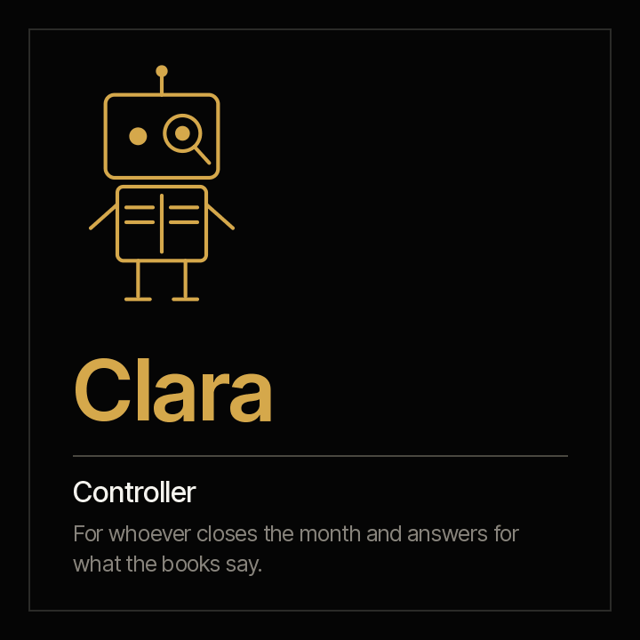

<picture><source media="(prefers-color-scheme: dark)" srcset="../../docs/img/marca/en/criterio-cfo-oscuro.svg"></picture>

# Clara · the controller



**Clara puts the books next to their supporting documents.** The monthly close with its checklist and evidence, bank and account reconciliations, every DIAN or SRI e-invoice against its entry, and the auditor's package. She processes every document in the period, not a sample, and says what ties out, what does not and what has no support.

[Español](README.es.md) · `criterio-finance` · Apache 2.0 · One instance per entity

**Status: built and in testing.** The nine commands, the seven skills and the calculation engine are built; the engine passes its deterministic test against synthetic material from four industries, with a key the agent never sees and a control entity. The end-to-end test with the agent is the next step. The family, with Tomás, is in [`families/criterio-cfo/DISENO.md`](../../families/criterio-cfo/DISENO.md).

Fork of Anthropic's `finance` plugin: the upstream closes against US GAAP and SOX; here the framework is locally adopted IFRS, and electronic invoicing is a first-class concern.

---

## How it works

| | |
|---|---|
| **The large language model (LLM) extracts** | What only a written document carries: the status someone declares, an audit request that arrived by email |
| **The code calculates** | Tie-outs, reconciliations, invoice matching, checklist progress: `scripts/finanzas.py`, standard library, the same result every time |
| **A person declares** | Clara does not post entries, sign or declare the close status. Accounting or tax judgement is left as a question |

## The commands

<!-- cfo:comandos · generado por scripts/familias.py; no se edita a mano -->
| # | Command | What it delivers |
|---|---|---|
| 0 | `/criterio-finance:finance-setup` | The configuration, the folder inventory and the first close record |
| 1 | `/criterio-finance:close-scan` | The close record up to date, with what changed and the new signals |
| 2 | `/criterio-finance:close-status` | The close status: declared against evidenced, task by task |
| 3 | `/criterio-finance:bank-reconcile` | Each bank account reconciled, with its open items by age |
| 4 | `/criterio-finance:account-reconcile` | Each account reconciled against its sub-ledger |
| 5 | `/criterio-finance:ledger-check` | The trial balance and ledger tie-out, account by account |
| 6 | `/criterio-finance:einvoice-check` | Every e-invoice in the period against the books, not a sample |
| 7 | `/criterio-finance:audit-pack` | The auditor's package index, with the status of every request |
| 8 | `/criterio-finance:finance-wake` | What the close needs today; silent when nothing does |
<!-- /cfo:comandos -->

## The skills

<!-- cfo:skills · generado por scripts/familias.py; no se edita a mano -->
`audit-support` · `close-checklist` · `close-record` · `einvoice-matching` · `finance-intake` · `ledger-tieout` · `reconciliation`
<!-- /cfo:skills -->

## What it costs today

<!-- cfo:cifras · generado por scripts/familias.py; no se edita a mano -->
| Figure | Source |
|---|---|
| **44%** closed the quarter within six working days in 2023, down from 49% in 2019 | [Ventana Research / ISG, Smart Financial Close, 2023](https://research.isg-one.com/analyst-perspectives/research-reveals-the-importance-of-technology-in-shortening-the-close) — Not stated in the note |
| **45%** of SOX controls are manual in the organisations surveyed; programme hours rose 32% in two years, from 11,800 to 15,580 | [KPMG, SOX Survey, 2025](https://kpmg.com/us/en/articles/2025/2025-kpmg-sox-survey.html) — About 150 SOX professionals |
| **18 days** is the median annual close; top performers take 10 days or less and the slowest 35 | [APQC, blog del 8 de abril de 2026, y su medida de Open Standards Benchmarking del cierre anual a nivel de sitio, 2026](https://www.apqc.org/resources/blog/how-streamline-annual-closing-process-and-speed-year-end-close) — Not stated in the note; the benchmarking measure reports the 18.0-day median across 2,214 organisations |
| **18%** of people in the controllership function make errors at least daily, and 59% several per month, because of capacity constraints | [Gartner, comunicado del 21 de febrero de 2024, 2024](https://www.gartner.com/en/newsroom/press-releases/2024-02-21-gartner-survey-shows-that-a-third-of-accountants-make-several-error-per-weeo-due-to-capacity-constraints) — 497 people in the controllership function, surveyed in July 2023 |
<!-- /cfo:cifras -->

The figure that should sting is the first: **the close did not improve in four years**, despite everything spent on technology.

## The first result

In the first fifteen minutes, `finance-setup` shows the status of the period's close: every checklist task with or without its evidence, and the signals the engine raised on the tie-out, the banks, the accounts and the invoices. From there, every command delivers its report in the same order: what needs attention, the result, what could not be processed, the questions it asked and the sources.

## What it never does

- It does not post or correct entries.
- It does not file returns or supervisory reports, and it does not sign.
- It gives no opinion on deductibility, rates or IFRS treatment, and states no rate, deadline or tax unit value from memory.
- It does not declare the close status: the controller does.
- It never moves, renames or creates anything inside the organisation's documents. The only thing it leaves, if the person allows it, is the file that marks the root folder so it is recognised at a glance.

## Installing and configuring

```
/plugin marketplace add josenanez/criterio
/plugin install criterio-finance@criterio
/criterio-finance:finance-setup
```

**For whoever does not open a folder**, what Clara writes —reports, what falls due, signals— is published by Rostrum, the portal for every family: [`criterio-server`](../criterio-server/README.md). Written questions can be left there too, and Clara takes them in the `*-wake` command.

## Sources

Every format and rule used is in [`families/criterio-cfo/FUENTES.es.md`](../../families/criterio-cfo/FUENTES.es.md) (Spanish), with its version, link and status; every invoice field the engine processes, with its id in the technical annex.

## Acceptance criteria

See [ACCEPTANCE.md](ACCEPTANCE.md). **How the latest run went**, generated from the run itself: [`tests/criterio-finance/RESULTADOS.md`](../../tests/criterio-finance/RESULTADOS.md) (Spanish).
