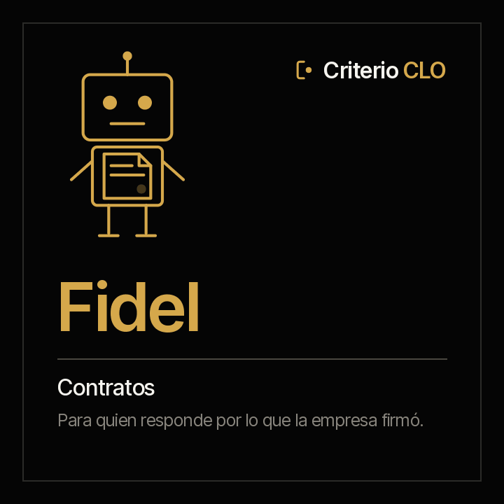

<picture><source media="(prefers-color-scheme: dark)" srcset="../../docs/img/marca/es/criterio-clo-oscuro.svg"></picture>

# Fidel · los contratos



**Fidel pone lo que la empresa firmó al lado de lo que está pasando.** El registro de contratos contra sus documentos, los vencimientos y los preavisos de renovación, cada obligación con su evidencia, quién firmó con qué facultad y lo pagado contra lo pactado y sus garantías. Procesa todos los contratos de la carpeta, no una muestra, y dice qué vence, qué no cuadra y qué no tiene soporte.

[English](README.md) · `criterio-legal` · Apache 2.0 · Una instancia por entidad

**Estado: construida y en prueba.** Los siete comandos, los cinco skills y el motor de cálculo están construidos; el motor pasa su prueba determinista contra material sintético de cuatro industrias, con una clave que el agente no ve y dos entidades de control. La prueba con el agente de extremo a extremo es el paso siguiente. La familia, con Constanza, en [`families/criterio-clo/DISENO.es.md`](../../families/criterio-clo/DISENO.es.md).

---

## Cómo trabaja

| | |
|---|---|
| **El modelo de lenguaje (LLM) extrae** | Lo que solo trae un documento escrito: las partes, el valor, las fechas, la renovación, los firmantes, los otrosíes, las garantías y las obligaciones de cada contrato, con su cita |
| **El código calcula** | Vencimientos, límites de preaviso, prórrogas, facultades contra la matriz, lo pagado contra lo pactado y las garantías contra lo exigido: `scripts/legal.py`, librería estándar, el mismo resultado cada vez |
| **Una persona decide** | Fidel no opina sobre la validez de un contrato ni interpreta una cláusula, y no recomienda renovar ni terminar. Lo que es criterio jurídico queda como pregunta |

Primera versión: Colombia y Ecuador. La matriz de atribuciones y los plazos de aviso los define la organización.

## Los comandos

<!-- clo:comandos · generado por scripts/familias.py; no se edita a mano -->
| # | Comando | Qué entrega |
|---|---|---|
| 0 | `/criterio-legal:legal-setup` | La configuración, el inventario y las primeras fichas de los contratos |
| 1 | `/criterio-legal:contract-scan` | Las fichas de los contratos al día, con lo que cambió y las señales nuevas |
| 2 | `/criterio-legal:contract-register` | El registro de contratos contra lo que dicen los documentos |
| 3 | `/criterio-legal:obligations-calendar` | Vencimientos, preavisos y obligaciones, con lo que venció sin evidencia |
| 4 | `/criterio-legal:authority-check` | Quién firmó cada contrato y con qué facultad |
| 5 | `/criterio-legal:contract-execution` | Lo pagado contra lo pactado, y las garantías contra lo exigido |
| 6 | `/criterio-legal:legal-wake` | Lo que toca hoy en los contratos; si no toca nada, se calla |
<!-- /clo:comandos -->

## Los skills

<!-- clo:skills · generado por scripts/familias.py; no se edita a mano -->
`contract-calendar` · `contract-record` · `legal-intake` · `payments-guarantees` · `signing-authority`
<!-- /clo:skills -->

## Lo que cuesta hoy

<!-- clo:cifras · generado por scripts/familias.py; no se edita a mano -->
| Cifra | Fuente |
|---|---|
| **8,6 %** del valor de los contratos se erosiona en promedio por una gestión contractual deficiente; los mejores, poco más de 3 %, los peores, más de 20 % | [World Commerce & Contracting con Deloitte, 2022](https://www.deloitte.com/us/en/services/tax/articles/contract-management-lifecycle-insights.html) — Más de 1.200 organizaciones |
| **90 %** de las organizaciones tiene dificultad para encontrar sus propios contratos | [EY Law y Harvard Law School Center on the Legal Profession, 2021](https://clp.law.harvard.edu/wp-content/uploads/2022/10/ey-contracting-report-june-2021.pdf) — 1.000 líderes de contratación, dentro de una investigación de más de 2.000 personas en 22 países, enero de 2021 |
| **19.000** contratos al año gestiona en promedio el equipo de contratación de una organización grande | [EY Law y Harvard Law School Center on the Legal Profession, 2021](https://clp.law.harvard.edu/wp-content/uploads/2022/10/ey-contracting-report-june-2021.pdf) — 1.000 líderes de contratación, enero de 2021 |
<!-- /clo:cifras -->

Una empresa que no encuentra sus propios contratos no puede saber qué firmó, qué vence ni a qué se obligó.

## El primer resultado

En los primeros quince minutos, `legal-setup` deja ver el calendario de los contratos: lo que vence, los preavisos que se acercan o que ya pasaron sin decisión y las obligaciones vencidas sin evidencia, con las señales que el motor levantó en el registro, las firmas y los pagos. Desde ahí, cada comando entrega su reporte en el mismo orden: lo que hay que atender, el resultado, lo que no se pudo procesar, las preguntas que hizo y las fuentes.

## Lo que nunca hace

- No opina sobre la validez de un contrato, de una cláusula, de una firma ni de una garantía.
- No recomienda renovar, terminar ni renegociar: la decisión es de una persona, y Fidel la registra cuando un documento la toma.
- No redacta, firma ni envía contratos, otrosíes ni preavisos.
- No dice de memoria una norma, un plazo legal ni una facultad que la matriz no tiene.
- No mueve, renombra ni crea nada dentro de los documentos de la organización. Lo único que deja, si la persona lo autoriza, es el archivo que marca la carpeta raíz para que se reconozca a primera vista.

## Instalación y configuración

```
/plugin marketplace add josenanez/criterio
/plugin install criterio-legal@criterio
/criterio-legal:legal-setup
```

**En Claude Cowork** — Personalizar → Explorar plugins → Personal → **+** → Agregar marketplace desde GitHub → `josenanez/criterio`.

`legal-setup` mira la carpeta, hace las preguntas que ningún documento responde —la entidad, la matriz de atribuciones, con cuántos días se avisa un vencimiento— y muestra el primer calendario. La estructura de carpetas recomendada está en el skill `legal-intake`; Fidel la sugiere y no mueve nada.

**Para quien no abre una carpeta**, lo que Fidel escribe —sus reportes, lo que vence, sus señales— lo publica Rostrum, el portal de todas las familias: [`criterio-server`](../criterio-server/README.es.md). Ahí también se le pueden dejar preguntas escritas, que toma en su `*-wake`.

## Las fuentes

Cada marco y cada cifra que se usa está en [`families/criterio-clo/FUENTES.es.md`](../../families/criterio-clo/FUENTES.es.md), con su versión, su enlace y su estado.

## Cómo se verifica

```
python3 scripts/legal.py selftest
python3 tests/criterio-clo/generar.py
python3 tests/criterio-clo/evaluar.py --agente fidel
```

Con la librería estándar, sin instalar nada. **Cómo salió la última corrida**, generado desde la corrida misma: [`tests/criterio-legal/RESULTADOS.md`](../../tests/criterio-legal/RESULTADOS.md). Criterios de aceptación en [ACCEPTANCE.md](ACCEPTANCE.md).
