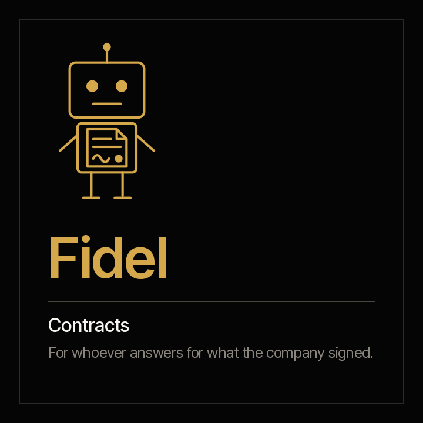

# Fidel · contracts



**Fidel puts what the company signed next to what is actually happening.** The contract register against its documents, expiries and renewal notices, every obligation with its evidence, who signed with what authority, and what was paid against what was agreed and its guarantees. He processes every contract in the folder, not a sample, and says what is expiring, what does not match and what has no support.

[Español](README.es.md) · `criterio-legal` · Apache 2.0 · One instance per entity

**Status: built and in testing.** The seven commands, the five skills and the calculation engine are built; the engine passes its deterministic test against synthetic material from four industries, with a key the agent never sees and two control entities. The end-to-end test with the agent is the next step. The family, with Constanza, is in [`families/criterio-clo/DISENO.es.md`](../../families/criterio-clo/DISENO.es.md) (Spanish).

---

## How it works

| | |
|---|---|
| **The large language model (LLM) extracts** | What only a written document carries: each contract's parties, value, dates, renewal, signatories, amendments, guarantees and obligations, with their citation |
| **The code calculates** | Expiries, notice deadlines, renewals, authority against the matrix, payments against the agreed value and guarantees against what was required: `scripts/legal.py`, standard library, the same result every time |
| **A person decides** | Fidel gives no opinion on whether a contract is valid, does not interpret clauses and does not recommend renewing or terminating. Anything that takes legal judgement stays a question |

First version: Colombia and Ecuador. The authority matrix and the warning periods are defined by the organisation.

## The commands

<!-- clo:comandos · generado por scripts/familias.py; no se edita a mano -->
| # | Command | What it delivers |
|---|---|---|
| 0 | `/criterio-legal:legal-setup` | The configuration, the inventory and the first contract records |
| 1 | `/criterio-legal:contract-scan` | The contract records up to date, with what changed and the new signals |
| 2 | `/criterio-legal:contract-register` | The contract register against what the documents say |
| 3 | `/criterio-legal:obligations-calendar` | Expiries, notices and obligations, with what is overdue without evidence |
| 4 | `/criterio-legal:authority-check` | Who signed each contract and with what authority |
| 5 | `/criterio-legal:contract-execution` | Payments against the agreed value, and guarantees against what was required |
| 6 | `/criterio-legal:legal-wake` | What the contracts need today; silent when nothing does |
<!-- /clo:comandos -->

## The skills

<!-- clo:skills · generado por scripts/familias.py; no se edita a mano -->
`contract-calendar` · `contract-record` · `legal-intake` · `payments-guarantees` · `signing-authority`
<!-- /clo:skills -->

## What it costs today

<!-- clo:cifras · generado por scripts/familias.py; no se edita a mano -->
| Figure | Source |
|---|---|
| **8.6%** of contract value is eroded on average by poor contract management; the best a little over 3%, the worst more than 20% | [World Commerce & Contracting con Deloitte, 2022](https://www.deloitte.com/us/en/services/tax/articles/contract-management-lifecycle-insights.html) — More than 1,200 organisations |
| **90%** of organisations report difficulty locating their own contracts | [EY Law y Harvard Law School Center on the Legal Profession, 2021](https://clp.law.harvard.edu/wp-content/uploads/2022/10/ey-contracting-report-june-2021.pdf) — 1,000 contracting leaders, within research of more than 2,000 people in 22 countries, January 2021 |
| **19,000** contracts a year are managed on average by a large organisation's contracting team | [EY Law y Harvard Law School Center on the Legal Profession, 2021](https://clp.law.harvard.edu/wp-content/uploads/2022/10/ey-contracting-report-june-2021.pdf) — 1,000 contracting leaders, January 2021 |
<!-- /clo:cifras -->

A company that cannot find its own contracts cannot know what it signed, what is expiring or what it committed to.

## The first result

In the first fifteen minutes, `legal-setup` shows the contract calendar: what is expiring, the notice deadlines that are close or already passed with no decision, and the overdue obligations without evidence, with the signals the engine raised on the register, the signatures and the payments. From there, every command delivers its report in the same order: what needs attention, the result, what could not be processed, the questions it asked and the sources.

## What it never does

- It gives no opinion on whether a contract, a clause, a signature or a guarantee is valid.
- It does not recommend renewing, terminating or renegotiating: a person decides, and Fidel records the decision when a document takes it.
- It does not draft, sign or send contracts, amendments or notices.
- It states no rule, legal deadline or authority from memory that the matrix does not hold.
- It never moves, renames or creates anything inside the organisation's documents.

## Installing and configuring

```
/plugin marketplace add josenanez/criterio
/plugin install criterio-legal@criterio
/criterio-legal:legal-setup
```

**In Claude Cowork** — Customise → Explore plugins → Personal → **+** → Add marketplace from GitHub → `josenanez/criterio`.

`legal-setup` looks at the folder, asks what no document answers —the entity, the authority matrix, how many days ahead to warn of an expiry— and shows the first calendar. The recommended folder structure is in the `legal-intake` skill; Fidel suggests it and moves nothing.

**For whoever does not open a folder**, what Fidel writes —reports, what falls due, signals— is published by Rostrum, the portal for every family: [`criterio-server`](../criterio-server/README.md). Written questions can be left there too, and Fidel takes them in the `*-wake` command.

## Sources

Every framework and figure used is in [`families/criterio-clo/FUENTES.es.md`](../../families/criterio-clo/FUENTES.es.md) (Spanish), with its version, link and status.

## How it is verified

```
python3 scripts/legal.py selftest
python3 tests/criterio-clo/generar.py
python3 tests/criterio-clo/evaluar.py --agente fidel
```

Standard library, nothing to install. **How the latest run went**, generated from the run itself: [`tests/criterio-legal/RESULTADOS.md`](../../tests/criterio-legal/RESULTADOS.md) (Spanish). Acceptance criteria in [ACCEPTANCE.md](ACCEPTANCE.md).
